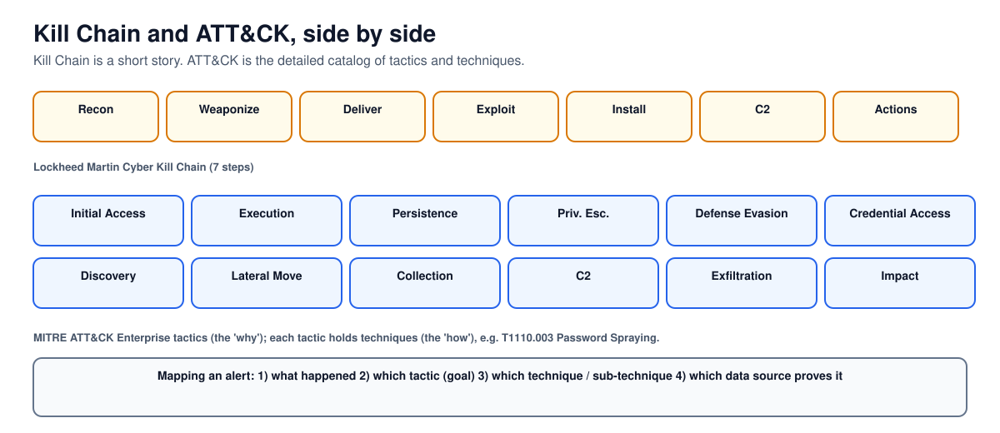
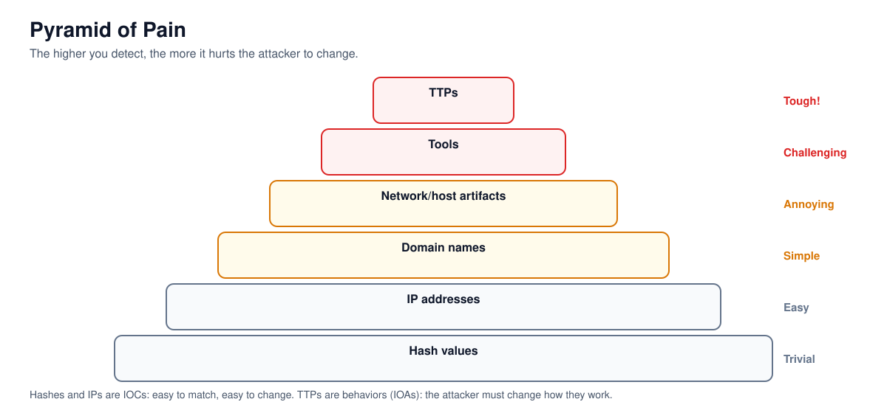

# 03 · Frameworks: MITRE ATT&CK, Cyber Kill Chain, Pyramid of Pain, IOCs vs IOAs

> **Module:** 05 · SOC Fundamentals · **Week:** 5 · **Time:** ~8 hours
> **You will:** map any alert to an ATT&CK tactic and technique, explain the Kill Chain, and use the Pyramid of Pain to choose better detections.

| | |
|---|---|
| **Prerequisites** | Lessons 01-02 |
| **Lab** | The ATT&CK table in [`lab/triage.py`](lab/triage.py) (`RULES`) and `demo.py` |
| **Maps to** | Security+ SY0-701/801 domains 2 and 4 (threats, security operations); SC-200 (map incidents to ATT&CK); TryHackMe SOC Level 1 (threat intel and frameworks rooms) |

---

## 1. Why it matters in a SOC / cloud-security job

- Every serious SIEM and EDR labels its alerts with ATT&CK IDs (for example `T1110.003`). You must read and write them.
- Reports to managers say "we have coverage for 40 percent of Credential Access". That is ATT&CK language.
- Interviews: "Explain tactics versus techniques" is one of the most common SOC questions.
- Cloud security: ATT&CK has an **Enterprise** matrix with cloud platforms (Azure AD / Entra ID, Office 365, IaaS). Use it for cloud alerts too.

---

## 2. Understand it

### 2.1 MITRE ATT&CK in plain words

**ATT&CK** (Adversarial Tactics, Techniques, and Common Knowledge) is a free catalog of how real attackers behave, built from public reports. It is a *knowledge base*, not a product.

| Word | Meaning | Example |
|---|---|---|
| **Tactic** | The attacker's **goal** at one step ("why") | Credential Access (TA0006) |
| **Technique** | **How** they reach the goal | Brute Force (T1110) |
| **Sub-technique** | A more specific way | Password Spraying (T1110.003) |
| **Procedure** | The exact real-world use by a group or tool | A named group sprays Office 365 accounts with 3 passwords |
| **Mitigation / detection / data source** | Defender advice | Enable MFA; look at sign-in logs |

The Enterprise matrix has 14 tactics, from Reconnaissance to Impact. There are separate matrices for Mobile and ICS (industrial control systems). The content changes with each release, so always check the current version on the ATT&CK site.



### 2.2 How to map an alert to ATT&CK (5 steps)

1. **Describe the behavior** in one plain sentence, without tool names. "Many accounts fail to sign in from one IP."
2. **Pick the tactic** (the goal). Goal here: get credentials, so *Credential Access*.
3. **Search the techniques** inside that tactic. "Brute Force" has sub-techniques: guessing, cracking, spraying, stuffing.
4. **Choose the most specific sub-technique** that your *evidence* supports, not your guess. Many accounts + few passwords = *Password Spraying* T1110.003.
5. **Write the evidence and the data source.** "Entra sign-in logs, 38 users, 76 attempts in 10 minutes."

If the evidence is not clear, map to the parent technique (T1110) and say so.

Real mapping used by the lab:

```text
impossible_travel        Initial Access / T1078
password_spray           Credential Access / T1110.003
success_after_failures   Credential Access / T1110; Initial Access / T1078
brute_force              Credential Access / T1110.001
port_scan                Discovery / T1046
encoded_powershell       Execution / T1059.001; Defense Evasion / T1027
av_detection             Execution / T1204.002
new_admin_member         Persistence / T1098
phishing_report          Initial Access / T1566.002
data_exfil_volume        Exfiltration / T1567.002
```

Note that one alert can map to several tactics (PowerShell is Execution *and* the encoding is Defense Evasion). T1078 *Valid Accounts* belongs to several tactics in ATT&CK (initial access, persistence, privilege escalation, defense evasion). The tactic you choose depends on the story of *this* alert.

### 2.3 Using ATT&CK in the SOC

| Use | How |
|---|---|
| **Triage** | Tells you what likely comes next. After Initial Access, expect Execution, Persistence. |
| **Investigation** | A checklist of things to look for. Found credential dumping? Look for lateral movement. |
| **Detection coverage** | Map your rules to techniques. Gaps are visible. |
| **Reporting** | Speak in a shared language. |
| **Threat intel** | Group reports list techniques they use. |

Warning: "covered" in a heat map does not mean "detected well". One weak rule can turn a cell green. Test the rule (Module 06).

### 2.4 The Lockheed Martin Cyber Kill Chain

A 7-step model of an intrusion (Lockheed Martin, 2011):

| Step | Meaning | Defender idea |
|---|---|---|
| 1 Reconnaissance | Attacker studies the target | Reduce public info |
| 2 Weaponization | Builds the malicious file/link | (invisible to you) |
| 3 Delivery | Sends it (email, USB, web) | Mail filter, awareness |
| 4 Exploitation | Code runs or user is tricked | Patching, EDR |
| 5 Installation | Gets persistence | Monitor autoruns, new services |
| 6 Command and Control | Remote control channel | Egress filtering, DNS logs |
| 7 Actions on Objectives | Steals data, encrypts, etc. | DLP, backups, segmentation |

**Idea:** break the chain at any link and the attack fails. **Limits:** it is linear, perimeter-minded and weak for insider and cloud-identity attacks. ATT&CK is richer and not linear. Many teams use both: Kill Chain to explain to managers, ATT&CK to work.

### 2.5 The Pyramid of Pain



David Bianco's model (2013) asks: *if I detect and block this type of indicator, how hard is it for the attacker to adapt?*

| Level | Example | Attacker effort to change |
|---|---|---|
| Hash values | SHA-256 of a malware file | Trivial: change one byte |
| IP addresses | C2 server IP | Easy: rent another |
| Domain names | `login-update.example` | Simple: register another (costs a little) |
| Network / host artifacts | Odd user agent, mutex, registry key | Annoying |
| Tools | A known attack framework | Challenging: they must find or build a new one |
| TTPs | The way they work (macro, then encoded PowerShell, then scheduled task) | Tough: they must change habits |

**Lesson for the SOC:** a hash or IP block is quick and useful *today*, but a detection on **behavior** (Word spawning PowerShell with an encoded command) keeps working for months.

### 2.6 IOC vs IOA

| | **IOC** (Indicator of Compromise) | **IOA** (Indicator of Attack) |
|---|---|---|
| Focus | **What** was left behind (artifact) | **What the attacker is doing** (behavior, intent) |
| Examples | Hash, IP, domain, file name | Office app spawning a shell; many accounts failing from one IP |
| Timing | Usually after something happened | During the attack |
| Pyramid level | Bottom (hashes, IPs, domains) | Top (tools, TTPs) |
| Weakness | Short life, easy to change | Needs good logs and tuning, more false positives |

Use both. IOCs are fast and cheap for known threats. IOAs find new ones.

### 2.7 From DBA to security

> **From DBA to security**
> - **ATT&CK = the checklist of how data theft happens.** You know the DBA version: stolen credentials, privilege escalation (`GRANT DBA`), data export (Data Pump), covering tracks (audit off). Map each to a technique.
> - **IOC vs IOA = error code vs behavior.** An ORA error is an artifact (IOC). A sudden full-table scan by an unknown user at 03:00 is a behavior (IOA).
> - **Pyramid of Pain = fixing root cause.** Killing one session is like blocking one IP. Fixing the missing privilege control is like detecting the TTP.

---

## 3. Hands-on

### 3.1 Repo lab: see mappings next to verdicts

```bash
python cybersecurity-track/05-soc-fundamentals/lab/demo.py
```

The `ATT&CK` column shows each alert's technique IDs (see the table in lesson 02). Now:

1. Open `lab/triage.py` and read `RULES`. For each rule, ask: *is the mapping the most specific one the evidence supports?* (For example `brute_force` uses T1110.001 *Password Guessing*; a rule that cannot tell guessing from spraying should map to T1110.)
2. Look at `A-1006`: Word, encoded PowerShell, malware domain. Which Kill Chain step is this (delivery, exploitation, installation, or C2)? Write your answer, then check the next list.
3. Find a technique page on https://attack.mitre.org (try T1059.001) and read the **Detection** and **Mitigations** sections. List the data sources.

Answers: step 2 is *exploitation* and the start of *C2* (the domain fetches a second stage). ATT&CK tactics: Execution (T1059.001), Defense Evasion (T1027).

### 3.2 Optional free tools

- **ATT&CK Navigator** (web tool at mitre-attack.github.io): color the techniques your lab rules cover. Add `T1110.003`, `T1110.001`, `T1078`, `T1098`, `T1059.001`, `T1571` and see the gaps.
- The mini SIEM in Module 06 has rules tagged with ATT&CK IDs.

### 3.3 Practice platforms

- **TryHackMe:** the *MITRE* room and the *Cyber Defense Frameworks* content in SOC Level 1.
- **HTB Academy:** *SOC Analyst* path (search the catalog for the detection and threat-hunting modules).

---

## 4. Real-world scenarios

**Scenario 1: A report says "tactic T1566".** A colleague writes "tactic T1566 Phishing". *Fix:* T1566 is a **technique** (Initial Access is the tactic, TA0001). In interviews this exact slip is common.

**Scenario 2: Block list vs behavior.** Your team blocks 200 IPs from a feed each week, yet an attacker keeps returning. *Investigate:* they rotate IPs, so you are at the bottom of the Pyramid. *Do:* add detections on behavior: many failed logins across accounts (spray), new MFA method registered, mailbox forwarding rule created.

**Scenario 3: Coverage report.** A manager shows a green ATT&CK heat map. You test two rules and find one never fires (the log source is not collected). *Do:* separate "rule exists" from "rule tested with data". Add a test for each.

---

## 5. Common mistakes

- Confusing tactic and technique.
- Choosing a sub-technique without evidence.
- Treating the Kill Chain as strict order. Real attacks skip, loop and repeat.
- Believing a hash block stops a group.
- Reading a coverage heat map as security.
- Copying the technique ID without the evidence.

---

## 6. Interview questions

<details><summary><b>Q1. What is MITRE ATT&CK?</b></summary>
A public knowledge base of adversary tactics, techniques and procedures, based on real observations. SOCs use it for mapping alerts, hunting, coverage and reporting.
</details>

<details><summary><b>Q2. Tactic vs technique?</b></summary>
Tactic is the goal (why), for example Credential Access. Technique is the method (how), for example Brute Force T1110. Sub-technique is more specific, for example Password Spraying T1110.003.
</details>

<details><summary><b>Q3. Map this: many accounts fail sign-in from one IP, then one succeeds.</b></summary>
Credential Access, T1110.003 Password Spraying. The success gives Initial Access with a valid account, T1078. Evidence comes from sign-in logs.
</details>

<details><summary><b>Q4. Name the Cyber Kill Chain steps.</b></summary>
Reconnaissance, Weaponization, Delivery, Exploitation, Installation, Command and Control, Actions on Objectives.
</details>

<details><summary><b>Q5. What are the limits of the Kill Chain?</b></summary>
It is linear and malware-and-perimeter oriented. It handles insider threats, stolen cloud credentials and living-off-the-land attacks poorly. ATT&CK covers those better.
</details>

<details><summary><b>Q6. Explain the Pyramid of Pain.</b></summary>
It ranks indicators by the pain they cause an attacker when you detect them: hashes (trivial), IPs, domains, artifacts, tools, and TTPs (tough). Detect high, when you can.
</details>

<details><summary><b>Q7. IOC vs IOA?</b></summary>
IOC is an artifact of compromise (hash, IP). IOA is attacker behavior in progress (Word starts PowerShell). IOAs last longer but need better tuning.
</details>

<details><summary><b>Q8. How do you use ATT&CK to measure detection coverage?</b></summary>
Map every rule to techniques, mark which have tested rules and working data sources, and prioritize the gaps by the threats that matter to your business. Do not count untested rules as coverage.
</details>

<details><summary><b>Q9. Why can the same technique appear under several tactics?</b></summary>
A technique can serve different goals. Valid Accounts (T1078) can be used to enter, to stay and to move up. The tactic is chosen by the goal in context.
</details>

<details><summary><b>Q10. Your alert fires on `cmd.exe /c whoami`. Map it.</b></summary>
Execution (T1059.003 Windows Command Shell) and Discovery (T1033 System Owner/User Discovery). One behavior can show two goals. Then check the parent process and the user for context.
</details>

---

## 7. Checklist

- [ ] I can explain tactic, technique, sub-technique and procedure.
- [ ] I mapped five lab alerts to ATT&CK using the five-step method.
- [ ] I can name the seven Kill Chain steps and place one alert on it.
- [ ] I can place five indicators on the Pyramid of Pain.
- [ ] I built a small Navigator layer for the lab rules.

## 8. References

- MITRE ATT&CK: https://attack.mitre.org
- ATT&CK Navigator: https://mitre-attack.github.io/attack-navigator/
- Lockheed Martin Cyber Kill Chain: search the Lockheed Martin site, "Cyber Kill Chain".
- David Bianco, "The Pyramid of Pain" (2013 blog post, still available online).
