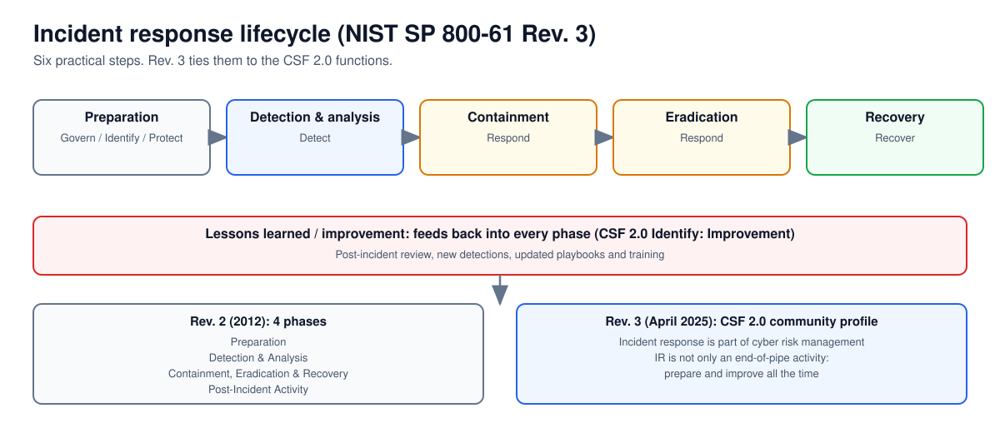

# 05 · Incident response with NIST SP 800-61 Rev. 3, and four playbooks

> **Module:** 05 · SOC Fundamentals · **Weeks:** 5-6 · **Time:** ~10 hours
> **You will:** run an incident through six phases, explain how Rev. 3 connects to NIST CSF 2.0, and follow playbooks for phishing, brute force / password spray, malware on an endpoint and impossible travel.

| | |
|---|---|
| **Prerequisites** | Lessons 01-04 |
| **Lab** | Case notes and escalation from [`lab/triage.py`](lab/triage.py); the `next` steps per rule are mini-playbooks |
| **Maps to** | Security+ SY0-701/801 domain 4 (incident response); NIST SP 800-61 Rev. 3 (April 2025) and CSF 2.0 (February 2024); SC-200 (respond to incidents); TryHackMe SOC Level 1/2; HTB CDSA |

---

## 1. Why it matters in a SOC / cloud-security job

Triage finds the fire. Incident response (IR) puts it out and makes sure it does not return. L1 starts the process; L2/L3 run it. You will be asked to follow playbooks on real days, and to explain the lifecycle in every interview.

- You must know **what you are allowed to do** (contain? isolate? disable?) and **who must approve**.
- Cloud incidents add new actions: revoke tokens, disable access keys, rotate secrets, restrict a role.

---

## 2. Understand it

### 2.1 NIST SP 800-61 Rev. 3 in plain words

NIST SP 800-61 is the standard US guide for handling incidents. **Rev. 2 (2012)** used four phases: *Preparation; Detection and Analysis; Containment, Eradication and Recovery; Post-Incident Activity*. **Rev. 3 (April 2025)** was rewritten to be a **community profile for NIST CSF 2.0**: IR is now treated as part of **cybersecurity risk management**, not as a separate end-of-pipe job. It maps IR work to the six CSF 2.0 functions: **Govern, Identify, Protect, Detect, Respond, Recover**.



Use the classic six steps as your working model (they are easy to remember), and know the mapping:

| Step | What you do | CSF 2.0 function |
|---|---|---|
| 1 **Preparation** | Policy, roles, contacts, playbooks, logging, backups, training, tools, exercises | Govern, Identify, Protect |
| 2 **Detection and analysis** | Alerts, triage, scoping, severity, evidence | Detect (and Respond: analysis) |
| 3 **Containment** | Stop the spread, short term and long term | Respond |
| 4 **Eradication** | Remove the cause: malware, accounts, persistence, the vulnerability | Respond |
| 5 **Recovery** | Restore, verify, monitor | Recover |
| 6 **Lessons learned** | Review, improve detections, fix root cause, update playbooks | Improvement (across all functions) |

Check the official NIST page for the exact current structure and wording before you quote it in an interview.

### 2.2 Phase details (the SOC view)

**Preparation (before anything happens)**
- Incident response plan: who declares an incident, severity levels, who is on call, legal and PR contacts.
- Logging and visibility (Module 06). Time sync (NTP). Asset and owner inventory.
- Playbooks, access to isolate hosts and disable accounts, tested backups.
- Practice: tabletop exercises.

**Detection and analysis**
- Triage (lesson 02), scope (who/what/when), severity, **start an incident record and a timeline in UTC**.
- Preserve evidence: copy logs, take a memory image or EDR triage package *before* you change things. Keep a chain of custody (who handled what, when).
- Classify: phishing, malware, account compromise, data loss, denial of service...

**Containment**
- *Short term:* isolate the host (EDR), disable or lock the account, block the IP/domain, revoke sessions and tokens, pull a mailbox rule.
- *Long term:* segment, temporary firewall rules, forced password reset, move to a clean VLAN.
- Decide the trade-off: containment may alert the attacker or disrupt the business. Ask the incident commander.

**Eradication**
- Remove malware, persistence (scheduled tasks, services, run keys, new accounts, OAuth app consents, mailbox rules), and **fix the entry point** (patch, MFA, close the port).
- Reset credentials and secrets in the right order, from a clean machine.

**Recovery**
- Rebuild from known-good images or restore from clean backups. Re-enable accounts. Restore service in stages.
- Monitor closely for return (same IOCs and behaviors, 2-4 weeks is common).

**Lessons learned**
- Blameless review within days. Answer: what happened, timeline, what worked, what did not, root cause, which detections or controls to add. Assign owners and dates. Update playbooks and metrics (MTTD, MTTR).

### 2.3 Roles in an incident

| Role | Task |
|---|---|
| Incident commander | Decides and coordinates |
| Analysts (L1/L2/L3) | Investigate, contain, evidence |
| IT / cloud / identity admins | Do the technical changes |
| Communications / PR, legal, HR | External and internal statements, legal duties |
| Management | Business decisions, resources |
| Scribe | Keeps the timeline. A good scribe is gold. |

### 2.4 Severity and escalation (example scheme)

| Severity | Example | Response |
|---|---|---|
| Low | Blocked phishing mail, no click | Ticket, close |
| Medium | One user clicked, no evidence of compromise | L2, reset password |
| High | Confirmed account takeover, malware on a workstation | Incident, containment now |
| Critical | Domain admin compromise, ransomware, confirmed data loss | Incident commander, management and legal |

Your company will have its own table. Learn it.

### 2.5 Playbook 1: Phishing (user report)

| Phase | Steps |
|---|---|
| Triage | Get the original mail (as attachment, with headers). Check sender, Reply-To, SPF/DKIM/DMARC results, links (defang!), attachments (hash only). Recipients? Clicks (proxy/EDR/mail click logs)? |
| Scope | Search the mail system for the same sender, subject, URL, hash. List recipients and clickers. |
| Contain | Purge the mail from all mailboxes. Block the domain/URL. For clickers: reset password, revoke sessions, check MFA methods and mailbox rules. |
| Eradicate | If a file was opened: EDR scan, isolate if executed. Remove malicious OAuth app consents and forwarding rules. |
| Recover | Re-enable accounts, tell users. |
| Lessons | Better filtering rule, report-button feedback to the user, short training for clickers (no blame). |
ATT&CK: T1566.001/.002 Phishing, T1078 Valid Accounts, T1114 Email Collection, T1056 Input Capture (fake login).

### 2.6 Playbook 2: Brute force / password spray

| Phase | Steps |
|---|---|
| Triage | Pattern: many accounts few passwords (spray) vs one account many passwords (brute force) vs many passwords reused across leaked pairs (credential stuffing). Source IP reputation and ASN. **Any success?** |
| Scope | All successful sign-ins from the source IP and ASN in the last 7 days. MFA result of each success. Legacy protocols (IMAP, SMTP AUTH, basic auth) used? |
| Contain | Block the IP (and the range if justified). For each successful account: reset password, revoke sessions and refresh tokens, require MFA registration check. |
| Eradicate | Remove attacker MFA methods, inbox rules, OAuth apps, added devices. Disable legacy auth. |
| Recover | Enforce MFA and conditional access; smart lockout; password policy (long passphrases, banned lists). |
| Lessons | Add a spray detection (distinct users per IP). Test it (Module 06 lab). |
ATT&CK: T1110.001/.003/.004. Cloud: Entra sign-in error 50126 means wrong password.

### 2.7 Playbook 3: Malware on an endpoint

| Phase | Steps |
|---|---|
| Triage | EDR alert details: file, hash, parent process, user, blocked or not? Hash reputation (hash lookup only). Is the host critical? Is it a test file or approved tool? |
| Scope | Process tree, network connections, files written, persistence, other hosts with the same hash or behavior. |
| Contain | If executed and not blocked: **isolate the host** with EDR. Disable the user if credentials may be stolen. Block hash/domain. |
| Eradicate | Collect the sample safely (EDR). Remove persistence. If trust is lost, reimage. |
| Recover | Reimage or restore, reconnect in stages, extra monitoring for several days. |
| Lessons | Entry vector (email, download, USB)? Patch or block rule? New detection for the behavior (not only the hash). |
ATT&CK: T1204 User Execution, T1059 Command and Scripting Interpreter, T1547 Boot or Logon Autostart Execution.

### 2.8 Playbook 4: Impossible travel

| Phase | Steps |
|---|---|
| Triage | Both sign-ins: success? MFA? device ID? user agent? IP type (VPN, proxy, mobile, hosting)? Known travel? |
| Scope | Other sign-ins by the user and by those IPs. Actions after sign-in: mailbox rules, file downloads, new MFA methods, app consents. |
| Contain | If suspicious: reset password, revoke sessions, ask the user by a known phone number. |
| Eradicate | Remove attacker rules, apps and devices. |
| Recover | Re-enable, user confirms normal activity. |
| Lessons | Add known VPN egress IPs to a reviewed good-list; use compliant-device conditional access; refine the rule (see lesson 02 case A-1001). |
ATT&CK: T1078 Valid Accounts, T1556 Modify Authentication Process (if MFA tampering).

### 2.9 Cloud-specific containment

| Cloud object | Action |
|---|---|
| User | Disable, revoke refresh tokens/sessions, reset password |
| Service principal / app | Disable, rotate secrets/certificates, review permissions and consents |
| Access keys | Deactivate, rotate, search audit logs for use |
| VM | Isolate with network rules or NSG, snapshot disk for evidence |
| Storage | Remove public access, review access logs |

### 2.10 From DBA to security

> **From DBA to security**
> - **IR phases = DR runbook phases.** Preparation = backups and standby tested; detection = monitoring; containment = stop the bleeding (kill sessions, lock accounts); recovery = restore; lessons learned = the post-mortem you already do after an outage.
> - **RMAN and Data Guard thinking.** "Clean restore point" in IR is the same idea: you need a backup from *before* the compromise. A backup taken after the attacker arrived restores the attacker.
> - **Evidence first.** Before you kill a rogue session or restart an instance, capture what you need. In Oracle you would save the `V$SESSION` rows and the alert log.
> - **Audit trail integrity.** Logs the attacker can delete are weak evidence. Send logs off the host.

---

## 3. Hands-on

### 3.1 Repo lab: run an incident from the queue

The password spray (A-1002) followed by a successful login (A-1003) is an incident. Print the case notes the lab wrote:

```bash
python - <<'EOF'
import sys
sys.path.insert(0, "cybersecurity-track/05-soc-fundamentals/lab")
import triage
print({t.id: t for t in triage.triage_default()}["A-1003"].notes)
EOF
```

Real output:

```text
CASE NOTES  A-1003  success_after_failures  2026-11-10T02:16:00Z
What fired: rule 'success_after_failures' on host=VPN-GW user=bob src_ip=203.0.113.50 domain=-
Details: {"failures_before_success": 2, "mfa": "not_required"}
Enrichment:
  - intel 203.0.113.50: malicious (confidence 0.9), Seen spraying many tenants
  - +55  rule severity: critical
  - +32  intel: 203.0.113.50 is malicious (feed-alpha, password-spray,botnet)
  - +10  asset VPN-GW is high (vpn gateway)
  - +5  user bob is a VIP
  - +5  outside business hours (UTC)
  - +20  corroborated by 2 related strong alert(s)
  - related alerts: A-1002, A-1011
Score: 100/100
ATT&CK: Credential Access / T1110 Brute Force; Initial Access / T1078 Valid Accounts
Verdict: true_positive
Recommended action: escalate_L3_declare_incident
Next steps:
  * Treat the account as compromised until proven otherwise
  * Disable the account or reset password, revoke tokens
  * Review everything the account did after the login
```

Your exercise: write the **incident timeline** (UTC) and fill the six phases for this incident.

```text
02:05  Password spray starts from 203.0.113.50 (76 attempts, 38 users)         A-1002
02:16  bob (VIP) signs in successfully, MFA not required                       A-1003
16:05  Another brute-force alert for bob from 198.51.100.77                    A-1011
```

Tasks:
1. Containment: what do you do for `bob` and for `203.0.113.50`? (Reset password, revoke sessions, block IP; check the VPN session and what resources bob reached.)
2. Eradication: what could the attacker have left? (Mail rules, MFA device, VPN profile, tokens.)
3. Recovery: enable MFA on that VPN profile. Why was "mfa: not_required" the root cause? (Control gap. This is the finding for lessons learned.)
4. Write the lessons-learned bullets and two new detections.

Run the tests to see the escalation rule hold (`escalate_L3_declare_incident` for score 85+ or a critical asset):

```bash
python -m pytest cybersecurity-track/05-soc-fundamentals -k "incident or l3"
```

```text
..                                                                       [100%]
2 passed, 30 deselected in 0.11s
```

### 3.2 Optional free tools
- **CISA incident response playbooks** (free PDFs) to compare with the tables above.
- **Atomic Red Team** (small safe tests of ATT&CK techniques) only in an isolated lab VM you own.
- A free ticket board with a template: Summary, Timeline, Impact, Actions, Root cause, Follow-ups.

### 3.3 Practice platforms
- **TryHackMe:** SOC Level 1 incident-handling rooms, then SOC Level 2 for deeper investigation (SAL2).
- **HTB Academy:** SOC Analyst path (incident handling modules); **HTB Labs:** Sherlocks. Write a timeline for each.

---

## 4. Real-world scenarios

**Scenario 1: Phishing click.** *What happened:* 3 users received "Password expires today"; 1 clicked. *Investigate:* proxy logs for the domain, sign-ins for the clicker after the click time, mailbox rules, MFA changes. *Do:* purge the mail, block the domain, reset and revoke for the clicker, hunt for the same sender. (This is lab alert A-1012.)

**Scenario 2: Macro to PowerShell.** *What happened:* Word starts encoded PowerShell that downloads from a malware domain. *Investigate:* EDR process tree, files written, scheduled tasks, lateral movement attempts, other hosts that contacted the domain. *Do:* isolate, collect triage package, reset the user's credentials, block the domain, hunt. Escalate: score 85 means incident (lab alert A-1006).

**Scenario 3: Unapproved Domain Admins add.** *What happened:* a helpdesk account adds `tmp-contractor` to Domain Admins at 23:50. *Investigate:* ticket, approver, helpdesk1 logons, new account creation time, what `tmp-contractor` did after. *Do:* remove from group, disable both accounts, reset helpdesk1, review all admin changes in 30 days. Critical asset (DC) means L3 and incident declaration.

---

## 5. Common mistakes

- Containing before preserving evidence, or never preserving it.
- Wiping a machine and losing the root cause.
- Resetting a password but not revoking sessions and tokens.
- Declaring "done" when only the symptom is fixed (no root cause, no new detection).
- Reconnecting a host to the network too early.
- No timeline. Memory fails fast in an incident.
- No communication plan: management learns from the news.
- Blame in the lessons-learned meeting, so people hide information next time.

---

## 6. Interview questions

<details><summary><b>Q1. List the incident response phases.</b></summary>
Preparation; detection and analysis; containment; eradication; recovery; lessons learned. NIST 800-61 Rev. 2 grouped them into four phases. Rev. 3 aligns IR to CSF 2.0 functions (Govern, Identify, Protect, Detect, Respond, Recover) and treats improvement as continuous.
</details>

<details><summary><b>Q2. What changed in NIST 800-61 Rev. 3?</b></summary>
It was reframed as a CSF 2.0 community profile. IR is part of overall cyber risk management, with preparation and improvement spread across the functions instead of a separate end phase. (Check the NIST page for the exact wording.)
</details>

<details><summary><b>Q3. Short-term vs long-term containment?</b></summary>
Short term: quick actions to stop spread (isolate host, disable account, block IP). Long term: stable measures while you eradicate and recover (segmentation, temporary rules, forced resets).
</details>

<details><summary><b>Q4. Containment vs eradication?</b></summary>
Containment stops the damage from growing. Eradication removes the attacker's access and cause (malware, persistence, vulnerable path).
</details>

<details><summary><b>Q5. Why preserve evidence before containment?</b></summary>
Isolation and reboots can destroy volatile data (memory, network connections). Evidence supports root cause, legal action and lessons learned. Keep chain of custody.
</details>

<details><summary><b>Q6. Phishing report with a clicker. What are your first five actions?</b></summary>
Get the original mail, check headers and URL (defanged), search for other recipients, check the clicker's sign-ins and mailbox rules, then purge, block and reset/revoke as needed.
</details>

<details><summary><b>Q7. How do you contain a compromised cloud account?</b></summary>
Disable or restrict the account, revoke refresh tokens and sessions, reset the password, review MFA methods, app consents and mailbox rules, and check audit logs for what it did.
</details>

<details><summary><b>Q8. Backup restore after ransomware: what must you check?</b></summary>
That the restore point is from before the compromise and is clean, that the entry point is fixed, and that credentials were rotated. Otherwise you restore the attacker.
</details>

<details><summary><b>Q9. What goes into a lessons-learned report?</b></summary>
Timeline, root cause, impact, what worked, what failed, detection and control gaps, action items with owners and dates, and metrics (MTTD, MTTR).
</details>

<details><summary><b>Q10. What is a tabletop exercise?</b></summary>
A discussion-based drill where the team walks through a scenario to test roles, decisions and playbooks, without touching real systems.
</details>

<details><summary><b>Q11. Spray with one success: what is the success account's risk level?</b></summary>
High until proven otherwise: the attacker has valid credentials. Reset, revoke, review the account's activity from that time, and check for persistence.
</details>

<details><summary><b>Q12. You are L1 and find evidence of an active compromise at 03:00. Who do you call, and what can you do alone?</b></summary>
Follow the escalation path (on-call L2/L3 or incident commander). Do only what your runbook allows (for example isolate a host if the playbook says L1 may). Write timestamps and every action in the ticket.
</details>

---

## 7. Checklist

- [ ] I can list the six steps and the CSF 2.0 functions behind them.
- [ ] I can explain the difference between containment and eradication.
- [ ] I followed one playbook table on a lab alert and wrote a timeline.
- [ ] I know the cloud containment actions (revoke tokens, rotate keys, disable app).
- [ ] I wrote a lessons-learned note with two new detections.

## 8. References

- NIST SP 800-61 Rev. 3, "Incident Response Recommendations and Considerations for Cybersecurity Risk Management: A CSF 2.0 Community Profile": https://csrc.nist.gov/pubs/sp/800/61/r3/final
- NIST Cybersecurity Framework 2.0: https://www.nist.gov/cyberframework
- NIST SP 800-61 Rev. 2 (2012, now superseded by Rev. 3) for the classic phases.
- CISA, "Cybersecurity Incident and Vulnerability Response Playbooks."
- Microsoft Learn, "Respond to incidents in Microsoft Sentinel" and "Microsoft Defender XDR incident response".
