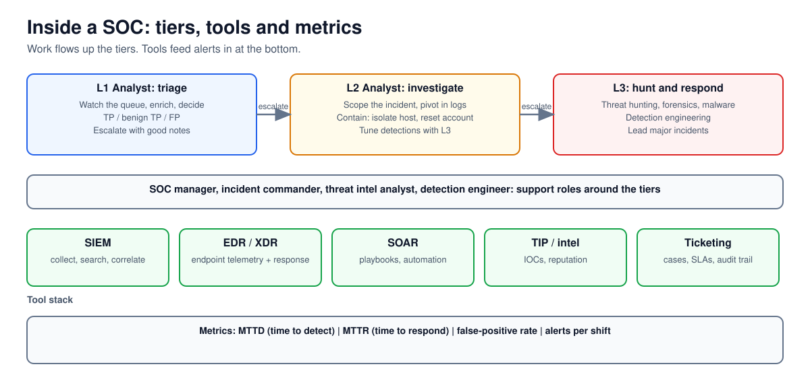

# Module 05 · SOC Fundamentals

> **Weeks:** 3-6 (studied early because your new job needs it) · **Time:** ~40 hours
> **You will:** understand how a Security Operations Center works, triage alerts with a repeatable method, map them to MITRE ATT&CK, use threat intelligence safely, and run an incident with NIST SP 800-61 Rev. 3.



## Learning path

| # | Lesson | Week | Certification objective |
|---|---|---|---|
| 01 | [What a SOC does](01-what-a-soc-does.md) | 3 | Security+ SY0-701/801 domain 4; SC-200 |
| 02 | [Alert lifecycle and triage](02-alert-triage.md) | 3-4 | Security+ domain 4; SC-200 (investigate incidents); SOC Level 1 |
| 03 | [ATT&CK, Kill Chain, Pyramid of Pain, IOC vs IOA](03-frameworks-attack-killchain-pyramid.md) | 5 | Security+ domains 2 and 4; SC-200 |
| 04 | [Threat intelligence basics](04-threat-intelligence-basics.md) | 5 | Security+ domain 4; SC-200 (Sentinel threat intelligence) |
| 05 | [Incident response (NIST 800-61 Rev. 3) and playbooks](05-incident-response-nist-800-61.md) | 5-6 | Security+ domain 4; NIST CSF 2.0 |

Always check the official exam pages for the current objectives before you book (Security+ SY0-801 launched in November 2026 and SY0-701 stays available for some time; SC-200 is current).

## The lab: alert triage simulator

Folder: [`lab/`](lab/). Offline, synthetic, standard library only.

| File | Purpose |
|---|---|
| `alerts.json` | Queue of 17 synthetic alerts (real attacks, benign true positives, false positives) |
| `threat_intel.json` | Offline reputation table (fake IPs, `*.example` domains, hashes) |
| `context.json` | Asset criticality, user context (VIP, approved travel), authorized scanners, change windows |
| `triage.py` | Enrich, score, map to ATT&CK, verdict, escalation, case notes |
| `demo.py` | Prints the sorted queue and two case notes |
| `test_triage.py` | 32 tests, including the tricky benign cases |

```bash
python cybersecurity-track/05-soc-fundamentals/lab/demo.py
python -m pytest cybersecurity-track/05-soc-fundamentals
```

## Key terms

| Term | Meaning |
|---|---|
| SOC | Security Operations Center: the team that monitors and responds |
| SIEM / SOAR / EDR / XDR | Log platform / automation / endpoint detection and response / extended detection and response |
| TP / BTP / FP / FN | True positive / benign true positive / false positive / false negative |
| MTTD / MTTR | Mean time to detect / to respond |
| IOC / IOA | Indicator of compromise / of attack |
| TTP | Tactics, techniques and procedures |
| ATT&CK | MITRE's catalog of attacker behavior |
| CTI, STIX, TAXII, TLP | Threat intelligence, its format, its transport, its sharing label |
| Playbook / runbook | Step-by-step response guide |
| Containment / eradication | Stop the spread / remove the cause |

## How this connects to your job

- L1 work is triage. Lessons 02 and 04 are your daily method.
- Lessons 03 and 05 are the language of reports, escalations and interviews.
- Module 06 teaches you the SIEM tools (Sentinel, Splunk) that produce these alerts.

## Mini-project (about 6 hours)

Build your own **triage playbook pack**:
1. Pick five alert types from the lab (for example spray, impossible travel, encoded PowerShell, new admin, exfiltration).
2. For each: write the checklist (what to check, where), the benign explanations, the ATT&CK mapping, the escalation rule, and a case-note template.
3. Add two new alerts and one new rule to the lab, with tests (one true positive and one benign case).
4. Write a one-page handover note for the demo queue.

## Interview questions (module level)

<details><summary><b>Q1. Describe a day in the life of an L1 SOC analyst.</b></summary>
Take over from the previous shift using the handover note, work the alert queue by priority, enrich and triage each alert, escalate with good notes, tune feedback on noisy rules, and hand over at the end of the shift.
</details>

<details><summary><b>Q2. How do you tell a true positive from a false positive?</b></summary>
Compare the claim in the alert with evidence: logs, enrichment (intel, asset, user), context (change windows, travel) and scope (related activity). If the activity happened and is authorized, it is a benign true positive; if the rule was wrong, it is a false positive.
</details>

<details><summary><b>Q3. What is ATT&CK used for in a SOC?</b></summary>
A common language for alert labeling, investigation checklists, hunting, detection coverage maps and reports.
</details>

<details><summary><b>Q4. Why is the Pyramid of Pain important?</b></summary>
It tells you where detection effort pays off: behavior (TTPs) is hard for attackers to change; hashes and IPs are easy to change.
</details>

<details><summary><b>Q5. How do you avoid leaking data when you analyze a suspicious file?</b></summary>
Search the hash first, use an internal or enterprise sandbox, never upload company documents to a public service, and defang indicators in tickets.
</details>

<details><summary><b>Q6. Name the phases of incident response.</b></summary>
Preparation, detection and analysis, containment, eradication, recovery, lessons learned. NIST SP 800-61 Rev. 3 maps IR to the CSF 2.0 functions.
</details>

<details><summary><b>Q7. What do you do when MTTR is rising?</b></summary>
Look for causes: new noisy rules, staffing, missing automation, unclear playbooks, or slow approvals. Measure per rule and per phase, then fix the biggest cause.
</details>

<details><summary><b>Q8. An alert fires on admin activity at night. How do you decide?</b></summary>
Match actor, host and time to an approved change. If all match, benign true positive; if not, treat as suspicious, verify with the actor out of band, and escalate.
</details>

<details><summary><b>Q9. What is the difference between SIEM and SOAR?</b></summary>
SIEM collects, correlates and alerts. SOAR automates the response steps and the workflow.
</details>

<details><summary><b>Q10. How would you explain "alert fatigue" to a manager?</b></summary>
When analysts see too many low-value alerts, they start to ignore alerts and real attacks are missed. The fix is tuning and automation, not more people alone.
</details>

## Practice on TryHackMe / HTB

- **TryHackMe:** *Cyber Security 101*, then *SOC Level 1* (SAL1 certificate), then *SOC Level 2* (SAL2).
- **HTB Academy:** *SOC Analyst* job-role path, which prepares for the HTB CDSA certification.
- **HTB Labs:** Sherlocks (short defensive investigations). LetsDefend content is moving into HTB (check the platform for the current catalog).

## References

- NIST SP 800-61 Rev. 3 and CSF 2.0: https://csrc.nist.gov
- MITRE ATT&CK: https://attack.mitre.org
- Microsoft Learn, SC-200: https://learn.microsoft.com/credentials/certifications/security-operations-analyst/
- CompTIA Security+ exam objectives (official page).
- FIRST TLP: https://www.first.org/tlp/
