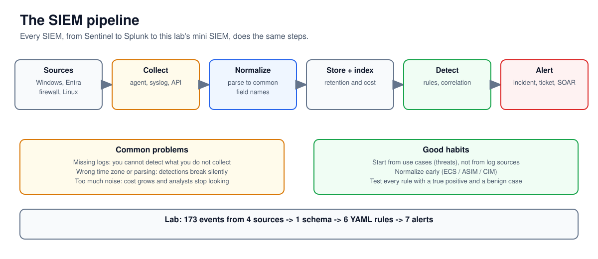

# 01 · SIEM concepts

> **Module:** 06 · SIEM, Sentinel and Splunk · **Week:** 5 · **Time:** ~8 hours
> **You will:** explain every stage of a SIEM pipeline (collect, parse, normalize, store, correlate, alert), choose the right log sources for a use case, and run a mini SIEM on four synthetic log sources.

| | |
|---|---|
| **Prerequisites** | Module 05 lessons 01-03; Module 02 (networking: ports, syslog) |
| **Lab** | [`lab/minisiem.py`](lab/minisiem.py), [`lab/demo.py`](lab/demo.py), [`lab/data/`](lab/data/) |
| **Maps to** | Security+ SY0-701/801 domain 4 (log aggregation, SIEM, alerting); SC-200 (configure Sentinel); Splunk Core Certified User (check the current name and blueprint on the Splunk site) |

---

## 1. Why it matters in a SOC / cloud-security job

The SIEM is where the SOC lives all day. A SIEM answers three questions: *What happened? Who did it? Is it normal?* If the logs are missing, wrongly parsed or too expensive to keep, the SOC is blind. Good analysts know the pipeline well enough to say "this rule did not fire because the log source stopped sending data two days ago".

Real situations:
- A detection works in testing but never fires in production because the time zone is wrong.
- The finance team asks why the SIEM bill doubled after somebody enabled verbose firewall logging.
- An auditor asks: "Show me every privileged group change in the last 12 months." Retention must cover it.

---

## 2. Understand it



### 2.1 What a SIEM is

SIEM = **Security Information and Event Management**. It combines two older ideas:
- **SIM** (information management): long-term log storage, search and reports for compliance.
- **SEM** (event management): real-time monitoring, correlation and alerts.

A modern SIEM also includes UEBA (behavior analytics), threat-intel matching, case management and automation (SOAR). Examples: Microsoft Sentinel, Splunk (Enterprise Security), Elastic Security, IBM QRadar, Wazuh, Google SecOps.

### 2.2 Log sources: what to collect first

Start from **use cases** ("detect stolen credentials"), then pick sources. Priority list for a typical company:

| Source | Why | Examples of key events |
|---|---|---|
| **Identity** (Entra ID, Active Directory, Okta) | Most attacks use valid accounts | Sign-ins (success/fail, MFA, location), role and group changes, app consent |
| **Endpoints** (EDR, Sysmon, Windows Security log) | See execution and persistence | Windows 4624 logon, 4625 failed logon, 4688 process creation, 4672 special privileges, 4720 account created, 4728/4732/4756 group member added, 4740 lockout, 1102 audit log cleared, PowerShell 4104 script block |
| **Network** (firewall, proxy, DNS, VPN) | Command and control, exfiltration | Allowed/denied connections, bytes out, DNS queries, URL categories |
| **Cloud control plane** (Azure Activity, AWS CloudTrail, GCP audit) | Changes to cloud resources | Role assignments, key creation, storage made public |
| **Email security** | Phishing | Delivered, clicked, blocked |
| **Linux/Unix** | Servers | `auth.log` (ssh, sudo), auditd |
| **Applications and databases** | Business data | Login failures, privileged SQL, exports |
| **Vulnerability and asset data** | Context | Criticality, owner, open CVEs |

**Rule of thumb:** *identity first, endpoint second, network third.* A rare, high-value log beats a huge, noisy one.

### 2.3 Collection methods

| Method | How | Notes |
|---|---|---|
| **Agent** | A small program on the host reads logs and ships them: Azure Monitor Agent (AMA) for Sentinel, Splunk Universal Forwarder, Elastic Agent, Wazuh agent | Reliable, buffered, can filter at source |
| **Syslog / CEF** | Devices send text over the network (UDP/TCP 514, or TCP with TLS) to a collector. CEF = Common Event Format, a syslog layout with key=value fields | Firewalls, network gear. UDP can lose messages |
| **API pull** | The SIEM calls a service API (Microsoft 365, Entra ID, AWS, SaaS apps) | Cloud services. Watch for rate limits and delay |
| **Native connector / streaming** | Cloud-to-cloud streaming (diagnostic settings, Event Hubs, S3 + queue) | Low effort inside the same cloud |
| **File/script** | Tail a log file, or a scheduled script | Last resort |

Questions to ask for each source: **How much data per day? How late does it arrive? Is it complete (time zone, format)? Who owns it? What happens if it stops?** (Alert on silent sources, "data gap" detections.)

### 2.4 Parsing and normalization

Raw logs speak many dialects: one says `src`, another says `IpAddress`, another `callerIpAddress`. **Parsing** extracts fields from raw text. **Normalization** maps them into one common schema, so one rule works for every source.

| Platform | Common schema |
|---|---|
| Microsoft Sentinel | **ASIM** (Advanced Security Information Model): parsers like `_Im_Authentication` |
| Splunk | **CIM** (Common Information Model): data models like Authentication, Network Traffic, Endpoint |
| Elastic | **ECS** (Elastic Common Schema) |
| Open standard | **OCSF** (Open Cybersecurity Schema Framework) |

This lab uses its own small schema:

| Windows 4625 raw field | Entra raw | Linux raw | Normalized |
|---|---|---|---|
| `TargetUserName` | `userPrincipalName` | (regex group) | `user` |
| `IpAddress` | `ipAddress` | (regex group) | `src_ip` |
| `EventID 4625` | `errorCode != 0` | `Failed password` | `action = logon_failure` |

### 2.5 Data models, indexing and search

A **data model** is a structured view over normalized data ("all authentication events"). It speeds up searches and lets one detection cover many vendors. The SIEM also **indexes** the data so searches are fast. Hot (recent, fast) versus cold (old, cheap) storage is common.

### 2.6 Correlation

Correlation means combining events:

| Type | Example |
|---|---|
| **Threshold** | 10 failed logons in 5 minutes |
| **Distinct count** | 1 IP, 8+ different users failing (spray) |
| **Sequence** | Failed logons, then a success, then a new MFA method |
| **Cross-source** | VPN login + endpoint process + proxy request for the same user |
| **Baseline / anomaly** | Upload is 20x the user's normal |
| **Time + geography** | Two countries in 60 minutes |
| **Threat-intel match** | A firewall log destination in the bad-IP list |

### 2.7 Retention and cost

Logs cost money (ingest, storage, search). Typical decisions:

| Decision | Example |
|---|---|
| **Hot retention** (searchable fast) | 30 to 90 days |
| **Cold/archive** | 1 to 7 years for audit (rules differ by law and standard; ask compliance) |
| **Filter at source** | Drop DNS "health check" noise, keep security-relevant events |
| **Tiering** | Microsoft Sentinel has different table plans and a data lake option; Splunk is often priced by ingest volume or workload (check the current vendor pricing pages) |
| **Summarize** | Store a daily count instead of every event for low-value logs |

Do not guess: write a **log source onboarding record** with owner, volume, retention, use cases and cost.

### 2.8 Use-case development

A use case is a short, written detection goal:

```text
Name:        Password spray against cloud sign-ins
Threat:      T1110.003 (Credential Access)
Data:        Entra SigninLogs (error 50126), 14 days history
Logic:       >= 8 distinct users fail from one IP in 10 minutes
Severity:    High
Triage:      did any sign-in from that IP succeed? MFA result?
False pos.:  shared office NAT
Owner/test:  detection engineer, test with the lab data
```

### 2.9 Tuning and false positives

Tuning is continuous. Steps: measure alerts per rule, review samples, find the cause, then change **thresholds, filters (exclusions), scope (asset lists), or logic**. Record the reason and the date. Never disable a rule just to quiet it; fix it. Exclusions need an owner and an expiry date.

### 2.10 From DBA to security

> **From DBA to security**
> - **A SIEM is a data warehouse for logs.** You already know ETL: *extract* (collect), *transform* (parse, normalize), *load* (index). The same skills apply, and schema design (a common schema) matters just as much.
> - **Oracle audit trail and `listener.log`** are log sources. Database auditing events (failed logins, `GRANT`, `ALTER USER`) should flow to the SIEM, not stay on the DB server. An attacker with DBA access could clean local logs.
> - **Retention = archive policy.** Like archive logs and RMAN retention, you pay for how long you keep things.
> - **Partitioning and hot/cold data** are the same idea as hot/cold tiers.
> - **Joins.** Correlation is a join on time window and key (user, IP). If you can write a SQL join with a time condition, you can write KQL and SPL.

---

## 3. Hands-on

### 3.1 Repo lab: the mini SIEM

The lab has four log files in `lab/data/` (all fake):

| File | Format | Notes |
|---|---|---|
| `windows_security.jsonl` | JSON lines | Event IDs 4624, 4625, 4688, 4728, 4732 |
| `entra_signins.jsonl` | JSON lines | Entra ID style, `errorCode` 0 or 50126, country |
| `firewall.csv` | CSV | allow/deny, ports, bytes out |
| `linux_auth.log` | syslog text | ssh and sudo lines |

Look at one raw line of each and compare it to the normalized `Event` dataclass in `minisiem.py`. Then run:

```bash
python cybersecurity-track/06-siem-sentinel-splunk/lab/demo.py
```

Real output:

```text
INGEST: normalized events per source: {'windows': 69, 'entra': 34, 'firewall': 55, 'linux': 15}
        total: 173 events, one common schema

RULES: 6 loaded: cyb06-0001, cyb06-0005, cyb06-0003, cyb06-0004, cyb06-0002, cyb06-0006

TIME (UTC)            LEVEL   ATT&CK           ENTITY                                 EVENTS  TITLE
-----------------------------------------------------------------------------------------------------------------------------
2026-11-10T02:00:00Z  high    T1110.003        src_ip=198.51.100.66                       10  Password spray - one source fails against many accounts
2026-11-10T02:10:00Z  high    T1110.001        src_ip=203.0.113.50,user=admin01           12  Brute force - many failed logons for one account from one source
2026-11-10T03:00:00Z  high    T1110.001        src_ip=203.0.113.77,user=root              11  Brute force - many failed logons for one account from one source
2026-11-10T09:00:00Z  medium  T1078            user=alice                                  2  Impossible travel - successful sign-ins from two countries too close in time
2026-11-10T14:41:00Z  high    T1059.001,T1027  host=HR-WS-12,user=erin                     1  PowerShell started with an encoded command
2026-11-10T14:45:00Z  medium  T1571            src_ip=192.0.2.77,dst_port=4444             3  Allowed outbound connection on a rare destination port
2026-11-10T23:50:00Z  high    T1098            host=DC-01,user=helpdesk1                   1  Member added to a privileged group

7 alerts from 173 events
```

Note the 173 events produced 7 alerts: the benign noise (typos, shared NAT, SCCM, a flight) correctly raised none.

Exercises (predict first, then run):
1. In `make_sample_data.py`, change the number of failed logons for `admin01` from 12 to 9, run `python make_sample_data.py`, then `demo.py`. *Predict:* the brute-force alert for `admin01` disappears (threshold is 10).
2. Break normalization: in `parse_entra`, map `location` to `host` instead of `country`. Which rule stops working? (Impossible travel.) This is how a parser change silently kills a detection.
3. Add a fifth source (for example DNS logs). Write a parser and a test.

Run all tests (46 tests for the module):

```bash
python -m pytest cybersecurity-track/06-siem-sentinel-splunk
```

```text
..............................................                           [100%]
46 passed in 0.33s
```

### 3.2 Optional free tools
- **Splunk Free / trial** (lesson 04), **Microsoft Sentinel free trial** (lesson 03).
- **Wazuh** or **Elastic** in Docker for an open-source SIEM (heavy: allow 4+ GB RAM).
- **Sysmon** (Microsoft Sysinternals) on a Windows VM, with a community config, to produce good endpoint logs.

### 3.3 Practice platforms
- **TryHackMe:** *SOC Level 1* path includes Splunk and Elastic-based investigation rooms (check the current room list).
- **HTB Academy:** *SOC Analyst* path (SIEM and log-analysis modules); **HTB Labs:** Sherlocks.

---

## 4. Real-world scenarios

**Scenario 1: Silent log source.** *What happened:* a rule for RDP brute force has not fired for 3 weeks. *Investigate:* check ingestion per table (rows per hour), look for a gap on the Windows event forwarder. The agent stopped after a certificate expired. *Do:* fix, backfill if possible, and add a "no data for 1 hour" alert per critical source.

**Scenario 2: Cost shock.** *What happened:* the bill doubled. *Investigate:* ingestion by table and by host. Verbose firewall "allow" logs and debug logs from one app. *Do:* filter at source, keep deny + selected allow logs, move low-value data to a cheaper tier, document owners.

**Scenario 3: Parsing change.** *What happened:* after a firewall firmware update, the field `dst_port` is empty. *Investigate:* raw event versus parsed event. *Do:* fix the parser; add a test with a sample log line (as the lab tests do for each parser).

---

## 5. Common mistakes

- Collecting everything "just in case" (cost, noise) or nothing important (blind).
- Not checking time zones and clock sync.
- Detections without a normalized schema, so one rule per vendor.
- No monitoring of the log pipeline itself.
- No retention plan matched to compliance.
- Tuning by deleting the rule.
- No test data for rules.

---

## 6. Interview questions

<details><summary><b>Q1. What is a SIEM?</b></summary>
A platform that collects logs from many sources, normalizes and stores them, correlates events, raises alerts and supports investigation and compliance reporting.
</details>

<details><summary><b>Q2. Which log sources would you onboard first?</b></summary>
Identity (Entra ID or Active Directory), then endpoint (EDR, Windows security events), then network (firewall, proxy, DNS) and cloud control plane logs. Start from use cases.
</details>

<details><summary><b>Q3. Agent vs syslog vs API collection?</b></summary>
Agents are reliable and can filter at the source. Syslog suits network devices, but UDP can lose events. APIs suit cloud and SaaS but have rate limits and delay.
</details>

<details><summary><b>Q4. Why normalize logs?</b></summary>
So one detection works across vendors, analysts learn one set of field names, and searches and dashboards are reusable. Examples: ASIM, CIM, ECS, OCSF.
</details>

<details><summary><b>Q5. Give three correlation examples.</b></summary>
10 failures in 5 minutes (threshold); failures then a success for the same user (sequence); same user active on VPN and from an unusual country (cross-source).
</details>

<details><summary><b>Q6. How do you control SIEM cost?</b></summary>
Filter noise at source, choose useful events, use cheaper tiers or archives for low-value data, summarize, review ingest by table every month, and tie each source to a use case.
</details>

<details><summary><b>Q7. How would you detect a log source that silently stopped?</b></summary>
A scheduled query that counts events per source per hour and alerts when a normally active source has zero events, with an owner for each source.
</details>

<details><summary><b>Q8. What is a false positive and how do you tune it?</b></summary>
An alert for activity that is not malicious. Review the samples, find the cause, then change the threshold, add a scoped and reviewed exclusion, or fix the logic, and test again for true positives.
</details>

<details><summary><b>Q9. Which Windows events matter for identity attacks?</b></summary>
4624 success, 4625 failure, 4672 special privileges, 4720 account created, 4728/4732/4756 group membership additions, 4740 lockout, and 1102 log cleared. Kerberos events 4768/4769 help with ticket attacks.
</details>

<details><summary><b>Q10. A rule never fires in production but works in testing. What do you check?</b></summary>
Is the data arriving (volume per table), is the parser filling the fields, time zone and delay, rule schedule and lookback window, field names, and whether an exclusion removes the events.
</details>

<details><summary><b>Q11. How long should you keep logs?</b></summary>
It depends on law, contracts and risk. Many teams keep 30-90 days hot and 1 year or more in an archive. Ask compliance and write it into policy.
</details>

---

## 7. Checklist

- [ ] I can draw the SIEM pipeline and explain each stage.
- [ ] I can list five log sources and two key events for each.
- [ ] I ran the mini SIEM and explained why 173 events gave 7 alerts.
- [ ] I broke a parser on purpose and saw a rule stop working.
- [ ] I wrote one use-case description.

## 8. References

- Microsoft Learn, "Microsoft Sentinel documentation" and "ASIM overview": https://learn.microsoft.com/azure/sentinel/
- Splunk Docs, "Common Information Model": https://docs.splunk.com
- Elastic Common Schema: https://www.elastic.co/guide/en/ecs/current/
- OCSF: https://ocsf.io
- NIST SP 800-92, "Guide to Computer Security Log Management".
- Microsoft, "Windows security auditing events" reference (Windows Server docs).
