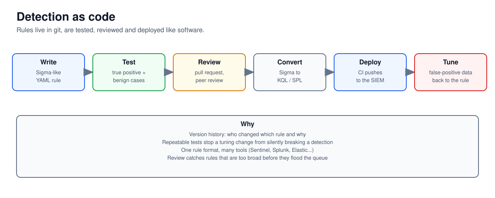

# 02 · Detection engineering basics

> **Module:** 06 · SIEM, Sentinel and Splunk · **Weeks:** 6-7 · **Time:** ~10 hours
> **You will:** write a detection rule from a threat idea, test it with true-positive and benign cases, express it in Sigma, and manage it like code.

| | |
|---|---|
| **Prerequisites** | Lesson 01; Module 05 lesson 03 (ATT&CK) |
| **Lab** | [`lab/rules/*.yml`](lab/rules/), [`lab/minisiem.py`](lab/minisiem.py), [`lab/test_minisiem.py`](lab/test_minisiem.py) |
| **Maps to** | SC-200 (create analytics rules); Security+ SY0-701/801 domain 4; Splunk Core Certified Power User topics (searches and alerts; verify the blueprint); TryHackMe SOC Level 2 |

---

## 1. Why it matters in a SOC / cloud-security job

Alerts do not fall from the sky. Someone writes each rule. A bad rule wastes the whole SOC's time (noise) or lets attackers through (misses). Even if you start as L1, you will soon be asked: "can you tune this rule?" Then: "can you write one?" Detection engineering is the career step after L1/L2 and is well paid.

---

## 2. Understand it



### 2.1 The detection lifecycle

| Step | Question | Output |
|---|---|---|
| 1 **Idea** | Which threat or technique? (ATT&CK) | Use-case card |
| 2 **Data check** | Do we collect the logs? Are the fields filled? | Confirmed source and fields |
| 3 **Write** | Simple, specific logic | Rule file |
| 4 **Test** | Does it fire on bad activity? Stay quiet on normal activity? | Test cases: true positives and benign negatives |
| 5 **Review** | Does a peer agree? Is the false-positive path documented? | Pull request |
| 6 **Deploy** | Start in "alert only" or low severity, then raise | Rule in production |
| 7 **Monitor and tune** | Alerts per day, true-positive rate, analyst feedback | Better rule |
| 8 **Retire** | Threat is gone or data changed | Archived rule |

### 2.2 Rule building blocks

| Block | Meaning | Example (from the lab) |
|---|---|---|
| **Selection** | Which events match | `action: logon_failure`, `source: [windows, linux]` |
| **Filter / exclusion** | Known good to remove | `parent_process|endswith: ccmexec.exe` |
| **Condition** | How blocks combine | `selection and not filter` |
| **Aggregation** | Count, distinct count, sequence, over a time window | 10 failures per `src_ip` and `user` in 5 minutes |
| **Metadata** | Name, ID, level, ATT&CK tags, owner, false positives, references | `tags: [attack.t1110.001]` |

Good rules are **specific** (few false positives), **robust** (hard to dodge by a small change), and **explainable** (the analyst knows what to check next).

Types of logic:
- **Atomic / signature:** one event looks bad (an encoded PowerShell command).
- **Threshold:** many events (brute force).
- **Behavior / anomaly:** compared to a baseline (rare outbound port).
- **Sequence:** A then B (failure x10, then success).
- **Intel match:** a field matches a list.

### 2.3 Sigma: a vendor-neutral rule format

**Sigma** is an open YAML format for detection rules, described as "what YARA is for files, and Snort is for network traffic, Sigma is for logs". You write a rule once, then convert it to KQL (Sentinel), SPL (Splunk), Elastic and others with a converter (`sigma-cli` / pySigma, with a backend per product).

A real-style Sigma rule:

```yaml
title: Suspicious Encoded PowerShell Command
id: 11111111-2222-4333-8444-555555555555      # use a fresh UUID
status: experimental
description: PowerShell started with an encoded command
author: you
date: 2026/11/10
logsource:
    category: process_creation
    product: windows
detection:
    selection_img:
        Image|endswith: '\powershell.exe'
    selection_cli:
        CommandLine|contains:
            - ' -enc '
            - ' -EncodedCommand '
    filter_sccm:
        ParentImage|endswith: '\CcmExec.exe'
    condition: selection_img and selection_cli and not filter_sccm
falsepositives:
    - Software deployment tools
level: high
tags:
    - attack.execution
    - attack.t1059.001
```

Things to notice:
- `logsource` says *where* the log lives, not the product-specific table. The converter maps it.
- Field modifiers: `|contains`, `|startswith`, `|endswith`, `|re`, `|all`. A list means OR.
- `condition` is boolean logic over named blocks.
- Newer Sigma specification versions also define *correlation rules* (counts over time, sequences) as separate rule documents. Check the current Sigma spec at the SigmaHQ site.

**The lab's rules are "Sigma-like":** same ideas, simplified, with an `aggregation` block, and they run on the lab's common schema (`process`, `command_line`, `parent_process`) instead of vendor field names. The lab's `ENC` rule:

```yaml
detection:
  selection:
    action: process_create
    process|endswith: powershell.exe
    command_line|contains:
      - ' -enc '
      - ' -encodedcommand '
  filter:
    parent_process|endswith: ccmexec.exe
  condition: selection and not filter
```

Same logic in KQL (Sentinel) and SPL (Splunk), on real tables:

```kusto
// KQL: Microsoft Defender XDR / Sentinel (DeviceProcessEvents table)
DeviceProcessEvents
| where FileName =~ "powershell.exe"
| where ProcessCommandLine contains " -enc " or ProcessCommandLine contains " -encodedcommand "
| where InitiatingProcessFileName !~ "CcmExec.exe"
```

```text
# SPL: Sysmon in Splunk (field names depend on your add-on, check yours)
index=windows sourcetype="XmlWinEventLog:Microsoft-Windows-Sysmon/Operational" EventCode=1
  Image="*\\powershell.exe" (CommandLine="* -enc *" OR CommandLine="* -encodedcommand *")
  NOT ParentImage="*\\CcmExec.exe"
```

### 2.4 Testing detections

A detection with no tests is a guess. For every rule keep at least:

| Test | Purpose | Lab example |
|---|---|---|
| **True positive** | The rule fires on a realistic attack | 12 failed logons in 4 minutes fires brute force |
| **Benign negative** | The rule stays quiet on normal behavior | 3 typos do not fire |
| **Boundary** | Just under and just over the threshold or window | 10 failures slowly over hours do not fire |
| **Filter test** | The exclusion removes only what you intend | SCCM parent is filtered; a lookalike `svc-provisioning-evil` is not |
| **Evasion test** | Small attacker change still detected? | `-EncodedCommand` as well as `-enc` |
| **Regression** | Old bugs stay fixed | Run all tests on each change |

Other ways to test: replay saved logs, simulate the technique with a safe tool (**Atomic Red Team**) in a lab VM, and **purple teaming** (red and blue together). Check detection **coverage** by technique and **quality** by test result.

The lab has tests for every rule. A sample (real output):

```bash
python -m pytest cybersecurity-track/06-siem-sentinel-splunk -k "sccm or filter or spray" -vv
```

```text
test_spray_fires_on_ten_accounts_from_one_ip PASSED [ 14%]
test_spray_ignores_shared_nat_with_three_users PASSED [ 28%]
test_spray_ignores_slow_attempts_outside_the_window PASSED [ 42%]
test_spray_ignores_successful_sign_ins PASSED [ 57%]
test_approved_provisioning_account_is_filtered PASSED [ 71%]
test_filter_is_exact_not_a_prefix PASSED [ 85%]
test_sccm_parent_is_filtered_out PASSED [100%]
7 passed, 39 deselected in 0.14s
```

### 2.5 Detection as code

Treat rules like software:

| Practice | Why |
|---|---|
| Rules in a **git** repository | History: who changed what and why |
| **Pull request review** | A second pair of eyes catches broad rules |
| **Automated tests in CI** (`pytest` here) | A tuning change cannot silently break a detection |
| **Linting** (valid YAML, required fields, ATT&CK tags, `falsepositives` documented) | Consistency. The lab test `test_six_rules_with_unique_ids_and_attack_tags` is an example |
| **CI/CD deploy** | Push rules to Sentinel (ARM/Bicep templates or the Sentinel repositories feature) or Splunk (apps/REST) the same way every time |
| **Environment promotion** | test, then staging, then production |
| **Metrics** | Alerts per rule, true-positive rate, time-to-tune |

### 2.6 Common detection pitfalls

| Pitfall | Example | Fix |
|---|---|---|
| Too broad | Alert on every PowerShell | Add specific conditions (encoded, download cradle, Office parent) |
| Too narrow | Matches only `-enc`, not `-EncodedCommand`, `-e` | Cover variants; test evasion |
| Missing context | No asset or user info | Enrich with watchlists/lookups |
| Time window mistakes | Query runs every hour but looks back 5 minutes | Match schedule to lookback, allow for ingestion delay |
| Case/escape errors | `\` in Windows paths | Test on real events |
| No false-positive plan | The first noisy day, someone disables it | Document known false positives and owners |
| Detecting only IOCs | Hash lists | Add behavior |

### 2.7 From DBA to security

> **From DBA to security**
> - **A detection rule is a monitoring query.** If you have written an Oracle alert such as "tablespace > 90%" or "more than 5 failed logins in `DBA_AUDIT_TRAIL` for one user", you have already written a threshold detection.
> - **Testing and CI = your change management.** You test a DB change on a copy before production. Do the same for rules.
> - **Exclusions = hint or profile exceptions.** They help, but each one hides something. Keep them small, owned and expiring.
> - **Baselines (AWR).** Anomaly detection depends on knowing normal. Build the baseline before you write the anomaly rule.

---

## 3. Hands-on

### 3.1 Repo lab: read, then write a rule

1. Open `lab/rules/password_spray.yml` and `lab/rules/new_admin_member.yml`. Find: selection, filter, condition, aggregation, falsepositives, tags.
2. Write a **new rule**: "Security log cleared" (Windows event 1102 means someone cleared the audit log, ATT&CK T1070.001, Defense Evasion).
   - Add the event to `make_sample_data.py` (one 1102 event from `DC-01`, plus nothing for the benign case) and add `1102` to `WIN_ACTIONS` as `log_cleared` in `minisiem.py` (parsing: user from `SubjectUserName`).
   - Create `rules/log_cleared.yml` (`selection: action: log_cleared`, level `high`).
   - Add two tests in `test_minisiem.py`: a true positive, and a benign negative (an ordinary logon).
3. Run the pipeline and the tests:

```bash
python cybersecurity-track/06-siem-sentinel-splunk/lab/make_sample_data.py
python cybersecurity-track/06-siem-sentinel-splunk/lab/demo.py
python -m pytest cybersecurity-track/06-siem-sentinel-splunk
```

Note: `test_sample_data_produces_exactly_the_planted_alerts` will fail until you add your alert to its expected list. That is the regression test doing its job.

4. **Tune on purpose.** In `rare_outbound_port.yml`, remove `8443` from the filter. Run the demo. Which new alert appears? (The benign dev tool at `192.0.2.25`.) Which test fails? (The benign-noise test.) Put it back, or better: add a documented exclusion for that host.

### 3.2 Optional free tools
- **sigma-cli / pySigma** (`pip install sigma-cli`): convert the Sigma rule above to KQL and SPL (install a backend plugin for each target).
- **SigmaHQ rules repository** on GitHub: read 5 real rules; look at `falsepositives` fields.
- **Atomic Red Team** in an isolated Windows VM you own: run a safe test for T1059.001 and check that the rule fires.
- `yamllint` for rule hygiene.

### 3.3 Practice platforms
- **TryHackMe:** SOC Level 2 content on detection and Sigma/YARA (search the catalog for current rooms).
- **HTB Academy:** SOC Analyst path (detection and Sigma-related modules; check the current list).

---

## 4. Real-world scenarios

**Scenario 1: The noisy rule.** *What happened:* a "new local admin" rule creates 120 alerts/day. *Investigate:* group by the actor: 90% are the software-deployment service account. *Do:* filter that account **and** require it to come from the deployment server, review monthly, add a test for the filter and for a different account (still alerts).

**Scenario 2: The bypassed rule.** *What happened:* a pentester used `-e` instead of `-enc` and was not detected. *Do:* extend variants, test evasion, move to a behavior rule (Office parent, long Base64 string, download cradle).

**Scenario 3: The rule that never fired.** *What happened:* 6 months, zero alerts, nobody noticed. *Investigate:* the field was `CommandLine` in one table and `ProcessCommandLine` in another; the parser changed. *Do:* test against real recent data, alert on "rule returns no results AND data volume is zero".

---

## 5. Common mistakes

- Writing the rule before checking the data.
- Testing only the true positive.
- Using exact matches for things attackers can change (file names, hashes).
- Broad exclusions ("ignore all of IT").
- Pushing straight to production with high severity.
- No owner, no review date.
- Copying a public rule without understanding it.

---

## 6. Interview questions

<details><summary><b>Q1. How do you build a detection from scratch?</b></summary>
Pick a threat (ATT&CK technique), confirm the data and fields exist, write simple specific logic, test with true-positive and benign cases, review, deploy at low severity, monitor and tune.
</details>

<details><summary><b>Q2. What is Sigma and why use it?</b></summary>
An open YAML format for log detections. Write once and convert to many SIEM languages, which supports sharing and vendor independence.
</details>

<details><summary><b>Q3. What is detection as code?</b></summary>
Managing rules in version control with review, automated tests and CI/CD deployment, like software.
</details>

<details><summary><b>Q4. Brute force vs password spray: how do the detections differ?</b></summary>
Brute force: many failures for one account from one source. Spray: few attempts per account across many accounts from one source, so count distinct users per source.
</details>

<details><summary><b>Q5. What tests do you write for a rule?</b></summary>
True positive, benign negative, boundary (threshold and window), filter, evasion variants, and regression tests in CI.
</details>

<details><summary><b>Q6. How do you reduce false positives without losing detections?</b></summary>
Analyze samples, add scoped and reviewed exclusions, tighten logic or add context (asset lists), re-run true-positive tests. Avoid removing the rule or very broad exclusions.
</details>

<details><summary><b>Q7. IOC-based vs behavior-based detection?</b></summary>
IOC rules match known artifacts and are cheap but short-lived. Behavior rules match attacker actions and last longer but need tuning.
</details>

<details><summary><b>Q8. Why do some rules never fire in production?</b></summary>
Data not arriving, fields not parsed, wrong time window or schedule, ingestion delay, wrong field name or case, or a broad exclusion.
</details>

<details><summary><b>Q9. How do you measure detection quality?</b></summary>
Precision (true positive share of alerts), alert volume, coverage of important ATT&CK techniques with *tested* rules, time-to-triage, and tuning time.
</details>

<details><summary><b>Q10. Scenario: you must detect impossible travel in Sentinel and Splunk. How?</b></summary>
Take successful sign-ins, sort by user and time, compare each event's country with the previous one, and alert when countries differ within a time limit (for example 60 minutes). Exclude known VPN egress IPs. In KQL use `prev()`; in SPL use `streamstats`.
</details>

<details><summary><b>Q11. What is purple teaming?</b></summary>
Red (attackers) and blue (defenders) work together: run a technique, see if it is detected, then improve the detection immediately.
</details>

---

## 7. Checklist

- [ ] I can explain selection, filter, condition and aggregation.
- [ ] I can read and write a basic Sigma rule.
- [ ] I added a new rule with a true-positive test and a benign negative test.
- [ ] I broke a rule on purpose and a test caught it.
- [ ] I know how detection-as-code fits into CI/CD.

## 8. References

- SigmaHQ (rules and specification): https://github.com/SigmaHQ/sigma and https://sigmahq.io
- pySigma and sigma-cli documentation.
- MITRE ATT&CK data sources and detections: https://attack.mitre.org
- Palantir, "Alerting and Detection Strategy Framework" (blog, search by title).
- Microsoft Learn, "Create custom analytics rules to detect threats" (Sentinel).
- Atomic Red Team: https://github.com/redcanaryco/atomic-red-team
