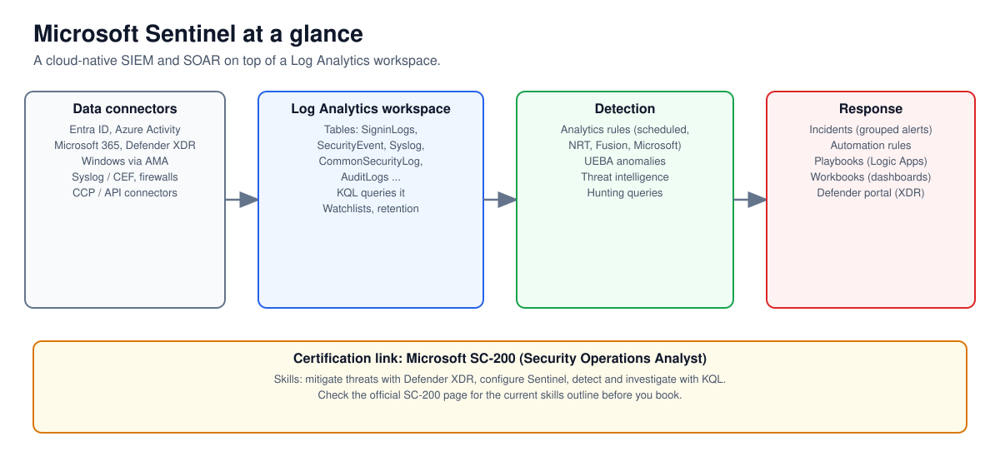

# 03 · Microsoft Sentinel and KQL

> **Module:** 06 · SIEM, Sentinel and Splunk · **Weeks:** 7-9 · **Time:** ~14 hours
> **You will:** set up the Sentinel building blocks, write KQL queries (where, project, summarize, join, bin, extend, parse), create an analytics rule, and explain incidents, workbooks, playbooks, UEBA and watchlists.

| | |
|---|---|
| **Prerequisites** | Lessons 01-02 |
| **Lab** | [`lab/queries/`](lab/queries/) (KQL exercises on the lab data, with a checker) |
| **Maps to** | **Microsoft SC-200** (Security Operations Analyst): Defender XDR, Sentinel, KQL. Check the official SC-200 study guide for the current skills outline before you book. Also Security+ domain 4. |

---

## 1. Why it matters in a SOC / cloud-security job

Your job mixes SOC and cloud security. If your company uses Microsoft 365 or Azure, **Sentinel and Microsoft Defender XDR** will be your main tools. SC-200 is the certification built for this role. KQL (Kusto Query Language) is the most useful single skill: you will use it in Sentinel, in Defender advanced hunting, in Azure Monitor and in Azure Data Explorer.

---

## 2. Understand it



### 2.1 Core parts

| Part | What it is |
|---|---|
| **Log Analytics workspace** | The data store. Sentinel is turned on *over* a workspace. Data lives in **tables**. You query with KQL. |
| **Data connectors** | Ways to bring data in: Entra ID, Microsoft 365, Azure Activity, Defender XDR, Windows Security Events (via **Azure Monitor Agent**), Syslog and CEF (via AMA), threat intelligence (TAXII), many third-party and API-based connectors. |
| **Tables** (examples) | `SigninLogs`, `AuditLogs` (Entra), `SecurityEvent` (Windows), `Syslog`, `CommonSecurityLog` (CEF firewalls), `AzureActivity`, `OfficeActivity`, `SecurityAlert`, `SecurityIncident`, `ThreatIntelligenceIndicator` (name may differ by version; check the schema reference) |
| **Analytics rules** | Detection logic that creates alerts and incidents |
| **Incidents** | Groups of related alerts plus entities and evidence; the analyst's work item |
| **Workbooks** | Dashboards (Azure Monitor workbooks) |
| **Playbooks** | Automation built with **Azure Logic Apps** |
| **Automation rules** | Light automation on incident creation or update: assign owner, set severity, close noisy ones, run a playbook |
| **Watchlists** | Your own lookup tables (CSV): VIP users, allowed IPs, critical servers |
| **UEBA** | User and Entity Behavior Analytics: baselines and anomaly signals |
| **Hunting** | Saved queries, bookmarks, notebooks, livestream |
| **Content hub** | Prebuilt solutions: rules, workbooks, playbooks per product |

Microsoft is moving the Sentinel experience into the **Microsoft Defender portal** (a single place for Defender XDR and Sentinel). Before you plan training, check the current Microsoft Learn notice for dates and for how the Azure portal experience changes.

### 2.2 Defender XDR and Sentinel: who does what?

| | Microsoft Defender XDR | Microsoft Sentinel |
|---|---|---|
| Focus | Detection and response for Microsoft products: endpoints (Defender for Endpoint), identities (Defender for Identity, Entra ID Protection), email (Defender for Office 365), cloud apps | **SIEM and SOAR** for *all* sources, Microsoft and not |
| Data | Microsoft-native, rich, "advanced hunting" tables like `DeviceProcessEvents`, `EmailEvents` | Anything you connect |
| Typical action | Isolate a device, quarantine mail | Correlate across sources, long retention, custom rules, playbooks |
| Link | Defender XDR incidents flow into Sentinel (connector) and the portals are merging | Together they give one incident queue |

For SC-200 you must know both and where each KQL table lives.

### 2.3 KQL fundamentals

KQL reads top to bottom. Each step passes a table to the next with `|` (like a Unix pipe or a SQL subquery chain).

| Operator | Purpose | Example |
|---|---|---|
| `where` | Filter rows | `where ResultType == "50126"` |
| `project` | Choose and rename columns | `project TimeGenerated, UserPrincipalName, IPAddress` |
| `extend` | Add computed columns | `extend Hour = hourofday(TimeGenerated)` |
| `summarize` | Group and aggregate (`count()`, `dcount()`, `sum()`, `make_set()`, `arg_max()`) | `summarize n = count() by IPAddress` |
| `bin()` | Round a value (time buckets) | `summarize count() by bin(TimeGenerated, 10m)` |
| `join` | Combine two tables | `T1 \| join kind=inner T2 on UserPrincipalName` |
| `parse` | Extract fields from text | `parse Message with "user=" User " ip=" Ip` |
| `sort` / `top` / `take` | Order, top N, sample | `top 10 by n desc` |
| `distinct`, `count` | Unique values, row count | `distinct IPAddress` |
| `let` | Variables and reusable tables | `let window = 1h;` |
| `ago()`, `between` | Time filters | `where TimeGenerated > ago(24h)` |
| `has`, `contains`, `in`, `!in`, `startswith`, `endswith`, `matches regex` | String and set matching. `has` (whole term) is faster than `contains` (substring). | `where CommandLine contains "-enc"` |
| `iff`, `case` | If/else | `extend Risk = iff(n > 10, "high", "low")` |
| `prev()` / `next()` | Value of previous row (data must be sorted) | for impossible travel |
| `mv-expand`, `parse_json`, `todynamic` | Work with JSON columns | |
| `render` | Charts | `render timechart` |
| `union` | Stack tables | |
| `datatable` | Inline test data | used in the lab files |

Join kinds that matter: `inner`, `leftouter`, `leftanti` (rows without a match, great for "new" things), `leftsemi` (rows that have a match). Default join kind in KQL is **innerunique**, which de-duplicates the left side; most people want `kind=inner`.

KQL tips: the time range picker also filters your results, tables are case-sensitive in name, `==` is case-sensitive and `=~` is not, and always filter by time first to save cost and time.

### 2.4 Example queries on real Sentinel tables

Failed sign-ins by user (last day):

```kusto
SigninLogs
| where TimeGenerated > ago(1d)
| where ResultType != "0"
| summarize Failures = count() by UserPrincipalName, bin(TimeGenerated, 1h)
| sort by Failures desc
```

Password spray (one IP, many users, 10-minute buckets). Entra `ResultType 50126` = wrong username or password:

```kusto
SigninLogs
| where TimeGenerated > ago(1h)
| where ResultType == "50126"
| summarize FailedUsers = dcount(UserPrincipalName), Attempts = count(), Users = make_set(UserPrincipalName, 20)
    by IPAddress, bin(TimeGenerated, 10m)
| where FailedUsers >= 8
```

Success after spray (join):

```kusto
let sprayIPs = SigninLogs
    | where TimeGenerated > ago(1d) and ResultType == "50126"
    | summarize U = dcount(UserPrincipalName) by IPAddress
    | where U >= 8;
SigninLogs
| where TimeGenerated > ago(1d) and ResultType == "0"
| join kind=inner sprayIPs on IPAddress
| project TimeGenerated, UserPrincipalName, IPAddress, Location
```

Encoded PowerShell from Windows security events (needs command-line auditing for event 4688):

```kusto
SecurityEvent
| where EventID == 4688
| where NewProcessName endswith "powershell.exe"
| where CommandLine contains " -enc " or CommandLine contains " -encodedcommand "
| project TimeGenerated, Computer, SubjectUserName, ParentProcessName, CommandLine
```

More in lesson 05 (cheat sheet).

### 2.5 Analytics rules

| Type | Use |
|---|---|
| **Scheduled** | Your KQL runs every N minutes over a lookback window. Most custom rules. |
| **NRT (near real-time)** | Runs about every minute for fast detections; simpler queries |
| **Microsoft security** | Turn alerts from other Microsoft products into incidents |
| **Fusion** | Machine-learning correlation of multi-stage attacks (on by default in many setups) |
| **Anomaly** | ML-based anomaly detections (often used as evidence, not as direct alerts) |
| **Threat intelligence** | Match logs to your indicators |

Important rule settings: query + **frequency** and **lookback** (they must make sense together, with a margin for ingestion delay), **threshold**, **entity mapping** (account, host, IP: needed for investigation and UEBA), **MITRE tactics and techniques**, **alert grouping** into incidents, **suppression**, and **custom details** (extra fields in the alert).

Create one: Sentinel > Analytics > Create > Scheduled query rule > paste the spray query > map the `IPAddress` entity > set tactics `Credential Access` / `T1110` > group alerts by IP > create. Or deploy from code (ARM/Bicep/the Repositories feature); see lesson 02.

### 2.6 Incidents, workbooks, playbooks

- **Incident:** severity, status, owner, tags, comments, **tasks** (a checklist), entities, timeline, and an investigation graph. Triage as in Module 05.
- **Workbooks:** charts for sign-in failures by country, rule noise by rule, MTTR. Start from a template in the Content hub.
- **Playbooks (Logic Apps):** triggers: *incident*, *alert*, *entity*. Typical actions: enrich the IP, post to Teams, open a ticket, disable a user, add the IP to a block list. Needs a managed identity or connection with the least privilege (do not give a playbook Global Admin).
- **Automation rules:** the simple stuff that does not need a Logic App: auto-assign, auto-close a known false positive, add a tag.

### 2.7 UEBA and watchlists

- **UEBA** builds baselines per user and entity from connected sources (Entra, Windows and others; check what is supported). Output: `BehaviorAnalytics`, `Anomalies`, `IdentityInfo` tables. Use it for context: "first time this user signed in from this country", "unusual amount of failed logons".
- **Watchlists** are CSV lookups, read with `_GetWatchlist('name')`. Uses: VIP users (raise severity), approved scanner IPs (exclude), terminated employees, critical assets.

```kusto
let VIPs = _GetWatchlist('VIPUsers') | project UserPrincipalName = SearchKey;
SigninLogs
| where ResultType == "50126"
| join kind=inner VIPs on UserPrincipalName
```

### 2.8 Costs and housekeeping

Ingestion volume is the main cost driver. Use data collection rules (DCR) to filter at the source, pick the right table plan, set retention per table, and review ingestion in the Usage tables. Check the current pricing and table plan options on the Microsoft pages (they change).

### 2.9 SC-200 map (always check the official outline)

| SC-200 area (approximate) | Where in this track |
|---|---|
| Mitigate threats with Microsoft Defender XDR | Module 07 (EDR/XDR) |
| Mitigate threats with Defender for Cloud | Module 10 (cloud security) |
| Configure and manage Sentinel (workspace, connectors, rules, content) | This lesson |
| Detect, investigate, respond, hunt with Sentinel and KQL | This lesson, lessons 02 and 05, Module 05 |

### 2.10 From DBA to security

> **From DBA to security**
> - **KQL is SQL with the table first and pipes.** `SELECT ... FROM t WHERE ... GROUP BY ...` becomes `t | where ... | summarize ... by ...`. Your SQL tuning habits apply: filter early, project only needed columns, avoid joining huge tables.
> - **Workspace tables = a data warehouse.** Retention per table is like partition retention.
> - **Watchlists = lookup/reference tables.** Same as a small dimension table.
> - **Playbooks = DBMS_SCHEDULER jobs plus alert scripts.** An action on event, with least privilege (your DB experience with grants maps to Logic App connections and Azure RBAC).
> - **Azure RBAC = roles and grants.** Sentinel Reader, Responder, Contributor are roles; give analysts only what they need.

---

## 3. Hands-on

### 3.1 Repo lab: KQL exercises on the lab data (no Azure needed to start)

The lab data is exported as a KQL `datatable`, so you can paste it into any KQL window (Azure Data Explorer free cluster, a Log Analytics demo workspace, or your own workspace). Steps:

1. Open `lab/queries/events_datatable.kql` (176 lines, 173 events, creates `Events`).
2. Paste it at the top of the query window, then write a query under it. Example (Q1, failed Windows logons):

```kusto
Events | where Source == "windows" and Action == "logon_failure" | count
```

3. Do the 12 questions in `lab/queries/exercises.md`. Compare with `solutions.kql` when stuck.
4. Put your answers in `answers.json` and check them:

```bash
python cybersecurity-track/06-siem-sentinel-splunk/lab/queries/check_answers.py cybersecurity-track/06-siem-sentinel-splunk/lab/queries/answers.json
```

Real output (from a test file where Q6 and Q11 were wrong on purpose):

```text
Q1   PASS  How many failed Windows logons are there in total?
Q2   PASS  Which source IP has the most failed Windows logons?
Q3   PASS  How many different accounts failed to sign in to Entra ID from 198.51.100.66?
Q4   PASS  Which user signed in successfully (Entra) from two different countries within 60 minutes?
Q5   PASS  Which member was added to the Domain Admins group?
Q6   FAIL  How many Windows process-creation events run PowerShell with an encoded command (-enc or -EncodedCommand)?
Q7   PASS  On which host did an encoded PowerShell command run with WINWORD.EXE as the parent process?
Q8   PASS  Which allowed outbound destination port is NOT in the common list (53, 80, 123, 443, 8080, 8443)?
Q9   PASS  How many MB (1 MB = 1,000,000 bytes) did the firewall allow to be sent to 203.0.113.80?
Q10  PASS  How many different source IPs have failed SSH logons on Linux?
Q11  FAIL  Which UTC hour (0-23) has the most failed logons across all sources?
Q12  PASS  Which account had a SUCCESSFUL Entra sign-in from the spraying IP 198.51.100.66?

Score: 10/12
```

The checker computes the right answers in plain Python from the same data (`python check_answers.py --show` prints them, with spoilers). It does **not** run your KQL; you run it in the real tool and report the result.

Honest note: the `solutions.kql` queries were written to be correct KQL, but they were checked by reading and by computing the same answers in Python, not by running them in a live Azure tool. If a query does not run in your tool, treat it as a bug to fix and learn from.

### 3.2 Optional free tools (clearly optional)

| Tool | Use |
|---|---|
| **Azure Data Explorer free cluster** (dataexplorer.azure.com) | Run KQL on pasted data, no subscription needed (a Microsoft account is enough; check the current terms) |
| **Log Analytics demo environment** (Microsoft Learn) | Read-only workspace with sample data and tables like `SigninLogs` |
| **Azure free account + Sentinel trial** | A real workspace. Create a budget alert and delete the resource group afterwards to avoid cost. Check the current free-trial terms. |
| **Microsoft 365 Developer Program** (if you qualify) | A sandbox tenant to generate real sign-ins |
| **Microsoft Learn SC-200 learning path** | Free, with sandboxes |
| **Kusto Detective Agency** | A free KQL puzzle game |

Safety: never put real company data in a personal trial. Do not enable data connectors for your employer's tenant without written permission.

### 3.3 Practice platforms
- **TryHackMe:** search for Microsoft Sentinel / KQL / Azure rooms and *SOC Level 1/2*.
- **HTB Academy:** *SOC Analyst* path. Search the catalog for Sentinel/KQL-related content.

---

## 4. Real-world scenarios

**Scenario 1: Incident from a spray rule.** *What happened:* incident "Password spray" severity High, entity IP `203.0.113.50`. *Investigate:* open the incident, view the entity page, run the "success after spray" join, check `ConditionalAccessStatus`, MFA, `Location`. *Do:* for each success: revoke sessions, reset the password, check mailbox rules in `OfficeActivity`; block the IP; close with a note and tune.

**Scenario 2: Playbook sends 400 emails.** *What happened:* a playbook triggers on every alert and floods the SOC. *Investigate:* the trigger and the automation rule conditions. *Do:* trigger on incidents (not alerts), filter on severity, add a throttle, test in a dev workspace.

**Scenario 3: Cost spike.** *What happened:* ingestion tripled after enabling "All Security Events". *Investigate:* `Usage | summarize sum(Quantity) by DataType` and the top computers. *Do:* choose a lower event set (common/minimal), filter with a DCR, move low-value tables to a cheaper plan.

---

## 5. Common mistakes

- No time filter at the start of a query.
- Mixing `==` (case-sensitive) and `=~` or forgetting that `ResultType` is a **string**.
- Using `join` without `kind=` and losing rows to `innerunique`.
- Rule frequency shorter than ingestion delay, so events are missed.
- Missing entity mapping, so incidents cannot be investigated.
- Giving playbooks excessive permissions.
- Forgetting UTC.
- Enabling all connectors with default retention and then being surprised by the cost.

---

## 6. Interview questions

<details><summary><b>Q1. What is Microsoft Sentinel?</b></summary>
A cloud-native SIEM and SOAR built on a Log Analytics workspace. It collects data via connectors, detects with analytics rules, groups alerts into incidents and automates response with playbooks.
</details>

<details><summary><b>Q2. Sentinel vs Defender XDR?</b></summary>
Defender XDR detects and responds across Microsoft endpoint, identity, email and cloud app products. Sentinel is the SIEM for all sources, with long retention, custom detections and automation. They share incidents and the portals are converging.
</details>

<details><summary><b>Q3. What is KQL and how is it different from SQL?</b></summary>
Kusto Query Language: a read-only, pipe-based language. The table comes first, then operators like `where`, `summarize`, `project` each pass results to the next.
</details>

<details><summary><b>Q4. Explain `summarize` and `bin()`.</b></summary>
`summarize` groups rows and calculates aggregates (count, dcount, sum). `bin()` rounds a value, usually time, to a bucket size, for example 10 minutes, to count per time window.
</details>

<details><summary><b>Q5. Write a KQL query for 10 or more failed sign-ins per user in an hour.</b></summary>
`SigninLogs | where TimeGenerated > ago(1d) and ResultType != "0" | summarize Fails = count() by UserPrincipalName, bin(TimeGenerated, 1h) | where Fails >= 10`
</details>

<details><summary><b>Q6. Scheduled vs NRT analytics rules?</b></summary>
Scheduled rules run your query at a set frequency with a lookback window. NRT rules run about every minute for faster detection but allow simpler queries.
</details>

<details><summary><b>Q7. What are playbooks and automation rules?</b></summary>
Playbooks are Logic Apps workflows (enrich, notify, disable user). Automation rules are lightweight triggers on incident creation or update (assign, tag, close, call a playbook).
</details>

<details><summary><b>Q8. What is UEBA?</b></summary>
Behavior analytics that builds baselines for users and entities and flags anomalies, giving context to investigations (for example a first-time country).
</details>

<details><summary><b>Q9. What is a watchlist used for?</b></summary>
A CSV lookup table in Sentinel, for example VIP users, approved IPs or critical servers, used with `_GetWatchlist()` to enrich or exclude.
</details>

<details><summary><b>Q10. A scheduled rule never creates incidents. Troubleshoot.</b></summary>
Check that the data arrives (table volume), run the query manually over the lookback window, check frequency versus ingestion delay, entity mapping, alert grouping and suppression, and rule health logs.
</details>

<details><summary><b>Q11. How would you reduce Sentinel cost?</b></summary>
Filter and choose events at the source (DCR), use appropriate table plans and retention, remove unused connectors, and review ingestion by table regularly.
</details>

<details><summary><b>Q12. How do you detect impossible travel in KQL?</b></summary>
Filter successful sign-ins, `sort by UserPrincipalName asc, TimeGenerated asc`, use `prev()` to get the previous user, country and time, then keep rows for the same user where the country differs within a time limit. Exclude known VPN egress ranges.
</details>

---

## 7. Checklist

- [ ] I can name the Sentinel components and the main tables.
- [ ] I can write queries with where, project, extend, summarize, bin, join and parse.
- [ ] I solved the 12 KQL exercises and checked them with `check_answers.py`.
- [ ] I created (or designed) a scheduled analytics rule with entity mapping.
- [ ] I can explain Defender XDR vs Sentinel and map topics to SC-200.

## 8. References

- Microsoft Learn, Microsoft Sentinel: https://learn.microsoft.com/azure/sentinel/
- Microsoft Learn, KQL overview: https://learn.microsoft.com/kusto/query/
- SC-200 certification page and study guide: https://learn.microsoft.com/credentials/certifications/security-operations-analyst/
- Microsoft Defender XDR advanced hunting schema reference.
- Entra sign-in error codes reference (Microsoft Learn).
- Azure Data Explorer free cluster: https://dataexplorer.azure.com
