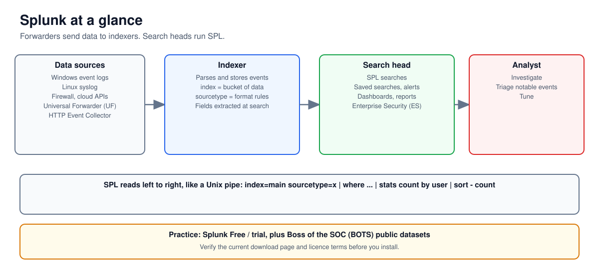

# 04 · Splunk and SPL

> **Module:** 06 · SIEM, Sentinel and Splunk · **Weeks:** 8-10 · **Time:** ~12 hours
> **You will:** explain Splunk's building blocks (indexes, sourcetypes, forwarders), write SPL (search, stats, eval, rex, table, timechart, transaction), create saved searches and alerts, and practice with free options and the Boss of the SOC (BOTS) datasets.

| | |
|---|---|
| **Prerequisites** | Lessons 01-03 |
| **Lab** | [`lab/queries/events.csv`](lab/queries/events.csv) and the SPL exercises |
| **Maps to** | Splunk Core Certified User / Power User (check the current certification names and blueprints on the Splunk site); Security+ domain 4; TryHackMe and HTB SOC paths |

---

## 1. Why it matters in a SOC / cloud-security job

Splunk is one of the most common SIEMs in large companies, banks and telecoms. Even if your main tool is Sentinel, interviews and some teams use Splunk. SPL (Search Processing Language) is a very good tool for ad-hoc investigation. Learning KQL and SPL together (lesson 05) makes you flexible.

---

## 2. Understand it



### 2.1 Architecture in one minute

| Component | Role |
|---|---|
| **Universal Forwarder (UF)** | Small agent on servers; reads files and Windows event logs, sends data to indexers |
| **Heavy Forwarder** | Full Splunk instance that can parse, filter and route before indexing |
| **HTTP Event Collector (HEC)** | HTTPS endpoint for apps and cloud services to push events |
| **Indexer** | Parses and stores events in **indexes**, and answers search requests |
| **Search head** | The web UI and the place where searches, dashboards and alerts run |
| **Deployment server** | Manages forwarder configuration |
| **Apps and add-ons** | Packaged parsers, dashboards, knowledge. Example: Splunk Add-on for Microsoft Windows; Splunk Enterprise Security (ES) is the SIEM app |

Splunk Cloud is the same idea managed by Splunk.

### 2.2 Data basics

| Term | Meaning |
|---|---|
| **Event** | One log record (with `_time` and `_raw`) |
| **Index** | A store of events with its own retention and access control (for example `windows`, `firewall`, `main`) |
| **Sourcetype** | The **format type** of the data (it tells Splunk how to split lines and find timestamps and fields), for example `WinEventLog:Security`, `linux_secure`, `cisco:asa`, `csv` |
| **Source** | Where it came from (file path, URL) |
| **Host** | The machine that produced it |
| **Fields** | Mostly extracted **at search time** from the raw text (not at index time), by the sourcetype's rules or by `rex` |
| **CIM** | Common Information Model: normalized field names and data models (Authentication, Network Traffic, Endpoint, Web...) so one search works across vendors |
| **Lookup** | A CSV table you can join (VIP users, asset list, threat intel) |
| **Macro** | A reusable piece of SPL |

Index and sourcetype are the two most important ideas. Always start a search with them: `index=windows sourcetype="WinEventLog:Security" ...`. This is the biggest speed gain.

### 2.3 SPL fundamentals

An SPL search is a **pipeline**: `<search terms> | command | command`. Each command takes the results of the previous one.

| Command | Purpose | Example |
|---|---|---|
| (search terms) | Initial filter, very fast | `index=main sourcetype=lab_events action=logon_failure` |
| `where` | Filter with expressions | `where count > 10` |
| `stats` | Aggregate: `count`, `dc` (distinct count), `sum`, `values`, `list`, `min`, `max`, `latest` | `stats count by src_ip` |
| `eval` | Compute a field (`if`, `case`, `strftime`, `len`, `lower`, `match`) | `eval MB = bytes/1000000` |
| `rex` | Extract fields with a regular expression | `rex field=_raw "user=(?<user>\S+)"` |
| `table`, `fields` | Choose columns | `table _time user src_ip` |
| `sort` | Order. `sort - count` = descending | `sort 0 - count` (0 means no limit) |
| `head`, `tail`, `dedup` | First rows, last rows, remove duplicates | `dedup user` |
| `top`, `rare` | Most/least common values | `top limit=5 src_ip` |
| `timechart` | Aggregate over time buckets | `timechart span=10m count by action` |
| `bin` | Round time or numbers | `bin _time span=1h` |
| `transaction` | Group events into a "session" by fields and time | `transaction user maxspan=30m` |
| `streamstats` | Running statistics (previous row, rolling count) | `streamstats current=f last(country) as prev by user` |
| `eventstats` | Add a statistic to every event | `eventstats avg(bytes) as avg_bytes by user` |
| `lookup`, `inputlookup` | Enrich from a lookup / read a lookup | `lookup vip_users user OUTPUT is_vip` |
| `join`, `append` | Combine searches (use sparingly, they are slow and limited) | |
| `tstats` | Very fast search over indexed fields / accelerated data models | `tstats count where index=main by host` |
| `spath` | Parse JSON | `spath input=_raw` |
| `iplocation` | Add country/city to an IP | |

Practical rules:
- Put time range and `index`/`sourcetype` first. Use `earliest=-24h`.
- Wildcards at the **start** of a term (`*abc`) are slow.
- `stats` is usually better than `transaction`. Use `transaction` only when you need the raw grouped events, for a small result.
- Time zones: Splunk shows `_time` in the user's time zone (set it to UTC for the SOC).

Examples:

```text
index=main sourcetype=lab_events log_source=entra action=logon_failure
| stats dc(user) as users count as attempts by src_ip
| where users >= 8
```

```text
index=main sourcetype=lab_events action=network_allow
| stats sum(bytes_out) as bytes by dst_ip
| eval MB = round(bytes/1000000, 1)
| sort - MB
```

```text
index=main sourcetype=lab_events log_source=windows action=logon_failure
| timechart span=10m count by hostname
```

```text
index=main sourcetype=lab_events log_source=windows action=logon_failure
| transaction user src_ip maxspan=5m
| where eventcount >= 10
```

### 2.4 Saved searches, alerts, dashboards

| Object | Detail |
|---|---|
| **Report / saved search** | A search saved with a name; can be scheduled (cron). |
| **Alert** | A saved search with a schedule (or real-time) and a **trigger condition** (number of results > 0, per result, custom), **throttling** (do not alert again for N minutes), and **actions** (email, webhook, add to Triggered Alerts). |
| **Dashboard** | Panels from searches: Classic or Dashboard Studio. Base searches and post-process searches save resources. |
| **ES correlation search** | In Splunk Enterprise Security, a search that creates a **notable event** (with risk score and urgency) for analysts. Risk-based alerting (RBA) adds risk scores to entities and alerts when the sum passes a threshold. |

Important alert settings: search time range vs schedule (avoid gaps), throttle by a field (for example by `src_ip`), severity, and the ATT&CK annotation in ES.

### 2.5 Free and trial options

Always check the current terms on the Splunk website, they change.

| Option | What you get | Notes |
|---|---|---|
| **Splunk Enterprise free trial** | Full features for a limited time, a daily indexing cap | Good for alerts and dashboards |
| **Splunk Free license** (after the trial) | Small daily indexing cap, reduced features (for example, no scheduled alerting and no multi-user authentication) | OK for searching and learning SPL |
| **Splunk Cloud trial** | A short trial of the cloud service | No local install |
| **Splunk Docker image** | `docker run` a Splunk Enterprise container | Good on your laptop (needs about 2-4 GB RAM); accept the license terms |
| **Free training** | Splunk "Fundamentals" e-learning and Splunk lab environments | Check Splunk Education |

### 2.6 Boss of the SOC (BOTS)

**Boss of the SOC (BOTS)** is Splunk's blue-team "capture the flag" and its public datasets. The datasets (BOTS v1, v2, v3; check the `splunk` GitHub organization for the current list) contain realistic logs (Windows, Sysmon, network, web, cloud) with an attack story and a list of questions.

How to use it: install a Splunk Enterprise instance, download one dataset (start with the smallest, v1), install the required add-ons from the dataset README, search the `botsv1` index, and answer the questions in the guide. Expect several GB of disk and some patience on a laptop. Verify the download and license terms on the repository page first, and use only the official repository.

### 2.7 From DBA to security

> **From DBA to security**
> - **SPL pipeline = SQL with pipes.** `stats count by x` is `SELECT x, COUNT(*) ... GROUP BY x`; `where` after `stats` is `HAVING`; `eval` is a computed column.
> - **Index = tablespace/partition; sourcetype = table definition.** Choosing `index` first is like partition pruning.
> - **Search-time fields = schema on read.** Unlike a relational table with a fixed schema, Splunk extracts fields when you search. It is flexible but you must check the extraction.
> - **Lookups = reference tables**, `lookup` = a join.
> - **License by GB/day** is like database licensing by core or size: control the volume.
> - **Splunk admin tasks** (retention per index, roles, forwarders, backups of configs) feel like DBA admin tasks.

---

## 3. Hands-on

### 3.1 Repo lab: SPL exercises on the lab data

1. Install Splunk Enterprise (trial) or run the Docker image. Optional and local only; use a throwaway admin password that is not reused anywhere.
2. Settings > Add Data > Upload > `lab/queries/events.csv`. Source type: **new** `lab_events`. Timestamp field `ts`. Index `main`.
3. Set your user time zone to UTC (account menu > Preferences).
4. Test: `index=main sourcetype=lab_events | stats count` should show **173**.
5. Do the 12 questions in `lab/queries/exercises.md` with SPL. Use `solutions.spl` when stuck. Remember the field names: `log_source`, `hostname`, `group_name` (because `source`, `host` and `group` are special in Splunk).
6. Check your answers with `check_answers.py` (as in lesson 03).

Expected answers (real output of `python check_answers.py --show`; this is a spoiler, try first):

```text
Q1: 25   (How many failed Windows logons are there in total?)
Q2: 203.0.113.50   (Which source IP has the most failed Windows logons?)
Q3: 10   (How many different accounts failed to sign in to Entra ID from 198.51.100.66?)
Q4: alice   (Which user signed in successfully (Entra) from two different countries within 60 minutes?)
Q5: tmp-contractor   (Which member was added to the Domain Admins group?)
Q6: 2   (How many Windows process-creation events run PowerShell with an encoded command (-enc or -EncodedCommand)?)
Q7: HR-WS-12   (On which host did an encoded PowerShell command run with WINWORD.EXE as the parent process?)
Q8: 4444   (Which allowed outbound destination port is NOT in the common list (53, 80, 123, 443, 8080, 8443)?)
Q9: 1350   (How many MB (1 MB = 1,000,000 bytes) did the firewall allow to be sent to 203.0.113.80?)
Q10: 2   (How many different source IPs have failed SSH logons on Linux?)
Q11: 2   (Which UTC hour (0-23) has the most failed logons across all sources?)
Q12: bob   (Which account had a SUCCESSFUL Entra sign-in from the spraying IP 198.51.100.66?)
```

Honest note: the SPL in `solutions.spl` was written carefully and the answers were computed independently in Python, but the queries were not executed in a live Splunk. If a search does not behave as expected, debug it. That is part of learning.

7. **Make a real alert** (needs the trial license, not Splunk Free): save the spray search as an alert, schedule it every 10 minutes over the last 10 minutes, trigger when results > 0, throttle by `src_ip` for 60 minutes.
8. **Make a dashboard** with: failed logons over time (`timechart`), top source IPs, countries per user.

### 3.2 Optional: BOTS

Download BOTS v1 (see 2.6). Answer the first 10 questions. Write case notes for them in the format from Module 05.

### 3.3 Practice platforms
- **TryHackMe:** search for the Splunk rooms (basics, exploring SPL, and investigation rooms) and the SOC Level 1 path.
- **HTB Academy:** SOC Analyst path (search the catalog for Splunk-related modules).
- **Splunk Education:** free fundamentals e-learning (check availability).

---

## 4. Real-world scenarios

**Scenario 1: "Find all users who logged in from a new country this week."** *Investigate:* build the baseline with `stats values(country)` over 30 days, then `where` for new values in the last 7 days. *Do:* verify with the user, exclude VPN IPs, report.

**Scenario 2: A dashboard that is slow.** *What happened:* 20 panels, each running its own heavy search on "All time". *Fix:* restrict the time range, use base searches, use `tstats` on accelerated data models, schedule reports and use their results.

**Scenario 3: Windows logs "disappeared".** *What happened:* events from one server stopped. *Investigate:* `| tstats count where index=windows by host, _time span=1h`, forwarder status on the server, deployment server config, license or index full. *Do:* fix, add an alert for hosts that stop sending.

---

## 5. Common mistakes

- Searching `index=*` over all time.
- Leading wildcards, `join` on large data, `transaction` where `stats` would work.
- Forgetting that the field `source` is a reserved word when you create your own field.
- Mixing time zones in dashboards.
- Not limiting sort (`sort` default is 10,000 results; use `sort 0` when you want all).
- No throttling on alerts.
- Using Splunk Free and expecting scheduled alerts to work.

---

## 6. Interview questions

<details><summary><b>Q1. Explain index, sourcetype, source and host.</b></summary>
Index is the store of events; sourcetype tells Splunk the data format; source is where it came from (file or URL); host is the machine that generated it.
</details>

<details><summary><b>Q2. What is the Universal Forwarder?</b></summary>
A lightweight agent that collects logs and forwards them to indexers. It does little parsing; the heavy forwarder can parse and route.
</details>

<details><summary><b>Q3. `stats` vs `transaction`?</b></summary>
`stats` aggregates and is fast and scalable. `transaction` groups raw events into sessions by field and time, which is slower; use it for small results when you need the grouped events.
</details>

<details><summary><b>Q4. Write SPL for 10+ failed logins per user and IP.</b></summary>
`index=windows EventCode=4625 | stats count by user, src_ip | where count >= 10` (field names depend on the add-on and CIM mapping).
</details>

<details><summary><b>Q5. What does `rex` do?</b></summary>
Extracts fields from text with a regular expression and named groups, for example `rex field=_raw "from (?<src_ip>\d+\.\d+\.\d+\.\d+)"`.
</details>

<details><summary><b>Q6. What is CIM?</b></summary>
Common Information Model: standard field names and data models so searches and dashboards work across data sources.
</details>

<details><summary><b>Q7. Alert vs report?</b></summary>
A report is a saved (optionally scheduled) search. An alert adds a trigger condition, throttling and actions (email, webhook, ticket).
</details>

<details><summary><b>Q8. How do you make Splunk searches fast?</b></summary>
Specify index, sourcetype and a narrow time range; filter early; avoid leading wildcards and `join`; use `tstats` and accelerated data models; summarize with reports.
</details>

<details><summary><b>Q9. What is a notable event in Splunk ES?</b></summary>
The alert object created by a correlation search, with urgency and risk information, which analysts triage in the Incident Review.
</details>

<details><summary><b>Q10. What is Boss of the SOC?</b></summary>
Splunk's blue-team competition format, whose public datasets give realistic logs and questions for practice.
</details>

<details><summary><b>Q11. You get a slow dashboard complaint. What do you check?</b></summary>
Panel searches, time ranges, base search reuse, use of `tstats` and data model acceleration, number of concurrent searches, and scheduled reports instead of live searches.
</details>

---

## 7. Checklist

- [ ] I can explain index, sourcetype, forwarder, indexer and search head.
- [ ] I loaded `events.csv` into Splunk and got 173 events.
- [ ] I solved the 12 SPL questions and checked them.
- [ ] I created a saved search and an alert (or designed one).
- [ ] I know the Splunk Free and trial options and their limits (verified on the website).

## 8. References

- Splunk Docs, Search Manual and SPL2/SPL reference: https://docs.splunk.com
- Splunk Education (free fundamentals): https://www.splunk.com/en_us/training.html
- Splunk Common Information Model docs.
- Boss of the SOC datasets: search GitHub for the official `splunk/botsv1` repository (use the Splunk organization only).
- Splunk Enterprise free trial and Splunk Free license terms (official download page).
