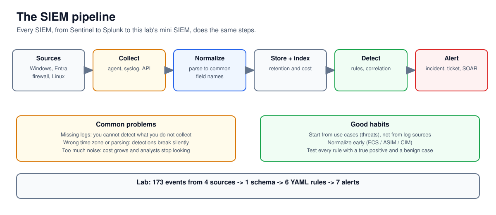

# Module 06 · SIEM, Microsoft Sentinel and Splunk

> **Weeks:** 5-10 · **Time:** ~55 hours
> **You will:** understand how a SIEM works end to end, write and test detections (Sigma-like YAML), use KQL in Microsoft Sentinel and SPL in Splunk, and translate between them.



## Learning path

| # | Lesson | Week | Certification objective |
|---|---|---|---|
| 01 | [SIEM concepts](01-siem-concepts.md) | 5 | Security+ SY0-701/801 domain 4; SC-200 (configure Sentinel) |
| 02 | [Detection engineering basics and Sigma](02-detection-engineering.md) | 6-7 | SC-200 (analytics rules); Splunk Power User topics |
| 03 | [Microsoft Sentinel and KQL](03-microsoft-sentinel.md) | 7-9 | **SC-200** (Defender XDR, Sentinel, KQL) |
| 04 | [Splunk and SPL](04-splunk.md) | 8-10 | Splunk Core Certified User / Power User (verify current names) |
| 05 | [KQL and SPL cheat sheet: 20 SOC queries](05-kql-spl-cheat-sheet.md) | 9-10 | SC-200; interviews |

Check the official pages for current exam objectives before you book anything.

## The lab: a mini SIEM in Python

Folder: [`lab/`](lab/). Offline, synthetic data only, standard library + PyYAML.

| Path | Purpose |
|---|---|
| `data/` | Four synthetic log sources: Windows security (JSON lines), Entra-style sign-ins (JSON lines), firewall (CSV), Linux auth (syslog text) |
| `make_sample_data.py` | Deterministic generator of those files (already run) |
| `minisiem.py` | Parsers, one common schema, a Sigma-like rule engine, alerts, exporters |
| `rules/*.yml` | 6 detections: brute force, password spray, impossible travel, new admin group member, encoded PowerShell, rare outbound port |
| `demo.py` | Ingest, normalize, detect, print alerts |
| `test_minisiem.py` | 46 tests: parsers, each rule with true positives and benign negatives, full pipeline, checker |
| `export_for_tools.py` | Writes `queries/events.csv` (Splunk) and `queries/events_datatable.kql` (KQL) |
| `queries/` | 12 KQL and SPL exercises, solutions, and `check_answers.py` |

```bash
python cybersecurity-track/06-siem-sentinel-splunk/lab/demo.py
python -m pytest cybersecurity-track/06-siem-sentinel-splunk
python cybersecurity-track/06-siem-sentinel-splunk/lab/queries/check_answers.py --show
```

## Key terms

| Term | Meaning |
|---|---|
| SIEM | Collects, normalizes, stores, correlates logs and raises alerts |
| Parsing / normalization | Extract fields / map to a common schema (ASIM, CIM, ECS, OCSF) |
| Correlation | Combine events (threshold, distinct count, sequence, cross-source) |
| Sigma | Vendor-neutral YAML detection rule format |
| Detection as code | Rules in git with tests, review and CI/CD |
| KQL | Kusto Query Language (Sentinel, Defender, Azure Data Explorer) |
| SPL | Search Processing Language (Splunk) |
| Analytics rule | A Sentinel detection that creates alerts and incidents |
| Playbook / automation rule | Logic App workflow / lightweight incident automation |
| UEBA / watchlist | Behavior analytics / lookup table |
| Index / sourcetype | Splunk data store / data format definition |
| BOTS | Boss of the SOC: Splunk's public blue-team datasets |
| Data model | A normalized structured view over data |

## How this connects to your job

You will spend most of your day in one of these tools. Module 05 gives the method; this module gives the tool skills. Module 07 (EDR/XDR) supplies endpoint data, and Module 10 (cloud security) supplies cloud audit logs that you will query here. The DBA background helps most with query thinking (SQL), retention and data volume.

## Mini-project (about 10 hours)

Build a **detection pack**:
1. Add 3 rules to the mini SIEM (suggestions: security log cleared 1102, new service installed 4697, successful login after many failures). For each, add data, a true-positive test, and a benign-negative test.
2. Write each rule also in Sigma (valid YAML), KQL and SPL in a `detections/` folder, with ATT&CK tags and false-positive notes.
3. Optional: convert one Sigma rule with `sigma-cli` and compare it with your hand-written query.
4. Write a one-page tuning note: which exclusion would you add for each rule, and what is the risk?

## Interview questions (module level)

<details><summary><b>Q1. Describe the SIEM data pipeline.</b></summary>
Sources produce logs, collectors (agents, syslog, API) ship them, parsing and normalization give common fields, storage and indexing keep them with a retention policy, detection rules and correlation produce alerts, and alerts become incidents or tickets with optional automation.
</details>

<details><summary><b>Q2. How do you reduce false positives?</b></summary>
Review samples, understand the cause, add scoped and reviewed exclusions, tighten thresholds or logic, add asset and user context, and re-test with true-positive cases.
</details>

<details><summary><b>Q3. What is Sigma?</b></summary>
A YAML-based open standard for describing log detections independent of any SIEM. Converters generate queries for Splunk, Sentinel, Elastic and others.
</details>

<details><summary><b>Q4. KQL vs SPL in one sentence each.</b></summary>
KQL is a typed, table-first pipeline language used by Microsoft products. SPL is Splunk's search-first pipeline language with compact commands like `stats` and `eval`.
</details>

<details><summary><b>Q5. Explain brute force vs spray detection.</b></summary>
Brute force counts failures per account and source. Spray counts distinct accounts per source in a short window.
</details>

<details><summary><b>Q6. How does Sentinel relate to Defender XDR?</b></summary>
Defender XDR provides native detection and response for Microsoft endpoints, identities, email and cloud apps. Sentinel is the SIEM/SOAR across all sources. Their incidents and portals are converging.
</details>

<details><summary><b>Q7. What is a data connector and what is a DCR?</b></summary>
A connector brings a data source into Sentinel. A data collection rule defines what the Azure Monitor Agent collects and how it is filtered or transformed.
</details>

<details><summary><b>Q8. Why test detections?</b></summary>
Untested rules may never fire, or fire constantly. Tests with true positives, benign cases and boundaries make tuning safe.
</details>

<details><summary><b>Q9. What would you check if a rule stops alerting?</b></summary>
Data volume per source, parsing and field names, time window and schedule, ingestion delay, exclusions, and rule health or errors.
</details>

<details><summary><b>Q10. How do you control SIEM cost?</b></summary>
Collect for use cases, filter at the source, use cheaper tiers or archives for low-value data, set retention per source, and review volume monthly.
</details>

## Practice on TryHackMe / HTB

- **TryHackMe:** *SOC Level 1* and *SOC Level 2* paths (SIEM and Splunk/Elastic-based rooms; search the catalog for Splunk and Microsoft Sentinel content).
- **HTB Academy:** *SOC Analyst* job-role path (CDSA prep); search the catalog for SIEM, Splunk and KQL content.
- **HTB Labs:** Sherlocks. LetsDefend content is moving into HTB (check the current catalog).
- **Splunk BOTS** datasets and the **Kusto Detective Agency** game (free).

## References

- Microsoft Learn, Microsoft Sentinel and KQL: https://learn.microsoft.com/azure/sentinel/ and https://learn.microsoft.com/kusto/query/
- SC-200 certification page: https://learn.microsoft.com/credentials/certifications/security-operations-analyst/
- Splunk Docs: https://docs.splunk.com
- SigmaHQ: https://sigmahq.io
- NIST SP 800-92, Guide to Computer Security Log Management.
- MITRE ATT&CK: https://attack.mitre.org
