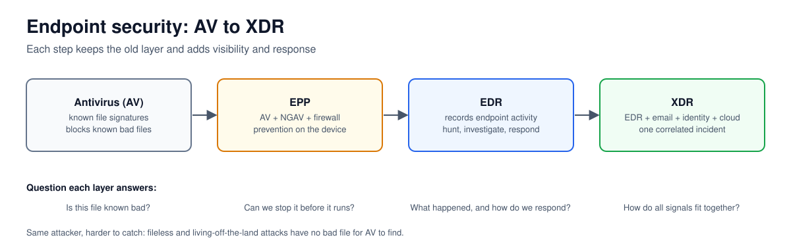

# 01. Endpoint security evolution: AV, EPP, EDR, XDR

> **Module:** 07 · EDR / XDR / MDR · **Week:** 9 · **Time:** ~3 hours
> **You will:** explain the four generations of endpoint security, say what each one can and cannot see, and choose the right one for a given attack.
> **Certification map:** Security+ SY0-701/801 domain 2 (threats, vulnerabilities, mitigations) and domain 4 (security operations); Microsoft SC-200 (Defender for Endpoint); CompTIA CySA+ (check the current exam code on the official page).

---

## 1. Why it matters in a SOC / cloud-security job

Almost every serious attack touches an **endpoint** (a laptop, server or VM). In your SOC job you will open many alerts that start with "a process on host X did Y". To read them you need to know where that data comes from.

Real situations you will meet:

- A user opens a Word file from email. Word starts PowerShell. No file on disk is "known bad", so classic antivirus stays quiet. An EDR sees the strange parent-child pair and raises an alert.
- A cloud VM in your tenant starts talking to a strange IP. The cloud firewall logs show the connection, but only the endpoint agent can tell you *which process* made it.
- A manager asks: "We have antivirus on every PC. Why do we also pay for EDR?" You must answer in two sentences.

---

## 2. Understand it



### 2.1 The four generations

| Generation | Full name | Main idea | Blind spot |
|---|---|---|---|
| **AV** | Antivirus | Compare files with a list of known bad signatures (hashes, patterns) | New or changed malware; attacks with no file (fileless) |
| **EPP** | Endpoint Protection Platform | AV plus *next-generation* prevention: machine-learning file checks, exploit blocking, host firewall, device control | It decides quickly (block or allow) and keeps little history. If it misses, you have no story to read |
| **EDR** | Endpoint Detection and Response | Continuously **records** endpoint activity, detects *behavior*, lets analysts investigate and **respond** (isolate, kill, collect) | Sees only the endpoint. A phishing email or a stolen cloud token is outside its view |
| **XDR** | Extended Detection and Response | EDR plus other sources (email, identity, cloud apps, network) with one correlated incident | Needs connectors, tuning and good data. Vendor "XDR" is often strongest on that vendor's own products |

In real products these layers are bundled. A modern endpoint agent does prevention *and* recording. Think of EPP and EDR as two **jobs**, not two separate programs.

### 2.2 Prevention vs detection

- **Prevention** blocks before harm: signatures, ML file scoring, exploit mitigation, attack surface reduction rules.
- **Detection** finds what got past prevention: behavior rules, anomaly detection, threat intelligence, hunting.
- **Response** acts: contain, remove, recover.

No prevention is perfect. A good program assumes a breach will happen and builds for **fast detection and response**. This idea is called *assume breach*.

### 2.3 Why signatures failed against many attacks

Attackers moved to **living off the land** (LOLBins): they use tools already on Windows, such as PowerShell, `certutil`, `rundll32` and `mshta`. Nothing "bad" is dropped on disk. The *behavior* is bad, not the file. EDR therefore watches **who started what, with which command line, and what it touched**.

### 2.4 Where each tool sits

| Question | AV / EPP | EDR | XDR |
|---|---|---|---|
| Was a known-bad file run? | Yes | Yes | Yes |
| Did Word start PowerShell? | No | **Yes** | Yes |
| What did the attacker do in the last 30 days? | No | **Yes** (stored telemetry) | Yes |
| Which user clicked the phishing mail? | No | Partly | **Yes** |
| Was the same user's token used from another country? | No | No | **Yes** |
| Can I isolate the host remotely? | Rarely | **Yes** | Yes |

### 2.5 Related terms you will hear

- **NGAV**: next-generation antivirus. Usually the prevention part of EPP.
- **Sensor / agent**: small program on the endpoint that collects data.
- **Telemetry**: the raw events the sensor collects (see lesson 02).
- **IOC** (indicator of compromise): a fact such as a hash or IP address that was seen in an attack. **IOA** (indicator of attack): a *behavior* pattern. EDR rules lean on IOAs.
- **Threat hunting**: a human searches telemetry for attackers that no rule caught.

---

## 3. From DBA to security

> **From DBA to security.**
> - **AV** is like a *constraint check on known-bad values*: it only rejects what it already knows.
> - **EDR telemetry** is like the **Oracle audit trail plus AWR history**: a record of who did what, kept so you can look back after an incident.
> - An **EDR agent** on the DB server is like the **Enterprise Manager agent**: it runs on the host, reports to a console and can be told to act. Tell your DBA team early: agents use CPU. Ask the security team to add *exclusions for the Oracle data and redo paths* (and test them) so scanning does not slow I/O. Exclusions are a trade-off, so they need approval and documentation.
> - **Assume breach** matches how a DBA thinks about backups: you do not assume the disk will never fail.

---

## 4. Hands-on

### 4.1 Repo lab (offline)

The lab for this module reads Sysmon-like events and detects behavior that AV would miss. Run the tests first to check your setup:

```bash
.venv/Scripts/python -m pytest cybersecurity-track/07-edr-xdr-mdr
```

Real output from the full module (24 tests):

```text
........................                                                 [100%]
24 passed in 0.06s
```

Then read `lab/sample_events.py`. Notice that **no file is "malicious"**: every event is a normal Windows program doing a strange thing. That is the point of this lesson.

### 4.2 Free tools to try (optional)

- **Microsoft Defender Antivirus** is already on your Windows 11 laptop. Open *Windows Security → Virus & threat protection*. This is EPP-style prevention.
- **Sysmon** (Sysinternals) turns a Windows machine into an EDR-like telemetry source. See lesson 02.
- **Microsoft Defender XDR / Sentinel trial**: only in a trial tenant. Never connect your employer's tenant without permission.

---

## 5. Practice platforms

- TryHackMe: **Cyber Security 101** and **SOC Level 1** paths include endpoint security and Sysmon content. Search the catalog for "Endpoint Security Monitoring" and "Sysmon".
- HTB Academy: **SOC Analyst** job-role path (leads to the HTB CDSA certification).
- HTB Labs **Sherlocks**: defensive investigations with endpoint artifacts.

---

## 6. Three realistic scenarios

**Scenario 1: "We have AV, so why did we get ransomware?"**
*What happened:* a user ran a signed, legitimate admin tool that the attacker had used to disable the AV service. *Investigate:* look for process creation of service-control commands, security tool tampering events, and who ran them. *Do:* isolate the host, restore from backup, and add tamper protection and an alert on "security service stopped".

**Scenario 2: Fileless attack.**
*What happened:* PowerShell ran a command from memory. No file was written. *Investigate:* read the parent process, the command line (decode it if it is base64) and network connections by that process. *Do:* kill the process tree, block the destination, search other hosts for the same command line.

**Scenario 3: A manager wants to remove EDR to "save cost".**
*Do:* show the table in section 2.4. AV answers "is this file bad?". Only EDR answers "what did the attacker do after they got in?". Offer facts: dwell time (how long attackers stay unseen) shrinks with good detection.

---

## 7. Common mistakes

1. Treating "AV installed" as "we are protected".
2. Running EDR in *audit/passive* mode forever and never turning on blocking.
3. Adding broad exclusions (whole folders, whole processes) to stop alerts. Attackers love exclusions.
4. Forgetting servers, cloud VMs and Linux hosts. Cover them too.
5. Assuming XDR works out of the box. Without email and identity connected, it is just EDR.
6. Not testing the agent health: many hosts have a sensor that is installed but not reporting.

---

## 8. Interview questions

<details><summary><b>Q1. What is the difference between AV and EDR?</b></summary>AV mostly blocks known bad files by signature. EDR records endpoint activity, detects bad behavior, and lets analysts investigate and respond (isolate, kill, collect). AV answers "is this file bad"; EDR answers "what happened".</details>

<details><summary><b>Q2. What is EPP?</b></summary>Endpoint Protection Platform. A prevention-focused product: AV, machine-learning file scanning, exploit protection, firewall and device control, managed from one console.</details>

<details><summary><b>Q3. What does XDR add to EDR?</b></summary>Other data sources (email, identity, cloud, network) and correlation, so many alerts become one incident about one user or device.</details>

<details><summary><b>Q4. What is a LOLBin? Give three examples.</b></summary>A Living Off the Land Binary: a legitimate OS program that attackers abuse. Examples: PowerShell, certutil, rundll32, mshta, bitsadmin, regsvr32.</details>

<details><summary><b>Q5. What is "assume breach"?</b></summary>A design attitude: expect that an attacker will get in, so invest in detection, containment and recovery, not only in prevention.</details>

<details><summary><b>Q6. IOC vs IOA?</b></summary>An IOC is a static clue (hash, IP, domain). An IOA is a behavior pattern (Office starts PowerShell). IOAs survive small changes by the attacker; IOCs expire fast.</details>

<details><summary><b>Q7. Why can fileless malware bypass classic AV?</b></summary>There is no malicious file to scan. The attack runs in memory using trusted programs, so only behavior-based detection can see it.</details>

<details><summary><b>Q8. A server has an EDR agent but the team says it slows the database. What do you do?</b></summary>Measure first (CPU and I/O before and after). Work with the security team on narrow, documented, approved exclusions for data and redo paths, test them, and keep behavior monitoring on. Do not disable the agent.</details>

<details><summary><b>Q9. What is telemetry?</b></summary>The raw events an agent collects: process starts, file changes, registry changes, network connections, module loads, and so on.</details>

<details><summary><b>Q10. Your boss asks "do we still need antivirus if we buy EDR?" What do you say?</b></summary>Most modern EDR platforms include the prevention engine, so you do not run both from different vendors. You still need prevention; you add visibility and response on top.</details>

<details><summary><b>Q11. Scenario: an alert says "Excel started cmd.exe". What is your first thought?</b></summary>This parent-child pair is unusual. Check the document name, the command line, the user, and any network connection. It could be a malicious macro. Check the timing against email delivery.</details>

---

## 9. Checklist

- [ ] I can draw the AV → EPP → EDR → XDR picture from memory.
- [ ] I can explain why LOLBins defeat signature-only tools.
- [ ] I ran the module tests and read `sample_events.py`.
- [ ] I can answer "why do we need EDR if we have AV?" in two sentences.

## 10. References

- MITRE ATT&CK, "Living off the Land" techniques (T1218 System Binary Proxy Execution): https://attack.mitre.org/techniques/T1218/
- Microsoft Learn: Microsoft Defender for Endpoint overview: https://learn.microsoft.com/microsoft-365/security/defender-endpoint/
- NIST SP 800-61 Rev. 3 (incident response): https://csrc.nist.gov/pubs/sp/800/61/r3/final
- Library: "MITRE ATT&CK in Action: 50 SOC playbooks" (the idea of IOAs and "legitimate explanations to verify" is paraphrased here).

Next: [02. What EDR collects and Sysmon](02-edr-telemetry-and-sysmon.md)
