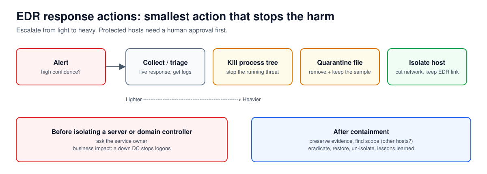

# 03. EDR response actions and product concepts

> **Module:** 07 · EDR / XDR / MDR · **Week:** 10 · **Time:** ~4 hours
> **You will:** choose the right response action for an alert, explain the risks of each one, and compare Microsoft Defender for Endpoint, CrowdStrike Falcon and SentinelOne by *concepts*, not by marketing.
> **Certification map:** SC-200 (investigate and respond with Defender for Endpoint); Security+ domain 4 (incident response); NIST SP 800-61 (containment, eradication, recovery).

---

## 1. Why it matters in a SOC / cloud-security job

Finding the attacker is half the job. The other half is **stopping them without breaking the business**.

- A wrong "isolate" on a domain controller can stop logons for the whole company.
- A slow response lets ransomware spread to file servers.
- Many SOCs write a **playbook** (a step list) that says which action may be taken automatically and which needs an approval.

Your employer will use one of these products. Interviewers ask about all three, so learn the shared ideas.

---

## 2. Understand it



### 2.1 The main response actions

| Action | What it does | Use when | Risk |
|---|---|---|---|
| **Isolate host** (network containment) | Cuts the host from the network. The agent keeps a channel to the EDR cloud so you can still manage it | Confirmed or very likely compromise; spreading threat | User and service downtime. A server may stop serving customers |
| **Kill process / process tree** | Stops the running malicious process and its children | A live threat on a host | The attacker may have persistence and restart it. A wrong kill can crash a legitimate app |
| **Quarantine file** | Moves a file to a safe place, removes execute rights, keeps a copy for analysis | A known bad file on disk | False positive blocks a legitimate file. Keep the original for the case |
| **Live response** | Opens a remote shell-like session to run commands, collect files, list processes | Deep investigation, collect evidence | Powerful: only trained staff, logged, approved |
| **Collect investigation package** | Gathers logs, autoruns, network info into an archive | Evidence for the case | Time; large files |
| **Block indicator** | Blocks a hash, IP, URL or certificate across all hosts | Known bad item | Over-blocking if the indicator is wrong |
| **Disable user / revoke sessions** | Done in identity tools (XDR can trigger it) | Stolen credentials | User disruption |
| **Remediate / roll back** | Some products can undo changes (for example restore files after ransomware). Rules differ by product | Ransomware | Not guaranteed. Backups are still the real plan |

### 2.2 Choosing the action: three questions

1. **How sure am I?** (confidence: low, medium, high)
2. **How bad if I am right?** (blast radius: one laptop, a server, a domain controller)
3. **How bad if I act and am wrong?** (business impact of the action)

A simple rule many teams use:

| Confidence | Asset | Action |
|---|---|---|
| High | Workstation | Isolate now, then investigate |
| High | Server / DC | Call the owner, get approval, then isolate (or contain a narrower way) |
| Medium | Any | Collect evidence first, watch, escalate |
| Low | Any | Monitor, tune the rule |

The lab encodes the same idea: a **score** per host. At 80 or more, it recommends *isolate*; from 40 to 79 it recommends *investigate*. A protected host (such as a domain controller) **needs human approval**.

### 2.3 After the action

Containment is not the end. Follow the incident-response phases (NIST SP 800-61 Rev. 3 aligns them with CSF 2.0 functions): **detect and analyze, contain, eradicate, recover, lessons learned**.

- **Scope:** search other hosts for the same hash, command line, domain or service name.
- **Eradicate:** remove persistence (services, tasks, Run keys), reset credentials that were exposed.
- **Recover:** restore, un-isolate, monitor closely.
- **Document:** timeline, actions, who approved. Auditors and insurers will ask.

### 2.4 Product concepts (neutral)

All three are cloud-managed EDR platforms with a sensor on each endpoint. Features and names change often. Always check the vendor's current documentation.

| Idea | Microsoft Defender for Endpoint | CrowdStrike Falcon | SentinelOne |
|---|---|---|---|
| **Delivery** | Built into Windows; onboard via Intune, Group Policy or a script. Part of the Microsoft Defender XDR portal | One lightweight sensor, cloud console | One agent, cloud console |
| **Data you query** | Advanced hunting (KQL tables such as `DeviceProcessEvents`) | Event search in the console and its query language | Deep visibility style queries |
| **Isolation** | "Isolate device" (full or selective) | "Network containment" | "Network quarantine" |
| **Remote investigation** | Live response session | Real Time Response | Remote shell |
| **Automation** | Automated investigation and remediation (AIR) | Policies and workflows | Policies and automatic remediation |
| **Managed service** | Microsoft Defender Experts (add-on) | Vendor MDR and managed hunting offerings | Vendor MDR offerings |

How to think about them:

- **Same job, different workflow.** If you know one console, you can learn another in days.
- **Ecosystem fit** matters. A Microsoft shop gets deep links to Entra ID, Intune, Office 365 and Sentinel. A mixed shop may value a vendor-neutral sensor.
- **Test, do not trust.** Run a proof of concept with your own attack simulations (see "Atomic Red Team" for safe tests), not only the vendor's demo.

### 2.5 Tamper protection and health

An attacker with admin rights will try to **disable the agent**. Turn on tamper protection, alert on "sensor stopped" or "host silent", and report agent coverage as a metric.

---

## 3. From DBA to security

> **From DBA to security.**
> - **Isolate host** is like **taking a RAC node out of the cluster** or putting a database in `RESTRICTED SESSION`: users are cut, but you (the DBA) can still get in to fix it.
> - **Approval before isolating a domain controller** is like **change control before bouncing production**. You do not stop a core system on a hunch.
> - **Live response** is like **SYSDBA access**: powerful, so it must be logged and limited to a few trained people.
> - **Rollback** is *not* a backup: you still need tested restore, as with RMAN.

---

## 4. Hands-on

### 4.1 Repo lab: simulated response

The lab class `SimulatedEDR` changes only an in-memory object. Real output from a run:

```text
REFUSED isolate SRV-DC01: protected host needs human approval
ISOLATED SRV-DC01 (simulated: only the EDR channel stays open)
ISOLATED WS-ACCT-07 (simulated: only the EDR channel stays open)
KILLED process G-102 on WS-ACCT-07 (simulated)
```

Lines 1 and 2 are the same request: first without approval (refused), then with approval (done). Open `lab/edr_analyzer.py` and find `isolate_host`. Questions to answer:

1. Why does it keep an `audit` list?
2. What happens if you isolate an already isolated host? (It returns `NOOP`. Safe to repeat.)

And the score ladder, also from the lab:

```text
lsass only -> 60 investigate
office+lolbins -> 100 isolate_host
all -> 100 isolate_host
```

One credential-dump alert alone gives 60 (investigate). Add the Office and LOLBin alerts and the host crosses the isolate line.

### 4.2 Free options to try (optional)

- If your employer already uses one of the three products, ask for a **read-only** analyst role. Look at the device page and the incident graph.
- Microsoft offers trial tenants for Defender; use only a trial tenant and a test VM.
- Atomic Red Team (open source, Red Canary) has small, documented tests mapped to ATT&CK. Run them only on your own VM.

---

## 5. Practice platforms

- TryHackMe: **SOC Level 1** and **SOC Level 2** paths. Search for rooms about incident response and endpoint investigation.
- HTB Academy: **SOC Analyst** job-role path; HTB Labs **Sherlocks** let you practice finding what happened on an endpoint.
- Library: "MITRE ATT&CK in Action" playbooks assign a **response owner** and an **approval level** to each response. Notice the same idea of approval tiers.

---

## 6. Three realistic scenarios

**Scenario 1: Ransomware starts on a laptop.**
*What happened:* many files are renamed in minutes; the EDR alerts "mass file modification". *Do:* isolate **immediately** (workstation, high confidence). Then check file shares the user could reach, disable the account sessions, and collect evidence.

**Scenario 2: Credential dumping on a file server.**
*What happened:* a tool read LSASS memory on a production file server. *Do:* call the server owner and the incident manager. Get approval, then isolate or restrict (block outbound except the EDR). Reset exposed credentials, including service accounts. Check for lateral movement from this server.

**Scenario 3: False positive on a backup agent.**
*What happened:* quarantining a backup agent file made backups fail. *Do:* restore the file, add a narrow, documented exception (full path and signer, not a whole folder), and note it in the tuning log. Lesson: test response actions on critical software in advance.

---

## 7. Common mistakes

1. Isolating a server without telling its owner.
2. Killing the child process but leaving the persistence (service, task, Run key).
3. Quarantining without keeping a copy for analysis.
4. Broad exclusions to silence a false positive.
5. Resetting only one password when the attacker reached many.
6. Letting live response sessions go unlogged.
7. Not telling the user: a user whose laptop "died" will often make a call that helps you; tell them what to do (and not to reboot).

---

## 8. Interview questions

<details><summary><b>Q1. What does "isolate host" do, and why can you still manage it?</b></summary>It blocks the host's normal network traffic. The agent keeps one allowed channel to the EDR cloud, so analysts can still run commands and collect evidence.</details>

<details><summary><b>Q2. When would you not isolate immediately?</b></summary>On a critical server or domain controller where downtime is costly. First involve the owner and get approval, or use a narrower control (block specific connections, disable the account).</details>

<details><summary><b>Q3. Killing a process is not enough. Why?</b></summary>The attacker may have persistence (service, scheduled task, Run key, WMI) that restarts it. You must find and remove all persistence and the root cause.</details>

<details><summary><b>Q4. What is live response?</b></summary>A remote investigation session on the endpoint (commands, file collection, process list) through the EDR console. It must be logged and limited to trained staff.</details>

<details><summary><b>Q5. Difference between quarantine and delete?</b></summary>Quarantine moves and neutralizes the file but keeps it recoverable and available for analysis; delete destroys it. Evidence handling usually prefers quarantine.</details>

<details><summary><b>Q6. What is tamper protection?</b></summary>A setting that prevents local users and malware from stopping, uninstalling or reconfiguring the agent.</details>

<details><summary><b>Q7. Compare MDE, CrowdStrike and SentinelOne in one answer.</b></summary>All are cloud-managed EDR with a sensor, detection, isolation, remote investigation and automation. Differences are mostly ecosystem fit, query language, console workflow and managed-service options. Choose by a proof of concept on your environment.</details>

<details><summary><b>Q8. What is a "blast radius"?</b></summary>How much damage a problem (or a wrong action) can cause. Weigh the blast radius of the attack against the blast radius of your response.</details>

<details><summary><b>Q9. After isolating a host, what are your next three steps?</b></summary>Scope (hunt for the same indicators elsewhere), eradicate (remove persistence, reset credentials), and preserve evidence and document the timeline.</details>

<details><summary><b>Q10. Scenario: the EDR auto-quarantined a file used by payroll software at month end. What do you do?</b></summary>Restore the file from quarantine after checking its hash and signer, tell the payroll owner, add a narrow exception, and record the change. Review whether auto-remediation should have approval for this asset group.</details>

<details><summary><b>Q11. Why log every response action?</b></summary>For audit, learning, and to prove who approved what. Also to avoid two analysts working against each other.</details>

---

## 9. Checklist

- [ ] I can list five response actions and a risk for each.
- [ ] I can say when approval is needed before isolation.
- [ ] I ran the lab snippet and saw REFUSED vs ISOLATED.
- [ ] I can compare the three products by concept.

## 10. References

- NIST SP 800-61 Rev. 3: https://csrc.nist.gov/pubs/sp/800/61/r3/final
- Microsoft Learn, respond to threats with Defender for Endpoint (isolate device, live response): https://learn.microsoft.com/defender-endpoint/
- CrowdStrike and SentinelOne official documentation (check the vendor portals; access depends on your licence).
- Atomic Red Team project: https://github.com/redcanaryco/atomic-red-team
- MITRE ATT&CK Mitigations: https://attack.mitre.org/mitigations/enterprise/

Previous: [02](02-edr-telemetry-and-sysmon.md) · Next: [04. Investigating an EDR alert](04-investigating-an-edr-alert.md)
