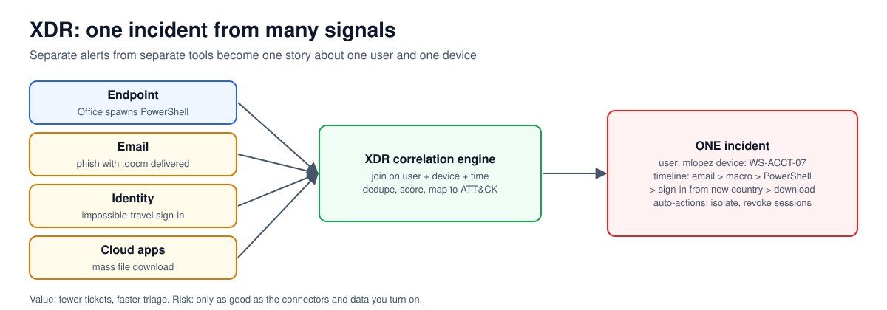

# 05. XDR: cross-domain correlation

> **Module:** 07 · EDR / XDR / MDR · **Week:** 11 · **Time:** ~3 hours
> **You will:** explain what XDR correlates and why, compare XDR with SIEM and SOAR, and list what must be true before XDR gives value.
> **Certification map:** SC-200 (Microsoft Defender XDR: incidents, email, identity and cloud apps); Security+ domain 4; CySA+ (correlation).

---

## 1. Why it matters in a SOC / cloud-security job

Attackers do not stay in one place. A single attack can touch an **email**, an **identity**, an **endpoint** and a **cloud app** within one hour. Four tools, four alerts, four tickets. Without correlation an analyst sees four small things, or worse, closes each one as "low".

- Your cloud-security role means identity and cloud-app signals matter as much as endpoint ones.
- Many companies you will interview with (or work for) use a vendor XDR portal as the main analyst screen.
- SC-200 is built around this idea: Defender XDR, Sentinel and KQL.

---

## 2. Understand it



### 2.1 What "cross-domain" means

A *domain* is a type of security data. Typical XDR domains:

| Domain | Example signal |
|---|---|
| **Endpoint** | Office spawns PowerShell (EDR) |
| **Email / collaboration** | A phishing mail with a macro file was delivered; a user clicked a link |
| **Identity** | Sign-in from a new country; risky sign-in; a new MFA method added |
| **Cloud apps** | Mass download from file storage; new inbox forwarding rule |
| **Network / cloud workload** | Connection to a known C2 address; unusual container behavior |

XDR **joins** these on shared keys: **user, device, IP, file hash, URL, message ID, time**. The result is one **incident** with a timeline and an attack story.

Real output from a tiny join we ran on the lab's data plus two synthetic non-endpoint signals (email and identity). This is a toy, not the lab's code, but it shows the idea of joining by host:

```text
INCIDENT for WS-ACCT-07: 8 signals from 3 sources
   endpoint  EDR-001 Office app spawned PowerShell with an encoded command
   endpoint  EDR-002 LOLBin abuse: certutil downloads a file from a URL
   endpoint  EDR-002 LOLBin abuse: rundll32 loads code from a user-writable path or script
   endpoint  EDR-002 LOLBin abuse: mshta runs remote or script content
   endpoint  EDR-003 Service installed from a suspicious location
   endpoint  EDR-004 Non-system process read LSASS memory
   email     09:01 mail with invoice_Nov.docm delivered
   identity  09:20 sign-in from a new country
```

The email at 09:01 explains how the attack started. The new-country sign-in at 09:20 shows the stolen credentials *already being used*. Neither is visible in the EDR alone.

### 2.2 XDR vs SIEM vs SOAR

| | XDR | SIEM | SOAR |
|---|---|---|---|
| **Main job** | Detect and respond across the vendor's security products | Collect **any** log, search, report, meet compliance | Run automated playbooks |
| **Data** | Rich, structured, usually from the vendor's own sensors | Broad: firewalls, servers, apps, cloud, custom | Uses alerts from others |
| **Response** | Built-in (isolate, disable user, purge email) | Needs integration or SOAR | Its main job |
| **Strength** | Quick to value, deep detail, low noise | Flexibility and retention | Speed and consistency |
| **Weakness** | Weaker for third-party or custom data | Heavy tuning; analysts build correlation | Only as good as the playbooks |

In practice they **work together**. A common design is Defender XDR sending incidents to Microsoft Sentinel (a cloud SIEM/SOAR). Module 06 covers the SIEM side.

### 2.3 Native vs open XDR

- **Native XDR:** one vendor, its own sensors for endpoint, email, identity and cloud. Tight integration; deep data; lock-in.
- **Open (hybrid) XDR:** a platform that ingests *other vendors'* tools. More flexible; more integration work; data may be shallower.

Neither is "better". Choose by the tools you already own.

### 2.4 What makes XDR work (checklist)

1. **Sensors everywhere:** endpoint agent coverage on servers and laptops, not only some.
2. **Connectors on:** email, identity provider, cloud apps. Many are off by default or need licenses.
3. **Good identity data:** one user may have three names (UPN, SAM name, email). Entity matching needs clean identity.
4. **Time sync (NTP):** correlation by time breaks if clocks are wrong.
5. **Tuning and exclusions** reviewed regularly.
6. **Response permissions** agreed: what can run automatically?
7. **Retention** long enough for investigation (30 days is often too short for slow attacks).

### 2.5 Automated response in XDR

Typical automatic actions: isolate device, disable user, revoke sessions, soft-delete (purge) email from all mailboxes, block a file hash everywhere. Two cautions:

- Automation can break the business (disabling a CEO or a service account by mistake). Use *approval levels* and exclude critical accounts.
- Automated actions need **audit logs** and a human review of the first weeks.

---

## 3. From DBA to security

> **From DBA to security.**
> - **XDR correlation** = **joining tables on a key**. Endpoint, identity and email are separate tables; `user` and `device` are the join keys. If keys are dirty (three spellings of the same user), the join fails. Data quality matters here exactly as in a warehouse.
> - **SIEM** is the **data warehouse** (everything, long retention). **XDR** is a **purpose-built data mart** with ready-made queries.
> - **Time sync** matters like **SCN/timestamp ordering** in recovery: wrong ordering gives a wrong story.
> - **Automated response** = a **scheduler job with DML**: powerful, so test it, limit its grants and log what it does.

---

## 4. Hands-on

### 4.1 Repo lab

The lab joins events by **host** and scores per host. Try to extend it: in a scratch file, add one more "signal" dictionary with `host` set to `WS-IT-02` and a source of `email`. Does `recommend()` change? (No: `recommend()` only uses endpoint alerts. Think about how you would weight non-endpoint signals.)

```bash
.venv/Scripts/python -m pytest cybersecurity-track/07-edr-xdr-mdr
```

```text
........................                                                 [100%]
24 passed in 0.06s
```

### 4.2 Optional

- In a **trial tenant**, open the Microsoft Defender portal and read an incident's **Attack story** and **Alerts** tabs. Notice how alerts from different products are grouped.
- If you have access to Sentinel, find the incident from Defender XDR there and compare the entities.
- In KQL (Defender advanced hunting) a typical join is `DeviceProcessEvents | join kind=inner (EmailEvents ...) on ...`. Practice with the public demo data if your tenant has it.

---

## 5. Practice platforms

- TryHackMe: SOC Level 1 and 2 paths include multi-source investigation rooms; search for "Microsoft Defender" and "Sentinel" content.
- HTB Academy: **SOC Analyst** path; **Sherlocks** often need you to combine endpoint, email and identity evidence.
- Microsoft Learn: free SC-200 learning path (Defender XDR modules).

---

## 6. Three realistic scenarios

**Scenario 1: Four alerts, one story.**
*What happened:* phishing mail (email alert), macro runs (endpoint alert), new sign-in from abroad (identity alert), mass file download (cloud app alert). *Investigate:* one XDR incident; read the attack story from first to last. *Do:* isolate the device, revoke sessions, reset password and MFA, purge the mail, restrict the cloud app, tell the user.

**Scenario 2: XDR is quiet but the SOC is blind.**
*What happened:* an attack on a Linux server and a third-party firewall. XDR shows nothing. *Investigate:* check whether those sources are connected. *Do:* send those logs to the SIEM and write detections there. XDR is not a replacement for a SIEM.

**Scenario 3: Auto-disable hits a service account.**
*What happened:* automated response disabled an account used by a batch job; payments failed. *Do:* restore, exclude service accounts from auto-disable, route them to *approval required*, and use managed identities where possible.

---

## 7. Common mistakes

1. Buying XDR and leaving email and identity connectors off.
2. Treating XDR as a SIEM replacement.
3. Ignoring entity quality (duplicate users and devices).
4. Turning on every automation at once without a pilot.
5. No ownership: who closes incidents, who tunes, who approves?
6. Closing an alert as "low" without checking if it is part of an incident.
7. Assuming the vendor's severity equals your business risk.

---

## 8. Interview questions

<details><summary><b>Q1. What is XDR?</b></summary>Extended Detection and Response: it collects and correlates signals from several domains (endpoint, email, identity, cloud, network) into incidents and offers response across them.</details>

<details><summary><b>Q2. XDR vs SIEM?</b></summary>XDR is vendor-focused, rich and quick to value, with built-in response. SIEM is open, collects any log, supports compliance and custom correlation, but needs more tuning. Most mature SOCs use both.</details>

<details><summary><b>Q3. XDR vs SOAR?</b></summary>SOAR automates playbooks across tools. XDR detects and correlates; its automation is mostly inside its own products.</details>

<details><summary><b>Q4. What keys does XDR use to correlate?</b></summary>User, device, IP address, file hash, URL, message ID, process GUID and time.</details>

<details><summary><b>Q5. Native vs open XDR?</b></summary>Native: one vendor's integrated products; deep but locked in. Open: ingests other vendors' products; flexible but needs more integration work.</details>

<details><summary><b>Q6. Why can bad time sync break an investigation?</b></summary>Correlation and timelines rely on timestamps. If hosts disagree by minutes, events appear out of order and joins fail.</details>

<details><summary><b>Q7. Give an example of an attack that only XDR can see fully.</b></summary>Phishing email → macro → token theft → sign-in from a new country → mass cloud file download. Each part is in a different product.</details>

<details><summary><b>Q8. What risks come with automated response?</b></summary>Wrong actions on critical accounts or servers, outages, and no audit. Use approvals, exclusions for critical assets, and review logs.</details>

<details><summary><b>Q9. What do you check if XDR shows few alerts?</b></summary>Sensor coverage, connector status, licensing, ingestion health, and whether the right data sources are in scope.</details>

<details><summary><b>Q10. How would you measure XDR value?</b></summary>Mean time to detect and respond, number of tickets per incident (fewer is better), false positive rate, coverage %, and analyst hours saved.</details>

<details><summary><b>Q11. Scenario: your CISO asks "XDR or SIEM?". What do you say?</b></summary>Ask what we need to cover. XDR for fast detection and response on our main stack, SIEM for broad logs, retention and compliance. Plan to use both and send XDR incidents to the SIEM.</details>

---

## 9. Checklist

- [ ] I can name five XDR domains and a signal for each.
- [ ] I can compare XDR, SIEM and SOAR in a table from memory.
- [ ] I know the seven "make XDR work" conditions.
- [ ] I ran the lab tests.

## 10. References

- Microsoft Learn: Microsoft Defender XDR overview: https://learn.microsoft.com/defender-xdr/microsoft-365-defender
- Microsoft Learn: SC-200 study guide (check the official page for the current skills outline): https://learn.microsoft.com/credentials/certifications/security-operations-analyst/
- NIST SP 800-61 Rev. 3 (detection and analysis).
- MITRE ATT&CK: https://attack.mitre.org/

Previous: [04](04-investigating-an-edr-alert.md) · Next: [06. MDR](06-mdr-managed-detection-and-response.md)
