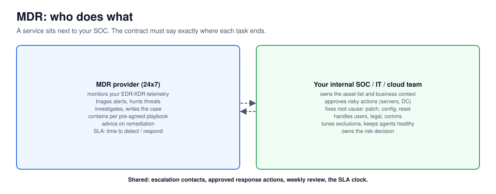

# 06. MDR: managed detection and response

> **Module:** 07 · EDR / XDR / MDR · **Week:** 11 · **Time:** ~3 hours
> **You will:** explain what an MDR service does, split the work between the provider and your internal SOC, read an SLA, evaluate a provider, and work with one every day.
> **Certification map:** Security+ domain 5 (security program management: third-party risk, SLAs); SC-200 and CySA+ (operations); ISO/IEC 27001:2022 supplier relationships (Annex A).

---

## 1. Why it matters in a SOC / cloud-security job

Many companies cannot run a 24x7 SOC alone. It needs at least 8 to 12 trained people for round-the-clock cover. So they buy **MDR**: a service where an outside team watches their EDR/XDR data and responds.

You may sit on **either side**:

- As an **internal SOC analyst** you will receive MDR escalations at 3 a.m. and must act or approve fast.
- As a **security engineer** you may help choose the provider and check that the service delivers.

Typical problems: "The MDR emailed us about a server and nobody replied for six hours", or "The MDR isolated the wrong host".

---

## 2. Understand it



### 2.1 What MDR is (and is not)

**MDR** = Managed Detection and Response. A provider uses technology (often your EDR, or its own) plus human analysts to **monitor, triage, hunt, investigate and respond**, 24x7.

| | MSSP (older model) | MDR |
|---|---|---|
| Main output | Alerts forwarded to you | **Investigated incidents** with a recommended or taken action |
| Typical focus | Log collection, device management | Threat detection and response |
| Response | Usually "notify the customer" | Can contain (isolate) under agreed rules |
| Threat hunting | Rare | Often included |

MDR is **not** a replacement for your own security work. It does not patch your servers or fix your design.

### 2.2 What the service usually does

1. **24x7 monitoring** of EDR/XDR telemetry (sometimes also identity, email, cloud and network).
2. **Triage:** reject false positives, so you only get real cases.
3. **Investigation:** build the timeline and scope.
4. **Containment** within agreed limits (isolate a host, disable an account, block an indicator).
5. **Threat hunting:** proactive searches for hidden attackers.
6. **Guidance and reporting:** advice for remediation, weekly or monthly reports, incident reports.
7. **Detection tuning:** improving rules for your environment.

### 2.3 Shared responsibility

| Task | MDR provider | Your internal team |
|---|---|---|
| Watch telemetry 24x7 | Yes | Backup / escalation |
| Keep agents installed and healthy | Advises | **Yes** (usually yours) |
| Know which assets are critical | Needs your list | **Yes** |
| Triage and investigate alerts | Yes | Review summaries |
| Contain per playbook | Yes (if authorized) | Approves high-risk actions |
| Isolate a **domain controller** | Asks first | **Approves** |
| Fix root cause (patch, reconfigure) | Advises | **Yes** |
| Reset passwords, talk to users | Advises | **Yes** |
| Legal, communications, regulators | No | **Yes** |
| Risk decisions | No | **Yes** |

Write this table into the contract as a **RACI** (Responsible, Accountable, Consulted, Informed). Vague roles cause missed incidents.

### 2.4 SLAs: the numbers that matter

An **SLA** (service level agreement) is a written promise with measurable targets. Read these carefully.

| Metric | Meaning | Check |
|---|---|---|
| **MTTA** (time to acknowledge) | Alert raised → analyst starts | By severity: critical in minutes |
| **MTTI** (time to investigate) | Start → verdict | When does the clock *start*? |
| **MTTR** (time to respond/contain) | Alert → containment | Does it include waiting for your approval? |
| **Escalation time** | How long to reach you | Which channel (phone, ticket)? |
| **Reporting** | Weekly / monthly / incident | Content and format |
| **Availability** | Console/portal uptime | Credits if missed |

A tiny example, with real output from a script on three synthetic tickets, SLA: acknowledge within 15 minutes, respond within 120 minutes:

```text
INC-1 ack 12 min OK | respond 65 min OK
INC-2 ack 28 min MISSED | respond 190 min MISSED
INC-3 ack 9 min OK | respond 50 min OK
```

INC-2 happened at night. Ask: is the SLA the same at night? Who was on call on your side? Did the provider wait for your approval (and does the SLA clock stop while they wait)? **Always read where the clock starts and stops.**

### 2.5 How to evaluate an MDR provider

Use a scorecard. Ask for evidence, not slogans.

| Area | Questions |
|---|---|
| **Coverage** | Which tools do they support (your EDR or theirs)? Identity, email, cloud, network? Linux, macOS, cloud workloads? |
| **People** | Are analysts in-house or outsourced? Experience, shifts, language, time zones? Who will you talk to? |
| **Detection quality** | How do they write and test detections? ATT&CK coverage map? Do they hunt? Do they share detections? |
| **Response authority** | What can they do without asking? Can you set allow and deny lists? Can they act on servers? |
| **Transparency** | Can you see the console, the raw data, and their investigation notes? Or only a PDF? |
| **SLAs** | MTTA / MTTR by severity; when the clock starts; penalties and credits |
| **Integration** | Ticketing, SIEM, chat, phone; API access |
| **Data** | Where is data stored (region)? Retention? Encryption? Who can access it? Return and delete on exit? |
| **Reporting** | Metrics and trends; incident reports usable for auditors and insurers |
| **Testing** | Will they allow a purple-team or red-team test to prove detection? |
| **References** | Customers of similar size and industry |
| **Commercials** | Pricing model (per endpoint, per user, per data volume), what is extra (incident response hours), exit terms |
| **Security of the provider** | Their own certifications (for example ISO/IEC 27001 and an independent SOC 2 report), insurance |

Red flags: no access to raw data; "AI-only triage" with no named humans; response limited to "we will email you"; no right to test; unclear pricing for incidents.

**Proof of concept:** run a short trial where you inject known safe test behaviors (for example Atomic Red Team tests, agreed in advance with your own IT team) and measure what is detected, how fast, and how well it is explained.

### 2.6 Working with an MDR day to day

1. **Onboarding:** deliver an up-to-date asset list with criticality, owners, and a contact list with phone numbers.
2. **Define response levels** per asset group, for example:
   - *Workstations:* provider may isolate on high confidence.
   - *Servers:* provider calls the owner first.
   - *Domain controllers and production databases:* approval from named people only.
3. **Escalation runbook:** who answers 24x7? Primary, backup, manager. Test it with a drill.
4. **Respond to every escalation** and give feedback: "true positive", "benign", "needs tuning". Feedback trains the service.
5. **Weekly review:** open cases, false positive trends, new hunting findings, coverage gaps.
6. **Monthly service review:** SLA numbers, trends, top assets, improvement plan.
7. **Own the fixes:** an MDR report says "patch this". Track it as a ticket (module 08).
8. **Keep agents healthy:** silent hosts are blind spots. Report coverage weekly.
9. **Change management:** tell the provider about planned work (big patches, migrations, pen tests) so they do not treat it as an attack, and so they know when to expect noise.
10. **Exit plan:** know how you would take the data and move to another provider.

---

## 3. From DBA to security

> **From DBA to security.**
> - **MDR** is like **managed database services** or **remote DBA support**. The provider watches 24x7, but *you* still own the data, the schema design and the business decisions.
> - **SLA clock rules** = **support contract severity levels** (Sev1 response in 30 minutes). Read when the clock starts and stops, as you did with Oracle support.
> - **Escalation runbook** = **on-call rota** with a phone tree. You have done this.
> - **Response levels per asset** = **change windows and approval rules** for production vs test.
> - **Exit plan** = **migration/export plan** to leave a vendor without losing your data.

---

## 4. Hands-on

No code lab for this lesson; the exercise is on paper (about 1 hour). The lab for the module is in lesson 04.

1. **Build a scorecard.** Copy the table in 2.5 into a spreadsheet. Add columns: weight (1-5), provider A score, provider B score, evidence. Invent two providers and score them from a "marketing sheet" you write.
2. **Write response levels** for a fictional company with: 400 laptops, 30 servers, 2 domain controllers, 1 production Oracle database. Decide, per group, what the MDR may do alone.
3. **Compute SLA results.** Use the snippet in 2.4 with your own timestamps. Add a rule that the clock stops while "waiting for customer".
4. **Run a tabletop** (talk-through drill): "The MDR calls at 02:00: LSASS dumping on the file server." Who answers? Who approves isolation? What do you tell the business?

Optional: read the public service descriptions of two MDR vendors and compare what each promises on response authority. Take notes; do not copy.

---

## 5. Practice platforms

- TryHackMe: SOC Level 1 and 2 paths cover escalation and incident reports.
- HTB Academy: SOC Analyst path includes incident handling. HTB Labs Sherlocks help you write investigation notes of the type an MDR would send.
- For soft skills: module 12 of this track (handoffs, escalation emails, shift reports).

---

## 6. Three realistic scenarios

**Scenario 1: The 3 a.m. call.**
*What happened:* the MDR says "ransomware behavior on FILESRV-02, we recommend isolation; please approve". *Do:* confirm identity of the caller (known number or the ticket), check the facts they give, decide using your response level table, approve, and start your incident process (manager, IT, business owner). Record the time.

**Scenario 2: Missed escalation.**
*What happened:* the MDR sent an email to a mailbox nobody reads. *Do:* fix contacts (phone first for critical), add a backup contact, run a drill, and add a clause that critical items need a phone call and a ticket.

**Scenario 3: Too many "benign" cases.**
*What happened:* 70% of MDR tickets are admin activity. *Do:* give the provider a list of admin hosts and approved tools, schedule maintenance notices, and agree narrow exclusions with a review date.

---

## 7. Common mistakes

1. Thinking MDR means "we no longer need security staff".
2. Not giving the provider an asset list, so every server looks the same.
3. Vague response permissions: either the provider can do too much, or nothing.
4. Not testing the escalation path until a real incident.
5. Looking only at price per endpoint and ignoring what incident response costs.
6. Never reading the SLA fine print (where the clock starts).
7. Not giving feedback on false positives.
8. No exit plan or data return clause.

---

## 8. Interview questions

<details><summary><b>Q1. What is MDR?</b></summary>A managed service combining technology and human analysts to monitor, triage, hunt, investigate and respond to threats 24x7, often on top of your EDR/XDR.</details>

<details><summary><b>Q2. MDR vs MSSP?</b></summary>MSSP traditionally forwards alerts and manages devices. MDR investigates and responds, and often hunts. MDR gives you cases, not raw alerts.</details>

<details><summary><b>Q3. What stays your responsibility with MDR?</b></summary>Asset inventory and criticality, agent health, patching and root-cause fixes, user and business communication, legal and regulatory duties, and risk decisions.</details>

<details><summary><b>Q4. Which SLA numbers do you check?</b></summary>Time to acknowledge, to investigate and to respond by severity; when each clock starts and stops; escalation channels; reporting and portal availability; and the remedy if missed.</details>

<details><summary><b>Q5. How do you evaluate an MDR provider?</b></summary>With a weighted scorecard (coverage, people, detection quality, response authority, transparency, SLAs, integration, data handling, references, price) and a proof of concept with safe test behaviors.</details>

<details><summary><b>Q6. What response authority would you give an MDR?</b></summary>Tiered: on workstations they can isolate on high confidence; on servers they call the owner first; on domain controllers and production databases only named approvers can approve.</details>

<details><summary><b>Q7. What is MTTR, and why is the definition important?</b></summary>Mean time to respond (or resolve). Contracts define it differently: some stop the clock while waiting for the customer. Without a clear definition, numbers cannot be compared.</details>

<details><summary><b>Q8. How do you make an MDR better over time?</b></summary>Give feedback on each case, share asset context and change calendar, review weekly, tune exclusions with review dates, and test with purple-team exercises.</details>

<details><summary><b>Q9. What data risks come with MDR?</b></summary>The provider sees sensitive telemetry and can act on your endpoints. Check data location, access control, encryption, retention, subprocessors, their own certifications, and data return on exit.</details>

<details><summary><b>Q10. Scenario: the MDR keeps isolating the same developer laptop for "suspicious scripts". What do you do?</b></summary>Review the cases with the developer. If the scripts are approved, agree a documented, narrow exception (signer, path, host group) with an expiry date, and keep detection on for other behaviors.</details>

<details><summary><b>Q11. Can MDR replace an internal SOC?</b></summary>For small organizations it can cover most 24x7 monitoring. Most still need internal people for context, remediation and decisions. Larger firms use MDR to extend, not replace, their SOC.</details>

<details><summary><b>Q12. What goes in the MDR escalation runbook?</b></summary>Contacts and backups with phone numbers, severity definitions, who can approve actions per asset group, how to verify the caller, and where to record decisions.</details>

---

## 9. Checklist

- [ ] I can explain MDR in two sentences and compare it with MSSP.
- [ ] I can fill the shared-responsibility table for a fictional company.
- [ ] I know where an SLA clock can hide delays.
- [ ] I built the evaluation scorecard.
- [ ] I wrote response levels for workstations, servers, DCs and the production database.

## 10. References

- NIST SP 800-61 Rev. 3 (incident response roles and communication): https://csrc.nist.gov/pubs/sp/800/61/r3/final
- NIST SP 800-161 Rev. 1 (supply chain risk management; relevant to vendors): https://csrc.nist.gov/pubs/sp/800/161/r1/final
- ISO/IEC 27001:2022 Annex A, supplier relationships controls (see module 04).
- MITRE ATT&CK evaluations and ATT&CK Navigator (to map a provider's detection coverage): https://attack.mitre.org/

Previous: [05](05-xdr-cross-domain-correlation.md) · Back to [module README](README.md)
