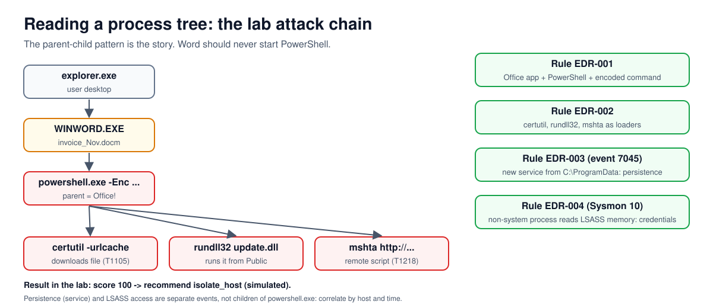

# Module 07. EDR, XDR and MDR

> **Weeks:** 9 to 11 · **Time:** ~25 hours · **Level:** SC-200 / Security+ operations
> **You will:** understand how modern endpoint security works, read EDR telemetry, investigate a suspicious process tree, and know how XDR and MDR services fit into a SOC.

## Why this module

Most attacks run on an endpoint. In your Cloud Security + SOC role you will read endpoint alerts every day. After this module you can look at "Word started PowerShell" and explain *why it matters* and *what to do*.

## Learning path

| # | Lesson | Week | Certification objective |
|---|---|---|---|
| 01 | [Endpoint security evolution: AV, EPP, EDR, XDR](01-endpoint-security-evolution.md) | 9 | Security+ D2/D4; SC-200 intro |
| 02 | [What EDR collects, and Sysmon](02-edr-telemetry-and-sysmon.md) | 9 | Security+ D4 (logging); SC-200 advanced hunting |
| 03 | [Response actions and product concepts](03-response-actions-and-products.md) | 10 | SC-200 respond; NIST SP 800-61 |
| 04 | [Investigating an EDR alert (+ lab)](04-investigating-an-edr-alert.md) | 10-11 | SC-200 investigate; ATT&CK |
| 05 | [XDR: cross-domain correlation](05-xdr-cross-domain-correlation.md) | 11 | SC-200 Defender XDR |
| 06 | [MDR: managed detection and response](06-mdr-managed-detection-and-response.md) | 11 | Security+ D5 (third-party risk, SLAs) |

Certification codes: Security+ SY0-701 is still available and SY0-801 launched on 17 November 2026; the core concepts are the same. Check the official CompTIA and Microsoft pages before booking.

## Lab

[`lab/`](lab/) holds an offline process-tree analyzer for synthetic Sysmon-like events.

```bash
.venv/Scripts/python -m pytest cybersecurity-track/07-edr-xdr-mdr     # 24 tests
.venv/Scripts/python cybersecurity-track/07-edr-xdr-mdr/lab/demo.py   # trees, alerts, simulated isolate
```

| File | Purpose |
|---|---|
| `sample_events.py` | Synthetic attack chain, benign admin activity, a quiet domain controller |
| `edr_analyzer.py` | `build_trees`, four rules, `recommend`, `SimulatedEDR` |
| `demo.py` | Prints the result |
| `test_edr_analyzer.py` | Detections, benign no-alert cases, evasion cases, response and approval |



## Key terms

| Term | Meaning |
|---|---|
| **Endpoint** | A laptop, desktop, server or VM |
| **AV / EPP** | Antivirus / endpoint protection platform: prevention |
| **EDR** | Records endpoint activity; detects behavior; lets you respond |
| **XDR** | EDR plus email, identity, cloud and more, correlated |
| **MDR** | A managed service that watches and responds for you |
| **Telemetry** | Raw events from the sensor |
| **Sysmon** | Free Microsoft Sysinternals tool that logs detailed Windows activity |
| **Process tree** | Parent-child diagram of processes |
| **LOLBin** | Legitimate program abused by attackers (certutil, rundll32, mshta) |
| **LSASS** | Windows process that holds logon secrets in memory |
| **IOC / IOA** | Indicator of compromise (static) / of attack (behavior) |
| **Isolation** | Cutting a host from the network but keeping the agent link |
| **Persistence** | Ways malware survives reboot: services, tasks, Run keys |
| **SLA** | Written service targets (time to acknowledge, to respond) |

## How this connects to your job

- **Daily alerts:** every endpoint alert is a process, a parent and a command line. Lesson 04 trains this reading.
- **Cloud security:** cloud VMs need the same agents. XDR links endpoint, identity and cloud-app signals.
- **Escalations:** if your company uses an MDR, you will answer its calls and approve actions (lesson 06).
- **DBA bridge:** database servers need agents too. Plan exclusions and approvals with the security team (module 11 goes deeper).

## Mini-project (about 6 hours)

**"Add a fifth rule and a hunting note."**

1. Add rule **EDR-005: Run-key persistence** to the lab. Write sample events (Sysmon 13) for an attack and a benign installer. Write the tests first.
2. Add a **scheduled-task** rule (Security 4698) with a benign counterpart.
3. Update the ATT&CK mapping in `MITRE`.
4. Write a one-page **hunting note**: question, data needed, query idea in plain words, expected false positives, and the response level.
5. Put the note and the diff in your portfolio (module 13).

## Practice on TryHackMe / HTB

- TryHackMe: **Cyber Security 101 → SOC Level 1 → SOC Level 2** (SAL1 / SAL2 certificates). Search for Sysmon, Windows event logs and endpoint rooms.
- HTB Academy: **SOC Analyst** job-role path, which leads to the HTB CDSA certification.
- HTB Labs: **Sherlocks** (defensive investigations). LetsDefend content is moving into HTB.
- Only use your own machines or the platforms' labs.

## Interview questions (module level)

<details><summary><b>Q1. Explain the difference between AV, EDR and XDR to a manager.</b></summary>AV blocks known bad files. EDR records what happens on each computer so we can find and stop attackers that AV missed. XDR adds email, identity and cloud data so we see the whole attack in one place.</details>

<details><summary><b>Q2. Walk me through investigating "Excel spawned PowerShell".</b></summary>Open the process tree. Read the command line and decode it. Check the document and the user, then the network and file activity of the PowerShell process. Look for persistence and LSASS access. Scope by searching for the same indicators on other hosts. Decide: contain (isolate for a workstation), eradicate, recover, document.</details>

<details><summary><b>Q3. What Sysmon events would you enable first?</b></summary>1 (process create), 3 (network), 10 (process access), 11 (file create), 13 (registry set), 22 (DNS), and filtered 7 (image load).</details>

<details><summary><b>Q4. How do you detect credential dumping?</b></summary>Sysmon 10 on lsass.exe with a memory-read access mask from a non-allow-listed full path. Also watch for dump files and tools. Prevent with LSA protection, Credential Guard and ASR.</details>

<details><summary><b>Q5. When would you not isolate a host at once?</b></summary>On critical servers and domain controllers, where an outage is costly. Get the owner's approval or use narrower containment.</details>

<details><summary><b>Q6. How do you avoid false positives from admins?</b></summary>Make rules precise (name, arguments, parent, path), include benign test cases, allow-list by full path and signer, and review the rule often with data.</details>

<details><summary><b>Q7. What is MDR and how is it different from running your own SOC?</b></summary>A provider's analysts watch your EDR/XDR 24x7 and respond within agreed limits. You still own context, remediation and risk decisions.</details>

<details><summary><b>Q8. What would you ask an MDR vendor before signing?</b></summary>Coverage, who the analysts are, detection quality and testing, response authority, console access, SLA definitions (when the clock starts), data location and exit terms, references.</details>

<details><summary><b>Q9. What is the value of XDR and what is its main risk?</b></summary>Value: correlated incidents, faster triage. Risk: only as good as connected data; vendor lock-in; automation mistakes.</details>

<details><summary><b>Q10. How would you prove your EDR detects attacks?</b></summary>Run safe, documented tests (for example Atomic Red Team mapped to ATT&CK) on a test machine, record what alerted, fix gaps, and repeat on a schedule.</details>

## References

- MITRE ATT&CK: https://attack.mitre.org/
- Microsoft Learn, Defender for Endpoint and Defender XDR: https://learn.microsoft.com/defender-xdr/
- Microsoft Sysinternals Sysmon: https://learn.microsoft.com/sysinternals/downloads/sysmon
- NIST SP 800-61 Rev. 3: https://csrc.nist.gov/pubs/sp/800/61/r3/final
- CompTIA Security+ exam objectives (official page).
- Library: "MITRE ATT&CK in Action: 50 SOC playbooks" (concept source).
