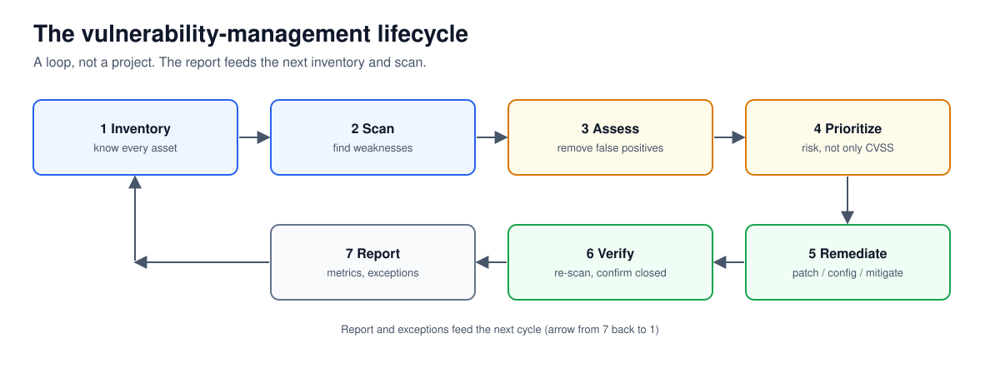

# 01. The vulnerability-management lifecycle

> **Module:** 08 · Vulnerability Management · **Week:** 11 (starts) · **Time:** ~3 hours
> **You will:** describe the seven steps of vulnerability management, say what can go wrong at each step, and name the metrics that prove the program works.
> **Certification map:** Security+ SY0-701/801 domain 4 (vulnerability management: identification, analysis, response, validation, reporting); CySA+ (vulnerability management); ISO/IEC 27001:2022 Annex A 8.8 (management of technical vulnerabilities); CIS Controls v8 control 7.

---

## 1. Why it matters in a SOC / cloud-security job

A **vulnerability** is a weakness that an attacker can use. Every month new ones are published, and your estate (servers, laptops, cloud VMs, containers, databases) has hundreds of them at any time.

- Many real breaches use a flaw that had a fix for months. The problem was not "no patch"; it was "nobody knew we had that server" or "nobody scheduled the fix".
- In your SOC job, vulnerability data tells you *where an alert matters more*: an exploit attempt against an unpatched server is urgent; against a patched one it is noise.
- Auditors ask: "How do you find and fix vulnerabilities, and can you prove it?"

---

## 2. Understand it



### 2.1 The seven steps

| # | Step | What you do | Typical failure |
|---|---|---|---|
| 1 | **Asset inventory** | Know every asset: owner, criticality, exposure (internet / internal), environment | Unknown servers and shadow cloud accounts are never scanned |
| 2 | **Scan** | Run scanners on a schedule (and after big changes). Authenticated where possible | Scans fail silently (blocked by firewall, wrong credentials); coverage unknown |
| 3 | **Assess** | Remove false positives, group duplicates, confirm the finding is real | Raw scanner output sent to teams: thousands of rows, no trust |
| 4 | **Prioritize** | Rank by real risk: exploitation, exposure, asset value, then severity | Sorting by CVSS only |
| 5 | **Remediate** | Patch, change configuration, or **mitigate** (compensating control). Or accept the risk with an expiry date | No owner; no change window; patch breaks the app |
| 6 | **Verify** | Re-scan to prove the fix; close the ticket only on evidence | Tickets closed "done" but the weakness is still there |
| 7 | **Report** | Metrics for the team, management and auditors. Feed lessons to step 1 | Vanity numbers (count of scans) instead of risk reduction |

It is a **loop**. New vulnerabilities appear every week, and new assets appear every day.

### 2.2 Terms

| Term | Meaning |
|---|---|
| **Vulnerability** | A weakness in software, configuration or process |
| **CVE** | Common Vulnerabilities and Exposures: an ID for one specific vulnerability, such as `CVE-2024-12345` (format only; not a real ID) |
| **CWE** | Common Weakness Enumeration: the *type* of weakness (for example CWE-89 SQL injection, CWE-79 cross-site scripting) |
| **CVSS** | Common Vulnerability Scoring System: severity score 0 to 10 |
| **Exposure** | Who can reach the asset: the internet, the internal network, or nobody |
| **Remediation** | Fixing the weakness |
| **Mitigation / compensating control** | Reducing risk without the full fix (for example a firewall rule, a WAF rule, disabling a feature) |
| **False positive** | The scanner says vulnerable, but it is not |
| **False negative** | The scanner misses a real weakness |
| **Patch Tuesday** | Microsoft's regular monthly patch release (second Tuesday of the month) |
| **Exception / risk acceptance** | A formal, approved decision not to fix now, with an expiry date |

### 2.3 Not the same as patch management or pentesting

| | Vulnerability management | Patch management | Penetration test |
|---|---|---|---|
| Goal | Find, rank and track weaknesses | Install updates on schedule | Show how an attacker can break in |
| Frequency | Continuous / weekly | Monthly or by policy | Yearly or after big changes |
| Output | Ranked list, metrics | Updated systems | Narrative report with proof |
| Scope | Whole estate, automated | Managed devices | Selected targets, human-led |

They work together. Patching is one way to fix a finding.

### 2.4 Metrics that matter

| Metric | What it tells you |
|---|---|
| **Scan coverage** (% of assets scanned in the last N days) | Whether you see the estate |
| **Authenticated scan success rate** | Quality of the data |
| **Mean time to remediate (MTTR)** by tier | Speed |
| **SLA compliance** (% fixed within the due date) | Discipline |
| **Open critical and KEV items** and their age | Real risk |
| **Exceptions: count and expiring soon** | Hidden debt |
| **Reopen rate** (fixed, then found again) | Quality of fixes |

A vulnerable server nobody scans is not in the numbers. **Coverage comes first.**

---

## 3. From DBA to security

> **From DBA to security.**
> - **Asset inventory** = your **database inventory** (every instance, version, patch level, owner). You already know how bad an unknown "test" database in production is.
> - **Scan + assess** = **running a health check** (for example Oracle's own checks, or an AWR/ADDM report) and then deciding which findings are real.
> - **Patch Tuesday / CPU** = **Oracle's quarterly Critical Patch Update** cycle (lesson 04). Same rhythm: release, test, schedule, apply, verify.
> - **Verify** = **validate after patching** (`opatch lsinventory`, `datapatch`, `dba_registry_sqlpatch`). A ticket is closed on evidence.
> - **Exceptions** = **deferring a patch** with a recorded reason and an owner.

---

## 4. Hands-on

### 4.1 Repo lab

Run the module tests. They also cover the inventory gap: a finding for an asset that is not in the inventory.

```bash
.venv/Scripts/python -m pytest cybersecurity-track/08-vulnerability-management
```

Real output:

```text
.....................                                                    [100%]
21 passed in 0.06s
```

In the demo (lesson 03) the host `NEW-VM-77` is *not* in the asset table. The prioritizer does not drop it. It assumes medium criticality and adds a note: `asset not in inventory: assumed medium criticality, owner unknown`. That is step 1 failing visibly instead of silently.

### 4.2 Free tools to try (optional, own lab only)

- **Greenbone / OpenVAS** (Docker or a VM) against your own test VM.
- **Nessus Essentials** (free, limited number of IPs; check Tenable's page for current limits).
- **Microsoft Defender Vulnerability Management** if your tenant has it: read the "Weaknesses" and "Recommendations" pages.
- **OpenSCAP** for configuration checks on Linux.
- The library lab "Vulnerability management lab (OSSIM, ZAP, OpenSCAP)" walks through asset add, an authenticated scan, a web scan with OWASP ZAP and a compliance scan. Use it as a guided exercise, on **its own isolated lab network**.

Never scan systems you do not own or have written permission to scan.

---

## 5. Practice platforms

- TryHackMe: search for rooms on **Nessus**, **OpenVAS** and **vulnerability scanning** (they are in the Cyber Security 101 and later paths).
- HTB Academy: module **Vulnerability Assessment** (Nessus and OpenVAS basics).
- Also the SOC Analyst path for how vulnerability data supports alert triage.

---

## 6. Three realistic scenarios

**Scenario 1: Perfect scores, missed server.**
*What happened:* the dashboard says 98% of assets are patched, yet an old VM is exploited. *Investigate:* the VM was created by a project and never added to the inventory. *Do:* compare scan results with cloud inventory, DHCP leases and EDR agent lists. Report **coverage** alongside patch rate.

**Scenario 2: 12,000 findings.**
*What happened:* the first scan produced a huge list; teams ignore it. *Do:* filter to *authenticated, confirmed, exploitable and internet-facing* first. Deliver 20 fixes with owners, not 12,000 rows.

**Scenario 3: "Closed" but still vulnerable.**
*What happened:* a ticket was closed because the patch job ran, but the service was never restarted. *Do:* add a mandatory re-scan as the closing step, and track the reopen rate.

---

## 7. Common mistakes

1. Scanning without an inventory.
2. Sorting only by CVSS (lesson 03).
3. Unauthenticated scans only: noisy and shallow.
4. Closing tickets without verification.
5. No owner per asset, so findings float.
6. Exceptions with no end date.
7. Scanning production without telling anyone (scans can crash fragile systems; schedule and test).
8. Reporting "number of vulnerabilities found" as success.

---

## 8. Interview questions

<details><summary><b>Q1. List the steps of vulnerability management.</b></summary>Asset inventory, scan, assess, prioritize, remediate, verify, report. It repeats as a loop.</details>

<details><summary><b>Q2. Why does inventory come first?</b></summary>You cannot scan or patch what you do not know exists. Coverage gaps are invisible in patch-rate dashboards.</details>

<details><summary><b>Q3. CVE vs CWE?</b></summary>A CVE identifies one specific vulnerability in a product. A CWE names a class of weakness (for example CWE-89 SQL injection). Many CVEs share one CWE.</details>

<details><summary><b>Q4. Vulnerability scan vs penetration test?</b></summary>A scan is automated, broad and finds known weaknesses. A pen test is human-led, narrower, tries to exploit and chain issues, and reports the impact.</details>

<details><summary><b>Q5. What is a false positive and how do you handle it?</b></summary>A reported weakness that is not real. Validate it (check version, configuration, authenticated data), mark it in the scanner with a reason, and share the logic with the scanner team.</details>

<details><summary><b>Q6. What is a compensating control?</b></summary>An alternative control that reduces the risk when you cannot patch yet (WAF rule, network isolation, disabling the vulnerable feature, extra monitoring).</details>

<details><summary><b>Q7. Name three vulnerability-management metrics.</b></summary>Scan coverage, mean time to remediate by tier, SLA compliance. Also open KEV items, exception count and reopen rate.</details>

<details><summary><b>Q8. How do you verify a fix?</b></summary>Re-scan (ideally authenticated) and confirm the finding is gone, or check the package or patch version directly. Close the ticket on evidence.</details>

<details><summary><b>Q9. A team says a scan crashed their server. What now?</b></summary>Apologize and investigate: scan policy (intensity, dangerous checks), time, and the device. Move scans to a safe window, use a gentler policy for fragile systems, and agree a process with the owner.</details>

<details><summary><b>Q10. Scenario: management wants "zero vulnerabilities". What do you say?</b></summary>Zero is not realistic: new CVEs appear daily. Set risk-based targets: all KEV and internet-facing critical items fixed within SLA, high coverage, few overdue items, no expired exceptions.</details>

<details><summary><b>Q11. How do cloud assets change the process?</b></summary>They appear and disappear quickly, so inventory must come from cloud APIs, and scanning uses agents, snapshots or image scanning in the pipeline.</details>

---

## 9. Checklist

- [ ] I can draw the seven-step loop from memory.
- [ ] I can explain CVE, CWE and CVSS in one sentence each.
- [ ] I know five metrics, and why coverage comes first.
- [ ] I ran the module tests.

## 10. References

- NIST SP 800-40 Rev. 4: Guide to Enterprise Patch Management Planning: https://csrc.nist.gov/pubs/sp/800/40/r4/final
- CIS Controls v8, Control 7 (Continuous Vulnerability Management): https://www.cisecurity.org/controls
- ISO/IEC 27001:2022 Annex A 8.8 (see module 04).
- CVE program: https://www.cve.org/ · CWE: https://cwe.mitre.org/
- Library: "Vulnerability management lab (OSSIM, ZAP, OpenSCAP)".

Next: [02. Scanners and scan types](02-scanners-and-scan-types.md)
