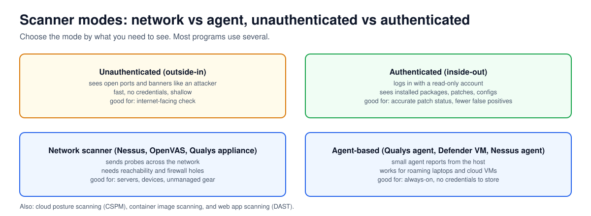

# 02. Scanners and scan types

> **Module:** 08 · Vulnerability Management · **Week:** 12 · **Time:** ~4 hours
> **You will:** compare Nessus, OpenVAS/Greenbone, Qualys and Defender Vulnerability Management, and choose between authenticated and unauthenticated, agent and network, and cloud and container scanning.
> **Certification map:** Security+ domain 4 (vulnerability scanning, credentialed vs non-credentialed, agent vs agentless); CySA+; SC-200 (Defender vulnerability management); CIS Controls v8 control 7.

---

## 1. Why it matters in a SOC / cloud-security job

A scanner is a source of facts. If you choose the wrong mode, you get wrong facts. Examples:

- An *unauthenticated* scan says a server "may be" missing a patch. An *authenticated* scan reads the real patch list. The first creates false alarms; the second is accurate.
- A laptop that is never in the office never gets a network scan. An *agent* does see it.
- A container image is rebuilt daily. A weekly scan of the running host is too slow. Scan the **image** in the pipeline.

---

## 2. Understand it



### 2.1 Four ways to scan

| Mode | How it works | Good for | Weak at |
|---|---|---|---|
| **Unauthenticated (non-credentialed)** | Sends probes from outside; reads banners, open ports, visible versions | Attacker's view of internet-facing assets; quick checks | Accuracy: guesses from banners; misses local issues |
| **Authenticated (credentialed)** | Logs in (SSH, WinRM, SMB, database account) with a **read-only** account and reads packages, patches, configs | Accurate patch status, config checks, fewer false positives | Needs credentials and access; credential storage risk |
| **Network (agentless)** | A scanner appliance or VM sends traffic across the network | Servers, network devices, printers, unmanaged gear | Firewalls block it; roaming devices missed |
| **Agent-based** | A small agent on the host reports data to a cloud or console | Laptops, remote and cloud VMs, always-on data | Needs install and upkeep; not for devices that cannot run agents |

Most programs mix them: **authenticated agent scanning for managed hosts, network scanning for the rest, and unauthenticated scans against the internet-facing surface** to see what an attacker sees.

### 2.2 The scanners

| Scanner | Type | Notes |
|---|---|---|
| **Nessus** (Tenable) | Commercial network scanner; free *Essentials* edition for small labs (check current limits) | Large plugin library; templates for credentialed, compliance and web scans. Widely known |
| **OpenVAS / Greenbone** | Open-source scanner (Greenbone Community Edition); commercial editions exist | Free to learn; runs in containers or a VM; vulnerability tests updated by feeds |
| **Qualys VMDR** | Cloud platform with **agents** and scanners | Strong for large estates; combines detection, prioritization and patch tracking |
| **Microsoft Defender Vulnerability Management** | Part of the Defender for Endpoint ecosystem; uses the existing endpoint sensor | Continuous, **no separate scan** for supported devices; software inventory, recommendations, links to Intune |

Plus specialist tools: **OWASP ZAP** and **Burp** (web apps, module 09), **OpenSCAP** (Linux configuration baselines, CIS benchmarks), **Trivy / Grype** (container images and code dependencies), **CSPM** tools (cloud posture) such as Defender for Cloud.

Do not memorize product features; they change. Remember the **category** and the **trade-offs**.

### 2.3 Authenticated scanning: do it safely

- Use a **dedicated, read-only** account per platform (not a domain admin).
- Store the secret in a **vault**, with rotation. Never reuse a human password.
- Restrict the account: logon only from scanner IPs, no interactive logon.
- Log its use and alert if it appears from elsewhere.
- For databases: a **read-only scan account** with the minimum grants documented by the scanner vendor.

### 2.4 Cloud and container scanning

| Target | How |
|---|---|
| **Cloud VMs** | Agent (installed by image or policy), or snapshot-based scanning that reads a disk copy without touching the VM |
| **Cloud configuration** | CSPM: checks storage buckets, security groups, IAM, logging (misconfiguration, not CVEs) |
| **Container images** | Scan in the CI/CD pipeline and in the registry; fail the build on severe, fixable findings |
| **Running containers / Kubernetes** | Runtime and admission checks; image digests; node scans |
| **Infrastructure as code** | Static checks on Terraform and templates before deployment |
| **Dependencies (SCA)** | Software composition analysis of libraries in your code |

Container findings need *different ownership*: the fix is "rebuild the image from a newer base", not "patch the server".

### 2.5 Reading a result

A good finding has: **asset, CVE, plugin/test ID, evidence** (for example the detected version string or the package list line), severity, and a **solution**. Learn to read the **evidence** field first: it tells you whether the result is believable.

Common false-positive causes:

- A vendor **back-ported** a fix without changing the version number (common with Linux distributions). A banner-based scan sees the old version.
- A service is installed but disabled or not reachable.
- A product is vulnerable only with a certain setting turned on.
- A scan hit a load balancer, not the real server.

### 2.6 Scan operations

- **Frequency:** weekly or continuous for internet-facing; at least monthly for the rest; plus after major changes.
- **Safe windows and policies:** gentle settings for fragile systems; no "dangerous checks" in production unless agreed.
- **Scan health:** track scans that failed or had authentication errors. A failed authenticated scan quietly turns into a weak unauthenticated one.
- **Allow-list the scanner** in the EDR/IDS to avoid alert storms, and tell the SOC the scan times (your SOC role makes you the person who knows both sides).

---

## 3. From DBA to security

> **From DBA to security.**
> - **Authenticated vs unauthenticated** = **querying `V$VERSION` as a user** vs **guessing the version from the listener banner**. The first is exact; the second can be wrong.
> - **Read-only scan account** = a **least-privilege monitoring user** (for example `SELECT_CATALOG_ROLE`, not `DBA`). You already know how to create it, and how to refuse a request to use `SYS`.
> - **Agent vs agentless** = **Enterprise Manager agent** vs **remote SQL*Net connection**.
> - **Scan windows** = **batch windows**. A heavy scan at month-end close is as bad as a heavy backup.
> - **Back-ported fixes** = **PSU/RU patch levels**: the "version" text alone can mislead; the patch registry tells the truth.

---

## 4. Hands-on

### 4.1 Repo lab

The prioritizer in this module takes scanner output as data. Open `lab/sample_data.py` and look at `FINDINGS`: each row is *what a scanner exports* (asset, CVE, title, CVSS). Notice what is **missing** and must come from elsewhere: exposure, criticality, exploit evidence. A scanner alone cannot rank your work.

```bash
.venv/Scripts/python -m pytest cybersecurity-track/08-vulnerability-management
```

```text
.....................                                                    [100%]
21 passed in 0.06s
```

### 4.2 Free tools to try (optional, own lab only)

1. **Greenbone Community Edition in Docker** (follow the project's official instructions). Scan **one VM you own** on a host-only network. Compare an unauthenticated and an authenticated scan of the same VM: count the findings and read three pieces of evidence.
2. **Nessus Essentials** on the same VM, if you want to compare.
3. **Trivy** on a public image: `trivy image <image>` (needs internet; optional). Notice that a fix often means "use a newer base image".
4. On Windows, open *Settings → Windows Update*. List what an authenticated scan would learn that a port scan could not.

Reminder: a scan is traffic that looks like an attack. Only scan what you own or are authorized to scan, and tell the SOC.

---

## 5. Practice platforms

- TryHackMe: search for **Nessus**, **OpenVAS** and **Vulnerability Scanning** rooms.
- HTB Academy: **Vulnerability Assessment** module; **Network Enumeration with Nmap** as a companion.
- Defender Vulnerability Management: Microsoft Learn modules (free).

---

## 6. Three realistic scenarios

**Scenario 1: Critical finding on a Linux server, but it is patched.**
*What happened:* the scan says an old OpenSSH version. *Investigate:* the package changelog shows the distribution back-ported the fix. *Do:* mark as false positive with the package evidence, and ask for an authenticated scan so the scanner checks package versions.

**Scenario 2: Scan causes an outage.**
*What happened:* a full-intensity scan froze a legacy device. *Do:* exclude it from aggressive policies, scan with a gentle template, in a window, and add a note in the inventory: "fragile".

**Scenario 3: New cloud account, no scans.**
*What happened:* a team created a cloud subscription outside the process. *Investigate:* compare the cloud inventory with scanner assets. *Do:* enable agent or snapshot scanning by policy at account creation, and alert on unscanned accounts.

---

## 7. Common mistakes

1. Relying on unauthenticated scans for patch status.
2. Using a powerful account (domain admin, `SYS`) as the scan credential.
3. Not checking failed authentication in scan reports.
4. Treating container image findings as host-patching tasks.
5. Scanning without telling the SOC and IT.
6. Trusting the severity without reading the evidence.
7. Scanning once a quarter.

---

## 8. Interview questions

<details><summary><b>Q1. Authenticated vs unauthenticated scan?</b></summary>Authenticated logs in with credentials and reads real patch and config data: accurate, fewer false positives. Unauthenticated looks from outside like an attacker: fast and needs no access, but shallow and guess-based.</details>

<details><summary><b>Q2. Agent vs network scanning?</b></summary>Agents report from the host (good for laptops, remote and cloud VMs, continuous). Network scanners probe from a central point (good for servers and devices that cannot run agents, but need network reach).</details>

<details><summary><b>Q3. What account do you use for an authenticated scan?</b></summary>A dedicated read-only account with minimal rights, a vaulted rotated secret, restricted source IPs and monitoring of its use.</details>

<details><summary><b>Q4. Name four scanners and one point about each.</b></summary>Nessus: commercial with a free small edition. OpenVAS/Greenbone: open-source. Qualys: cloud platform with agents. Defender Vulnerability Management: uses the Defender for Endpoint sensor, continuous.</details>

<details><summary><b>Q5. Why do back-ported patches cause false positives?</b></summary>A distribution may fix a flaw without changing the upstream version number. A banner-based check sees the old version and reports it as vulnerable.</details>

<details><summary><b>Q6. How do you scan container images?</b></summary>In the CI/CD pipeline and registry with an image scanner, failing builds on severe fixable findings. Fix by rebuilding from an updated base image.</details>

<details><summary><b>Q7. What is CSPM and how is it different from vulnerability scanning?</b></summary>Cloud Security Posture Management checks cloud configuration (open storage, wide security groups, missing logging). Vulnerability scanning finds software flaws. You need both.</details>

<details><summary><b>Q8. A scan failed to authenticate on 30 servers. Why does it matter?</b></summary>The results fall back to shallow checks, so the report looks fine but misses real issues. Track authentication success as a quality metric.</details>

<details><summary><b>Q9. How often should you scan?</b></summary>Internet-facing: weekly or continuous. Internal: at least monthly. Plus after changes. Agents can report continuously.</details>

<details><summary><b>Q10. Scenario: the SOC reports a flood of alerts at 02:00 from one IP. What could it be?</b></summary>A scheduled vulnerability scan. Verify against the scan calendar and the scanner's IP list; if it is not expected, treat as reconnaissance. Both sides should share the scan schedule and allow-list the scanner correctly.</details>

---

## 9. Checklist

- [ ] I can explain four scan modes and when to use each.
- [ ] I can name four scanners and one trade-off each.
- [ ] I know how to set up a safe scan account.
- [ ] I know three causes of false positives.

## 10. References

- Tenable Nessus, Greenbone Community Edition, Qualys VMDR and Microsoft Learn (Defender Vulnerability Management) official documentation.
- NIST SP 800-115: Technical Guide to Information Security Testing and Assessment: https://csrc.nist.gov/pubs/sp/800/115/final
- CIS Benchmarks and OpenSCAP (SCAP content): https://www.cisecurity.org/cis-benchmarks
- Library: "Vulnerability management lab (OSSIM, ZAP, OpenSCAP)".

Previous: [01](01-vm-lifecycle.md) · Next: [03. Scoring and prioritization](03-scoring-and-prioritization.md)
