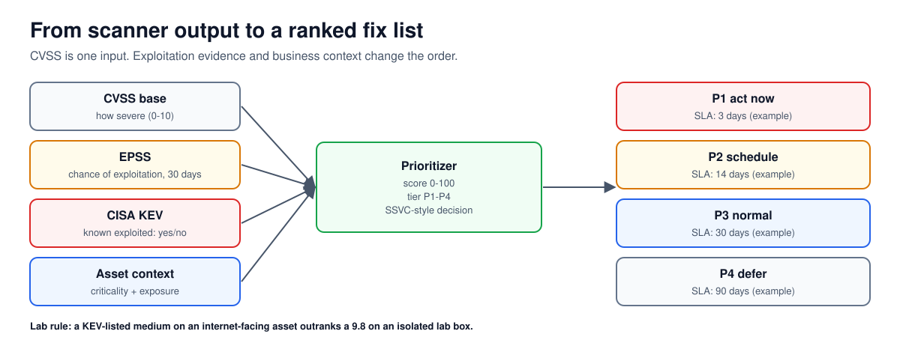

# 03. Scoring and prioritization: CVSS v4.0, EPSS, KEV, SSVC

> **Module:** 08 · Vulnerability Management · **Week:** 12 (and the lab in week 13) · **Time:** ~6 hours
> **You will:** read a CVE and CVSS v4.0 vector, explain base, threat and environmental scores, use EPSS and CISA KEV, describe the SSVC idea, and run a prioritizer that outputs a ranked fix list with SLA due dates.
> **Certification map:** Security+ domain 4 (vulnerability analysis: CVSS, CVE, exploitability, asset value); CySA+; ISO/IEC 27001:2022 A.8.8.
> **Lab:** [`lab/`](lab/) (offline, synthetic data).

---

## 1. Why it matters in a SOC / cloud-security job

Every scan produces more findings than any team can fix. **The order of work is the skill.** If you fix by CVSS alone, you spend months on "critical" items that no attacker uses, and miss a "medium" that is being exploited today.

- A "CVSS 9.8" on an isolated lab box with no data is low risk.
- A "CVSS 5.5" that is on the **KEV** list (known exploited) on an internet-facing server is an emergency.
- Management asks "what do we fix first, and when?" You answer with a ranked list and due dates.

---

## 2. Understand it



### 2.1 CVE and CWE

- **CVE** identifies a specific flaw: `CVE-YYYY-NNNN...`. The CVE program (MITRE, sponsored by CISA) assigns IDs. The **NVD** (US National Vulnerability Database) adds scores and details.
- **CWE** names the weakness type. For example CWE-89 (SQL injection), CWE-79 (cross-site scripting), CWE-787 (out-of-bounds write). Use CWE to find *patterns* in your code and systems, and CVE to track *a specific fix*.

### 2.2 CVSS v4.0

**CVSS** (Common Vulnerability Scoring System) measures **severity**. Version 4.0 was published by FIRST in November 2023. A v4.0 vector starts with `CVSS:4.0/` followed by metrics. The scores come in groups:

| Group | What it adds | Who sets it | Name of the score |
|---|---|---|---|
| **Base** | Intrinsic qualities: how it is attacked and how bad the impact is | The vendor or CNA that publishes the CVE | **CVSS-B** |
| **Threat** | Exploit maturity: is there an attack or public proof of concept? | You or your threat-intel feed; changes over time | **CVSS-BT** |
| **Environmental** | Your context: how important is the asset (confidentiality, integrity, availability requirements) and your own mitigations | You | **CVSS-BE** (or **CVSS-BTE** with threat) |
| **Supplemental** | Extra facts that do **not** change the score (safety, automatable, recovery, value density, response effort, provider urgency) | Vendor or you | not scored |

Main **base** metrics in v4.0:

| Metric | Meaning |
|---|---|
| **AV** Attack Vector | Network, Adjacent, Local, Physical |
| **AC** Attack Complexity | Low / High |
| **AT** Attack Requirements | None / Present (v4.0 new: conditions that must exist) |
| **PR** Privileges Required | None, Low, High |
| **UI** User Interaction | None, Passive, Active |
| **VC / VI / VA** | Confidentiality, Integrity, Availability impact on the **vulnerable system** |
| **SC / SI / SA** | The same three impacts on **subsequent (downstream) systems** |

What changed versus v3.1 (high level): attack requirements (AT) were added; "scope" was replaced by separate vulnerable-system and subsequent-system impact; user interaction has finer levels; threat (exploit maturity) is now a clear, separate group; supplemental metrics were added.

**The big lesson:** most databases (NVD) show **CVSS-B only**. Base says "how bad could it be in general". It does not know your network, your data or whether anyone is using the exploit. Treat it as the **start**, not the answer. Both v3.1 and v4.0 scores exist in the wild; you will see both for a while.

Qualitative bands: 0.1-3.9 Low, 4.0-6.9 Medium, 7.0-8.9 High, 9.0-10.0 Critical (and 0.0 None).

### 2.3 EPSS

**EPSS** (Exploit Prediction Scoring System, from FIRST) gives each CVE a **probability (0 to 1)** that it will be exploited in the wild in the next 30 days, plus a percentile. It is data-driven and updated daily. Use it to **separate the likely from the possible**.

- It estimates *likelihood*, not *impact*.
- Most CVEs have a very low EPSS (under 0.01). A score of 0.5 or more is notable.
- A new CVE may have a low score at first. Re-check.

### 2.4 CISA KEV

The **Known Exploited Vulnerabilities (KEV) catalog**, kept by CISA, lists CVEs with **evidence of active exploitation**. US federal agencies must fix them by a due date set in the catalog (Binding Operational Directive 22-01). Private companies are not bound, but KEV is an excellent trigger: **being on KEV means attackers are using it now.**

A common policy: "KEV + reachable by an attacker = fix urgently (days)".

### 2.5 SSVC: the decision-tree idea

**SSVC** (Stakeholder-Specific Vulnerability Categorization, from Carnegie Mellon's SEI, with CISA's version) skips the single number. It asks a few questions and walks a **decision tree** to an action:

| Decision point | Example answers |
|---|---|
| **Exploitation** | None, public proof of concept, active |
| **Automatable** | Can an attacker automate it at scale? Yes/No |
| **Technical impact** | Partial or total control of the system |
| **Mission prevalence / well-being** | How important is the affected function? |

Output actions in CISA's tree: **Track**, **Track\***, **Attend**, **Act**. The advantage: it is explainable ("Act, because it is actively exploited and gives total control"). The lab's tiers (P1 to P4) follow the same spirit.

### 2.6 Asset context

The same CVE has different risk on different assets:

| Context | Question |
|---|---|
| **Exposure** | Is it on the internet, internal, or isolated? |
| **Criticality** | What does the business lose if it is down or stolen? (data sensitivity, revenue, safety) |
| **Compensating controls** | WAF in front? Segmented? EDR with exploit blocking? |
| **Environment** | Production vs development vs lab |

### 2.7 The lab's formula

Simple on purpose, so you can explain it to an auditor:

```text
score = 100 * ( 0.35 * exploit + 0.30 * exposure + 0.20 * criticality + 0.15 * cvss/10 )
exploit   = 1.0 if the CVE is in KEV, else its EPSS value
exposure  = internet 1.0, internal 0.5, isolated 0.1
criticality = asset criticality (1 to 5) divided by 5
```

Tiers and SLAs (example policy, adjust to your organization):

| Tier | Rule | Meaning | SLA |
|---|---|---|---|
| **P1** | KEV **and** internet-facing, or score 80 or more | Act now | 3 days |
| **P2** | KEV, or score 55 or more | Schedule soon | 14 days |
| **P3** | score 30 or more | Normal cycle | 30 days |
| **P4** | the rest | Defer / monitor | 90 days |

If a KEV entry has an earlier due date than the SLA, the **earlier date wins**. A KEV date already in the past means "due today". CVSS is only **15%** of the score on purpose.

This is a teaching model. Real programs tune weights, add compensating controls, and may use vendor risk scores. The point is to be **transparent**.

---

## 3. From DBA to security

> **From DBA to security.**
> - **CVSS alone** is like ranking SQL by **elapsed time only**. A slow query that runs once a year matters less than a medium one that runs 10,000 times an hour. **Context decides.** Think `executions x elapsed`: exploit likelihood x impact.
> - **EPSS** is like **optimizer statistics**: a data-based estimate. It can be stale and wrong in single cases, but good on average.
> - **KEV** is like a **confirmed production incident in the vendor's own bug list**: no more guessing.
> - **Asset criticality** = **database tiering** (tier-1 production vs a sandbox). You already know which databases cannot go down.
> - **Due dates** = **change windows**: an SLA is only possible if you can fit the work in them.

---

## 4. Hands-on: the prioritizer lab

| File | Role |
|---|---|
| `lab/sample_data.py` | Synthetic scan findings, asset table, EPSS table, KEV table (fake CVE IDs in year 2099) |
| `lab/vm_prioritizer.py` | `score_finding`, `tier_for`, `due_date`, `prioritize`, exceptions register (lesson 04) |
| `lab/demo.py` | Prints the ranked list and the exceptions demo |
| `lab/test_vm_prioritizer.py` | 21 tests, including the KEV-medium vs isolated-high rule |

```bash
.venv/Scripts/python -m pytest cybersecurity-track/08-vulnerability-management
.venv/Scripts/python cybersecurity-track/08-vulnerability-management/lab/demo.py
```

Real output (first part of the demo):

```text
=== RANKED REMEDIATION LIST (scan date 2026-11-17) ===
#  asset       cve            cvss  epss kev expo     crit score tier due        status
1  VPN-GW-01   CVE-2099-3003   9.8  0.97 yes internet    4  95.7 P1   2026-11-20 open
2  WEB-01      CVE-2099-1001   5.5  0.31 yes internet    5  93.2 P1   2026-11-20 open
3  HR-APP-02   CVE-2099-5005   7.5  0.62 -   internal    4  63.9 P2   2026-12-01 open
4  WEB-01      CVE-2099-7007   9.0  0.01 -   internet    5  63.9 P2   2026-12-01 open
5  DB-ORA-01   CVE-2099-4004   8.1  0.08 -   internal    5  50.0 P3   2026-12-17 open
6  DEV-BOX-03  CVE-2099-2002   9.8  0.02 -   internal    2  38.4 P3   2026-12-17 open
7  NEW-VM-77   CVE-2099-8008   6.5 0.004 -   internal    3  36.9 P3   2026-12-17 open
8  DEV-BOX-03  CVE-2099-6006   4.3 0.001 -   internal    2  29.5 P4   2027-02-15 open
9  LAB-OLD-09  CVE-2099-2002   9.8  0.02 -   isolated    1  22.4 P4   2027-02-15 open

Notes:
  VPN-GW-01 CVE-2099-3003: known exploited (KEV)
  WEB-01 CVE-2099-1001: known exploited (KEV)
  NEW-VM-77 CVE-2099-8008: asset not in inventory: assumed medium criticality, owner unknown
```

### How to read this

- **Row 2 vs row 9 is the lesson.** `WEB-01` with CVSS **5.5** (medium) is **#2** and P1, because it is on KEV and internet-facing. `LAB-OLD-09` with CVSS **9.8** is **last** (P4), because it is isolated, low value and has a tiny EPSS. A test checks exactly this.
- **Row 4**: `WEB-01` has a CVSS 9.0 flaw with a low EPSS and no KEV. It is P2 (14 days), not P1. It is still ahead of the database item because the host is on the internet.
- **Row 5**: the Oracle database finding is **P3** here. Check why: internal, not exploited, EPSS 0.08. If it were on KEV it would jump. Your DBA team would still schedule it with the next CPU cycle (lesson 04).
- **Row 6 and 9**: same CVE, different assets, different order. Context matters.
- **Row 7**: an asset **not in the inventory** gets an explicit note. Fix the inventory.
- **Due dates:** the VPN due date (2026-11-20) is the 3-day P1 SLA, which is also the KEV due date. For `WEB-01` the SLA (3 days) is sooner than the KEV date (2026-12-08), so the SLA wins.

### Break it yourself

1. Predict, then change `CVE-2099-2002` in `sample_data.KEV` to a KEV entry with due date 2026-11-30. Which two rows move? Which tier is each in? (The `DEV-BOX-03` one becomes P2; the isolated lab one becomes P2 too, because KEV alone gives P2. Is that what you want for an isolated box? Add a rule and a test.)
2. Change the weights. Does the KEV-medium test still pass? Why is that test valuable? (It protects the principle when someone "improves" the formula.)
3. Add an `exposure` of `"partner"` (VPN-only access) with weight 0.7. Write a test first.
4. Add compensating controls: a WAF flag that cuts the exposure weight for `internet` to 0.7. What risk does that create? (It must be verified, not assumed.)

---

## 5. Practice platforms

- TryHackMe: scanning and vulnerability rooms; search for "Nessus" and "vulnerability".
- HTB Academy: **Vulnerability Assessment** module; for CVE reading, read public advisories and ask "KEV? EPSS? exposure?".
- FIRST.org provides a free EPSS data download and API; CISA provides the KEV catalog (JSON and CSV). Practice joining them with a scan export (your own lab).

---

## 6. Three realistic scenarios

**Scenario 1: New KEV entry on Tuesday.**
*What happened:* a vendor flaw is added to KEV on the same day it is announced. *Investigate:* search your inventory for the product and version; check exposure. *Do:* treat internet-facing instances as P1 immediately; apply the vendor mitigation if no patch yet; monitor for exploitation in logs (tell your SOC).

**Scenario 2: Auditor says "all criticals within 7 days".**
*What happened:* the policy uses CVSS only, so teams patch dozens of isolated critical items while a KEV medium waits. *Do:* propose a risk-based policy (KEV and internet-facing first; CVSS-based for the rest), with data from this lab-style ranking, and document it.

**Scenario 3: Two scanners disagree.**
*What happened:* one scanner reports CVSS 7.5, another 9.8 for the same CVE (different versions or different vectors). *Investigate:* compare the vectors and versions (v3.1 vs v4.0). *Do:* choose one source of truth in the policy, and prefer vendor advisory data for the final call.

---

## 7. Common mistakes

1. Sorting by CVSS base only.
2. Ignoring EPSS and KEV.
3. Treating EPSS as impact. It is only *likelihood*.
4. No asset criticality, so a lab box ranks like a payment server.
5. Assuming a WAF or segmentation without verifying it.
6. Not re-scoring when new exploit information appears.
7. Hiding the formula: stakeholders do not trust a black box.
8. Mixing CVSS versions without saying so.

---

## 8. Interview questions

<details><summary><b>Q1. What are the CVSS v4.0 score groups?</b></summary>Base (intrinsic, CVSS-B), Threat (exploit maturity, CVSS-BT), Environmental (your asset context, CVSS-BE or BTE), and Supplemental (extra context that does not change the score).</details>

<details><summary><b>Q2. What does CVSS not tell you?</b></summary>Whether it is being exploited, how exposed your asset is, and how valuable the asset is. Base scores measure severity in general, not your risk.</details>

<details><summary><b>Q3. What is EPSS?</b></summary>A FIRST model that estimates the probability a CVE will be exploited in the wild in the next 30 days. It measures likelihood, not impact.</details>

<details><summary><b>Q4. What is the CISA KEV catalog?</b></summary>A list of CVEs with confirmed active exploitation, with remediation due dates for US federal agencies. Many companies use KEV as an urgent trigger.</details>

<details><summary><b>Q5. Explain SSVC.</b></summary>A decision-tree approach. You answer questions (exploitation status, automatable, technical impact, mission prevalence) and arrive at an action such as Track, Attend or Act. It is more explainable than one number.</details>

<details><summary><b>Q6. CVE vs CWE?</b></summary>A CVE is one specific flaw in a product. A CWE is a weakness type that many CVEs share.</details>

<details><summary><b>Q7. Which gets fixed first: CVSS 9.8 on an isolated lab server, or CVSS 5.5 on KEV on an internet-facing server?</b></summary>The KEV one. It is actively exploited and reachable. The isolated lab server has low exposure and low value.</details>

<details><summary><b>Q8. How do you set patch SLAs?</b></summary>By tier from risk (KEV and exposure first), based on what the business can handle in change windows, written into policy, measured as SLA compliance, with a formal exception path.</details>

<details><summary><b>Q9. What changed in CVSS v4.0?</b></summary>Attack Requirements metric, separate impact on the vulnerable and subsequent systems (replacing scope), finer user-interaction values, a clear Threat group, and Supplemental metrics.</details>

<details><summary><b>Q10. How would you explain risk-based prioritization to a non-technical manager?</b></summary>"We fix first what attackers are already using and can reach, on the systems that matter most to the business, not just what has the highest number."</details>

<details><summary><b>Q11. Scenario: your EPSS source shows 0.01 but the vendor says exploitation is observed. What do you do?</b></summary>Trust the stronger evidence (vendor/KEV/threat intel) and treat it as exploited. EPSS can lag; document the override.</details>

<details><summary><b>Q12. How do compensating controls change priority?</b></summary>They can lower environmental risk (for example a verified WAF rule or network block), so the fix may be delayed within an exception. They must be verified, time-limited and recorded.</details>

---

## 9. Checklist

- [ ] I ran the tests (21 passed) and the demo.
- [ ] I can explain the formula and why CVSS is only 15%.
- [ ] I can explain row 2 vs row 9 of the output.
- [ ] I changed one input and predicted the new rank.
- [ ] I can name the CVSS v4.0 groups and the SSVC outcomes.

## 10. References

- FIRST CVSS v4.0 specification: https://www.first.org/cvss/v4-0/
- FIRST EPSS: https://www.first.org/epss/
- CISA Known Exploited Vulnerabilities Catalog: https://www.cisa.gov/known-exploited-vulnerabilities-catalog (BOD 22-01)
- CISA SSVC guide: https://www.cisa.gov/stakeholder-specific-vulnerability-categorization-ssvc
- NVD: https://nvd.nist.gov/ · CWE: https://cwe.mitre.org/

Previous: [02](02-scanners-and-scan-types.md) · Next: [04. Remediation operations and database patching](04-remediation-operations-and-db-patching.md)
