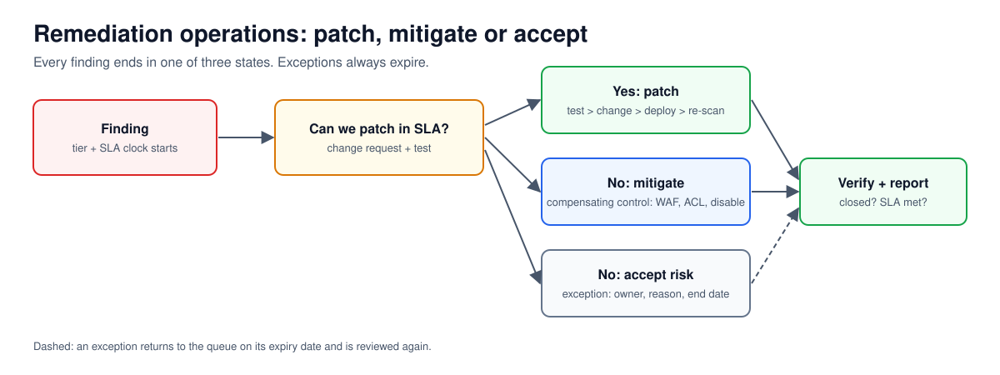

# 04. Remediation operations, exceptions, and database patching

> **Module:** 08 · Vulnerability Management · **Week:** 13 · **Time:** ~5 hours
> **You will:** run remediation as an operation (SLAs, owners, change management, exceptions, compensating controls, metrics) and apply it to a DBA example: Oracle Critical Patch Updates and patch testing.
> **Certification map:** Security+ domain 4 (remediation, exceptions and exemptions, validation, reporting) and domain 5 (risk acceptance); ISO/IEC 27001:2022 A.8.8 and A.8.32 (change management); CIS Controls v8 control 7.
> **Lab:** [`lab/`](lab/) (exceptions register with expiry).

---

## 1. Why it matters in a SOC / cloud-security job

Finding a vulnerability is easy. **Getting it fixed** is the hard part. Teams are busy, systems are fragile, and every patch is a risk.

- A SOC analyst sees an exploit attempt, checks the vulnerability list, and says "this server has an open P1 for 20 days". That is a process failure, not a scanner failure.
- Without **exceptions** that expire, risk acceptance becomes permanent neglect.
- Auditors do not ask "do you have vulnerabilities?" They ask "show me how you decide, track and close them".

---

## 2. Understand it



### 2.1 Patch SLAs

An SLA (service level agreement) says how fast a finding must be fixed. Example from the lab (your policy may differ):

| Tier | Meaning | Fix within |
|---|---|---|
| P1 | Known exploited and reachable, or very high score | 3 days |
| P2 | Known exploited, or high score | 14 days |
| P3 | Medium | 30 days |
| P4 | Low | 90 days |

Rules that make SLAs work:

1. **The clock starts** when the finding is confirmed (not when someone reads it).
2. Each finding has **one named owner** (team and person).
3. The SLA is **agreed with IT/DevOps** and tied to change windows. A 3-day SLA is useless if the next window is in 3 weeks.
4. **Emergency changes** exist for P1.
5. SLA performance is **reported** by team.

### 2.2 Three ways to close a finding

| Way | What | Evidence needed |
|---|---|---|
| **Remediate** | Patch, upgrade or reconfigure so the weakness is gone | Re-scan shows it closed |
| **Mitigate** (compensating control) | Cut the risk without the full fix: block a port, add a WAF rule, disable a feature, isolate the asset, add monitoring | The control is tested and documented; finding stays open as "mitigated" |
| **Accept** (exception) | Management accepts the risk for a limited time | Signed exception with owner, reason, controls, **end date** |

### 2.3 Exceptions and risk acceptance

An **exception** (also called exemption or risk acceptance) is a formal "we will not fix this by the SLA". Good practice:

- A **written reason** (for example "vendor patch breaks the application; fix due in release 4.2").
- A **named approver** who owns the risk (a business or risk owner, **not** the person who wants to skip the work).
- **Compensating controls** listed (mandatory for high tiers).
- A hard **expiry date**; the maximum length depends on the tier (the lab: P1 30 days, P2 90, P3 180, P4 365).
- **Review before expiry**: the register warns 14 days ahead.
- On expiry the finding **comes back** with the original SLA, due now.
- An exception covers **one CVE on one asset**, not "all assets with that CVE".

Real output of the lab's exceptions demo (continuation of the demo output in lesson 03):

```text
=== EXCEPTIONS REGISTER ===
created EX-001: CVE-2099-2002 on DEV-BOX-03 until 2026-12-31 (approver ciso.delegate)
created EX-002: CVE-2099-6006 on DEV-BOX-03 until 2026-11-01 (already past)
REJECTED: a named approver (risk owner) is required
REJECTED: P1 exceptions may last at most 30 days

=== AFTER APPLYING EXCEPTIONS ===
#  asset       cve            cvss  epss kev expo     crit score tier due        status
1  DEV-BOX-03  CVE-2099-2002   9.8  0.02 -   internal    2  38.4 P3   2026-12-17 excepted
2  DEV-BOX-03  CVE-2099-6006   4.3 0.001 -   internal    2  29.5 P4   2026-11-17 exception_expired

expiring within 60 days: ['EX-001']
already expired        : ['EX-002']

=== SUMMARY ===
total: 9
open: 8
excepted: 1
by_tier: {'P1': 2, 'P2': 2, 'P3': 2, 'P4': 2}
overdue: 0
due_within_7_days: 3
```

Read it line by line:

- `EX-001` is accepted for the same CVE on `DEV-BOX-03` only. The isolated lab box with the same CVE stays **open**, because exceptions never cover another asset (a test checks it).
- `EX-002` was created for a period that already ended. It shows as **`exception_expired`**, and the due date changes to **today**: the finding is back.
- The first `REJECTED` request has no approver. The second asks for a 6-month exception on a P1 item, but P1 exceptions are capped at 30 days.
- The **summary** counts excepted items separately, so "open" is honest.

### 2.4 Compensating controls: be honest

A compensating control only counts if it is **verified**. "We have a firewall" is not evidence. Examples with evidence:

| Control | Evidence |
|---|---|
| Block the vulnerable port at the firewall | Rule ID, and a scan from outside showing it closed |
| WAF virtual patch | Rule ID in block mode, test request blocked |
| Disable the vulnerable feature or service | Config diff, re-scan |
| Move to an isolated VLAN | Network diagram, firewall rule test |
| Extra monitoring | Detection rule and a test alert |

### 2.5 Working with change management

Patching is a **change**. Most organizations use ITIL-style change records:

| Change type | Use for | Process |
|---|---|---|
| **Standard** | Routine, pre-approved patches (monthly OS patches) | Pre-approved template, low friction |
| **Normal** | New or higher-risk changes | CAB (change advisory board) review, scheduled window |
| **Emergency** | P1, known-exploited | Fast approval, tested minimal change, review afterwards |

Tips:

- Bring the **ranked list** and the reason ("KEV, internet-facing") to the change meeting.
- Ask for a **standard change** template for monthly OS and browser patches.
- Always have a **rollback plan** and a **post-change validation** step (re-scan).
- Share the **maintenance calendar** with the SOC so planned reboots and scans are not treated as attacks.

### 2.6 Metrics for the management report

| Metric | Why |
|---|---|
| Open items by tier and age | Backlog and risk |
| **SLA compliance** per team | Fairness and pressure |
| **MTTR** per tier | Speed |
| **Overdue KEV items** (should be 0) | The most important number |
| Exceptions: count, expiring in 30 days, expired | Hidden debt |
| **Scan coverage** | Trust in the numbers |
| Reopen rate | Fix quality |

Show **trends**, not only a snapshot. Show **risk reduced** (for example "internet-facing KEV items: 7 → 0").

---

## 3. Database patching: the DBA bridge

You already patch Oracle. In security language this is a **vulnerability-management** task with a strong process. Use your skills.

### 3.1 Oracle Critical Patch Updates (CPU)

- Oracle publishes security fixes for many products **every quarter** (January, April, July, October), in a **Critical Patch Update**, on the Tuesday closest to the 17th of the month. Oracle publishes an advisory page listing the fixed CVEs, affected versions and CVSS scores. Out-of-cycle **Security Alerts** exist for urgent flaws.
- For the database, the fixes arrive in quarterly **Release Updates (RU)** (the naming and the exact patch model change between versions, so check My Oracle Support and the Oracle documentation for your version).
- Typical technical steps: take a backup (RMAN) and a copy of the Oracle Home; check prerequisites with **OPatch** (`opatch lsinventory`, conflict check); apply the patch with the database stopped (or use rolling methods in RAC and Data Guard); run **`datapatch`** to apply the SQL-level changes; then validate with `dba_registry_sqlpatch` and `opatch lsinventory`.
- Typical operational steps: read the advisory; map CVEs to **your** versions and options (many fixes apply only to certain components); rank with **exposure** (is the listener reachable from the network?) and **KEV/EPSS** information; schedule.

Why this is a good VM example:

| Vulnerability management | Oracle practice |
|---|---|
| Inventory | Every instance, version, patch level, Oracle Home, owner |
| Intake | CPU advisory each quarter |
| Prioritize | Applicability, network reachability, privileges needed |
| Test | Clone, patch, regression and performance test |
| Change | Production change window, rollback plan |
| Verify | `datapatch` result, `dba_registry_sqlpatch`, re-scan |
| Report | Patch level per instance vs the target CPU |

### 3.2 Patch testing: a safe flow

1. **Clone** production to a test environment (RMAN duplicate, storage snapshot or a Data Guard standby).
2. **Apply** the patch exactly as you will in production, from the **same runbook**.
3. **Functional tests:** application smoke tests, batch jobs, interfaces, backups.
4. **Performance tests:** compare **AWR reports** (before vs after) for top SQL, waits and plan changes. You already know this skill. A patch can change plans.
5. **Security tests:** re-scan; check the listener, audit and parameter settings did not change.
6. **Rollback test:** prove you can roll back (`opatch rollback`, restore from backup, or flashback where used).
7. **Go/no-go** with the application owner.
8. **Production:** standby-first, or rolling in RAC, when available, to cut downtime.
9. **Verify and report.**

### 3.3 When you cannot patch at once

Use compensating controls and an **exception**:

- Restrict listener access to app servers only (firewall + `tcp.validnode_checking` and `tcp.invited_nodes` in `sqlnet.ora`).
- Remove or lock unused accounts and sample schemas; remove `PUBLIC` grants not needed.
- Turn on **unified auditing** for privileged and failed logins, and alert on them in the SIEM.
- Disable unused components or features the CVE needs.
- Add a firewall or database firewall layer. Write the **end date** and the planned patch date.

---

## 4. From DBA to security

> **From DBA to security.**
> - **A patch SLA** = **your quarterly CPU commitment**, but written, measured and reported.
> - **Exception register** = **the list of "we skipped this CPU because of X"**, with an expiry date and an approver.
> - **Compensating control** = **tightening the listener and grants** while you wait for the window.
> - **Change management** = **CAB and change windows**. You know them already; now you present risk data to get a slot.
> - **Rollback** = **RMAN restore / `opatch rollback`**. No change without it.
> - **Verify** = **`datapatch` + `dba_registry_sqlpatch`** and a re-scan.
> - **Interview line:** "I have patched Oracle through quarterly CPUs, with clone testing, AWR comparison and rollback plans. I can run the same discipline for vulnerability management."

---

## 5. Hands-on

### 5.1 Repo lab: exceptions register

```bash
.venv/Scripts/python -m pytest cybersecurity-track/08-vulnerability-management
.venv/Scripts/python cybersecurity-track/08-vulnerability-management/lab/demo.py
```

Real test output:

```text
.....................                                                    [100%]
21 passed in 0.06s
```

Try these (predict first):

1. Ask for a P2 exception with **no** compensating controls. (It is rejected: P1 and P2 need controls.)
2. Create an exception that expires in 10 days and call `expiring_soon(today, 14)`. (It is listed.)
3. Add a method `renew(exc_id, new_expiry, approver)` that refuses to renew P1 exceptions more than once. Write the test first.
4. Add **overdue** counting to `summarize` by team (`owner` in `ASSETS`) and print an SLA report per team.

### 5.2 On paper: patch plan for a DBA

Write a one-page runbook "Quarterly Oracle CPU": inventory query, test clone steps, tests, change request fields, rollback, validation queries, and who approves. Use the table in 3.1 as a template. This is a **great portfolio item** (module 13).

---

## 6. Practice platforms

- TryHackMe and HTB Academy: **Vulnerability Assessment** content; HTB SOC Analyst path for the operations side.
- For databases: your own Oracle test VM (Oracle Database Free is available for learning; check Oracle's current page). Practice `opatch lsinventory` and reading `dba_registry_sqlpatch`.

---

## 7. Three realistic scenarios

**Scenario 1: Vendor patch breaks the app.**
*What happened:* the application vendor does not support the new database RU yet. *Investigate:* the vendor certification matrix. *Do:* request a P2 exception for 60 days with compensating controls (listener restricted, audit on, monitoring), approved by the business owner; plan the patch after certification; track expiry.

**Scenario 2: Overdue KEV item on an internet-facing VPN.**
*What happened:* day 5 of a 3-day SLA. *Do:* escalate to the owner's manager and the CISO with the facts (KEV, exposure, days over). Offer an emergency change, or a temporary mitigation (block access from the internet, vendor workaround). Record it in the report.

**Scenario 3: "We always accept it, it is fine."**
*What happened:* the same exception was renewed 6 times. *Do:* review the register. Require a new approver and a **plan to remove** the root cause (replace the product, upgrade the OS). Escalate repeated renewals to risk management (module 04).

---

## 8. Common mistakes

1. Exceptions without an end date.
2. The requester approving their own exception.
3. "Mitigated" with no test of the control.
4. Patching production before the clone test.
5. No rollback plan.
6. Reporting "patched" when the service was never restarted.
7. Ignoring databases and appliances because "they are special".
8. Not telling the SOC about maintenance windows.
9. One huge monthly report that nobody reads.

---

## 9. Interview questions

<details><summary><b>Q1. What goes into a risk-acceptance (exception) record?</b></summary>Reason, named risk owner, affected asset and CVE, compensating controls, end date, review date and approval evidence.</details>

<details><summary><b>Q2. Why must exceptions expire?</b></summary>Without an end date, accepted risk becomes permanent, and the environment changes. Expiry forces a new decision with fresh data.</details>

<details><summary><b>Q3. What is a compensating control?</b></summary>An alternative measure that reduces risk when the fix is not possible yet, such as blocking a port, a WAF rule, disabling a feature or isolating the asset. It must be verified.</details>

<details><summary><b>Q4. Standard vs normal vs emergency change?</b></summary>Standard: pre-approved routine changes. Normal: reviewed by a CAB and scheduled. Emergency: fast-tracked for urgent risk, reviewed after.</details>

<details><summary><b>Q5. What would you report to management each month?</b></summary>Open items by tier and age, SLA compliance, MTTR, overdue KEV items, exceptions (expiring and expired), scan coverage and trends.</details>

<details><summary><b>Q6. How often does Oracle publish security patches?</b></summary>Quarterly, in the Critical Patch Update (January, April, July and October), plus out-of-cycle Security Alerts for urgent issues.</details>

<details><summary><b>Q7. How do you test a database patch?</b></summary>Clone production, apply the patch with the production runbook, run functional tests, compare AWR performance before and after, re-scan, test rollback, then get go/no-go.</details>

<details><summary><b>Q8. How do you verify an Oracle patch was applied?</b></summary>Check `opatch lsinventory` for the patch, `dba_registry_sqlpatch` for the SQL-level step (`datapatch`), and re-scan.</details>

<details><summary><b>Q9. Scenario: you cannot patch the database for 60 days. What do you do?</b></summary>Raise an exception with an end date and approver; restrict listener access, remove unused accounts and grants, enable auditing and alerts, add a firewall rule, and schedule the patch; track until closed.</details>

<details><summary><b>Q10. Who should approve a risk acceptance?</b></summary>The business or risk owner who owns the asset's risk and has authority for that level, not the technical team seeking the delay. High risks need senior approval.</details>

<details><summary><b>Q11. How do you get teams to meet SLAs?</b></summary>Agree SLAs with them in advance, give clear ranked lists with reasons, reduce friction (standard changes, automation), report fairly by team, and escalate with facts.</details>

<details><summary><b>Q12. What is "patch verification" and why do it?</b></summary>Confirming that the fix really took effect (re-scan, package/patch version, service restart). It prevents false closure.</details>

---

## 10. Checklist

- [ ] I ran the tests and the demo, and can explain `exception_expired`.
- [ ] I can fill an exception record and say who approves it.
- [ ] I can describe a safe database patch test flow.
- [ ] I know the Oracle CPU rhythm and how to verify a patch.
- [ ] I wrote my one-page "Quarterly Oracle CPU" runbook.

## 11. References

- NIST SP 800-40 Rev. 4 (enterprise patch management): https://csrc.nist.gov/pubs/sp/800/40/r4/final
- Oracle Critical Patch Updates, Security Alerts and Bulletins: https://www.oracle.com/security-alerts/
- Oracle Database Patching Guide (use the documentation for your version): https://docs.oracle.com/en/database/
- ISO/IEC 27001:2022 Annex A 8.8, 8.32 (see module 04).
- CISA KEV catalog and BOD 22-01: https://www.cisa.gov/known-exploited-vulnerabilities-catalog

Previous: [03](03-scoring-and-prioritization.md) · Back to [module README](README.md)
