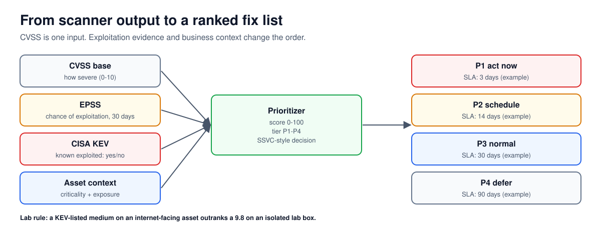

# Module 08. Vulnerability Management

> **Weeks:** 11 to 13 · **Time:** ~24 hours · **Level:** Security+ / CySA+ vulnerability management
> **You will:** run the full vulnerability-management loop: inventory, scan, assess, prioritize, remediate, verify, report. You will rank findings by real risk, not only CVSS.

## Why this module

A security team that cannot fix things is only a reporting team. This module teaches you to decide **what to fix first and by when**, and to run the process with owners, SLAs, exceptions and metrics. As a DBA you already patch Oracle every quarter. Here you learn the security view of the same discipline.

## Learning path

| # | Lesson | Week | Certification objective |
|---|---|---|---|
| 01 | [The vulnerability-management lifecycle](01-vm-lifecycle.md) | 11 | Security+ D4; ISO 27001 A.8.8; CIS 7 |
| 02 | [Scanners and scan types](02-scanners-and-scan-types.md) | 12 | Security+ D4 (credentialed, agent); Defender VM |
| 03 | [Scoring and prioritization (+ lab)](03-scoring-and-prioritization.md) | 12-13 | CVSS, EPSS, KEV, SSVC; CySA+ |
| 04 | [Remediation operations and database patching (+ lab)](04-remediation-operations-and-db-patching.md) | 13 | Security+ D4/D5; ISO 27001 A.8.32 |

Check the official CompTIA, ISC2 and Microsoft pages before booking any exam. Security+ SY0-701 and SY0-801 (launched 17 November 2026) share these core ideas.

## Lab

[`lab/`](lab/) turns synthetic scan results plus EPSS, KEV and asset tables into a ranked remediation list with SLA due dates, and keeps an exceptions register with expiry.

```bash
.venv/Scripts/python -m pytest cybersecurity-track/08-vulnerability-management     # 21 tests
.venv/Scripts/python cybersecurity-track/08-vulnerability-management/lab/demo.py
```

| File | Purpose |
|---|---|
| `sample_data.py` | Fake findings, assets, EPSS, KEV (CVE IDs use year 2099 on purpose) |
| `vm_prioritizer.py` | Score, tier, SLA due date, `ExceptionRegister`, `summarize` |
| `demo.py` | Prints the ranked list, the exceptions demo and a summary |
| `test_vm_prioritizer.py` | Headline test: a KEV-listed medium on an internet-facing asset outranks a 9.8 on an isolated lab box |



## Key terms

| Term | Meaning |
|---|---|
| **Vulnerability** | A weakness in software, configuration or process |
| **CVE / CWE** | ID of one flaw / type of weakness |
| **CVSS v4.0** | Severity score; groups: Base, Threat, Environmental, Supplemental |
| **EPSS** | Probability of exploitation in the next 30 days |
| **KEV** | CISA catalog of vulnerabilities known to be exploited |
| **SSVC** | Decision-tree method: Track, Track*, Attend, Act |
| **Authenticated scan** | A scan that logs in with a read-only account |
| **Agent / network scan** | Host-based reporting vs probing from a scanner |
| **SLA** | Fix-by time per tier |
| **Exception** | Time-limited, approved risk acceptance |
| **Compensating control** | Verified partial protection while the fix waits |
| **CPU / RU** | Oracle Critical Patch Update / Release Update |

## How this connects to your job

- **SOC triage:** an exploit alert against an asset with an open KEV item is a top priority.
- **Cloud security:** inventory and scanning for cloud VMs, containers and misconfigurations.
- **DBA strength:** patch testing, change windows, rollback and verification are already your skills. Present them in security language.
- **Reporting:** the metrics (coverage, SLA, overdue KEV, exceptions) are what management and auditors read.

## Mini-project (about 6 hours)

**"Run a monthly vulnerability review on a fictional company."**

1. Create your own `sample_data` with 20 findings across 8 assets, including one cloud VM, one database and one container image.
2. Run the prioritizer. Write a one-page report: top 5 actions with reasons, SLA status, metrics.
3. Add one new rule (for example a `compensating_control` flag that lowers exposure) with tests. Say why the control must be verified.
4. Create two exceptions and one that expires next week. Include them in the report.
5. Add the Oracle CPU runbook from lesson 04. Put everything in your portfolio (module 13).

## Practice on TryHackMe / HTB

- TryHackMe: **Cyber Security 101** path, then rooms on Nessus, OpenVAS and vulnerability scanning (search the catalog). **SOC Level 1 / 2** for triage with vulnerability context.
- HTB Academy: **Vulnerability Assessment** module; **SOC Analyst** path (leads to the HTB CDSA certification).
- Home lab: Greenbone Community Edition or Nessus Essentials against a VM you own. The library lab "Vulnerability management lab (OSSIM, ZAP, OpenSCAP)" is a guided path (use its isolated network).

## Interview questions (module level)

<details><summary><b>Q1. Describe your vulnerability-management process.</b></summary>Inventory first, then scheduled authenticated scans, assessment of false positives, risk-based prioritization (KEV, EPSS, exposure, criticality), tracked remediation with SLAs and owners, verification by re-scan, and reporting with metrics. Exceptions are approved, controlled and expire.</details>

<details><summary><b>Q2. Why not just fix all "critical" CVSS findings first?</b></summary>CVSS is severity in general. It ignores exploitation and your context. A medium that is actively exploited on an internet-facing server is more urgent than a critical on an isolated box.</details>

<details><summary><b>Q3. What are KEV and EPSS?</b></summary>KEV: CISA list of vulnerabilities with confirmed exploitation. EPSS: a probability that a CVE will be exploited in the next 30 days.</details>

<details><summary><b>Q4. What is the difference between authenticated and unauthenticated scanning?</b></summary>Authenticated uses credentials to read real patch and config data. It is accurate. Unauthenticated sees what an outside attacker sees and guesses versions.</details>

<details><summary><b>Q5. How do you handle a patch you cannot apply?</b></summary>Use a compensating control that I verify, and a time-limited exception with a named approver, then schedule the real fix.</details>

<details><summary><b>Q6. How would you patch a production Oracle database?</b></summary>Read the CPU advisory, map to our versions, clone and test (functional plus AWR comparison), prepare rollback, change window with standby-first or rolling where possible, apply with OPatch and `datapatch`, verify with `dba_registry_sqlpatch`, re-scan, report.</details>

<details><summary><b>Q7. Which metrics do you show management?</b></summary>Coverage, SLA compliance, MTTR by tier, open and overdue KEV items, exceptions expiring and expired, trends.</details>

<details><summary><b>Q8. What is SSVC?</b></summary>A decision-tree approach that maps exploitation status, automatability, technical impact and mission impact to an action (Track, Attend, Act), which is easier to explain than one number.</details>

<details><summary><b>Q9. What would you do if a scan finds a server not in the inventory?</b></summary>Find the owner, add it to the inventory, apply default criticality until confirmed, scan it with authentication, and find how it was missed.</details>

<details><summary><b>Q10. A team keeps missing SLAs. What do you do?</b></summary>Check if the SLA fits their change windows, remove friction (standard changes, automation), give a clear ranked list, report fairly, escalate with facts, and offer help on blocked items.</details>

## References

- FIRST CVSS v4.0: https://www.first.org/cvss/v4-0/ · EPSS: https://www.first.org/epss/
- CISA KEV: https://www.cisa.gov/known-exploited-vulnerabilities-catalog
- CISA SSVC: https://www.cisa.gov/stakeholder-specific-vulnerability-categorization-ssvc
- NIST SP 800-40 Rev. 4: https://csrc.nist.gov/pubs/sp/800/40/r4/final
- CIS Controls v8: https://www.cisecurity.org/controls
- Oracle Critical Patch Updates: https://www.oracle.com/security-alerts/
- Library: "Vulnerability management lab (OSSIM, ZAP, OpenSCAP)".
