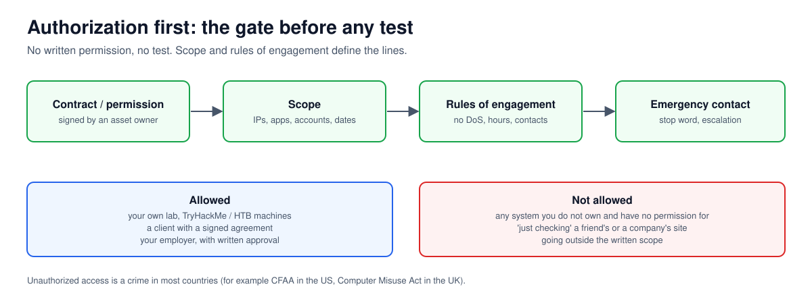
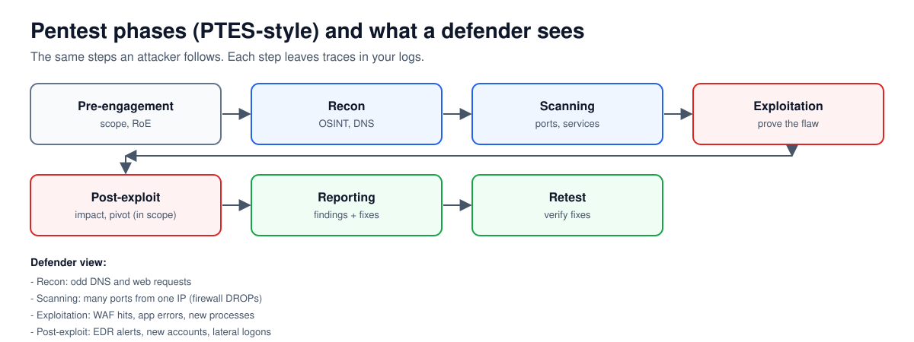

# 01. Ethics, legal authorization, scope, and methodology

> **Module:** 09 · Pentesting Fundamentals · **Week:** 13 · **Time:** ~3 hours
> **You will:** explain why written permission comes before any test, read a scope and rules-of-engagement document, name the phases of PTES and the OWASP WSTG, and tell apart black, grey and white box, internal and external, red and purple team.
> **Certification map:** Security+ SY0-701/801 domain 5 (penetration testing, rules of engagement, legal and compliance) and domain 4; CySA+; ISC2 Code of Ethics (CC).
> **Level:** "pentest idea" for a **defender**. You are not becoming a pentester in this module. You are learning how they think, so you can read their reports and detect them.

---

## 1. Why it matters in a SOC / cloud-security job

- Your company will hire **pentesters** (testers who try to break in, with permission). You will be the person who receives the report, tracks the fixes, and watches the logs during the test.
- In the SOC you must tell a **real attack** from an **authorized test**. That depends on knowing the scope, the dates and the source IPs.
- A tester who goes outside the scope can cause an outage or a legal problem. A defender who does not know the test dates may isolate the tester's machine and break the test, or may miss a real attacker who hides behind the test.

### The one rule

> **Only test what you own, or what you have written authorization to test.**

Unauthorized access to computer systems is a crime in most countries, even if you "only looked" and meant no harm. Examples of laws: the Computer Fraud and Abuse Act (US), the Computer Misuse Act 1990 (UK), the Information Technology Act 2000 (India). Intent to help does not make it legal. If you are not sure, **stop and ask**.

---

## 2. Understand it



### 2.1 The documents before a test

| Document | What it says |
|---|---|
| **Contract / statement of work (SoW)** | Who is testing, for whom, what is delivered, price, confidentiality |
| **Authorization letter** ("get out of jail free" letter) | Signed by someone with the **authority** over the systems. Lists testers and dates. Carry it during on-site work |
| **Scope** | Exact targets: IP ranges, domains, applications, cloud accounts, user roles, physical sites. **And what is out of scope** |
| **Rules of Engagement (RoE)** | What is allowed and not: test hours, no denial of service, no social engineering unless agreed, handling of data found, how to report critical issues at once |
| **Contacts** | Technical contact, emergency contact, a **stop word** to halt the test |
| **Third parties** | Cloud providers and SaaS vendors have their own testing rules. A permission from you does not cover their systems |

Good scope example (synthetic): "In scope: 192.0.2.0/25 and `shop.example`, from 20 Nov 2026 09:00 to 17:00. Out of scope: 192.0.2.10 (production payment database), and any third-party service."

### 2.2 A tiny scope guard

The lab contains a `ScopeGuard` class. It checks an address against the in-scope ranges, the out-of-scope ranges and the time window. It is a toy, but it teaches the habit: **check before you touch**. Real output:

```text
192.0.2.50     2026-11-20 10:00  ALLOW  authorised
192.0.2.10     2026-11-20 10:00  STOP   explicitly out of scope
198.51.100.7   2026-11-20 10:00  STOP   not listed in scope
192.0.2.50     2026-11-21 10:00  STOP   outside the agreed test window
```

Notice line 2: `192.0.2.10` is inside the `192.0.2.0/25` range, but is explicitly **excluded**. Out-of-scope always wins.

### 2.3 Methodologies

A methodology is a repeatable plan. It makes results consistent and defensible.

| Methodology | Focus | Notes |
|---|---|---|
| **PTES** (Penetration Testing Execution Standard) | Full engagement lifecycle | Phases below |
| **OWASP WSTG** (Web Security Testing Guide) | Detailed web application test cases | Organized by category: information gathering, configuration, identity, authentication, authorization, session, input validation, error handling, cryptography, business logic, client side, APIs |
| **OWASP MASTG** | Mobile apps | Companion project |
| **NIST SP 800-115** | Technical guide to security testing | Planning, discovery, attack, reporting |
| **OSSTMM** | Operational security testing | Metrics-oriented |
| **MITRE ATT&CK** | Adversary behavior | Used by red and purple teams to plan and to report |



**PTES phases** (names vary slightly by source):

1. **Pre-engagement interactions:** scope, RoE, contracts, goals.
2. **Intelligence gathering:** public information (OSINT), DNS, technologies.
3. **Threat modeling:** what are the assets and likely attackers?
4. **Vulnerability analysis:** scanning and manual checks.
5. **Exploitation:** prove that a weakness can be used (carefully, within the RoE).
6. **Post-exploitation:** what could an attacker reach next? (only as far as the RoE allows).
7. **Reporting:** findings, evidence, risk, fixes, executive summary.

Many teams add **retest** (verify the fixes) as the last step.

### 2.4 Types of tests

| Dimension | Types | Meaning |
|---|---|---|
| **Knowledge** | **Black box** | Tester knows nothing (like an outside attacker) |
| | **Grey box** | Tester has some information (a normal user account, an architecture diagram) |
| | **White box** | Tester has full knowledge: source code, design, admin access |
| **Position** | **External** | From the internet against public systems |
| | **Internal** | From inside the network (as an insider or a compromised laptop) |
| **Target** | Network, web app, API, mobile, cloud, wireless, physical, social engineering | |
| **Goal** | **Vulnerability assessment** | Find and list weaknesses (broad, little exploitation) |
| | **Penetration test** | Find **and prove** weaknesses by exploiting them in scope |
| | **Red team** | Long, goal-based (for example "reach the finance database") that tests **detection and response** as well. Few people know about it |
| | **Purple team** | Red and blue teams work **together**: attack a technique, check if it was detected, fix the gap, repeat |
| | **Bug bounty** | Public program with rules; rewards for valid findings |

Which one for which need? A new web app before launch: **grey-box web test** (and some white box code review). A mature SOC that wants to test its detections: **purple team**. A compliance requirement (for example PCI DSS asks for regular tests): **an authorized penetration test**.

### 2.5 Safe testing habits (you will see these in every report)

- Test in **non-production** where possible. If production, agree on windows and limits.
- **No denial of service** unless explicitly allowed.
- Keep a **log of every action** with time and source IP. You must be able to say "this was us".
- **Handle data found** with care: do not copy more than needed; encrypt evidence; delete at the end as agreed.
- **Stop and call** if you find a critical issue, an active compromise by someone else, or you reach something out of scope.
- Never keep access after the test, and remove any accounts or files you created.

---

## 3. From DBA to security

> **From DBA to security.**
> - **Authorization letter + scope** = **a change request with an approved scope** (which databases, which window, which actions). You would never run `DROP` on a system not in the ticket.
> - **Rules of engagement** = **change-window rules and a rollback plan**.
> - **Test in non-production first** = **test on a clone before production**. Same instinct.
> - **A pentest and your audit trail:** your database audit logs will show the tester's logins and queries. Make sure the test **source IPs and accounts** are known to the DBA team, so you can tell a test from an attack.
> - **Grey box** = **you give the tester a normal application login**, like a test user in the schema. Not `SYS`.

---

## 4. Hands-on

### 4.1 Repo lab

Run the scope-guard demo, which is part of the module demo:

```bash
.venv/Scripts/python cybersecurity-track/09-pentesting-fundamentals/lab/demo.py
```

Then the tests (29 tests for the whole module):

```bash
.venv/Scripts/python -m pytest cybersecurity-track/09-pentesting-fundamentals
```

```text
.............................                                            [100%]
29 passed in 0.16s
```

**Exercise on paper (40 minutes):** write a one-page scope and RoE for testing a **fictional** web shop `shop.example`: targets, exclusions, dates, allowed techniques, forbidden techniques, contacts, stop word, data handling, who gets the report. Compare it with the checklist in 2.1.

### 4.2 Where you may practice for real (free and legal)

- Your **own VMs and containers** (for example OWASP Juice Shop or DVWA, intentionally vulnerable web apps, in Docker on your laptop, **not exposed to a network**).
- **TryHackMe** and **Hack The Box**: the lab machines are built for you to attack within the platform rules.
- **PortSwigger Web Security Academy**: free labs for web testing.
- `scanme.nmap.org` is a host the Nmap project provides for light test scans, under its published rules of use. Read them first.
- **Never** try anything on a school, employer, bank, government or random site "to learn".

---

## 5. Practice platforms

- TryHackMe: **Cyber Security 101**, then the **Jr Penetration Tester** path if you want the attacker view (search the catalog), and **SOC Level 1 / 2** for the defender view.
- HTB Academy: modules such as **Penetration Testing Process** and **Web Requests**; the **SOC Analyst** path for your role.
- HTB Labs: Sherlocks (defensive); Starting Point and machines (attacker practice) within the platform terms.

---

## 6. Three realistic scenarios

**Scenario 1: The scan from an unknown IP.**
*What happened:* the SOC sees a big scan from 203.0.113.99 at 14:00. *Investigate:* check the pentest calendar and the tester's source IP list. If not listed, treat as hostile. *Do:* block, search logs for success, and tell the security manager. If listed, note it in the ticket.

**Scenario 2: The tester found something out of scope.**
*What happened:* while testing, the tester reaches a partner's system by accident. *Do:* stop, record the facts, call the emergency contact, do not look further. A good report states this. The customer contacts the partner.

**Scenario 3: A friend asks you to "check" their company site.**
*Do:* say no unless there is a written authorization from someone with the authority, naming you and the scope. "Good intent" is not permission. Offer to point them to a bug-bounty program or to practice platforms.

---

## 7. Common mistakes

1. Testing without a signed authorization.
2. Vague scope ("the website"), so nobody knows what is allowed.
3. Forgetting third parties (cloud provider, SaaS, CDN).
4. Not telling the SOC, or telling the whole SOC in a red-team engagement where the test is to see if they detect it (agree a "white cell" who knows).
5. No emergency contact or stop word.
6. Keeping the client's data after the test.
7. Believing a scan with a commercial tool is a pentest.
8. Defenders: blocking the tester's IP at once in a test that is meant to find out how far an attacker can go. Agree the rules.

---

## 8. Interview questions

<details><summary><b>Q1. What do you need before a penetration test?</b></summary>Written authorization from someone with authority over the systems, a defined scope (what is in and out), rules of engagement (allowed techniques, hours, data handling), contacts and an emergency stop process.</details>

<details><summary><b>Q2. Black, grey and white box?</b></summary>Black: no prior knowledge. Grey: partial knowledge, such as a user account. White: full knowledge, such as source code and admin access.</details>

<details><summary><b>Q3. Vulnerability assessment vs penetration test?</b></summary>An assessment finds and lists weaknesses broadly with little exploitation. A pen test tries to exploit them in scope to prove the impact.</details>

<details><summary><b>Q4. Red team vs purple team?</b></summary>Red team: goal-based, stealthy simulation of an adversary that tests detection and response. Purple team: red and blue work together, test a technique, check detection, fix, and repeat.</details>

<details><summary><b>Q5. What are the PTES phases?</b></summary>Pre-engagement, intelligence gathering, threat modeling, vulnerability analysis, exploitation, post-exploitation, reporting.</details>

<details><summary><b>Q6. What is the OWASP WSTG?</b></summary>The Web Security Testing Guide: a detailed list of test cases for web applications, grouped by category such as authentication, session management and input validation.</details>

<details><summary><b>Q7. What are rules of engagement?</b></summary>The agreed limits and procedures of the test: allowed methods, forbidden actions such as denial of service, time windows, data handling, communication and escalation.</details>

<details><summary><b>Q8. Why does the SOC need the pentest schedule?</b></summary>To tell a test from a real attack, avoid unnecessary incidents, and to make sure a real attacker is not ignored by blaming "the pentest".</details>

<details><summary><b>Q9. Is it legal to test your own website? Your employer's site, if you are curious?</b></summary>Your own: yes (but mind third-party hosting terms). Your employer's: only with written authorization for that scope. Curiosity is not permission.</details>

<details><summary><b>Q10. A colleague wants to scan a customer's server "just to check". What do you say?</b></summary>No. Without written authorization from the customer, it is unauthorized access. Ask the customer formally, agree scope and window in writing, then test.</details>

<details><summary><b>Q11. When would you recommend a purple-team exercise?</b></summary>When the SOC has basic detections and wants to measure and improve them against specific ATT&CK techniques with the attackers' help.</details>

---

## 9. Checklist

- [ ] I can say the one rule in my own words.
- [ ] I wrote a scope and RoE one-pager for `shop.example`.
- [ ] I can list PTES phases and the types of tests.
- [ ] I know what to do when a scan hits the SOC from an unknown IP.

## 10. References

- PTES technical guidelines: http://www.pentest-standard.org/
- OWASP Web Security Testing Guide: https://owasp.org/www-project-web-security-testing-guide/
- NIST SP 800-115: https://csrc.nist.gov/pubs/sp/800/115/final
- MITRE ATT&CK: https://attack.mitre.org/
- ISC2 Code of Ethics: https://www.isc2.org/ethics
- Nmap project, scanme.nmap.org usage rules: https://nmap.org/
- Library: Kali / PWK pentest books (concepts only, paraphrased).

Next: [02. Recon and scanning concepts](02-recon-and-scanning.md)
