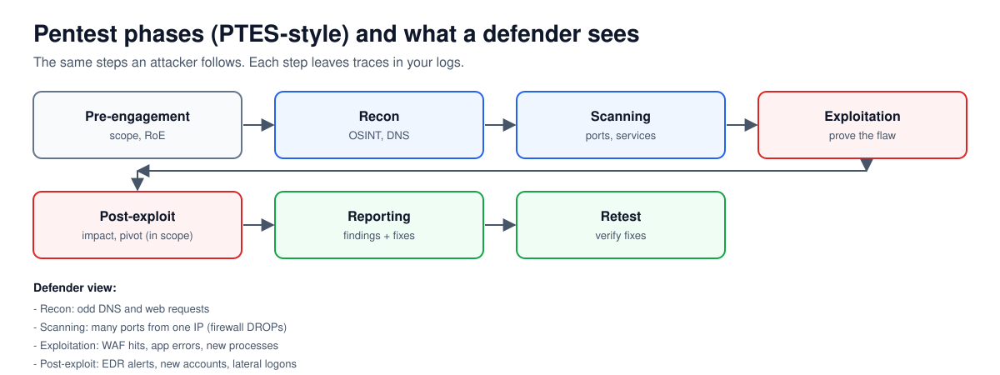

# 02. Recon and scanning concepts: nmap and how it looks to a defender

> **Module:** 09 · Pentesting Fundamentals · **Week:** 14 · **Time:** ~4 hours
> **You will:** explain passive and active reconnaissance, describe the main nmap scan types and what each one looks like in firewall, IDS and host logs, and write a simple detection for a port scan.
> **Certification map:** Security+ domain 2 (threat analysis, reconnaissance) and domain 4 (monitoring); Network+ N10-009 (ports, protocols, TCP handshake); CySA+.
> **Only scan your own lab or systems you are authorized to scan** (lesson 01).

---

## 1. Why it matters in a SOC / cloud-security job

**Reconnaissance** (recon) is the first thing an attacker does. It is also the first thing a pentester does. As a defender, recon is your **earliest warning**.

- Firewall logs will show thousands of dropped connections from one IP. Is it a test, a researcher, or the start of an attack?
- Internet-facing servers are scanned **all the time** by automated tools. You must decide what is noise and what is targeted.
- Cloud security groups often expose a port by mistake. A scan shows you what the attacker sees. Your job is to see it first.

---

## 2. Understand it

### 2.1 Passive vs active recon

| Type | What | Does the target see it? | Examples |
|---|---|---|---|
| **Passive (OSINT)** | Use public information only | No | DNS records, certificate transparency logs, search engines, job ads (technology names), code repositories, leaked-credential reports, WHOIS |
| **Active** | Touch the target | **Yes, in logs** | Port scans, banner grabbing, directory brute-force, web crawling, vulnerability scans |

Defender view: passive recon leaves no trace on your servers. So **reduce what is public**: remove sensitive data from repositories, avoid version banners, keep DNS clean, watch certificate logs for look-alike domains.

### 2.2 What a port scan finds

A **port** is a numbered door on a host (0 to 65535). A service **listens** on a port (for example web on 443, SSH on 22, Oracle listener on 1521 by default). A scan asks "which doors are open?". Results:

| State | Meaning |
|---|---|
| **open** | A service accepted the connection |
| **closed** | The host answered "nobody here" (a reset) |
| **filtered** | A firewall dropped the probe; no answer |

Recall the TCP three-way handshake: **SYN → SYN/ACK → ACK**. Scan types differ in how much of that they complete.

### 2.3 nmap scan types, and what the defender sees



**nmap** is the standard open-source network scanner. Common options (concepts only):

| Option | Name | What it does | What it looks like to a defender |
|---|---|---|---|
| `-sn` | Host discovery ("ping scan") | Finds which hosts are up, without port scanning | ICMP echo, ARP on local network, a few TCP probes to 80/443 from one source |
| `-sS` | **SYN scan** ("half-open") | Sends SYN, reads the reply, **never completes** the handshake | Many SYNs to many ports from one IP; many resets; firewall DROP entries; no completed sessions in app logs |
| `-sT` | **Connect scan** | Uses the OS to complete the full handshake | Full connections that close at once; **appear in application and listener logs** |
| `-sU` | UDP scan | Probes UDP ports; slow | Many UDP packets to many ports; ICMP "port unreachable" replies |
| `-sV` | Version detection | Talks to open services to identify the product and version | Odd or malformed requests to each service; unusual banners and short sessions |
| `-O` | OS detection | Sends special packets and studies replies | Unusual TCP flag combinations, odd packets |
| `-A` | "Aggressive" | Combines version, OS, script and traceroute | Loud: obvious in any IDS |
| `--script` | NSE scripts | Runs checks (some are safe, some are intrusive) | Depends on the script; often many HTTP or SMB requests |
| `-T0` to `-T5` | Timing | Slow (`-T0`, `-T1`) to fast (`-T4`, `-T5`) | Slow scans stay below simple thresholds: "low and slow" |
| `-p-` | All ports | Scans all 65,535 ports | Very many distinct destination ports |

### 2.4 Where scans show up in logs

| Log source | What to look for |
|---|---|
| **Firewall** (allow and drop logs) | One source IP, one or many destinations, **many distinct destination ports** in a short time; mostly DROP or RESET |
| **IDS/IPS** (Snort, Suricata) | Built-in "scan" signatures; thresholds on connections per source |
| **Windows Firewall / Filtering Platform** | Events 5152 (blocked packet) and 5156 (allowed connection) when auditing is on |
| **Application / listener logs** | Many short or failed connections from one IP (for example the Oracle listener log showing connections with no valid request) |
| **Cloud flow logs** | VPC flow logs (AWS), NSG flow logs (Azure): rejected flows to many ports |
| **EDR / host logs** | Only the local process activity; scanning *from* a compromised host shows a process opening many connections (Sysmon 3) |
| **Web server logs** | Requests for many paths in a short time (directory brute-force), unusual user agents |

A defender question list: **who** (source IP, reputation), **what** (which ports), **how fast**, **did any probe succeed**, **what came after** (a login attempt, an exploit string).

### 2.5 Detecting a port scan: the lab

The lab has `detect_port_scans`: it groups log rows by (source, destination), slides a time window, and flags a source that touches **15 or more distinct ports in 60 seconds**. Real output on synthetic data (25 sequential ports from `203.0.113.99`, plus ordinary traffic from `198.51.100.5` to port 443):

```text
{'src': '203.0.113.99', 'dst': '192.0.2.20', 'distinct_ports': 15, 'first_ts': 1000, 'last_ts': 1014}
```

Only the scanner is flagged. The normal client hitting one port repeatedly is **not**. The tests also show the weakness on purpose: a **slow scan** (one port every 2 minutes) is **missed** by a 60-second window. The fix is a longer window (hours) with a higher cost in memory and false positives, or a different signal (a source with a very high ratio of denied connections).

### 2.6 Beyond nmap

- **Web recon:** directory discovery, technology fingerprinting, sub-domain discovery.
- **Service enumeration:** SMB shares, SNMP, LDAP queries, database listeners.
- **Vulnerability scanners** (module 08) are noisier: they send many test requests.
- **Credential attacks** (password guessing) come after recon; they appear as many failed logons (Windows 4625, database audit failures).

### 2.7 Defender controls

| Control | Effect |
|---|---|
| Close unused ports; default-deny firewall | Less to find |
| Remove or genericize banners | Less information |
| Rate limit and block repeat scanners (carefully) | Slows recon |
| IDS signatures and flow-log alerts | Early warning |
| Tarpits and honeypots | Detect and delay (advanced) |
| Regular scans **by you** from outside | Know what the attacker sees |

Do not rely on blocking scanners. Public scanners will always find the public IP. The goal is: **nothing dangerous is reachable**, and **you are alerted when something tries**.

---

## 3. From DBA to security

> **From DBA to security.**
> - **Port scan** = **someone checking which listeners are up**. Your Oracle **listener on 1521** (and any custom port) must not be reachable from the internet. A scan shows it in seconds.
> - **Listener log** = the **first place a database scan appears**: repeated connections with no valid service name. Learn to read `listener.log` as a security log (module 11).
> - **Banner and version leaks** = **default `SQLNET` and error messages** revealing versions. Remove what you can.
> - **Thresholds** = **alert thresholds in monitoring**. "15 ports in 60 seconds" is like "10 failed logins in a minute": a simple rule that catches the loud case and misses the slow one.
> - **VPC/NSG flow logs** = **network-level audit** you did not have in your DBA life, but know the idea.

---

## 4. Hands-on

### 4.1 Repo lab

```bash
.venv/Scripts/python cybersecurity-track/09-pentesting-fundamentals/lab/demo.py
.venv/Scripts/python -m pytest cybersecurity-track/09-pentesting-fundamentals
```

Try, predicting first:

1. Change `min_ports` to 30. Does the lab scanner (25 ports) still alert? (No.) What is the trade-off?
2. Make the scan slower: `ts: 1000 + i * 10`. Does it alert with a 60-second window? (At 10 seconds per port, you have 7 ports in a window: no.) Increase the window to 300. (Then yes.)
3. Add a second scanner that scans **many hosts, one port** (a "sweep" for port 3389 across a /24). `detect_port_scans` groups by (source, destination), so it will **miss** it. Write a `detect_sweeps` function and its test.

### 4.2 Optional: real nmap on your own lab (never on others)

On a VM you own (or a TryHackMe/HTB machine, within platform rules):

```bash
nmap -sn 192.168.56.0/24          # who is up (host-only lab network example)
nmap -sS -p 1-1024 192.168.56.101  # SYN scan of common ports (needs admin)
nmap -sT -p 22,80,443 192.168.56.101
nmap -sV -p 22,80 192.168.56.101   # service versions
```

Then look at the **target's** logs: a firewall (`iptables` or Windows Firewall logging), `ss -tn` while scanning, and the web server access log. Compare `-sS` and `-sT`: only one appears in the application log. **Write down what you saw.** This is the skill.

---

## 5. Practice platforms

- TryHackMe: search for the **Nmap** rooms (in the Jr Penetration Tester path), and defender rooms on firewall and IDS logs.
- HTB Academy: **Network Enumeration with Nmap**; the SOC Analyst path for the log side.
- Library: Kali / PWK pentest books (concepts only).

---

## 6. Three realistic scenarios

**Scenario 1: Internet noise.**
*What happened:* 50 alerts a day "port scan from the internet". *Do:* these are background scans. Suppress alerts where all probes were dropped and no service answered. Alert only when a scan is followed by a **successful** connection, a login attempt, or an exploit string.

**Scenario 2: Scan from inside.**
*What happened:* a workstation scans the whole /24 at 02:00. *Investigate:* check EDR: which process? (Sysmon 3 from an unknown binary?) *Do:* isolate (lesson 03 of module 07), check for credential theft and lateral movement. An internal scan is a strong sign of a compromised host or an unauthorized tool.

**Scenario 3: Open database port.**
*What happened:* an external scan (your own weekly scan) finds port 1521 reachable from the internet. *Do:* treat as P1: restrict with the firewall or security group at once, check the listener log for external connections, and review accounts. Open the exception or incident process as needed.

---

## 7. Common mistakes

1. Scanning something you do not own, to "learn".
2. Believing that a firewall drop log is harmless. It shows you are being probed.
3. Alerting on every scan: you will drown. Alert on **scan plus a success**.
4. Thresholds that are easy to evade (slow scans).
5. Not scanning yourself from outside.
6. Forgetting UDP and IPv6.
7. Ignoring internal scans.

---

## 8. Interview questions

<details><summary><b>Q1. Passive vs active reconnaissance?</b></summary>Passive uses public information (DNS, certificates, search, repositories) and does not touch the target. Active sends traffic to the target, such as port scans, so it appears in logs.</details>

<details><summary><b>Q2. What is the difference between nmap -sS and -sT?</b></summary>-sS is a SYN (half-open) scan: it never completes the handshake, so it rarely appears in application logs but shows in firewall logs. -sT completes the full connection through the OS, so it appears in application and listener logs.</details>

<details><summary><b>Q3. How would you detect a port scan?</b></summary>Count distinct destination ports (or hosts) per source in a time window, from firewall, IDS or flow logs. Alert on a threshold, and raise severity if a probe succeeded or an exploit follows.</details>

<details><summary><b>Q4. What do open, closed and filtered mean?</b></summary>Open: a service accepted. Closed: the host replied that nothing listens. Filtered: no reply, usually a firewall dropped it.</details>

<details><summary><b>Q5. What is a low-and-slow scan and how do you catch it?</b></summary>A scan that spreads probes over a long time to stay under thresholds. Use longer windows, track per-source totals over days, and look at the ratio of denied connections.</details>

<details><summary><b>Q6. Which logs would show a scan against a database server?</b></summary>Firewall and flow logs, the listener log, host firewall logs, IDS, and the EDR if the scan comes from a host.</details>

<details><summary><b>Q7. Why do version banners matter?</b></summary>They reveal the product and version, helping an attacker pick a known flaw. Remove or genericize them where possible.</details>

<details><summary><b>Q8. A scan comes from inside your network. What do you do?</b></summary>Identify the host and process, check if it is an approved scan, otherwise treat the host as possibly compromised: investigate and contain.</details>

<details><summary><b>Q9. Name three things to do so recon finds less.</b></summary>Close unused ports with a default-deny firewall, remove banners, and keep sensitive data out of public repositories and DNS.</details>

<details><summary><b>Q10. Scenario: you see a SYN flood of one packet to each of 1000 ports from one IP. Is it a scan or a DoS?</b></summary>One probe per distinct port from one source is a scan. A DoS or SYN flood would be a very high rate to the same few ports, often from many sources.</details>

<details><summary><b>Q11. What is the first thing you check after detecting a scan?</b></summary>Whether it is authorized (the pentest or scan calendar), then whether any probe succeeded and what the source did next.</details>

---

## 9. Checklist

- [ ] I can explain passive vs active recon.
- [ ] I can say what -sS, -sT, -sU, -sV, -sn look like in logs.
- [ ] I ran the lab detector and changed one parameter.
- [ ] I know why a slow scan evades a short window.

## 10. References

- Nmap reference guide: https://nmap.org/book/man.html
- MITRE ATT&CK, Reconnaissance (TA0043) and Network Service Discovery (T1046): https://attack.mitre.org/tactics/TA0043/
- Microsoft Learn, Windows Filtering Platform events (5152, 5156).
- NIST SP 800-115.

Previous: [01](01-ethics-scope-and-methodology.md) · Next: [03. Web app testing and Burp Suite](03-web-app-testing-and-burp.md)
