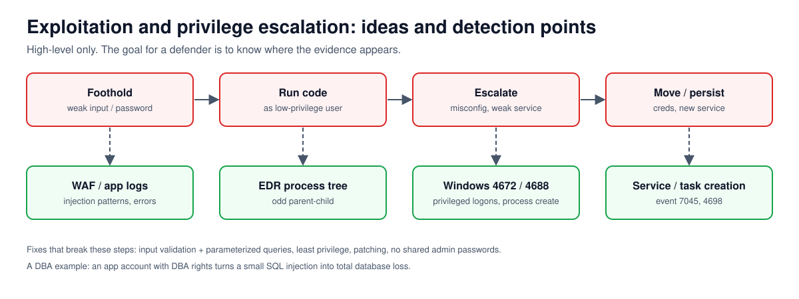

# 04. Exploitation and privilege-escalation concepts (high level)

> **Module:** 09 · Pentesting Fundamentals · **Week:** 15 · **Time:** ~3 hours
> **You will:** explain, at idea level, how a weakness becomes a foothold, how an attacker raises privileges and moves sideways, where each step leaves evidence, and which controls break each step.
> **Certification map:** Security+ domain 2 (attack types, privilege escalation, lateral movement) and domain 4; CySA+; MITRE ATT&CK tactics (Initial Access, Execution, Privilege Escalation, Credential Access, Lateral Movement).
> **Scope of this lesson:** **concepts and detection only.** There is no exploit code here, and none should be written for systems you do not own. Real exploitation practice belongs on TryHackMe, HTB or your own lab machines.

---

## 1. Why it matters in a SOC / cloud-security job

A defender who understands *why* each attacker step works can **break the chain** and **spot it**.

- The pentest report you receive will say "we got a shell, escalated to administrator, and reached the database". You must know what each step means and which logs show it.
- When you triage an EDR alert (module 07) you are looking at one link of this chain.
- The best fix is usually early in the chain (patch, input handling, least privilege), but **detection later in the chain** saves you when prevention fails.

---

## 2. Understand it



### 2.1 What "exploitation" means

**Exploitation** is using a weakness to make a system do something its owner did not intend. The weakness may be:

| Class | Idea | Example (concept) |
|---|---|---|
| **Software flaw** | A bug lets input take control | Memory-corruption bug in a service; unsafe deserialization |
| **Input handling** | Data treated as code | SQL injection, command injection (lesson 03) |
| **Weak or stolen credentials** | Logging in is easier than hacking | Default passwords, password reuse, leaked keys in a repository |
| **Misconfiguration** | A setting gives too much | Open admin interface, storage readable by everyone, `PUBLIC` grants |
| **Logic flaw** | The design can be abused | Changing a price or a user ID in a request |
| **Human** | Persuade a person | Phishing (module 03 and 05) |

In a pentest, a **proof** is enough: show that the weakness is real and what it can reach, then stop. Professional testers avoid damage and data copying beyond what is needed.

### 2.2 A typical chain (conceptual)

1. **Initial foothold:** a weak input, password or exposed service gives a first position, usually with **low privileges** (a web service account or a normal user).
2. **Execution:** the attacker runs something on the target as that low-privilege user.
3. **Privilege escalation:** gain more rights (administrator, `root`, `SYSTEM`, a cloud role).
4. **Credential access:** find passwords, tokens or keys to reuse.
5. **Lateral movement:** use those credentials to reach other systems.
6. **Persistence:** make access survive reboots and password resets.
7. **Objective:** data, ransomware, fraud, or "prove the report".

### 2.3 Privilege escalation: common ideas

| Type | Idea | Typical cause | Defender control |
|---|---|---|---|
| **Vulnerable software or kernel** | A local flaw lets a normal user become admin | Missing patches | Patch (module 08), exploit protection |
| **Misconfigured permissions** | Writable service binary, writable script run by an admin, weak file ACLs | Bad defaults, rushed installs | Least privilege, file permission audits |
| **Unquoted or weak service paths** | A service runs a program from a path an attacker can influence | Packaging mistakes | Hardened installs, code signing |
| **Excess sudo or admin rights** | A user may run a powerful command as root | "Convenience" rules | Review `sudoers`; just-in-time access |
| **Stored credentials** | Passwords in scripts, config, history, memory | Poor secrets handling | Vaults, rotation, LSA protection |
| **Token or role abuse in cloud** | A role can pass or assume a stronger role | Over-broad IAM | IAM review, permission boundaries |
| **Database privileges** | An account with `CREATE ANY PROCEDURE` or `ALTER ANY` rights becomes DBA | Over-granted roles | Least privilege, review of system privileges |

### 2.4 Where each step shows in your logs

| Step | Evidence | Examples |
|---|---|---|
| Initial foothold via web flaw | WAF and web-server logs; app errors; unusual child processes of the web server | Many 500 errors; `w3wp.exe` or `httpd` starting a shell (module 07 table) |
| Execution | EDR process tree; Sysmon 1; Linux `auditd` execve | Parent-child anomalies |
| Privilege escalation | Windows 4672 (special privileges assigned), 4688; new members of admin groups (4728, 4732); `sudo` logs on Linux | A normal account suddenly using admin tools |
| Credential access | Sysmon 10 on LSASS; access to credential stores; failed logons 4625 bursts | Module 07 lesson 04 |
| Lateral movement | Logons type 3 and 10 (4624) from workstation to server; remote service creation 7045; scheduled task 4698; SMB admin shares | A workstation logging on to many servers |
| Persistence | Services, tasks, Run keys, new accounts (4720), WMI | Module 07 lesson 04 |
| Database | Audit trail: new `GRANT` statements, changes to `SYS`/roles, new users, logins from new hosts | Oracle unified audit policies |

### 2.5 Breaking the chain: defense in depth

| Step | Prevent | Detect | Respond |
|---|---|---|---|
| Foothold | Patch, input handling, MFA, no default passwords | WAF, app and DB logs | Block, fix, reset |
| Execution | Allow-listing, ASR, least privilege | EDR | Kill, isolate |
| Escalation | Patch, least privilege, no local admin | 4672, group changes | Reset, remove rights |
| Credential access | LSA protection, Credential Guard, vaults | LSASS access alerts | Reset all exposed secrets |
| Lateral movement | Segmentation, unique local admin passwords (LAPS), tiered admin model | Unusual logons | Isolate, disable account |
| Persistence | Control changes, app control | New services and tasks | Remove, hunt |

Most **repeated** pentest findings come from three causes: **missing patches, excess privileges, and reused or exposed credentials**. Fixing these gives the biggest return.

### 2.6 ATT&CK as the shared language

Pentesters and defenders both use **MITRE ATT&CK** to describe steps. A good report maps each finding or attack path to ATT&CK techniques, so the SOC can check: "Did we have a detection for T1003.001? Did it fire during the test?" That is the heart of purple teaming (lesson 01).

The library's ATT&CK playbook document gives, per technique, the telemetry needed, the entity keys to join, a portable detection idea and legitimate explanations. Use that pattern when you turn a pentest finding into a detection.

---

## 3. From DBA to security

> **From DBA to security.**
> - **Privilege escalation inside Oracle** is a DBA topic you already know: a user with `CREATE ANY PROCEDURE`, `EXECUTE ANY PROCEDURE`, `ALTER USER` or the `SELECT ANY DICTIONARY` privilege can often reach DBA-level power. **Review who has `ANY` privileges** with `DBA_SYS_PRIVS`. This is the database form of lesson 2.3.
> - **Lateral movement** through **database links** and shared credentials: a compromised low-value database can reach a production one. Audit `DBA_DB_LINKS`.
> - **Credentials in scripts** (a password in a backup shell script, a wallet readable by everyone) are classic findings.
> - **OS to DB:** the `oracle` OS user owns the data files. A compromised server means a compromised database. Protect the OS layer.
> - **Detection:** unified audit policies on `GRANT`, `ALTER USER`, `CREATE USER`, and logon failures; send them to the SIEM (module 11).

---

## 4. Hands-on

### 4.1 Repo lab: the SQL injection chain, in memory

The lab shows a **small chain** end to end, all inside one Python process: injection → login as admin (a privilege jump) → the fix. The tests that prove it (real names and results):

```text
test_pentest_lab.py::test_sqli_bypasses_password_on_vulnerable_login PASSED
test_pentest_lab.py::test_sqli_comment_logs_in_as_admin_without_password PASSED
test_pentest_lab.py::test_parameterized_login_blocks_both_payloads PASSED
```

(Run with `.venv/Scripts/python -m pytest cybersecurity-track/09-pentesting-fundamentals -o addopts="--import-mode=importlib" -v -k "sqli or admin or parameterized"` to see names. The default settings print dots.)

Then ask yourself, as a defender: **at which step would my logs have shown this?** (The web app would have logged a login success for `admin` from a user who never entered the admin password: the audit trail needs the *source IP* and the *method*.)

### 4.2 Paper exercise: map a chain to detections (45 minutes)

Take this fictional story and fill a table with step, ATT&CK technique, log source and detection idea:

> A visitor finds a SQL injection in `shop.example`'s search page. The web service account can read the customer table. A config file contains a database admin password. The attacker logs into the database from the web server, creates a user, and exports the table.

Check yourself against 2.4 and 2.5. Then write two **preventive** fixes and one **detective** fix.

### 4.3 Optional: practice on legal platforms

- TryHackMe and HTB have beginner "privilege escalation" content for Windows and Linux. Do it **inside the platform**. Pause after each step and ask: what log would this create?
- HTB **Sherlocks** let you do the defender side of similar attacks.

---

## 5. Practice platforms

- TryHackMe: search for "Linux PrivEsc", "Windows PrivEsc" and the Jr Penetration Tester path; **SOC Level 1 / 2** for detection.
- HTB Academy: **Linux Privilege Escalation** and **Windows Privilege Escalation** modules (attacker view), **SOC Analyst** path (defender view).
- Only inside the platform's terms.

---

## 6. Three realistic scenarios

**Scenario 1: Report says "domain admin in 4 hours".**
*What happened:* the tester used a phishing foothold, found a service-account password in a script, and used it to reach a server where a domain admin was logged in. *Investigate:* which of the three common causes apply? *Do:* remove passwords from scripts (vault), tier admin accounts, enable LAPS, add detection for credential access, and retest.

**Scenario 2: Normal user in admin group.**
*What happened:* event 4732 shows a user added to local Administrators at 03:00. *Investigate:* who made the change? Is there a ticket? *Do:* if no ticket, treat as escalation: remove, investigate the actor's account and host.

**Scenario 3: Database user with `ANY` privileges.**
*What happened:* a quarterly review finds a reporting account with `ALTER ANY PROCEDURE`. *Do:* remove the privilege, check the audit trail for use, document, and add a review job.

---

## 7. Common mistakes

1. Thinking that exploitation always needs a clever bug. Most real compromises use weak or reused credentials.
2. Treating a "low" finding as unimportant: attackers **chain** low issues.
3. Detecting only at the end (data theft) and not earlier steps.
4. Shared admin passwords across servers.
5. Over-granted database and cloud roles "for convenience".
6. A pentest report filed and forgotten.
7. Running exploit tools you do not understand, on systems you do not own.

---

## 8. Interview questions

<details><summary><b>Q1. What is privilege escalation? Vertical vs horizontal?</b></summary>Gaining rights beyond those you started with. Vertical: from a normal user to admin or root. Horizontal: staying at the same level but acting as another user or reaching another user's data.</details>

<details><summary><b>Q2. Give three common causes of privilege escalation.</b></summary>Missing patches on local flaws, misconfigured permissions (writable service files, excess sudo), and stored credentials in scripts and configs.</details>

<details><summary><b>Q3. What is lateral movement and how do you detect it?</b></summary>Moving from one compromised system to others with stolen credentials. Detect by unusual logons between hosts (4624 types 3 and 10), remote service or task creation (7045, 4698), and EDR alerts. Prevent with segmentation, LAPS and tiered admin.</details>

<details><summary><b>Q4. Which Windows event shows special privileges assigned to a logon?</b></summary>4672.</details>

<details><summary><b>Q5. Why are chained "low" findings important?</b></summary>An attacker combines small weaknesses (information leak, weak permission, reused password) into a serious compromise. Severity depends on the chain.</details>

<details><summary><b>Q6. How does a DBA-level view help here?</b></summary>Database privileges (`ANY` privileges, roles, links, wallet access) are a primary escalation path. Reviewing grants and auditing privilege changes reduces risk.</details>

<details><summary><b>Q7. What three fixes remove most repeat pentest findings?</b></summary>Patching, least privilege, and proper credential management (unique passwords, vaulting, MFA).</details>

<details><summary><b>Q8. How do you use ATT&CK with a pentest report?</b></summary>Map each attack step to techniques, check if detections exist and fired during the test, then close gaps. This is the purple-team loop.</details>

<details><summary><b>Q9. What is LAPS?</b></summary>Local Administrator Password Solution: it gives each machine a unique, rotated local admin password, so one stolen password does not unlock every machine.</details>

<details><summary><b>Q10. Scenario: the tester got a shell through the web server. What do you check first?</b></summary>The web server's process tree (a web process starting a shell), the account it runs as and its privileges, where it can connect (network segmentation), and what credentials are stored on that host.</details>

<details><summary><b>Q11. Should a pentester keep exploiting after proof of impact?</b></summary>No. Stop at proof within the rules of engagement. Avoid data loss, outages and copying more data than needed.</details>

---

## 9. Checklist

- [ ] I can describe the seven-step chain in my own words.
- [ ] I can name a log source for each step.
- [ ] I did the paper exercise and wrote two preventive and one detective fix.
- [ ] I know I do not practice exploitation outside labs and platforms built for it.

## 10. References

- MITRE ATT&CK Enterprise tactics: https://attack.mitre.org/tactics/enterprise/
- CIS Controls v8 (access control, least privilege): https://www.cisecurity.org/controls
- Microsoft Learn, Local Administrator Password Solution.
- Oracle Database Security Guide (privileges and auditing) for your version: https://docs.oracle.com/en/database/
- Library: ATT&CK playbooks and the pentest books (concepts only).

Previous: [03](03-web-app-testing-and-burp.md) · Next: [05. Report writing and using results](05-reporting-and-using-results.md)
