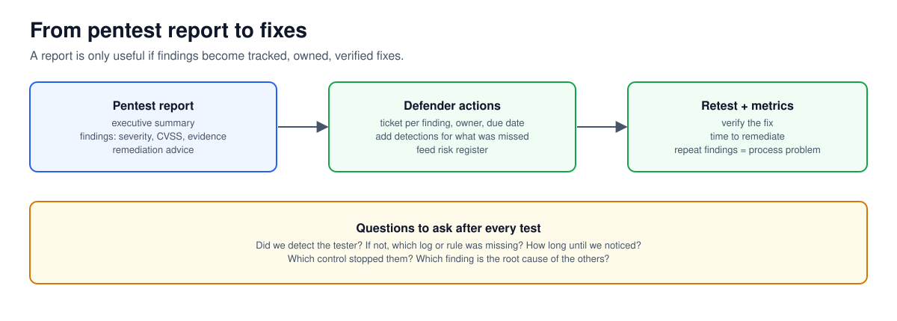

# 05. Report writing, and how defenders use pentest results

> **Module:** 09 · Pentesting Fundamentals · **Week:** 15 · **Time:** ~4 hours
> **You will:** write a clear finding (title, severity, CVSS, evidence, impact, remediation), write an executive summary a manager can read in one minute, generate a Markdown report from structured data, and turn a report into tracked fixes and new detections.
> **Certification map:** Security+ domain 5 (reporting, communication) and domain 4; CySA+ (reporting and communication); ISO/IEC 27001:2022 Annex A 8.29 (security testing).
> **Lab:** [`lab/report_gen.py`](lab/report_gen.py) (offline, synthetic findings).

---

## 1. Why it matters in a SOC / cloud-security job

A test that is not understood is wasted money. The **report** is the product.

- If you are on the **receiving** side, you must read it critically: Is the evidence clear? Is the severity right for *our* business? What do we fix first?
- If you write **findings** (for your own internal tests, a vulnerability assessment or an incident), the same skills apply.
- Your managers and auditors will read the first page only. It must be good.

---

## 2. Understand it



### 2.1 Report structure

| Section | Reader | Content |
|---|---|---|
| **Executive summary** | Managers, board | In plain language: what was tested, the overall result, the top risks, what to do first. Half a page. No jargon |
| **Scope and method** | Auditors, technical leads | Targets, dates, type of test, rules of engagement, tools, limits (what was *not* tested) |
| **Findings overview** | Everyone | A table: ID, severity, asset, title |
| **Detailed findings** | Engineers | One block per finding (below) |
| **Positive observations** | Everyone | What worked well (it motivates and informs) |
| **Appendices** | Technical | Raw evidence, tool output, methodology details |

### 2.2 Anatomy of a good finding

| Field | What to write | Poor example | Good example |
|---|---|---|---|
| **Title** | The weakness and where | "Bad login" | "SQL injection in login form" |
| **Severity** | Critical / High / Medium / Low / Informational, with the reason | "High" | "Critical: no authentication needed, full account takeover" |
| **CVSS** | Vector and score (v4.0 or v3.1; say which) | "10" | "CVSS-B 9.3 (v4.0) with the vector string" |
| **CWE / OWASP** | The weakness class | none | "CWE-89, OWASP A05 Injection" |
| **Asset** | Exact URL, host, parameter | "the web" | "shop.example /login, parameter `username`" |
| **Description** | One short paragraph: what is wrong and why | long theory | "The query is built by joining strings." |
| **Evidence** | **Reproducible** steps, requests and responses, screenshots, timestamps (redact secrets) | "It works" | Exact request, response snippet, time, tester IP |
| **Impact** | What an attacker gains, in **business** terms | "Bad" | "Login bypass as any user, including admin; likely read of all accounts" |
| **Remediation** | A specific fix and a better long-term fix | "Fix input" | "Use parameterized queries; give the app DB account only the rights it needs" |
| **References** | CWE, OWASP, vendor docs | | |
| **Status / retest** | Open, fixed, accepted | | |

Rules for evidence and writing:

1. **Show, do not claim.** Another person must be able to reproduce it.
2. **Redact** real passwords, tokens and personal data. Store the raw evidence securely.
3. Use **short sentences and simple words.** (This also helps readers who work in a second language.)
4. **One finding, one problem.** Group *the same cause* in many places into a single finding with a list of locations.
5. **Rate by context.** CVSS base is a start; adjust with business impact and exposure (module 08).
6. **Be fair and factual.** No blame, no drama.

### 2.3 Severity and CVSS

Common qualitative bands (CVSS): 0.0 none or informational, 0.1-3.9 low, 4.0-6.9 medium, 7.0-8.9 high, 9.0-10.0 critical. The lab has `severity_from_cvss` and tests for the boundaries (0.0, 3.9, 4.0, 7.0, 8.9, 9.0).

Pentest severity often combines **CVSS** and **likelihood x impact** for the client. Agree the method in the scope document. Two vendors may rate the same finding differently: ask for the vector and the reasoning.

### 2.4 The executive summary

Good formula, five sentences:

1. What was tested and when.
2. The overall result in one sentence.
3. The most important risk, in business words.
4. The three actions to take first.
5. What was not covered.

The lab's generator builds a short one from the data. Real output (below) uses the counts and the top finding.

### 2.5 The lab's report generator

`report_gen.py` takes structured `Finding` objects and produces Markdown:

- **Validates** every finding: every required field must be filled (a missing remediation raises an error), severity must be known, CVSS between 0 and 10.
- **Orders** findings by severity, then CVSS (high first), then title, and assigns IDs `F-01`, `F-02`, ...
- Writes the executive summary, an overview table and detailed finding blocks.

Run it:

```bash
.venv/Scripts/python cybersecurity-track/09-pentesting-fundamentals/lab/demo.py
```

The report section of the real output (the first part; the demo prints all three findings):

```text
=== 5. GENERATED REPORT (Markdown) ===
# Synthetic Web Test Report

**Scope:** shop.example (lab, authorised)  
**Test window:** 2026-11-18 to 2026-11-19

## 1. Executive summary

The test found 3 issue(s): 1 critical, 1 medium, 1 informational. Immediate action is needed on the most severe items. The most serious finding is "SQL injection in login form" on shop.example /login.

## 2. Findings overview

| ID | Severity | CVSS | Asset | Title |
|---|---|---|---|---|
| F-01 | Critical | 9.8 | shop.example /login | SQL injection in login form |
| F-02 | Medium | 6.1 | shop.example /search | Reflected cross-site scripting in search |
| F-03 | Informational | 0.0 | shop.example | Server version disclosed in HTTP header |

## 3. Detailed findings

### F-01: SQL injection in login form

- **Severity:** Critical (CVSS 9.8)
- **Asset:** shop.example /login
- **Weakness:** CWE-89

**Description.** The login query is built by joining strings, so input changes the SQL.

**Evidence.** Submitting a quote-and-comment payload as the username logged in as 'admin'.

**Impact.** Full authentication bypass and likely read access to the user table.

**Remediation.** Use parameterized queries, least-privilege DB account, and generic error messages.

**References:** OWASP Top 10: Injection, CWE-89
```

Notice that the input listed the XSS finding **first** in the list, but the report puts the critical SQL injection first. Ordering is done by code, so reports stay consistent. (The sample findings are fiction; the CVSS numbers are examples.)

Tests (in `lab/test_pentest_lab.py`) check: severity order; ties broken by CVSS; all three sections exist and the critical finding comes first; the summary counts; an empty report is handled; a missing remediation or bad severity or CVSS is **rejected**; and CVSS to severity bands.

### 2.5b Break it yourself

1. Add a fourth finding of severity `High` with CVSS 8.8. Where does it appear? (Between Critical and Medium.)
2. Add two `High` findings with CVSS 7.1 and 8.8. Which comes first? (8.8: ties are broken by CVSS.)
3. Make a finding with an empty `evidence`. What happens? (A `FindingError` names the missing field. A report with an unproven finding should not be sent.)
4. Add a `status` field (`open`, `fixed`, `accepted`) and print a retest table. Write the test first.
5. Add a **JSON** export so findings can flow into a ticket system. Which fields must be kept?

---

## 3. How defenders use pentest results

After the report arrives, the real work starts.

### 3.1 From report to action

| Step | Action | Owner |
|---|---|---|
| 1 | **Triage within days:** read the report; confirm findings; rate by *your* business risk | Security + system owners |
| 2 | **Ticket per finding** with owner, severity, due date (use your SLA tiers from module 08) | Security |
| 3 | **Fix:** patch, change code, change configuration; or mitigate | Owners |
| 4 | **Exceptions** for items that cannot be fixed: approver, controls, end date | Risk owner |
| 5 | **Retest:** the tester or you confirms the fix | Security |
| 6 | **Report to management:** counts, trend, SLA status | Security |

### 3.2 Turn findings into detections

For each attack step in the report, ask the **detection questions**:

1. **Did we see it?** Search logs for the tester's source IP and time window.
2. **Which log source would show it?** (WAF, EDR, DB audit, cloud logs)
3. **Did an alert fire?** If yes, how fast, and was it triaged correctly? If no, write one.
4. **Can we make it harder?** Block, rate limit, add MFA, reduce rights.

Record the answers in a table (finding, ATT&CK technique, detected: yes/no, gap, new rule, owner). Over time this becomes your **detection coverage map**. The first week after a test is the best time to improve detections: the evidence is fresh.

### 3.3 Find root causes and patterns

If five findings come from one cause (for example "string-built SQL in five endpoints"), fix the **cause**: a coding standard, a shared data-access layer, a developer training session, a static analysis rule in CI. Track **repeat findings** between tests: a repeat is a process failure.

### 3.4 Retest

A fix is not done until it is **verified**. Ask for a retest (often included for a limited time in the contract). Update the status: open, fixed (verified), accepted (exception).

---

## 4. From DBA to security

> **From DBA to security.**
> - **A finding** = **an incident or health-check item**: symptom, evidence (log, AWR snippet), root cause, fix, verification. You write these already in post-incident reviews.
> - **Executive summary** = **the management summary** at the top of a DR test or audit report. Same rule: lead with the business effect.
> - **Retest** = **post-patch validation**.
> - **Tester source IPs and DB audit trail**: you can match a test to its entries in `UNIFIED_AUDIT_TRAIL`. That is a good exercise in correlation.
> - **The injection finding** often lands on your desk too: the fix involves the application's database account and privileges.

---

## 5. Hands-on

Beyond the lab run above:

1. **Write one finding by hand** for the lab's XSS issue. Use the table in 2.2, with short sentences. Then compare it with the generator's output.
2. **Write the executive summary** (five sentences) for the lab's three findings, as if for your CEO. Have a friend (or an AI assistant) check that it has no jargon.
3. **Detection table:** for the three lab findings, fill: technique (CWE/ATT&CK), log source, detection rule idea, owner.
4. **Optional:** use a free template (for example the Markdown reports published in public pentest report repositories) to compare structure. Do not copy content.
5. Store your report and detection table in your portfolio (module 13). Use only synthetic or lab data.

Run the tests once more:

```text
.............................                                            [100%]
29 passed in 0.16s
```

---

## 6. Practice platforms

- TryHackMe and HTB Academy: after each room or module, **write a short finding** in this format. HTB Academy's pentesting paths include reporting guidance.
- HTB **Sherlocks**: write an investigation summary with a timeline.
- PortSwigger Web Security Academy: practise describing impact in plain words.
- Public bug-bounty write-ups are a good source of *style* (read, do not copy).

---

## 7. Three realistic scenarios

**Scenario 1: Report arrives with 40 findings.**
*What happened:* the team is overwhelmed. *Do:* sort by severity and exposure; group by root cause; set P1 to P4 tickets with due dates; send the top 5 plan to management; schedule a retest.

**Scenario 2: Disagreement on severity.**
*What happened:* the tester rates an internal-only issue "High"; the business says "Low". *Do:* compare CVSS vectors; add environmental context (internal, needs a valid login, low-value data); agree a final rating and write the reason in the ticket.

**Scenario 3: "We never saw the pentest."**
*What happened:* the tester ran for two days; the SOC had no alert. *Do:* this is the best finding. Build a table of which steps were visible in logs and which were not; add detections for the top three gaps; repeat as a purple-team run in a month.

---

## 8. Common mistakes

1. An executive summary full of jargon.
2. Findings without reproducible evidence.
3. Severity with no reasoning.
4. Remediation that says only "sanitize inputs".
5. Not saying what was **not** tested.
6. Putting real secrets or personal data in the report. Redact, and protect the document.
7. Filing the report and never retesting.
8. Fixing only the examples and not the root cause.

---

## 9. Interview questions

<details><summary><b>Q1. What goes into a good pentest finding?</b></summary>A clear title, severity with reasoning (and CVSS), the exact asset, a short description, reproducible evidence, impact in business terms, a specific remediation, and references.</details>

<details><summary><b>Q2. What belongs in an executive summary?</b></summary>What was tested and when, the overall result, the top risks in business words, the first actions, and the limits of the test. Plain language, half a page.</details>

<details><summary><b>Q3. Why sort findings by severity automatically?</b></summary>For consistent reports and so the most important items come first. Ties are broken by CVSS and a stable rule, like the lab does.</details>

<details><summary><b>Q4. How do you decide the order of fixes after a pentest?</b></summary>By real risk: severity, exploitability, exposure, asset value and whether it chains with other findings, with SLAs per tier (module 08).</details>

<details><summary><b>Q5. How do you use a pentest to improve detection?</b></summary>For each attack step check whether logs show it and whether an alert fired. If not, write or tune a detection, then test it again in a purple-team run.</details>

<details><summary><b>Q6. What is a retest?</b></summary>A check that a fix works, ideally by the tester. Findings are closed on evidence.</details>

<details><summary><b>Q7. How do you handle sensitive data in evidence?</b></summary>Redact it in the report, keep raw evidence encrypted with limited access, and delete it at the end of the agreed retention period.</details>

<details><summary><b>Q8. Two testers rate the same bug differently. What do you do?</b></summary>Compare vectors and assumptions, add environmental context, agree a rating and note the reason.</details>

<details><summary><b>Q9. What is a repeat finding and why does it matter?</b></summary>The same weakness found in successive tests. It means the root cause (process, training, design) was not fixed.</details>

<details><summary><b>Q10. Scenario: management asks "are we secure?" after a clean pentest. What do you say?</b></summary>"The test found no critical issues in the scope and time we tested. It is a snapshot, not a guarantee. We keep scanning, patching and monitoring, and we will test again after major changes."</details>

<details><summary><b>Q11. A finding says "SQL injection". What would you do as the DBA?</b></summary>Help restrict the application account to least privilege, review audit logs for abuse, support developers with parameterized queries, add alerts for unusual statements, and help retest.</details>

---

## 10. Checklist

- [ ] I can write a finding with every field in 2.2.
- [ ] I ran the report generator and changed a finding to see the order change.
- [ ] I wrote a five-sentence executive summary.
- [ ] I filled a detection table for the three lab findings.
- [ ] I know the six-step "report to action" flow.

## 11. References

- PTES reporting guidelines: http://www.pentest-standard.org/
- OWASP Web Security Testing Guide, reporting chapter: https://owasp.org/www-project-web-security-testing-guide/
- FIRST CVSS v4.0: https://www.first.org/cvss/v4-0/
- NIST SP 800-115 (reporting): https://csrc.nist.gov/pubs/sp/800/115/final
- MITRE ATT&CK: https://attack.mitre.org/
- Library: Burp Suite use cases and the pentest books (concepts only).

Previous: [04](04-exploitation-and-privilege-escalation-concepts.md) · Back to [module README](README.md)
