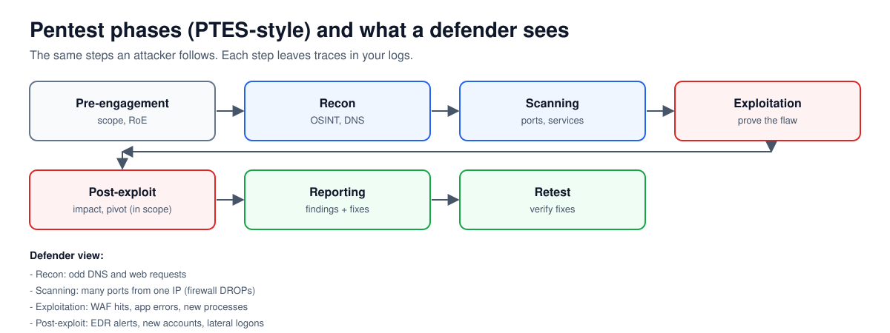

# Module 09. Pentesting Fundamentals (for a defender)

> **Weeks:** 13 to 15 · **Time:** ~24 hours · **Level:** "pentest idea" for a SOC and cloud-security professional
> **You will:** understand how penetration tests are authorized, planned, run and reported; see SQL injection and XSS in a safe in-memory lab; read nmap traces in logs; and turn pentest results into fixes and detections.

> **The one rule: test only what you own or are authorized in writing to test.**
> This module does not make you a pentester. It makes you a better defender, because you know how attackers think and what they leave behind.

## Learning path

| # | Lesson | Week | Certification objective |
|---|---|---|---|
| 01 | [Ethics, authorization, scope and methodology](01-ethics-scope-and-methodology.md) | 13 | Security+ D5; PTES, OWASP WSTG, NIST SP 800-115 |
| 02 | [Recon and scanning concepts (nmap)](02-recon-and-scanning.md) | 14 | Security+ D2/D4; Network+ ports and TCP |
| 03 | [Web app testing: OWASP Top 10, SQLi, XSS, Burp (+ lab)](03-web-app-testing-and-burp.md) | 14-15 | Security+ D2/D4; OWASP Top 10 2025 |
| 04 | [Exploitation and privilege-escalation concepts](04-exploitation-and-privilege-escalation-concepts.md) | 15 | Security+ D2; ATT&CK tactics |
| 05 | [Report writing and using results (+ lab)](05-reporting-and-using-results.md) | 15 | Security+ D5; CySA+ reporting |

Check the official CompTIA, ISC2 and Microsoft pages before booking any exam. Security+ SY0-701 and SY0-801 (launched 17 November 2026) share these concepts.

## Lab (fully offline and self-contained)

[`lab/`](lab/) runs inside one Python process. There is no web server, no network, and no real target. The "vulnerable app" is a toy with an in-memory sqlite database and fake users.

```bash
.venv/Scripts/python -m pytest cybersecurity-track/09-pentesting-fundamentals     # 29 tests
.venv/Scripts/python cybersecurity-track/09-pentesting-fundamentals/lab/demo.py
```

| File | Purpose |
|---|---|
| `mini_app.py` | SQL injection in a login query vs the parameterized fix; reflected XSS vs output encoding |
| `report_gen.py` | Structured findings to a Markdown report with severity ordering and validation |
| `scope_and_scan.py` | `ScopeGuard` (scope, exclusions, time window) and a port-scan detector for synthetic firewall logs |
| `demo.py` | Prints all of the above |
| `test_pentest_lab.py` | 29 tests: attacks work on the vulnerable version only, fixes do not break normal use, reports reject incomplete findings |



## Key terms

| Term | Meaning |
|---|---|
| **Pentest** | An authorized attempt to break in, to find and prove weaknesses |
| **Scope / RoE** | What may be tested / the rules of the test |
| **Black / grey / white box** | No / some / full knowledge for the tester |
| **Red / blue / purple team** | Attackers / defenders / both together |
| **PTES, WSTG** | A pentest process standard / the OWASP web test guide |
| **Recon** | Gathering information about a target (passive or active) |
| **SQL injection (CWE-89)** | User input changes a SQL query |
| **XSS (CWE-79)** | User input runs as script in a browser |
| **Parameterized query** | Bind variables: code and data on separate channels |
| **Output encoding** | Converting special characters so they show as text |
| **Burp Suite** | Intercepting proxy for web testing |
| **Privilege escalation** | Gaining more rights than you started with |
| **Finding** | One documented weakness with evidence, impact and fix |
| **Retest** | Verifying that a fix works |

## How this connects to your job

- **SOC:** you recognize scans, injection strings and escalation steps in logs, and you tell tests from attacks using the schedule and IP list.
- **Cloud security:** pentest reports on cloud apps feed your fix list; the same web flaws exist in cloud-hosted apps.
- **DBA bridge:** bind variables stop injection; least privilege limits damage; the audit trail shows abuse. You already own these skills.
- **Reporting:** reading a report critically and tracking fixes is a daily skill.

## Mini-project (about 6 hours)

**"Fix the toy app and prove it."**

1. Add a third lab function: a **product search** against a `products` table in sqlite, written in the vulnerable way. Add a probe that dumps rows from another table through a `UNION`-style input (in the lab database only).
2. Write the **failing tests first**, then the parameterized fix, and show tests pass.
3. Add a **least-privilege demonstration**: open a second connection that is read-only to the `products` table only (for example by using a separate database file) and show what the injection can and cannot reach.
4. Add two findings to `sample_findings()` and generate the report.
5. Write a **detection table** (finding, log source, rule idea) and a one-page **executive summary**. Put everything in your portfolio (module 13).

## Practice on TryHackMe / HTB (legal, built for it)

- TryHackMe: **Cyber Security 101**, then the **Jr Penetration Tester** path for the attacker view and **SOC Level 1 / 2** for the defender view. Search for Nmap, Burp Suite, SQL Injection and OWASP Top 10 rooms.
- HTB Academy: **Network Enumeration with Nmap**, **Using Web Proxies**, **SQL Injection Fundamentals**, **Penetration Testing Process**, and the **SOC Analyst** path (leads to the HTB CDSA certification).
- HTB Labs: **Sherlocks** for defensive investigations.
- Also free: PortSwigger Web Security Academy; OWASP Juice Shop and DVWA run locally in Docker (do not expose them).
- **Never** test a system you do not own or lack written permission for.

## Interview questions (module level)

<details><summary><b>Q1. What must exist before a penetration test starts?</b></summary>Written authorization from someone with authority, a defined scope and exclusions, rules of engagement, test window, contacts and an emergency stop process.</details>

<details><summary><b>Q2. Explain SQL injection and the fix to a developer.</b></summary>String-built SQL lets input become code. Use parameterized queries so data stays data. Add a least-privilege DB account and generic errors.</details>

<details><summary><b>Q3. Explain it to a DBA.</b></summary>It is hard-parse-style SQL built by concatenation. Bind variables fix both the performance and the security problem. Check the audit trail for odd statements from the app user.</details>

<details><summary><b>Q4. How does a SYN scan look in logs compared to a connect scan?</b></summary>A SYN scan shows in firewall and IDS logs (many probes, resets) but rarely in application logs. A connect scan completes the handshake and shows in application and listener logs too.</details>

<details><summary><b>Q5. Vulnerability assessment vs pentest vs red team?</b></summary>Assessment: broad list of weaknesses. Pentest: exploits them within scope to prove impact. Red team: goal-based stealth simulation that also tests detection and response.</details>

<details><summary><b>Q6. What does reflected XSS need to work, and how do you stop it?</b></summary>The app returns user input in a page without encoding. Stop it with context-aware output encoding, CSP and secure cookie flags.</details>

<details><summary><b>Q7. What would you do with a pentest report?</b></summary>Triage by real risk, ticket with owners and SLAs, fix or mitigate, record exceptions, retest, and add detections for steps we did not see.</details>

<details><summary><b>Q8. How do you tell an authorized pentest from a real attack in the SOC?</b></summary>Check the schedule, scope and tester IP list. Even for an authorized test keep monitoring, in case a real attacker hides behind it.</details>

<details><summary><b>Q9. What is the first thing a privilege-escalation review should check?</b></summary>Patch level, over-broad permissions and admin rights, and stored credentials. Those three explain most escalations.</details>

<details><summary><b>Q10. Why are the lab's passwords in plain text, and why is that wrong in real life?</b></summary>To keep the toy simple. Real systems store salted, slow hashes, because plain text turns any leak into a full credential breach.</details>

## References

- OWASP Top 10, WSTG and Cheat Sheet Series: https://owasp.org/
- PTES: http://www.pentest-standard.org/ · NIST SP 800-115: https://csrc.nist.gov/pubs/sp/800/115/final
- MITRE ATT&CK: https://attack.mitre.org/ · CWE: https://cwe.mitre.org/
- PortSwigger Web Security Academy: https://portswigger.net/web-security
- Nmap reference guide: https://nmap.org/book/man.html
- Library (concepts only, paraphrased): Burp Suite 27 use cases; Login Page Security Testing Handbook; Kali / PWK pentest books; ATT&CK playbooks.
