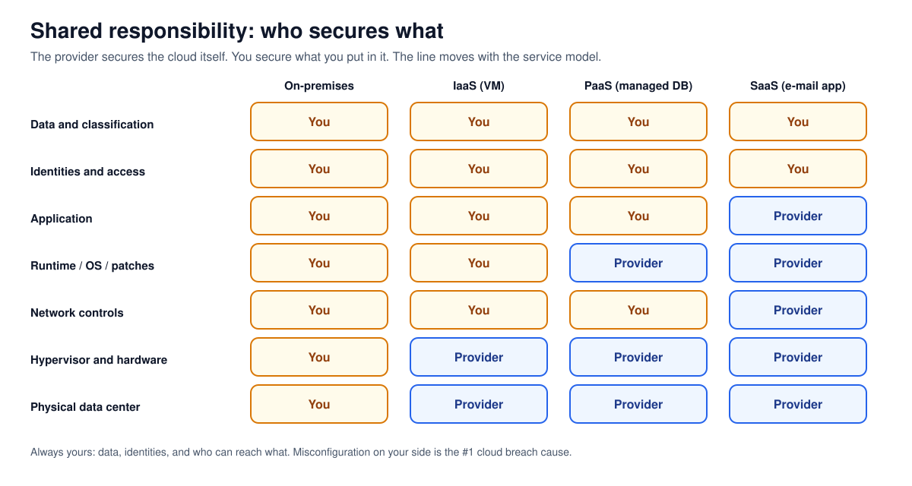

# 01. Cloud Security Fundamentals

> **Module:** 10 · Cloud Security · **Week:** 6 · **Time:** about 5 hours
> **You will:** explain shared responsibility for IaaS, PaaS and SaaS, name the security pillars of the big cloud frameworks, describe a landing zone, and read a CIS benchmark control.
> **Maps to:** Security+ SY0-701/801 (cloud models, shared responsibility) · AWS Security Specialty (foundations) · SC-900 · CCSP domain 1

## 1. Why it matters in a cloud-security / SOC job

- **Capital One, 2019.** An attacker used a server-side request forgery (SSRF) bug in a web app firewall setup to reach the instance metadata service and get temporary role credentials. The role could read many S3 buckets. The lesson: a small bug plus an over-powerful role equals a large breach. Both sides of the shared model failed.
- **Code Spaces, 2014.** An attacker got into the company's AWS console, demanded money, and deleted data and backups. The company closed. The lesson: separate backup access from daily admin access.
- **Everyday.** Most alerts you see are "someone made storage public", "key used from a strange place", or "MFA missing". Knowing who owns each control tells you who to call.

## 2. Understand it

### 2.1 Shared responsibility



| Model | Example | Provider secures | You secure |
|---|---|---|---|
| IaaS | EC2, Azure VM | Hardware, hypervisor, data center | Guest OS patches, network rules, apps, data, identity |
| PaaS | RDS, Azure SQL, App Service | The above plus OS and DB engine | Data, identity, network exposure, configuration, some patching choices |
| SaaS | Microsoft 365, Salesforce | Almost everything | Users, MFA, sharing settings, data, who gets licenses |

Rule: **data, identity and access are always yours.** Read each service's own page, because the exact split differs per service.

### 2.2 The cloud security pillars

Both AWS and Microsoft publish a "well-architected" framework with a security pillar. The names differ, the ideas are the same:

| Area | Question it answers | Example control |
|---|---|---|
| Identity and access | Who can do what? | Roles, MFA, least privilege |
| Detection | Will we see an attack? | CloudTrail, GuardDuty, alerts to SIEM |
| Infrastructure protection | What can reach what? | Private subnets, security groups |
| Data protection | Is data safe at rest and in transit? | KMS, TLS, classification |
| Incident response | Can we react fast? | Runbooks, forensic snapshots |
| Application security | Is the code safe? | Dependency scanning, WAF |

Design ideas that appear in these frameworks: strong identity foundation, traceability (log everything), security at all layers, automate security, protect data in transit and at rest, keep people away from data, prepare for events. Check the current text on the AWS Well-Architected and Microsoft Azure Well-Architected pages.

### 2.3 Landing zones

A **landing zone** is a ready, secure base for many accounts or subscriptions. Without one, each team builds its own and mistakes multiply.

| Part | AWS idea | Azure idea |
|---|---|---|
| Account structure | AWS Organizations: OUs and accounts | Management groups and subscriptions |
| Guardrails | SCPs, Control Tower controls | Azure Policy |
| Central logging | Org trail to a log-archive account | Diagnostic settings to a central Log Analytics workspace |
| Identity | IAM Identity Center | Entra ID with Conditional Access |
| Networking | Shared network account, Transit Gateway | Hub-and-spoke VNets |

Good practice: separate accounts for prod, dev, security tooling and log archive. A hacked dev account must not reach prod logs.

### 2.4 CIS Benchmarks

The Center for Internet Security publishes free, community-written hardening guides, including CIS Foundations Benchmarks for AWS and Azure. Each control has a rationale, an audit step and a fix. Examples of AWS items: no root access keys, MFA for the root user, CloudTrail enabled in all regions, S3 buckets block public access. Tools such as Prowler, ScoutSuite, AWS Security Hub and Microsoft Defender for Cloud check against these. Benchmarks have **Level 1** (basic, low impact) and **Level 2** (stricter) profiles.

> **From DBA to security**
> You already know shared responsibility: on-prem Oracle, you owned everything; with RDS you do not patch the OS but you still own grants, roles and audit. The CIS Oracle benchmark you may have used is the same idea as the CIS AWS benchmark: a numbered checklist with an audit command. Your habit of "check the config against a standard" is exactly CSPM.

## 3. Hands-on

1. Read the table of contents of a CIS AWS Foundations Benchmark (free PDF with registration). Pick 5 controls, write what each protects, and which later lesson covers it.
2. Run the lab to see two of these controls as code: the IAM analyzer (identity) and the CloudTrail detector (logging).

```bash
.venv/Scripts/python cybersecurity-track/10-cloud-security/lab/demo.py
```

Real output (Part 1, trimmed):

```text
== Part 1: CloudTrail detections (24 events from sample_cloudtrail.json) ==
TIME      SEVERITY  RULE                 ACTOR    DETAIL
02:10:00  critical  ROOT_LOGIN           root     Root console login from 203.0.113.50 (RU), MFA NOT used
11:45:00  critical  LOGGING_DISABLED     carol    StopLogging on trail 'org-trail' from 203.0.113.77
...
Benign admin day only (11 events): 0 findings
```

3. *Optional, free:* create an AWS or Azure free account, set a budget alert, enable MFA on root/owner, and run Prowler (AWS) or Microsoft Defender for Cloud's free recommendations. Delete resources after.

## 4. Practice platforms

- TryHackMe: Cyber Security 101 covers security basics. Search "cloud" in the room catalog for cloud intro rooms and check the page for the exact scope.
- HTB Academy: SOC Analyst path for log skills. Search modules for "cloud" topics.
- AWS Skill Builder and Microsoft Learn have free cloud security learning paths (SC-900 path is a good start).

## 5. Three realistic scenarios

1. **Dev account with prod data.** A developer copied customer data to a dev bucket. *Investigate:* data classification tags, who has access, CloudTrail for the copy. *Do:* move data, add a guardrail (SCP or policy), train, and use synthetic data in dev.
2. **"We use SaaS, so the vendor secures it."** A file-sharing link in a SaaS app exposed HR files. *Investigate:* sharing settings and audit log. *Do:* restrict external sharing by policy, review the shared-responsibility table for the product.
3. **Benchmark score fell from 92% to 70%.** *Investigate:* which controls failed and which change caused it (IaC change, new account). *Do:* fix via IaC, add the check to the pipeline so drift is caught early.

## 6. Common mistakes

- Thinking "the cloud is secure by default". Defaults favor ease of use.
- Using one big account for everything.
- Chasing a benchmark score instead of risk. Fix public data and powerful identities first.
- Not knowing who owns a resource (no tags).

## 7. Interview questions

<details><summary><b>Q1. IaaS, PaaS, SaaS: who patches the OS?</b></summary>
IaaS: you patch the guest OS. PaaS: the provider patches the OS and often the engine, though you choose versions and maintenance windows. SaaS: the provider does it all.
</details>

<details><summary><b>Q2. Name three things that are always the customer's job.</b></summary>
Data classification and protection, identity and access management, and configuration of the services they use (for example network exposure and encryption choices).
</details>

<details><summary><b>Q3. What is a landing zone?</b></summary>
A pre-configured, secure multi-account or multi-subscription environment with identity, networking, logging and guardrails already set, so every new workload starts from a safe baseline.
</details>

<details><summary><b>Q4. What is a guardrail?</b></summary>
A rule that prevents or detects unsafe actions at scale, for example an SCP that denies disabling CloudTrail, or an Azure Policy that denies public storage accounts. Preventive guardrails block, detective ones alert.
</details>

<details><summary><b>Q5. What are the CIS Benchmark levels?</b></summary>
Level 1 gives practical, low-impact recommendations. Level 2 adds stricter controls for higher security needs that may reduce usability.
</details>

<details><summary><b>Q6. Why separate accounts or subscriptions?</b></summary>
It limits blast radius, simplifies billing and permissions, and keeps logs and security tools away from workload admins.
</details>

<details><summary><b>Q7. Your company moves a database from on-prem Oracle to RDS. What stays with you?</b></summary>
Users, roles and grants, network exposure (security groups, subnets), encryption key choices, audit configuration, parameter settings, and backup retention choices. The provider handles host OS and hardware.
</details>

<details><summary><b>Q8. Preventive vs detective control: give a cloud example of each.</b></summary>
Preventive: S3 Block Public Access. Detective: a GuardDuty finding or a CloudTrail alert when a bucket policy changes.
</details>

<details><summary><b>Q9. What does "security by design" mean in cloud?</b></summary>
Build security into templates, pipelines and landing zones from the start (IaC scans, default encryption, private networking) so safe is the default and unsafe needs an exception.
</details>

<details><summary><b>Q10. A manager asks "are we compliant because AWS is certified?" Answer.</b></summary>
No. The provider's certifications cover its part. Your configuration and processes must also meet the standard. You can reuse the provider's audit reports as evidence for their layer.
</details>

## 8. Checklist

- [ ] I can draw the shared-responsibility table for IaaS, PaaS and SaaS.
- [ ] I can name 5 security areas of a well-architected framework.
- [ ] I can describe a landing zone and give two guardrail examples.
- [ ] I read 5 controls of a CIS benchmark and know how to audit them.
- [ ] I ran the lab demo and understand each finding line.

## 9. References

- AWS Shared Responsibility Model: https://aws.amazon.com/compliance/shared-responsibility-model/
- AWS Well-Architected Framework, Security pillar: https://docs.aws.amazon.com/wellarchitected/
- Microsoft Azure Well-Architected Framework and Cloud Adoption Framework landing zones: https://learn.microsoft.com/azure/
- CIS Benchmarks: https://www.cisecurity.org/cis-benchmarks
- Cloud project ideas that inspired the labs (library: "Cloud security engineer: 10 hands-on projects"), paraphrased.
