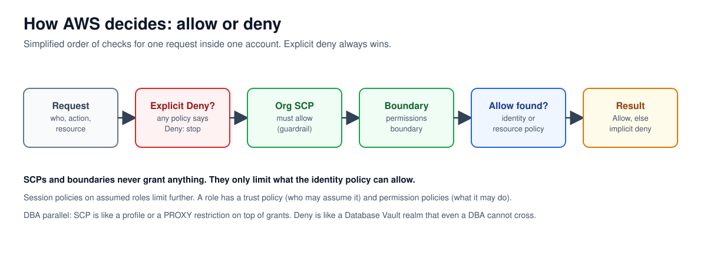

# 02. Identity in the Cloud

> **Module:** 10 · Cloud Security · **Weeks:** 7 to 8 · **Time:** about 9 hours
> **You will:** explain AWS IAM and Azure/Entra access control, read a policy, spot the common mistakes and privilege escalation paths, and run an analyzer that finds them.
> **Maps to:** Security+ (IAM, MFA, least privilege) · AWS Security Specialty (IAM) · SC-300 · AZ-500 · SC-900 · MITRE ATT&CK T1078.004 (Cloud Accounts), TA0004 (Privilege Escalation)

## 1. Why it matters in a cloud-security / SOC job

In the cloud, **identity is the perimeter**. There is often no firewall between an attacker and your data if they hold a valid key.

- **Capital One, 2019:** the stolen role credentials had too many S3 permissions.
- **Microsoft, 2023 (Storm-0558):** an attacker obtained a token-signing key and forged tokens to read mail of some organizations. Microsoft published a detailed review. Lesson: token and key protection matters as much as passwords.
- **Midnight Blizzard, 2023 to 2024:** Microsoft reported that the group used a password-spray against a legacy test tenant account, then abused OAuth applications to reach corporate mailboxes.
- **SOC daily work:** impossible-travel sign-ins, new access keys, role assumed from a new IP, a new app consent.

## 2. Understand it

### 2.1 AWS IAM

| Object | What it is |
|---|---|
| Root user | The account owner. Full power, cannot be limited by IAM policy. Use only for a few tasks, with MFA, no access keys |
| IAM user | A person or app with long-lived credentials (password, access keys). Avoid for people. Prefer federation |
| Group | A set of users to attach policies to |
| Role | No password. Assumed by users, services or other accounts. Gives temporary credentials |
| Policy | JSON that allows or denies actions on resources |
| STS | Security Token Service. Issues temporary credentials (AssumeRole, AssumeRoleWithSAML, and so on) |
| SCP | AWS Organizations guardrail on accounts. Limits only |
| Permission boundary | A cap on what one user or role may ever get |
| IAM Access Analyzer | Finds resources shared outside your account and unused access |

Policy example (read it like an Oracle GRANT):

```json
{"Effect": "Allow", "Action": ["s3:GetObject"], "Resource": "arn:aws:s3:::app-data-bucket/reports/*"}
```

Evaluation order (simplified): start at **deny** → any explicit Deny wins → Organization SCP must allow → boundaries and session policies must allow → an identity or resource policy must allow → else deny.



**Roles have two policy types:** a *trust policy* (who may assume it) and *permission policies* (what it can do). Many escalations are a weak trust policy.

### 2.2 Azure / Entra ID

| Concept | Meaning |
|---|---|
| Microsoft Entra ID | The cloud directory (formerly Azure Active Directory). Users, groups, apps, devices |
| Azure RBAC | Roles (Owner, Contributor, Reader, and many specific ones) assigned at a **scope**: management group, subscription, resource group or resource |
| Entra roles | Directory roles such as Global Administrator, User Administrator. A different system from Azure RBAC |
| Conditional Access | If-then rules at sign-in: require MFA, block legacy authentication, require a compliant device, limit by location or risk. Needs the right Entra license |
| PIM (Privileged Identity Management) | Just-in-time elevation: roles are eligible, activated for a few hours, with approval and justification, and logged |
| Managed identity | Azure-managed identity for a resource (system-assigned or user-assigned). No secret to store |
| Service principal / app registration | The identity of an application. Secrets and certificates here are a common leak |
| Consent | A user or admin lets an app access data. Risky "illicit consent" attacks abuse this |

### 2.3 Common misconfigurations

| Problem | Why it hurts | Fix |
|---|---|---|
| `Action: *` on `Resource: *` | Full admin to anything that uses the policy | Specific actions, specific resources |
| Long-lived access keys | Leak in code, laptops, CI logs | Roles, federation, rotation, secret scanning |
| No MFA | One phished password is enough | MFA everywhere, phishing-resistant for admins |
| Root used daily | No limits, big audit risk | Lock the root, alert on any root use |
| Too many Global Admins / Owners | Big blast radius | PIM, few permanent admins, break-glass accounts monitored |
| Trust policy `Principal: *` | Anyone can assume the role | Name exact principals, use conditions such as external ID |
| Legacy authentication allowed | Bypasses MFA | Block with Conditional Access |
| Secrets in app registrations that never expire | Hard to track | Certificates, managed identity, expiry alerts |

### 2.4 Privilege escalation paths (know these)

A user with a *small* permission can sometimes give themselves a *big* one.

| Path | How (concept) | Detect / prevent |
|---|---|---|
| `iam:PassRole` + a compute action (`ec2:RunInstances`, `lambda:CreateFunction`) | Start a service with a powerful role and run code as it | Restrict PassRole to specific role ARNs. Alert on PassRole of admin roles |
| `iam:CreatePolicyVersion` or `SetDefaultPolicyVersion` | Edit a policy attached to yourself | Deny these for non-admins |
| `iam:AttachUserPolicy` / `PutUserPolicy` | Attach AdministratorAccess to yourself | Permission boundary, SCP, alert |
| `iam:CreateAccessKey` on another user | Make keys for an admin | Limit to own user, alert on keys for others |
| `iam:UpdateAssumeRolePolicy` | Edit a role's trust policy to let yourself in | Alert on trust policy changes |
| Azure: Owner or User Access Administrator on a scope | Assign yourself higher roles | PIM, alerts on role assignment |
| Azure: app owner adds a secret to a privileged app | Sign in as the app | Review app owners, alert on credential changes |
| Token theft (AiTM phishing) | MFA relayed live, session cookie stolen | Phishing-resistant MFA, device-bound sessions, continuous access evaluation, revoke sessions |

Interview practice from the library (paraphrased): an attacker uses a look-alike login page that relays the password and MFA code, then reuses the session cookie from a hosting provider. Fix: revoke sessions (not only the password), hunt for new mailbox rules and OAuth grants, move admins to FIDO2/passkeys, and require compliant devices.

> **From DBA to security**
> Roles and grants are your home ground. An IAM policy is a GRANT with a resource and a condition. A role you assume is like `SET ROLE` or a proxy user. `Action: *` is `GRANT DBA`. The PassRole attack is like granting `CREATE JOB` plus the ability to run a job as a powerful schema owner. Your instinct "who has ANY privileges?" is the same question as "who has `iam:*`?". PIM is like a time-boxed `GRANT ... ` with a ticket.

## 3. Hands-on

The lab analyzer reads policy JSON and flags wildcard actions/resources, PassRole escalation and missing MFA conditions.

```bash
.venv/Scripts/python cybersecurity-track/10-cloud-security/lab/demo.py
```

Real output (Part 2):

```text
== Part 2: IAM policy analyzer ==
SEVERITY  POLICY                     RULE                 DETAIL
critical  AdministratorAccess-like   ADMIN_EQUIVALENT     Action * on Resource *: full administrator
critical  DevOpsPassRole             PASSROLE_ESCALATION  PassRole + ec2:runinstances, lambda:createfunction on *: run code as a stronger role
high      DevOpsPassRole             PASSROLE_WILDCARD    iam:PassRole on * lets the caller hand any role to a service
high      NotActionTrap              NOT_ACTION_ALLOW     Allow with NotAction grants everything except the listed actions
medium    AdminWithMfaGuard          WILDCARD_ACTION      Service wildcard ec2:*
medium    AdministratorAccess-like   NO_MFA_CONDITION     Sensitive actions allowed with no aws:MultiFactorAuthPresent condition
medium    DevOpsPassRole             WILDCARD_RESOURCE    Write-capable actions allowed on Resource *
medium    DevOpsPassRole             NO_MFA_CONDITION     Sensitive actions allowed with no aws:MultiFactorAuthPresent condition
medium    IamManagerNoMfa            NO_MFA_CONDITION     Sensitive actions allowed with no aws:MultiFactorAuthPresent condition

No findings: S3AppLeastPrivilege, IamManagerWithMfa, ReadOnlyAuditor
```

**Predict then run (break it yourself):**
1. Add a policy with `iam:CreatePolicyVersion` on `*`. Which rule fires? (`PRIVESC_ACTION`.)
2. Change `S3AppLeastPrivilege` to `s3:*`. What severity? (medium wildcard.)
3. Add a Deny with an MFA condition to `IamManagerNoMfa`. Does the MFA finding go away? (yes.)

Limits of this tool: it reads one policy at a time. It does not see SCPs, boundaries or resource policies together. Real tools (IAM Access Analyzer, Prowler, PMapper-style graph tools) combine everything.

Tests: `.venv/Scripts/python -m pytest cybersecurity-track/10-cloud-security -q`

*Optional:* in your own AWS account run IAM Access Analyzer; in Azure, review role assignments in the portal and try PIM with a trial license.

## 4. Practice platforms

- TryHackMe: search for rooms on AWS IAM, "cloud" and Active Directory. Check each room page for scope.
- HTB Academy: look for identity and Active Directory modules in the module list; Entra topics may appear as "Azure" modules.
- Microsoft Learn SC-300 and AWS Skill Builder IAM courses are free to read.

## 5. Three realistic scenarios

1. **Impossible travel for an admin.** Sign-in from two countries 20 minutes apart. *Investigate:* Entra sign-in logs (IP, device, MFA result, user agent), is the second sign-in a known VPN? *Do:* if not, revoke sessions, reset credentials, check audit logs for role changes and new app consents.
2. **IAM user created at 03:00.** *Investigate:* CloudTrail `CreateUser`, `AttachUserPolicy`, who called it and from which key. *Do:* disable the user, find the source key, treat as a compromised-key incident (Lesson 06).
3. **Developer can launch instances with any role.** The analyzer shows `PASSROLE_ESCALATION`. *Do:* restrict PassRole to named role ARNs and add a condition on the service (`iam:PassedToService`).

## 6. Common mistakes

- Reading only the Allow and forgetting explicit Deny, SCPs and boundaries.
- Fixing a wildcard by guessing actions. Use access advisor / last-used data and CloudTrail to find what is really needed.
- Treating Entra roles and Azure RBAC as one thing.
- Break-glass accounts without monitoring.

## 7. Interview questions

<details><summary><b>Q1. User vs role in AWS?</b></summary>
Users have long-lived credentials. Roles are assumed and give temporary credentials via STS. Use roles for workloads and for people via federation.
</details>

<details><summary><b>Q2. Explain the policy evaluation logic.</b></summary>
Default is deny. An explicit Deny in any applicable policy ends it. Otherwise SCPs and boundaries must allow, and an identity or resource policy must grant the access. No allow means deny.
</details>

<details><summary><b>Q3. What does an SCP do?</b></summary>
It is a guardrail on member accounts of an AWS Organization. It limits the maximum permissions and never grants any. It does not affect the management account.
</details>

<details><summary><b>Q4. How does iam:PassRole lead to escalation?</b></summary>
The caller may start a service (EC2, Lambda) and attach a role that is stronger than their own. Then the code in that service runs with the stronger role. Restrict the role ARNs that can be passed and the services allowed.
</details>

<details><summary><b>Q5. Azure RBAC vs Entra roles?</b></summary>
RBAC governs Azure resources at a scope. Entra roles govern the directory and its settings. Separate role sets and separate assignments.
</details>

<details><summary><b>Q6. What is Conditional Access? Give two policies you would start with.</b></summary>
Sign-in rules that evaluate signals (user, location, device, risk) and enforce controls. Start with: require MFA for all admins (then all users), and block legacy authentication. Also require compliant devices for sensitive apps.
</details>

<details><summary><b>Q7. What does PIM add?</b></summary>
Just-in-time, time-limited role activation with approval, justification and audit, so admins do not hold standing privilege.
</details>

<details><summary><b>Q8. Why prefer managed identities?</b></summary>
No secret to leak or rotate by hand. The platform issues short-lived tokens to the resource.
</details>

<details><summary><b>Q9. How do you find unused permissions?</b></summary>
Use last-accessed data (IAM access advisor), IAM Access Analyzer unused-access findings, and CloudTrail history. In Azure, use access reviews and permission analytics from Entra / Defender for Cloud.
</details>

<details><summary><b>Q10. MFA was used, yet the account was taken over. How?</b></summary>
Adversary-in-the-middle phishing relayed the MFA and stole the session token, or an MFA-fatigue attack, or a stolen refresh token. Counter with phishing-resistant MFA (passkeys/FIDO2), token protection, device compliance, short sessions, and fast session revocation.
</details>

<details><summary><b>Q11. You find an access key in a public GitHub repo. Steps?</b></summary>
Deactivate the key at once, review CloudTrail for everything it did, look for new users/keys/roles and resources, rotate related secrets, remove the key from git history, add secret scanning and move to roles.
</details>

<details><summary><b>Q12. How would you review 500 IAM roles quickly?</b></summary>
Automate: export policies, run an analyzer for wildcards, PassRole, trust policy `*` and no-MFA; sort by severity and by last-used date; fix the top risks first; add the check to CI for new policies.
</details>

## 8. Checklist

- [ ] I can read an IAM policy and say what it allows.
- [ ] I can explain Deny > SCP > boundary > Allow.
- [ ] I know five misconfigurations and five escalation paths.
- [ ] I can explain Entra roles vs Azure RBAC, Conditional Access, PIM, managed identity.
- [ ] I ran the analyzer and did the three predict-then-run steps.

## 9. References

- AWS IAM User Guide: https://docs.aws.amazon.com/IAM/latest/UserGuide/
- Microsoft Learn: Entra ID, Conditional Access, PIM: https://learn.microsoft.com/entra/
- MITRE ATT&CK Cloud matrix: https://attack.mitre.org/matrices/enterprise/cloud/
- Library: IAM and zero trust interview scenarios; Zscaler and Azure identity notes; Pentesting Azure Applications (concepts only). All paraphrased.
