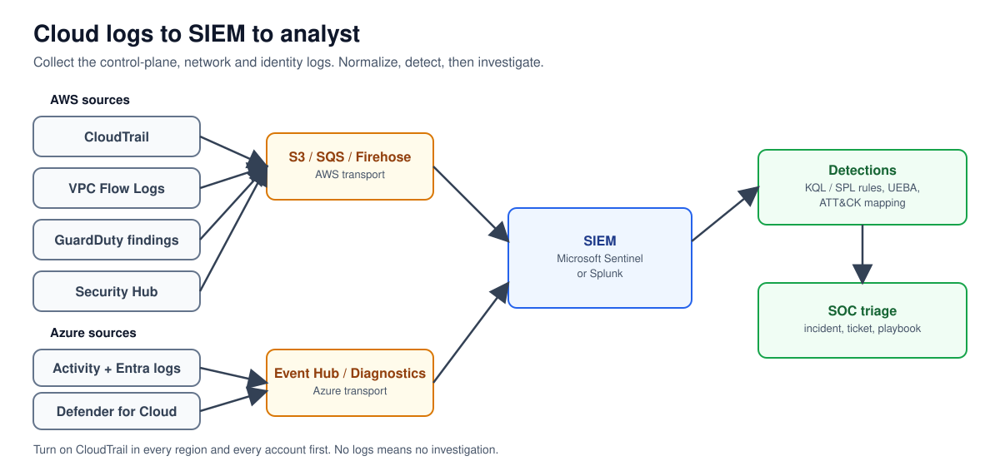

# 03. Cloud Logging and Detection

> **Module:** 10 · Cloud Security · **Week:** 9 · **Time:** about 7 hours
> **You will:** name the key AWS and Azure log sources, explain what each shows, send them to Sentinel or Splunk, and run five detections on CloudTrail-style logs.
> **Maps to:** Security+ (logging and monitoring) · SC-200 (Sentinel, KQL) · AWS Security Specialty (detection) · Splunk Core Certified User (SPL basics) · MITRE ATT&CK T1562.008 (Disable Cloud Logs), T1078.004, T1530, T1110

## 1. Why it matters in a cloud-security / SOC job

Cloud has no cables to sniff. **Logs are your only eyes.** Most cloud investigations start with: "Who called which API, from where, with which key?"

- Attackers know this. Turning off or deleting the trail (`StopLogging`, `DeleteTrail`) is a standard defense-evasion step, so it must raise a high alert.
- Some real GuardDuty finding names you will meet: `Stealth:IAMUser/CloudTrailLoggingDisabled`, `Policy:IAMUser/RootCredentialUsage`, `UnauthorizedAccess:IAMUser/InstanceCredentialExfiltration.OutsideAWS`, `CryptoCurrency:EC2/BitcoinTool.B!DNS`.
- The "Cloud security engineer" project list in the library has a project exactly like this lab: simulate root login, odd geolocation and port scanning, then triage with CloudTrail and GuardDuty.

## 2. Understand it



### 2.1 AWS sources

| Source | Shows | Notes |
|---|---|---|
| **CloudTrail** | API calls (who, what, when, from where) | Management events by default. Event history keeps about 90 days. Create a **trail** to S3 for long-term storage, all regions, with log file validation. Data events (S3 object reads, Lambda invokes) are optional and paid |
| **VPC Flow Logs** | Network connection records (source, destination, port, accept/reject, bytes) | No packet content. Good for scanning, exfil volume, odd destinations |
| **GuardDuty** | Managed threat detection findings | Uses CloudTrail, flow and DNS logs and optional protections for S3, EKS, malware and more. Sends findings to Security Hub and EventBridge |
| **Security Hub** | Collects findings from GuardDuty, Inspector, Macie and others and runs posture checks (for example the CIS standard) | One place for findings. Can aggregate across accounts and regions |
| **AWS Config** | Configuration history and rules | "What did this bucket look like last week?" |
| S3 / ELB / CloudFront access logs | Data and web access | Must be enabled |

### 2.2 Azure sources

| Source | Shows |
|---|---|
| **Activity Log** | Control-plane operations on Azure resources (about 90 days kept by default; export to Log Analytics for more) |
| **Entra sign-in logs** | Interactive and non-interactive sign-ins, MFA result, Conditional Access outcome, IP, device, risk |
| **Entra audit logs** | Directory changes: role assignment, app consent, user/group changes |
| **Resource diagnostic logs** | Data-plane logs of each service (Key Vault access, storage reads, NSG flow data) once enabled via diagnostic settings |
| **Microsoft Defender for Cloud** | Posture recommendations plus workload protection alerts |

### 2.3 Feeding the SIEM

| Goal | Microsoft Sentinel | Splunk |
|---|---|---|
| AWS CloudTrail, GuardDuty, VPC Flow | Sentinel AWS connector reads from S3 using SQS notifications and an IAM role | Splunk Add-on for AWS (pull from S3, SQS or Kinesis Firehose) |
| Azure Activity and Entra logs | Native connectors, tables such as `AzureActivity`, `SigninLogs`, `AuditLogs` | Splunk Add-on for Microsoft Cloud Services or Event Hubs |
| Defender for Cloud | Native connector | Via Event Hub or API |

Good practice: central log-archive account with write-only access for sources, S3 Object Lock or immutability, separate retention rules, time sync, and keep raw plus parsed copies.

Two example queries (adapt to your table and field names; test in your own lab):

```kusto
// Sentinel (KQL): sign-in failures then success for the same user
SigninLogs
| where TimeGenerated > ago(1h)
| summarize failures = countif(ResultType != "0"), successes = countif(ResultType == "0") by UserPrincipalName, IPAddress
| where failures >= 5 and successes >= 1
```

```text
# Splunk (SPL): CloudTrail logging stopped
index=aws sourcetype=aws:cloudtrail eventName IN (StopLogging, DeleteTrail)
| table _time userIdentity.arn sourceIPAddress eventName requestParameters.name
```

### 2.4 The five lab detections

| Rule | Why it matters | ATT&CK |
|---|---|---|
| Root login | Root should almost never be used | T1078.004 |
| New access key used from a new country | Key theft | T1078.004 |
| StopLogging / DeleteTrail | Blinding the defender | T1562.008 |
| PutBucketPolicy with `Principal: *` | Public data exposure | T1530 |
| Burst of failed ConsoleLogin | Password guessing or spraying | T1110 |

> **From DBA to security**
> CloudTrail is the **audit trail of the cloud account**, like Oracle Unified Audit but for the control plane. You know the rules already: log who, what, when, from where; protect the log from the people it audits; ship it off the box; watch for audit being turned off (like `NOAUDIT`). VPC Flow Logs are like listener logs without content. Baselining in AWR ("what is normal load?") is the same thinking as "what countries does this user normally use?".

## 3. Hands-on

Real data shape: each lab event looks like a CloudTrail record (`eventTime`, `eventName`, `userIdentity`, `sourceIPAddress`, `requestParameters`, `responseElements`). Open `lab/sample_cloudtrail.json` and read two records first.

```bash
.venv/Scripts/python cybersecurity-track/10-cloud-security/lab/demo.py
```

Real output (Part 1):

```text
== Part 1: CloudTrail detections (24 events from sample_cloudtrail.json) ==
TIME      SEVERITY  RULE                 ACTOR    DETAIL
02:10:00  critical  ROOT_LOGIN           root     Root console login from 203.0.113.50 (RU), MFA NOT used
03:07:00  critical  CONSOLE_LOGIN_BURST  erin     Successful login right after a failure burst (source 203.0.113.99): possible guessed password
11:45:00  critical  LOGGING_DISABLED     carol    StopLogging on trail 'org-trail' from 203.0.113.77
11:55:00  critical  LOGGING_DISABLED     carol    DeleteTrail on trail 'org-trail' from 203.0.113.77
11:40:00  high      KEY_NEW_COUNTRY      carol    New access key AKIAEXAMPLENEW01 used from 203.0.113.77 (RU); user normally works from ['CA']
11:50:00  high      BUCKET_MADE_PUBLIC   carol    PutBucketPolicy on 'corp-customer-exports' allows Principal * with no condition
03:04:40  medium    CONSOLE_LOGIN_BURST  erin     5 failed console logins within 10 min (latest source 203.0.113.99)

Benign admin day only (11 events): 0 findings
```

Read the story: carol created a key at 11:30 from CA. At 11:40 that key is used from RU, then logging is stopped, a bucket is made public, and the trail is deleted. That is a full cloud attack chain in 25 minutes.

Benign admin activity (key rotation, private bucket policy, two typos at login) produces **zero** findings. This is what a good detection looks like: quiet on normal work.

**Break it yourself:** lower `burst_threshold` to 2 and rerun. Bob's two typos now alert. That is the false-positive cost of a tight rule.

**Stretch:** add a rule for `ConsoleLogin` where `MFAUsed` is `No` for a non-root user. Add a benign test.

Tests (24 across the module): `.venv/Scripts/python -m pytest cybersecurity-track/10-cloud-security -q`

*Optional free tools:* AWS Free Tier with CloudTrail + GuardDuty 30-day trial; Microsoft Sentinel free trial on a Log Analytics workspace (watch cost, delete after); Splunk Free or the Splunk trial to practice SPL.

## 4. Practice platforms

- TryHackMe: SOC Level 1 has log-analysis and SIEM rooms (Splunk and Elastic style). Search for "Splunk", "Sentinel" and "cloud" rooms.
- HTB Academy: SOC Analyst path includes SIEM and log-analysis modules.
- HTB Labs Sherlocks: pick a cloud or identity-related Sherlock and write up the timeline.

## 5. Three realistic scenarios

1. **Root login alert at 02:10.** *Investigate:* IP, MFA used or not, what root did next (CloudTrail by `userIdentity.type=Root`). *Do:* call the account owner, if not them rotate root password and MFA, check IAM changes.
2. **GuardDuty: CloudTrail logging disabled.** *Investigate:* who stopped it, from where, what happened in the gap. *Do:* re-enable, apply an SCP that denies `StopLogging`, scope the gap using other sources (flow logs, service logs).
3. **Console-login burst then success.** *Investigate:* source IPs (ASN, VPN?), other users from same IP (spraying), post-login actions. *Do:* reset, revoke sessions, enforce MFA, block legacy auth.

## 6. Common mistakes

- CloudTrail enabled in one region only, or only "event history".
- Logs stored in the same account that an attacker can control.
- No alert on logging changes.
- Alerting on everything: too many rules without baselines cause alert fatigue.
- Forgetting that the GeoIP is only a hint; VPNs and cloud IPs distort it.

## 7. Interview questions

<details><summary><b>Q1. What is CloudTrail and what does it not log by default?</b></summary>
It records AWS API activity. By default it logs management events. Data events such as S3 object reads and Lambda invokes are off unless you enable them.
</details>

<details><summary><b>Q2. VPC Flow Logs vs CloudTrail?</b></summary>
CloudTrail is who called which API (control plane). Flow Logs are network connections metadata (who talked to whom on which port). Different questions, both needed.
</details>

<details><summary><b>Q3. What does GuardDuty do and what does it not?</b></summary>
It analyzes logs and gives findings about suspicious activity. It does not block anything itself. You need automation or people to respond.
</details>

<details><summary><b>Q4. How is Security Hub different from GuardDuty?</b></summary>
GuardDuty creates threat findings. Security Hub aggregates findings from many services and runs posture checks, giving one view.
</details>

<details><summary><b>Q5. Which Azure logs would you check for a suspicious sign-in?</b></summary>
Entra sign-in logs (IP, MFA result, Conditional Access result, device), then Entra audit logs for changes made afterward, then the Activity Log for Azure resource actions.
</details>

<details><summary><b>Q6. How do you protect the logs themselves?</b></summary>
Send them to a separate log-archive account or workspace, restrict write and delete, enable log file validation and object lock/immutability, and alert on changes to logging.
</details>

<details><summary><b>Q7. Why alert on StopLogging?</b></summary>
It removes visibility for what follows. It is rarely legitimate outside planned changes, so it is a high-value, low-noise rule.
</details>

<details><summary><b>Q8. How would you detect a stolen access key?</b></summary>
Baseline normal source IPs, countries, user agents and API patterns per key. Alert on first use from a new place, odd APIs (`ListBuckets` sweeps, `GetCallerIdentity`), and GuardDuty credential exfiltration findings.
</details>

<details><summary><b>Q9. Your rule fires 200 times a day on admin work. What do you do?</b></summary>
Tune: add context (known admin roles, change windows, allow lists with owners), raise the threshold, split by severity, and keep a test set of benign events so the rule does not regress.
</details>

<details><summary><b>Q10. How do cloud logs reach Sentinel?</b></summary>
Through data connectors: native ones for Azure and Entra, and the AWS connector that reads from S3 via SQS with an IAM role for AWS logs. They land in Log Analytics tables where analytics rules run KQL.
</details>

<details><summary><b>Q11. An attacker deleted the trail. What other evidence exists?</b></summary>
S3 access logs, VPC Flow Logs, GuardDuty findings, Config history, service logs, billing changes, and logs already copied to the SIEM or archive account. This is why central copies matter.
</details>

## 8. Checklist

- [ ] I can name three AWS and three Azure log sources and what each shows.
- [ ] I can explain how logs reach Sentinel and Splunk.
- [ ] I ran the five detections and explain each finding line.
- [ ] I understand why benign admin work must not alert.
- [ ] I wrote one KQL or SPL query of my own.

## 9. References

- AWS CloudTrail, GuardDuty, Security Hub docs: https://docs.aws.amazon.com/
- Microsoft Learn: Activity Log, Entra logs, Microsoft Sentinel, KQL: https://learn.microsoft.com/
- Splunk docs: Splunk Add-on for AWS: https://docs.splunk.com/
- MITRE ATT&CK T1562.008: https://attack.mitre.org/techniques/T1562/008/
