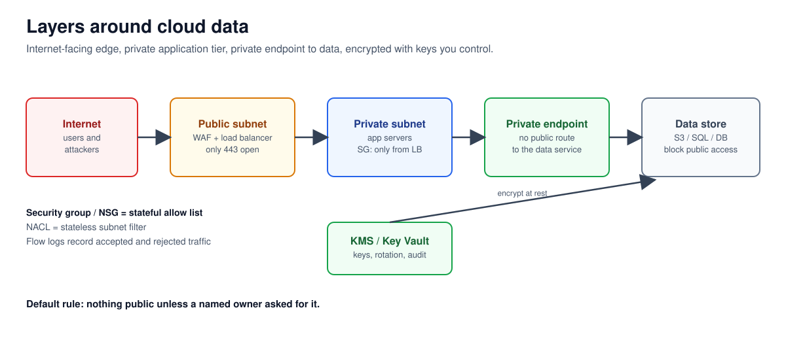

# 04. Network and Data Protection in the Cloud

> **Module:** 10 · Cloud Security · **Week:** 10 · **Time:** about 6 hours
> **You will:** design a safe VPC/VNet layout, write security group and NSG rules, explain private endpoints, encryption with KMS and Key Vault, and find public bucket or storage exposure.
> **Maps to:** Security+ (network security, data protection, cryptography) · Network+ (subnets, firewalls) · AWS Security Specialty (infrastructure and data protection) · AZ-500 · MITRE ATT&CK T1530 (Data from Cloud Storage), T1190

## 1. Why it matters in a cloud-security / SOC job

- Public object storage is the classic cloud leak. Many past breaches were simply "bucket readable by anyone", found by researchers or attackers who scan for them.
- Capital One (2019) again: network design allowed the web layer to reach the metadata service, and the role behind it could read storage.
- Daily SOC work: alerts on open security groups (`0.0.0.0/0` on SSH or database ports), public storage, disabled encryption, and unusual large downloads.

## 2. Understand it



### 2.1 Virtual networks

| Item | AWS | Azure |
|---|---|---|
| Private network | VPC | VNet |
| Segments | Subnets (public or private by route table) | Subnets |
| Stateful instance firewall | **Security group** (allow rules only, stateful) | **NSG** (allow and deny, priorities, stateful) |
| Stateless subnet filter | Network ACL (allow and deny, ordered) | NSG at subnet level |
| Private access to services | VPC endpoints: gateway (S3, DynamoDB) and interface endpoints (PrivateLink) | **Private Endpoint** (Private Link) and service endpoints |
| Internet out | NAT gateway | NAT gateway |
| Web protection | AWS WAF, Shield | Azure WAF, DDoS Protection |
| Network firewall | AWS Network Firewall | Azure Firewall |

Rules of thumb:
1. Only load balancers and gateways are public. App and data tiers are in private subnets.
2. Security group rules name **sources** (another security group is best), not `0.0.0.0/0`.
3. Admin access (SSH/RDP) goes through a bastion, SSM Session Manager or Azure Bastion. No open port 22 or 3389 to the Internet.
4. Use **private endpoints** so traffic to storage or databases never crosses the public Internet and the public endpoint can be turned off.
5. Block metadata-service abuse: use IMDSv2 (session-token based) on AWS, and limit what instance roles can do.

### 2.2 Data protection

| Topic | AWS | Azure |
|---|---|---|
| Keys | **KMS**: customer managed keys (CMK), key policy, grants, rotation, CloudTrail logs every use | **Key Vault** / Managed HSM: keys, secrets, certificates, RBAC or access policies, soft delete and purge protection |
| Encryption at rest | S3 SSE-S3 (default now for new objects) or SSE-KMS, EBS, RDS encryption | Storage Service Encryption (default), Azure Disk Encryption, TDE for Azure SQL |
| Encryption in transit | TLS. Bucket policy can deny non-TLS (`aws:SecureTransport`) | TLS. Require secure transfer on storage |
| Secrets | Secrets Manager, Parameter Store | Key Vault secrets |
| Classification | Amazon Macie finds sensitive data in S3 | Microsoft Purview |

**Envelope encryption** (concept): KMS encrypts a small **data key**; the data key encrypts the data. You store the encrypted data key next to the data. To read, call KMS to decrypt the data key. Access to the key is a second lock: a user needs permission on the bucket **and** the key.

### 2.3 Public bucket / storage exposure

| Cause | Fix |
|---|---|
| Bucket policy with `Principal: *` | Remove, or add strict conditions |
| ACL with `AllUsers` | Disable ACLs (Object Ownership: bucket owner enforced) |
| Block Public Access off | Turn it on at **account** level and for each bucket |
| Azure storage "allow blob anonymous access" on | Turn off at the storage account. Use SAS tokens with short expiry and least rights |
| Static website needs public content | Put CloudFront / Front Door in front, keep the bucket private |

The lab detector flags a `PutBucketPolicy` with `Principal: *` and no condition (see Lesson 03) and ignores a policy that names a specific role.

> **From DBA to security**
> This is the listener and firewall world you know. A security group is the host firewall plus `valid_node_checking` (`tcp.validnode_checking`): only listed sources get through. A private endpoint is like making the database reachable only on the internal network, no public listener. KMS and Key Vault are the Oracle Wallet / Key Management for TDE: the key is stored away from the data, and every use is audited. "Don't put the TDE wallet next to the datafiles" equals "don't put keys in the bucket".

## 3. Hands-on

1. Draw your own three-tier layout on paper. Mark what is public, what is private, and every allowed arrow with the port.
2. In the lab, open `lab/sample_data.py` and read the two bucket policies: the safe one (`Principal` is a role ARN) and the public one. Then run the detector on them:

```bash
.venv/Scripts/python cybersecurity-track/10-cloud-security/lab/demo.py
```

The line to look for:

```text
11:50:00  high      BUCKET_MADE_PUBLIC   carol    PutBucketPolicy on 'corp-customer-exports' allows Principal * with no condition
```

3. **Break it yourself:** add a `Condition` with `aws:SourceVpce` to the public policy in a test. The detector treats it as restricted. Is that right? (Often yes. A condition on the VPC endpoint limits who can read. But conditions like `aws:UserAgent` are weak, and a real review should read them.)
4. *Optional free:* in your AWS account create a bucket, enable Block Public Access, try to attach a public policy, and observe the block. Run Prowler or Security Hub's checks and read the S3 findings. In Azure, try creating a storage account with anonymous access disabled.

## 4. Practice platforms

- TryHackMe: search for rooms on AWS S3 and cloud misconfiguration; also Wireshark and nmap rooms to read network data.
- HTB Academy: network and firewall-related modules; check the module list for cloud content.
- Practice on your own free-tier account only. Never test other people's buckets.

## 5. Three realistic scenarios

1. **Security group open to the world on port 3389.** *Investigate:* Flow Logs for accepted traffic from unknown IPs, Windows event logs for logons. *Do:* close the rule, move to Bastion/SSM, check for compromise first, then fix IaC.
2. **A public bucket holds exports.** *Investigate:* when it changed (CloudTrail `PutBucketPolicy`), what objects exist, server access logs or data events for downloads by outsiders. *Do:* Block Public Access, notify data owner and privacy team, decide on disclosure duty, add a preventive SCP/policy.
3. **Unusual 40 GB egress at night.** *Investigate:* Flow Logs by destination, which instance, what role, GuardDuty exfiltration findings. *Do:* isolate, snapshot, review role permissions, block destination.

## 6. Common mistakes

- Opening `0.0.0.0/0` "temporarily" and forgetting.
- Encrypting but giving everyone `kms:Decrypt`.
- Assuming a private subnet means safe: the app inside may still be exploitable.
- Relying on obscure bucket names.
- No logging on the data store (cannot answer "was it downloaded?").

## 7. Interview questions

<details><summary><b>Q1. Security group vs NACL?</b></summary>
A security group is stateful, attached to a network interface or resource, and has only allow rules. A NACL is stateless, applies to a subnet, and has ordered allow and deny rules.
</details>

<details><summary><b>Q2. What is a private endpoint?</b></summary>
A private IP inside your network for a cloud service, so traffic stays on the provider backbone and you can disable the public endpoint.
</details>

<details><summary><b>Q3. How do you stop public S3 buckets?</b></summary>
Enable S3 Block Public Access at account level, use an SCP to deny changes to it, scan with Config/Security Hub, and detect `PutBucketPolicy`/ACL changes in CloudTrail.
</details>

<details><summary><b>Q4. Explain envelope encryption.</b></summary>
A data key encrypts the data. A master key in KMS encrypts the data key. Only the encrypted data key is stored with the data. It limits how much data a key sees and lets you rotate and audit the master key.
</details>

<details><summary><b>Q5. KMS key policy vs IAM policy?</b></summary>
A KMS key must allow access through its key policy (directly, or by allowing IAM policies to control it). Without the key policy allowing it, IAM alone is not enough.
</details>

<details><summary><b>Q6. Why use Key Vault soft delete and purge protection?</b></summary>
They stop an attacker or mistake from permanently deleting keys. Lost keys mean lost encrypted data, which is a form of ransomware.
</details>

<details><summary><b>Q7. How do you give admins server access without opening SSH?</b></summary>
Use SSM Session Manager, Azure Bastion, or a hardened jump host, with MFA and session logging.
</details>

<details><summary><b>Q8. What do VPC Flow Logs not show?</b></summary>
Packet contents, DNS content in detail, or the application user. They show metadata only.
</details>

<details><summary><b>Q9. IMDSv2: why does it matter?</b></summary>
It needs a session token for metadata requests, which makes simple SSRF attacks that fetch role credentials much harder. It is a hardening step after cases like Capital One.
</details>

<details><summary><b>Q10. A bucket must be readable by a partner. How do you do it safely?</b></summary>
Share with the partner's specific account or role, or use short-lived pre-signed URLs or SAS tokens, with logging on and data scoped to one prefix. Avoid making the bucket public.
</details>

## 8. Checklist

- [ ] I can draw a public/private tier layout with correct rules.
- [ ] I know SG vs NACL vs NSG and private endpoints.
- [ ] I can explain KMS, Key Vault and envelope encryption.
- [ ] I can list four ways storage becomes public and the fixes.
- [ ] I ran the lab and found the public-bucket detection.

## 9. References

- AWS VPC, S3 Block Public Access, KMS docs: https://docs.aws.amazon.com/
- Microsoft Learn: Azure networking, Private Link, Key Vault, storage security: https://learn.microsoft.com/azure/
- CIS AWS and Azure Foundations Benchmarks.
- Library: Cloud security engineer 10 projects (S3 misconfiguration and hardening project), paraphrased.
