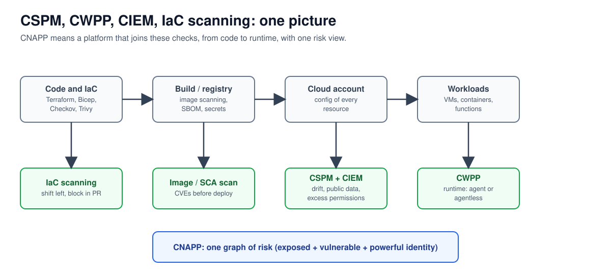

# 05. CSPM, CNAPP, CWPP, Compliance and IaC Scanning

> **Module:** 10 · Cloud Security · **Week:** 11 · **Time:** about 6 hours
> **You will:** explain the CSPM / CWPP / CIEM / CNAPP product categories, run or read a compliance scan, and scan Terraform before it reaches the cloud.
> **Maps to:** Security+ (vulnerability and configuration management) · AWS Security Specialty (governance) · AZ-500 / SC-200 (Defender for Cloud) · CIS Benchmarks · NIST CSF 2.0 *Identify* and *Protect*

## 1. Why it matters in a cloud-security / SOC job

A big cloud has thousands of resources and changes every hour. No person can check them. Posture tools do it all day, and a Cloud Security team spends much time on their output: which findings are real, which matter most, who fixes them.

- A "Cloud security posture audit" with Prowler or ScoutSuite is the first project in the library's cloud project list. It is a classic first task: scan, fix, rescan, show the score rise.
- Compliance teams ask for proof that "all buckets are encrypted". The tool gives the report.

## 2. Understand it



### 2.1 The acronyms

| Term | What it checks | Examples of products or tools (not an endorsement) |
|---|---|---|
| **CSPM** | Cloud configuration: public data, missing encryption, open ports, no MFA, logging off | Security Hub, Microsoft Defender for Cloud (CSPM), Prowler, ScoutSuite, commercial CSPM products |
| **CWPP** | Workloads at runtime: VM, container, serverless vulnerabilities, malware, suspicious behavior | Defender for Servers/Containers, GuardDuty runtime features, agent or agentless scanners |
| **CIEM** | Identity entitlements: unused and excessive permissions, privilege paths | IAM Access Analyzer, Entra Permissions Management (check current status), commercial tools |
| **DSPM** | Where sensitive data lives and who can reach it | Macie, Purview, commercial tools |
| **CNAPP** | A platform that joins CSPM + CWPP + CIEM + IaC + more, and shows **attack paths** | Several vendors. The idea matters more than the brand |
| **KSPM** | Kubernetes posture | Part of many CNAPPs |

Why a graph helps: one finding alone is low priority. "Internet-exposed VM + known critical CVE + role that can read customer data" together is an urgent attack path.

### 2.2 Compliance scanning

| Step | Detail |
|---|---|
| Pick a standard | CIS Foundations Benchmark, NIST, ISO 27001 controls, PCI DSS, internal policy |
| Scan | Security Hub standards, Defender for Cloud regulatory compliance dashboard, AWS Config conformance packs, Azure Policy initiatives, Prowler |
| Triage | Group by risk (exposure, data sensitivity, identity power), not by count |
| Remediate | Prefer fixing the IaC so the fix stays. Use auto-remediation with care |
| Exceptions | Written, owned, with an expiry date |
| Evidence | Export reports with date. Track score over time |

**Detective vs preventive:** a scan finds problems after the fact. Policy engines (Azure Policy deny, SCPs, Config with remediation) can stop them.

### 2.3 IaC scanning (shift left)

Infrastructure as Code (Terraform, Bicep, CloudFormation) means the cloud is built from files. Scan the files in the pull request **before** `apply`:

| Tool type | Example | Finds |
|---|---|---|
| Policy-as-code scanners | Checkov, Trivy (config), tfsec lineage, KICS, Terraform Sentinel/OPA | Public buckets, open security groups, unencrypted disks, wildcard IAM |
| Secret scanners | gitleaks, trufflehog | Keys and tokens in code |
| Plan-level checks | OPA/Conftest on `terraform show -json` output | Final values, after variables resolve |

The repo already has an offline Terraform policy lab: [`06-ai-devsecops/terraform`](../../06-ai-devsecops/terraform/README.md). It reads a Terraform **plan in JSON**, applies policy checks, and manages expiring waivers. It is written for AI infrastructure but the same checks (public storage, `0.0.0.0/0`, wildcard IAM) apply to any cloud. Run it after this lesson and compare to what Checkov would report.

Example of the idea (plan JSON excerpt style):

```text
aws_s3_bucket_public_access_block.block_public_acls = false   -> FAIL: public access not blocked
aws_security_group.ingress.cidr_blocks = ["0.0.0.0/0"] port 22 -> FAIL: SSH open to the world
```

> **From DBA to security**
> CSPM is the same job as running the CIS Oracle benchmark scripts or an AWR/health check on a schedule across all databases, then tracking drift. IaC scanning is like code review of DDL scripts and change tickets before running them in production. Waivers with expiry date are like documented, time-boxed exceptions to a security baseline, which any DBA who passed an audit has written.

## 3. Hands-on

1. Run the repo's Terraform policy checker (offline, no Terraform install needed) and read its output. Follow the commands in its README.
2. Connect the idea to this module's lab: our IAM analyzer is a tiny CIEM-style check for one policy at a time.

```bash
.venv/Scripts/python cybersecurity-track/10-cloud-security/lab/demo.py
```

The last lines show which sample policies are clean:

```text
No findings: S3AppLeastPrivilege, IamManagerWithMfa, ReadOnlyAuditor
```

3. *Optional free tools:* run **Prowler** against your own AWS free-tier account (read-only credentials), or enable Defender for Cloud's free tier on an Azure subscription, then fix three findings and rescan. Run **Checkov** or **Trivy config** on a small Terraform folder. Use `pip install checkov` in a separate virtual environment, not in the lab environment.

## 4. Practice platforms

- TryHackMe: search for rooms on DevSecOps, Terraform, and cloud posture. Check the room page for scope.
- HTB Academy: look for modules on cloud, DevOps and vulnerability scanning.
- Free: Prowler's documentation includes sample reports; Microsoft Learn has Defender for Cloud labs.

## 5. Three realistic scenarios

1. **Score drops after a release.** *Investigate:* diff of the Terraform change and the Config timeline. *Do:* fix in code, add the failing rule to the PR scan, block merge on high findings.
2. **10,000 findings.** *Investigate:* sort by internet exposure, data sensitivity, and identity power. *Do:* fix the top 20 attack paths first, group the rest by owner and set due dates.
3. **A team needs an exception.** *Do:* require a ticket, owner, compensating control, and expiry. Review expiring waivers every month.

## 6. Common mistakes

- Treating the score as the goal.
- Scanning only the cloud (late) and not the pipeline (early).
- Giving the scanner admin keys. Use read-only roles.
- Auto-remediating production without testing.
- Not fixing the IaC, so the same issue returns on the next apply (drift).

## 7. Interview questions

<details><summary><b>Q1. CSPM vs CWPP vs CNAPP?</b></summary>
CSPM checks configuration of cloud resources. CWPP protects running workloads. CNAPP combines them with identity, data and code context and shows attack paths.
</details>

<details><summary><b>Q2. What is "shift left"?</b></summary>
Moving checks earlier in the pipeline, such as scanning Terraform in the pull request, so problems are cheaper to fix and never reach production.
</details>

<details><summary><b>Q3. How do you prioritize 5,000 posture findings?</b></summary>
By exposure (internet-facing), data sensitivity, identity power, exploitability and business criticality. Attack paths first, then bulk fixes via templates.
</details>

<details><summary><b>Q4. What is drift?</b></summary>
When the real cloud configuration differs from the IaC. Manual console changes cause it. Detect with plan comparisons or Config, and fix by changing the code or reverting the change.
</details>

<details><summary><b>Q5. Preventive vs detective in compliance?</b></summary>
Preventive blocks bad changes (SCP, Azure Policy deny). Detective finds them (Config rules, Defender recommendations). You need both.
</details>

<details><summary><b>Q6. How does Checkov differ from Prowler?</b></summary>
Checkov scans IaC files before deployment. Prowler scans a live cloud account using read-only API calls.
</details>

<details><summary><b>Q7. What is a good exception process?</b></summary>
Ticket, risk owner, reason, compensating control, expiry date, and automatic reminder. Expired waivers fail the check again.
</details>

<details><summary><b>Q8. A scanner reports "S3 bucket not encrypted" for 50 buckets. Real risk?</b></summary>
New S3 buckets have default encryption, so check the specifics (SSE-S3 versus customer key requirements). Decide based on data sensitivity and compliance needs. Do not blindly mass-change.
</details>

<details><summary><b>Q9. How do you scan safely in production?</b></summary>
Read-only roles, scoped to needed APIs, with logging, rate limits, and no secrets stored in the tool. Agentless scanners snapshot disks instead of installing agents.
</details>

<details><summary><b>Q10. How would you show leadership that posture is improving?</b></summary>
Trend of critical findings and mean time to fix, percent of accounts covered, percent of resources defined in scanned IaC, and number of expired exceptions.
</details>

## 8. Checklist

- [ ] I can explain CSPM, CWPP, CIEM, DSPM and CNAPP with one example each.
- [ ] I know how to run a CIS-based compliance scan and triage it.
- [ ] I ran the repo's Terraform checker and understand a failing check.
- [ ] I can explain preventive vs detective and the waiver process.

## 9. References

- Prowler: https://github.com/prowler-cloud/prowler
- Checkov: https://www.checkov.io/
- Microsoft Defender for Cloud docs: https://learn.microsoft.com/azure/defender-for-cloud/
- AWS Security Hub docs: https://docs.aws.amazon.com/securityhub/
- Repo module: [`06-ai-devsecops/terraform`](../../06-ai-devsecops/terraform/README.md)
