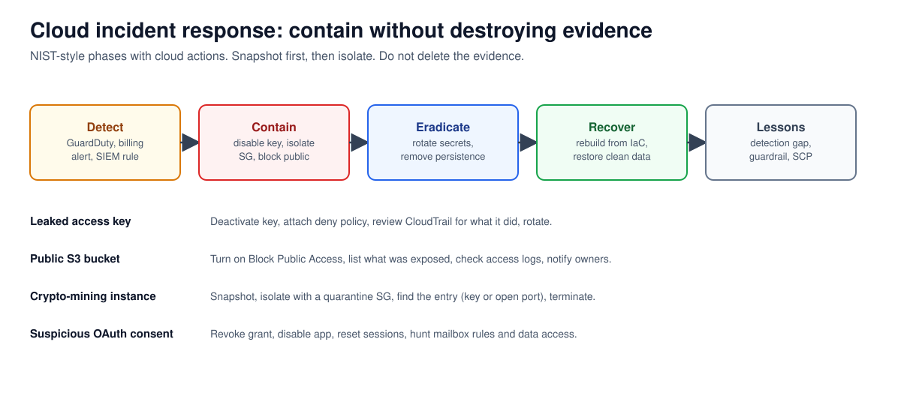

# 06. Cloud Incident Response

> **Module:** 10 · Cloud Security · **Week:** 12 · **Time:** about 7 hours
> **You will:** run four cloud incident playbooks (leaked access key, public S3 bucket, crypto-mining instance, suspicious OAuth consent) and write a short incident report.
> **Maps to:** Security+ (incident response) · NIST SP 800-61 Rev. 3 · AWS Security Specialty (incident response) · SC-200 · MITRE ATT&CK T1078.004, T1496 (Resource Hijacking), T1530, T1528 (Steal Application Access Token)

## 1. Why it matters in a cloud-security / SOC job

Cloud incidents move fast. A leaked key can be used within minutes of being pushed to a public repository, and miners can run up large bills in a day. You must **contain quickly but keep evidence**, because cloud resources can vanish when you delete them.

The library's cloud project list includes "simulate an incident like key compromise, document the lifecycle, and write a formal report". This lesson is that project.

## 2. Understand it



### 2.1 Cloud IR differences

| On-prem habit | Cloud change |
|---|---|
| Pull the network cable | Change a security group, deactivate a key, attach a deny policy |
| Image the disk | Snapshot the volume (EBS or managed disk) first |
| Look at host logs | Look at CloudTrail, Activity Log, Entra logs, flow logs |
| Rebuild the server | Redeploy from IaC and **rotate every secret** the old one could reach |
| One site | Check **all regions** and all accounts. Attackers use unused regions |

Core loop (NIST style): Prepare → Detect and analyze → Contain → Eradicate → Recover → Lessons learned. Prepare means: logs on, runbooks written, break-glass access tested, contacts ready.

### 2.2 Playbook A: compromised AWS access key

| Step | Action |
|---|---|
| Detect | GuardDuty credential finding, SIEM rule (key used from new country), provider notice, secret scanner alert |
| Contain | Deactivate the key (not delete, to keep the record). Attach an explicit deny policy to the user or revoke role sessions. AWS may also attach a managed quarantine policy to an exposed user |
| Scope | In CloudTrail filter by access key ID. List every API call, every region. Look for new users, keys, roles, policy changes, `RunInstances`, `CreateTrail` changes, S3 reads, KMS use |
| Eradicate | Delete attacker-made users and keys, roles, instances, Lambda, trust-policy edits. Rotate secrets the key could read |
| Recover | Replace with roles, add MFA, add SCP guardrails, enable secret scanning |
| Report | Timeline, impact, data touched, fixes |

### 2.3 Playbook B: public S3 bucket

| Step | Action |
|---|---|
| Detect | Config/Security Hub finding, CloudTrail `PutBucketPolicy` / ACL change, external researcher email |
| Contain | Turn on Block Public Access for the bucket and the account |
| Scope | What is in it (Macie or listing), when it became public, access logs or data events for external reads, were objects copied |
| Eradicate | Fix the policy, move data, rotate any secrets found inside |
| Notify | Data owner, privacy/legal. Exposure of personal data may trigger legal duties; the legal team decides |
| Recover | Preventive guardrail, IaC fix, regular scans |

### 2.4 Playbook C: crypto-mining instance

| Step | Action |
|---|---|
| Detect | GuardDuty `CryptoCurrency:EC2/BitcoinTool` finding, high CPU, big bill alert, odd instances in unused regions |
| Contain | Snapshot the volume, move the instance into a quarantine security group (no inbound or outbound), do not terminate yet |
| Scope | Find the **entry**: leaked key (CloudTrail `RunInstances` by whom), exposed service, weak SSH password. Check other regions and accounts |
| Eradicate | Terminate after evidence is saved. Remove attacker keys/roles. Patch the entry point |
| Recover | Budget alerts, region-deny SCP for unused regions, quotas, GuardDuty on everywhere |

### 2.5 Playbook D: suspicious OAuth consent (Entra / Microsoft 365)

Attackers sometimes trick a user into granting a malicious app access to mail and files. The app then has a **token that works without the password and survives a password reset**.

| Step | Action |
|---|---|
| Detect | Entra audit log "Consent to application", Defender for Cloud Apps alert, user report |
| Contain | Review the enterprise application, remove the user grants, disable the app, revoke sessions and refresh tokens |
| Scope | What permissions did it get (Mail.Read, Files.Read.All...)? Who else consented? What data did the app read (Unified Audit Log, mailbox audit)? Check new mailbox rules and forwarding |
| Eradicate | Delete the app registration/enterprise app. Reset credentials of affected users |
| Recover | Restrict user consent, enable the admin-consent workflow, review app permissions regularly, alert on high-risk consents |

Real example class: Microsoft reported the Midnight Blizzard group abused OAuth applications in a 2023 to 2024 intrusion of its corporate tenant. The method is real. Use it as a reason to monitor consents.

> **From DBA to security**
> You already have an incident habit: a database goes down, you do not rush. You protect the data, take a backup or snapshot of the current state, gather alert logs and trace files, then fix. In cloud IR it is the same: snapshot first, collect CloudTrail, then contain and rebuild. Your RMAN restore tests are the same discipline as "test your IR playbook before the incident".

## 3. Hands-on

Use the lab as the "detect and scope" step of Playbook A.

```bash
.venv/Scripts/python cybersecurity-track/10-cloud-security/lab/demo.py
```

From the output you can already write the scope paragraph: *carol's account created key AKIAEXAMPLENEW01 at 11:30 (from CA). The key was first used at 11:40 from 203.0.113.77 (RU). Between 11:45 and 11:55 the attacker stopped logging, made bucket corp-customer-exports public, and deleted trail org-trail.*

**Exercise: write the report.** Use the [investigation write-up template](../13-profile-and-portfolio/templates/writeup-template.md). Fill: summary, timeline (use the finding times), evidence (event names), impact (public bucket, logging gap 11:45 onward), actions (deactivate key, restore trail, Block Public Access, review access logs), and lessons (SCP deny on StopLogging/DeleteTrail, alert on key-new-country).

*Optional, in your own sandbox account:* create a throwaway IAM user and key, deactivate it from the CLI, and look up its events:

```bash
aws iam update-access-key --user-name TESTUSER --access-key-id <KEY_ID> --status Inactive
aws cloudtrail lookup-events --lookup-attributes AttributeKey=AccessKeyId,AttributeValue=<KEY_ID>
```

## 4. Practice platforms

- TryHackMe: SOC Level 1 and SOC Level 2 incident-response and investigation rooms; also search "cloud" for incident rooms.
- HTB Labs: **Sherlocks** are guided defensive investigations. Pick one with cloud/identity logs and write it up.
- HTB Academy: SOC Analyst path incident-handling content. Check the module list for details.

## 5. Three realistic scenarios (beyond the playbooks)

1. **Bill alert: 30x normal spend.** Instances in 6 regions. Walk Playbook C. Add region-deny SCP.
2. **Partner reports they can read your bucket.** Walk Playbook B. Prove with access logs whether anyone else did.
3. **Finance user's mailbox forwards to an outside address after a "document share" email.** Walk Playbook D and look for MFA-relay phishing.

## 6. Common mistakes

- Deleting the instance or user before saving evidence.
- Rotating the key but not checking what it created (persistence).
- Checking only the home region.
- Forgetting non-human identities: service principals, app secrets.
- No communication plan: who tells legal, the owner, and leadership?

## 7. Interview questions

<details><summary><b>Q1. Your first three actions on a leaked access key?</b></summary>
Deactivate the key, attach a deny or revoke sessions, then pull CloudTrail for that key across all regions to scope what it did. Preserve evidence and start a timeline.
</details>

<details><summary><b>Q2. Why deactivate instead of delete?</b></summary>
Deactivation stops use but keeps the key ID and record for investigation and can be reversed if you made a mistake.
</details>

<details><summary><b>Q3. How do you handle a compromised EC2 instance?</b></summary>
Snapshot the disk and memory if possible, isolate with a quarantine security group, collect logs, analyze, then terminate and rebuild from clean images.
</details>

<details><summary><b>Q4. How do you know whether data in a public bucket was downloaded?</b></summary>
Server access logs or CloudTrail data events for that bucket. If neither was enabled, you cannot prove it, which is why you enable them for sensitive buckets.
</details>

<details><summary><b>Q5. What is persistence in the cloud?</b></summary>
Attacker-created access: new users, access keys, roles with trust policies, Lambda functions, OAuth apps, federation settings. Hunt for them after containing.
</details>

<details><summary><b>Q6. Why check other regions?</b></summary>
Attackers launch resources in regions you do not use, where nobody looks. CloudTrail and GuardDuty must cover all regions.
</details>

<details><summary><b>Q7. What makes OAuth consent attacks hard to remove?</b></summary>
The app holds tokens that remain valid after a password reset. You must revoke the grant and sessions and remove the app.
</details>

<details><summary><b>Q8. What would you put in the incident report?</b></summary>
Summary, impact, timeline with evidence, root cause, actions taken, what data was affected, and preventive recommendations with owners and dates.
</details>

<details><summary><b>Q9. Who must you tell if personal data was exposed?</b></summary>
The data owner, security leadership and legal/privacy teams. They decide on regulator and customer notification duties. The analyst provides facts, not legal judgments.
</details>

<details><summary><b>Q10. How do you test your cloud IR readiness?</b></summary>
Tabletop exercises and safe simulations in a sandbox account (create and use a test key from another IP and check that alerts fire), and measure time to detect and contain.
</details>

## 8. Checklist

- [ ] I can recite the four playbooks and the order: detect, contain, scope, eradicate, recover.
- [ ] I know why to snapshot before terminating.
- [ ] I wrote a one-page report from the lab output.
- [ ] I can name three persistence methods to hunt for.

## 9. References

- NIST SP 800-61 Rev. 3 (Incident Response Recommendations): https://csrc.nist.gov/
- AWS Security Incident Response Guide: https://docs.aws.amazon.com/
- Microsoft Learn: investigate and respond to OAuth app threats: https://learn.microsoft.com/
- MITRE ATT&CK: T1496, T1528, T1078.004
- Library: AI Cyber Incident Playbook (IR phases) and the Cloud security project list, paraphrased.
