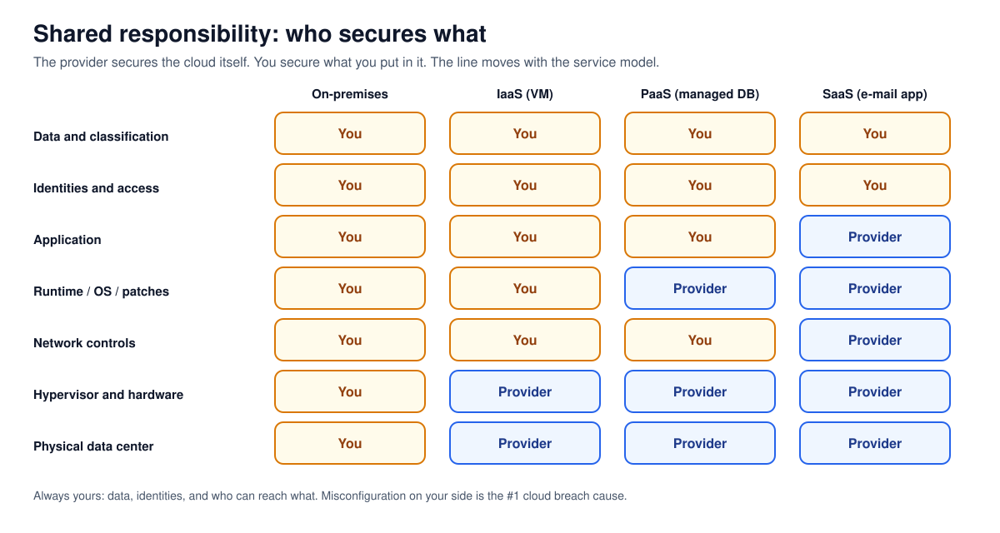

# Module 10: Cloud Security

> **Weeks:** 6 to 12 (runs in parallel with other modules) · **Time:** about 35 hours · **Why now:** your new job needs this first.
> **You will:** understand how AWS and Azure identity, logging and networking work from a security view, detect attacks in CloudTrail-style logs, review IAM policies by code, and handle four common cloud incidents.

| | |
|---|---|
| **Prerequisites** | [Module 03](../03-security-foundations/) basics (CIA, least privilege, MFA); basic Linux and JSON |
| **Lab** | [`lab/`](lab/): offline Python. Detects 5 attack patterns in CloudTrail-style JSON and analyzes IAM policies |
| **Maps to** | Security+ SY0-701/801 (cloud and architecture topics) · AWS Certified Security Specialty · Microsoft SC-900, SC-300, AZ-500, SC-200 · ISC2 CCSP (later) · MITRE ATT&CK Cloud matrix · CIS Foundations Benchmarks. Exam codes change, so check each vendor page before booking |

## Learning path

| # | Lesson | Week | Certification objective |
|---|---|---|---|
| 01 | [Cloud security fundamentals](01-cloud-security-fundamentals.md) | 6 | Shared responsibility, Well-Architected, landing zones, CIS |
| 02 | [Identity in the cloud](02-cloud-identity.md) | 7 to 8 | AWS IAM, Entra ID, RBAC, Conditional Access, PIM |
| 03 | [Cloud logging and detection](03-cloud-logging-and-detection.md) | 9 | CloudTrail, GuardDuty, Activity Log, Sentinel, Splunk |
| 04 | [Network and data protection](04-network-and-data-protection.md) | 10 | VPC/VNet, SG/NSG, private endpoints, KMS, public storage |
| 05 | [CSPM, CNAPP, CWPP and IaC scanning](05-cspm-cnapp-iac-scanning.md) | 11 | Posture, compliance, shift-left |
| 06 | [Cloud incident response](06-cloud-incident-response.md) | 12 | IR in the cloud: keys, buckets, miners, OAuth |

## Key terms (simple words)

| Term | Meaning |
|---|---|
| **Control plane** | The API and console used to create and change cloud resources. Logged by CloudTrail / Activity Log |
| **Data plane** | The actual use of a resource, such as reading an object or querying a database |
| **IAM** | Identity and Access Management: who can do what on which resource |
| **Role** | An identity that has no password. A user or service *assumes* it and gets temporary keys |
| **SCP** | Service Control Policy. An AWS Organizations guardrail that limits what accounts can ever allow |
| **CSPM** | Cloud Security Posture Management: finds misconfigurations |
| **CWPP** | Cloud Workload Protection Platform: protects VMs, containers, functions at runtime |
| **CNAPP** | Cloud-Native Application Protection Platform: joins CSPM, CWPP and more in one product |
| **IaC** | Infrastructure as Code, for example Terraform |
| **Landing zone** | A pre-built, secure starting structure of accounts or subscriptions |

## How this connects to your job

In a Cloud Security + SOC role you will read CloudTrail and Entra logs, triage GuardDuty and Defender alerts, review who has too much access, and help when a key leaks. Each lesson ends with the lab or tools that match those tasks.

## Mini-project (portfolio piece)

"Cloud detection pack": extend `lab/cloudtrail_detector.py` with two new rules (for example `DeleteBucketPublicAccessBlock` and `AttachUserPolicy` with AdministratorAccess). Add tests with benign cases. Then write a short post that maps each rule to a MITRE ATT&CK technique. Publish it with the template in [Module 13](../13-profile-and-portfolio/templates/).

## Interview questions (module level)

<b>Q1. Explain the shared responsibility model in one minute.</b>

The provider secures the cloud itself: buildings, hardware, the hypervisor and the managed service software. The customer secures what they configure in it: data, identities, network rules, encryption choices and application code. The split moves with the service type. With IaaS you patch the guest OS. With SaaS you mostly manage users, data sharing and settings. Data and identity are always the customer's job.

<b>Q2. What is the most common cause of cloud breaches?</b>

Misconfiguration and weak identity control: public storage, over-permissioned roles, leaked long-lived keys, no MFA, and missing logs. Exotic attacks on the provider are rare.

<b>Q3. Control plane vs data plane: why does it matter for logging?</b>

Control-plane events (create, change, delete) are logged by default in CloudTrail management events. Data-plane events (read an S3 object, invoke a function) cost more and are off by default, so you must enable them for sensitive resources or you cannot see who read the data.

<b>Q4. A role vs a user in AWS?</b>

A user has long-lived credentials (password, access keys). A role has none. Something assumes it through STS and gets temporary credentials that expire. Prefer roles for workloads and people with federation.

<b>Q5. What do SCPs do, and what can't they do?</b>

They set the maximum permissions for accounts in an AWS Organization. They never grant access by themselves, and they do not apply to the management account.

<b>Q6. What first three things would you check in a new AWS account?</b>

Root user: MFA on, no access keys. CloudTrail on in all regions with logs stored in a protected bucket. S3 Block Public Access at account level. Then GuardDuty and Security Hub, and an IAM review.

<b>Q7. Azure RBAC vs Entra roles?</b>

Azure RBAC controls access to Azure resources (VMs, storage) at management group, subscription, resource group or resource scope. Entra roles control the directory itself (users, apps, Conditional Access). They are separate systems, though Global Administrator can elevate itself to manage Azure resources.

<b>Q8. What is a managed identity and why use it?</b>

An identity that Azure creates and rotates for a resource, so code can call Key Vault or Storage with no secret in the code or config. It removes a whole class of leaked-secret incidents.

<b>Q9. A public bucket alert fires. What do you do?</b>

Confirm in the config and logs, turn on Block Public Access (contain), find what data is inside and whether it was accessed using access logs and data events, tell the owner and the data protection team, fix the root cause (IaC, guardrail), and record the lesson.

<b>Q10. What is the difference between CSPM and CWPP?</b>

CSPM checks cloud configuration (is the bucket public, is MFA on). CWPP protects what runs (vulnerabilities, malware and suspicious behavior on VMs, containers, functions). CNAPP combines them and adds identity and code context.

## Practice on TryHackMe / HTB

- TryHackMe: finish **Cyber Security 101**, then do **SOC Level 1** log-analysis rooms. Search the room catalog for "AWS", "cloud" and "Azure" to find cloud-specific rooms, and check the room page for what it covers before starting.
- HTB Academy: the **SOC Analyst** job-role path trains log reading skills you reuse here. Search the module list for cloud topics.
- HTB Labs: some **Sherlocks** involve cloud or identity logs. Filter by category and read the description.
- Free cloud practice: AWS Free Tier or an Azure free account (set a budget alert first). Deliberately vulnerable training projects exist for cloud (search for "CloudGoat" and "flAWS"). Use only your own accounts.

## References

- AWS Security documentation and the AWS Well-Architected Security Pillar: https://docs.aws.amazon.com/
- Microsoft Learn, Azure security and Entra: https://learn.microsoft.com/
- CIS Benchmarks: https://www.cisecurity.org/cis-benchmarks
- MITRE ATT&CK Cloud matrix: https://attack.mitre.org/
- NIST SP 800-61 Rev. 3 (incident response)
