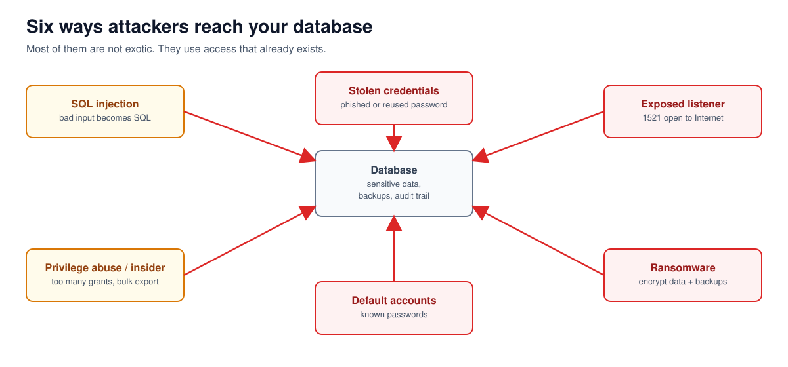

# 01. The Database Threat Landscape

> **Module:** 11 · Database Security · **Week:** 12 · **Time:** about 4 hours
> **You will:** name the six main attack paths to a database, explain SQL injection with a safe example, and use an audit checklist to review a database.
> **Maps to:** Security+ (application attacks, injection) · OWASP Top 10 injection · MITRE ATT&CK T1190, T1078, T1486, T1530 · CIS Oracle Benchmark

## 1. Why it matters in a SOC / cloud-security job

- **Heartland Payment Systems, 2008:** attackers used SQL injection to get into the network, then installed sniffing malware. Card data of a very large number of payments was stolen. It is one of the best-known SQL injection cases.
- **MOVEit Transfer, 2023:** a SQL injection flaw (CVE-2023-34362) in a file-transfer product was exploited at scale by the Cl0p group to steal data from many organizations.
- **Ransomware in general:** attackers often look for backup systems and database servers because they hold the data that hurts most.
- **SOC view:** you will see alerts like "SQL injection pattern in web logs", "new DBA grant", "database port reachable from Internet", "large export". Each maps to one path below.

## 2. Understand it



| # | Path | What happens | Example signals | Main defenses |
|---|---|---|---|---|
| 1 | **SQL injection** | App builds SQL by joining strings. Attacker input becomes SQL | WAF alerts, errors like `ORA-00933` / `ORA-01756` in app logs, strange `UNION SELECT` in URLs | Bind variables, input validation, least-privilege app account, WAF |
| 2 | **Stolen or weak credentials** | Phishing, reuse, password spray, secrets in code | Failed-login bursts, logons from new host | Strong profiles, MFA/Kerberos where possible, vaulting, rotation |
| 3 | **Privilege abuse / insider exfiltration** | A person or app with wide rights reads or copies too much | Mass `SELECT`, `expdp` export, `UTL_FILE` writes, DB link use | Least privilege, redaction, Database Vault, audit, alerts, DLP |
| 4 | **Exposed listener / port** | Database reachable from the Internet or from every network | Port scans, unknown source IPs, `TNS` errors | Network segmentation, firewall default deny, valid-node checking, no public IP |
| 5 | **Default and unused accounts** | Vendor accounts with known passwords | Logins by `SCOTT`, `DBSNMP`, old demo users | Lock/remove, change passwords, check `DBA_USERS_WITH_DEFPWD` |
| 6 | **Ransomware / destruction** | Data and backups encrypted or deleted | Mass file changes, backup deletes, stopped audit | Immutable backups, patching, EDR on hosts, access control |

### SQL injection in 60 seconds (safe, in-memory concept)

Bad pattern: build a query by joining text.

```python
# VULNERABLE (do not write this)
sql = "SELECT * FROM accounts WHERE owner = '" + user_input + "'"
# input: ' OR '1'='1   ->  SELECT * FROM accounts WHERE owner = '' OR '1'='1'
```

Safe pattern: pass input as a **bind variable** so it is always data.

```python
cur.execute("SELECT * FROM accounts WHERE owner = :owner", {"owner": user_input})
```

You know bind variables from performance tuning (they avoid hard parsing and cursor bloat). They are also the main security fix. In PL/SQL, dynamic SQL with `EXECUTE IMMEDIATE` should use `USING` binds, and `DBMS_ASSERT` helps validate object names.

### Common database kill chain (attacker view)

Initial access (SQL injection or stolen password) → discovery (list tables, users) → privilege escalation (find a role or weak grant) → collection (bulk select, export) → exfiltration (download, `UTL_HTTP`, cloud sync) → defense evasion (turn off audit, delete logs) → impact (encrypt, delete backups). The lab in Lesson 03 has a rule for four of these steps.

### The audit checklist (paraphrased from the library document)

A practical database audit goes through six areas. Use it as a review sheet:

| Area | Questions |
|---|---|
| Access control | Password strength and rotation? MFA for admins? Default accounts locked? Roles instead of direct grants? Shared admin accounts? Regular access reviews? |
| Encryption | TDE or equivalent for data at rest? Keys in a safe keystore with a lifecycle (create, rotate, retire)? TLS 1.2+ for connections? |
| Network | Database in its own segment? Firewall default-deny with allow rules? Only approved hosts and ports? Vulnerability scans? |
| Auditing | Logins, DDL, privilege changes audited? Logs kept (at least 90 days) in a central place? Monitoring tool in use? Regular log review? |
| Backup and recovery | Automated, encrypted, offsite backups? Restore tested every quarter? Retention matches policy? Procedures written? |
| Other | Patching per policy? Physical security? Penetration tests? Data classification? Admin training? |

> **From DBA to security**
> You did each of these as housekeeping. Now each one has a threat attached. Locking `SCOTT` stopped "default accounts". The `sqlnet.ora` valid-node list stopped "exposed listener". Your quarterly restore test is the ransomware control the whole industry asks for. When an interviewer asks "tell me about a security control you implemented", you already have five stories.

## 3. Hands-on

1. Run the audit checklist on one database you know (use a lab VM, not production). Mark each line yes, no or unknown.
2. For each "no" write one fix and one SQL or OS command that proves it (for example `SELECT username FROM dba_users_with_defpwd;`).
3. Run the Module 11 lab demo to see abuse paths in an audit log (full output in Lesson 03):

```bash
.venv/Scripts/python cybersecurity-track/11-database-security/lab/demo.py
```

4. *Optional:* practice SQL injection only inside a deliberately vulnerable training application that you run yourself (for example a local training app or a TryHackMe room). Never test real systems you do not own.

## 4. Practice platforms

- TryHackMe: search "SQL injection" for guided rooms (inside the Cyber Security 101 and web paths, check the current path list).
- HTB Academy: look for the SQL Injection Fundamentals module and related database modules.
- HTB Sherlocks: choose a data-theft investigation and trace how the data left.

## 5. Three realistic scenarios

1. **WAF shows `' OR 1=1` against the order page; 200 responses.** *Investigate:* app logs for matching requests, database audit for the app account, row counts returned. *Do:* block the source, fix the query to use binds, rotate app credentials, review data exposed.
2. **Port 1521 open to the Internet after a firewall change.** *Investigate:* firewall change log, listener log for outside IPs, failed and successful logons. *Do:* close the rule, check for compromise (new users, grants), enable valid-node checking.
3. **Analyst exports the full customer table to a USB share at night.** *Investigate:* audit trail (`SELECT`, `expdp`), HR context, access reviews. *Do:* involve HR and legal, preserve evidence, tighten access, add a mass-select alert.

## 6. Common mistakes

- Thinking the database is "inside" so it is safe.
- App connects as the schema owner (full DDL rights).
- Same account used by many people.
- Audit enabled but nobody reads it.
- Test and development copies of production data with no masking.

## 7. Interview questions

<details><summary><b>Q1. What is SQL injection and how do you prevent it?</b></summary>
It is when untrusted input changes the SQL statement structure. Prevent it with bind variables or parameterized queries, input validation, least-privilege accounts, safe error handling and a WAF as extra defense.
</details>

<details><summary><b>Q2. Why does the app account's privilege level matter for injection impact?</b></summary>
Injection runs with the app's rights. If the app account is limited to a few tables and DML, the attacker is limited as well. If it is a DBA, the whole database is lost.
</details>

<details><summary><b>Q3. Name three signs of insider exfiltration.</b></summary>
Mass SELECT on sensitive tables, unusual export tool use (such as Data Pump) or file writes, and logons from new hosts or tools at odd hours.
</details>

<details><summary><b>Q4. Why is an exposed listener dangerous?</b></summary>
It lets anyone on the network try to connect, guess passwords, or exploit unpatched flaws. Database ports should only be reachable from app servers and admin hosts.
</details>

<details><summary><b>Q5. How do you find default-password accounts in Oracle?</b></summary>
Query `DBA_USERS_WITH_DEFPWD`, then lock or change the passwords and remove sample schemas that are not needed.
</details>

<details><summary><b>Q6. How do attackers attack backups?</b></summary>
They use admin access to delete or encrypt backup files and catalogs, or target backup servers and cloud buckets. Use separate credentials and immutable storage.
</details>

<details><summary><b>Q7. Describe a database attack chain in order.</b></summary>
Initial access, discovery, privilege escalation, collection, exfiltration, evasion (audit off), impact (encrypt/delete). At each step there is a log source and a control.
</details>

<details><summary><b>Q8. What is the difference between privilege abuse and a compromised account?</b></summary>
Abuse is the real owner misusing their rights. Compromise is a third party using stolen credentials. Both look like valid logons, so you need baselines, context (host, program, time) and approvals to tell them apart.
</details>

<details><summary><b>Q9. A developer needs production data to debug. What do you advise?</b></summary>
Provide masked or synthetic data, or temporary, audited, read-only access with approval and expiry. Do not copy raw production data to dev.
</details>

<details><summary><b>Q10. What are the top five items in a quick database security review?</b></summary>
Exposure (network), accounts and privileges, patch level, encryption (at rest and in transit), and audit plus backup (including a restore test).
</details>

## 8. Checklist

- [ ] I can list six database attack paths with a defense for each.
- [ ] I can explain SQL injection and the bind-variable fix.
- [ ] I completed the audit checklist for one test database.
- [ ] I ran the lab demo and can describe one finding.

## 9. References

- OWASP SQL Injection Prevention Cheat Sheet: https://cheatsheetseries.owasp.org/
- MITRE ATT&CK: https://attack.mitre.org/
- CIS Oracle Database Benchmark: https://www.cisecurity.org/cis-benchmarks
- Oracle Database Security Guide: https://docs.oracle.com/en/database/
- Library: Database security audit checklist (paraphrased).
