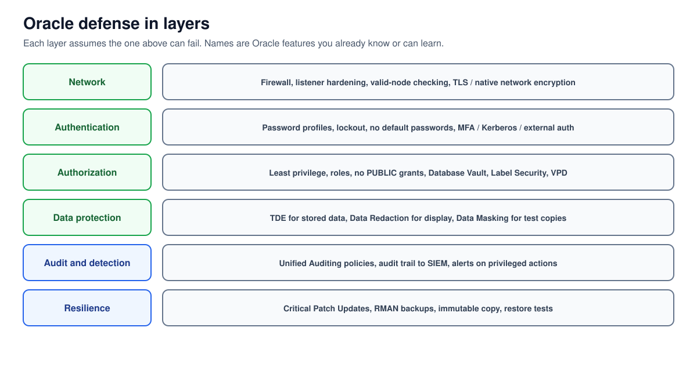

# 02. Oracle Security Controls

> **Module:** 11 · Database Security · **Weeks:** 12 to 13 · **Time:** about 6 hours
> **You will:** map Oracle features to security controls: least privilege, profiles, Unified Auditing, TDE, Data Redaction, Database Vault, Label Security, network encryption, listener hardening, CIS, and Critical Patch Updates.
> **Maps to:** Security+ (access control, cryptography, hardening) · CIS Oracle Database Benchmark · DISA STIG for Oracle (concept) · NIST CSF 2.0 *Protect* · ISO/IEC 27001:2022 Annex A (access control, cryptography, logging)

> **Version note.** Oracle features, defaults and licensing change between 12c, 19c, 21c and 23ai. Everything below is conceptual. Check the Security Guide for **your** version, and check licensing (some features are options) before you use them.

## 1. Why it matters in a SOC / cloud-security job

You will talk to DBAs and auditors. A finding like "TDE not enabled" or "unified auditing not configured" is a real audit result. Knowing the controls lets you explain risks in simple words and check that a fix is real. It also helps in the cloud: RDS for Oracle and Autonomous Database expose many of the same ideas.

## 2. Understand it



### 2.1 Least privilege, roles and accounts

| Practice | How in Oracle | Security reason |
|---|---|---|
| Schema owners do not log in | Create the app schema with `NO AUTHENTICATION` or lock it, and use a separate connect user | App injection or a stolen login cannot run DDL |
| Roles for each job | `CREATE ROLE app_read; GRANT SELECT ON ... TO app_read;` | Easy review and removal |
| Avoid `ANY` privileges | No `SELECT ANY TABLE`, `EXECUTE ANY PROCEDURE`, `ALTER ANY ...` for normal users | These reach every schema |
| Limit `PUBLIC` | Revoke `EXECUTE` on risky packages such as `UTL_FILE`, `UTL_HTTP`, `UTL_TCP`, `UTL_SMTP` from `PUBLIC` where not needed (the CIS benchmark lists these) | Stops easy file, network and mail abuse |
| Separate admin duties | Named DBA accounts, `AUDIT_ADMIN` and `AUDIT_VIEWER` roles, account management separate from DBA | Separation of duties |
| Review regularly | `DBA_ROLE_PRIVS`, `DBA_SYS_PRIVS`, `DBA_TAB_PRIVS`, `DBA_USERS` | Remove unused access |
| Privilege Analysis | `DBMS_PRIVILEGE_CAPTURE` records which privileges are used (check licensing for your version) | Shrinks grants to the real need |
| Remove defaults | Query `DBA_USERS_WITH_DEFPWD`, lock sample accounts | Known passwords |

Unlike "just make them DBA", the target is: **the application can do only DML on its tables; people use named accounts; nobody shares SYS.**

### 2.2 Password profiles

A **profile** sets resource and password limits. Main password parameters:

| Parameter | Use |
|---|---|
| `FAILED_LOGIN_ATTEMPTS` | Lock after this many failures (stops guessing; also allows denial-of-service by locking, so balance) |
| `PASSWORD_LOCK_TIME` | How long the lock lasts |
| `PASSWORD_LIFE_TIME`, `PASSWORD_GRACE_TIME` | Expiry and warning period |
| `PASSWORD_REUSE_TIME`, `PASSWORD_REUSE_MAX` | Stop reuse |
| `PASSWORD_VERIFY_FUNCTION` | Complexity check (Oracle ships sample verify functions) |
| `INACTIVE_ACCOUNT_TIME` | Lock unused accounts (from 12.2) |

Service accounts often need a profile with no expiry but with a very strong, vaulted password and tight network and privilege limits. Document the exception. Oracle also ships hardened sample profiles (for example `ORA_STIG_PROFILE`, `ORA_CIS_PROFILE` in recent versions). Check your version.

### 2.3 Unified Auditing

Unified Auditing (introduced in 12c) puts all audit records in one trail, readable from the `UNIFIED_AUDIT_TRAIL` view. In recent releases it is the standard way. Key ideas:

- You create **policies** and enable them:

```sql
CREATE AUDIT POLICY sensitive_read ACTIONS SELECT ON app.customers;
AUDIT POLICY sensitive_read;
AUDIT POLICY ora_logon_failures;      -- a predefined policy
SELECT policy_name FROM audit_unified_enabled_policies;
```

- Oracle ships **predefined policies** such as `ORA_SECURECONFIG`, `ORA_LOGON_FAILURES`, `ORA_ACCOUNT_MGMT`, and CIS and STIG sets.
- Some actions are audited **by default** (for example audit-policy changes and `ALTER DATABASE`).
- Records show who (`DBUSERNAME`), where (`USERHOST`, `OS_USERNAME`), which tool (`CLIENT_PROGRAM_NAME`), what (`ACTION_NAME`, `OBJECT_NAME`, `SQL_TEXT`), and the result (`RETURN_CODE`).
- Roles `AUDIT_ADMIN` (manage policies) and `AUDIT_VIEWER` (read the trail) separate duties.
- Manage the trail size with `DBMS_AUDIT_MGMT` and **archive to central storage first**.
- Oracle Audit Vault and Database Firewall can collect and report audit data. You can also forward to syslog or a SIEM (see Lesson 03).

### 2.4 TDE (Transparent Data Encryption)

TDE encrypts data **at rest**: tablespaces (recommended) or columns. A **master encryption key** in a **keystore** (wallet) protects the data keys. Related: encrypted RMAN backups, Data Pump encryption.

| TDE protects against | TDE does not protect against |
|---|---|
| Stolen datafiles, disks, backups | A logged-in user with SELECT rights (data is decrypted for them) |
| Lost media | SQL injection through the app |

Keystore care: back it up separately from the data and backups, control who can run `ADMINISTER KEY MANAGEMENT`, consider an HSM or external key manager. Lost keystore = unreadable data.

### 2.5 Data Redaction

Data Redaction (`DBMS_REDACT`, part of the Advanced Security option) changes **query results** on the fly: full redaction, partial (for example `XXXX-XXXX-XXXX-1234`), random, or regular-expression. Stored data is unchanged. It is for people who may query the table but should not see full values, such as support staff. Users with `EXEMPT REDACTION POLICY` bypass it, so grant that very rarely. For **non-production copies**, use data masking instead: it changes the stored data permanently in the copy.

### 2.6 Database Vault and Label Security (concept level)

| Feature | Idea | Example |
|---|---|---|
| **Database Vault** | Even powerful users such as the DBA cannot read app data unless allowed. Uses **realms** (protected object sets), **command rules**, and separation of duties | Realm around `HR` schema: the DBA can manage the database but cannot `SELECT` HR salaries |
| **Label Security** | Row-level access by sensitivity labels (for example Confidential) and user clearance | Support staff see only rows labeled Public |
| **VPD (Virtual Private Database)** | Policy functions add a `WHERE` clause to queries | Each manager sees only their own team rows |

These are options with their own licensing. They are stronger answers to **insider** threats than any ordinary grant.

### 2.7 Network encryption and listener hardening

- **Native network encryption** and integrity: set in `sqlnet.ora` (for example `SQLNET.ENCRYPTION_SERVER`, `SQLNET.CRYPTO_CHECKSUM_SERVER`). Or use **TLS** (TCPS) with certificates in a wallet. Prefer TLS 1.2 or higher.
- **Listener**: do not expose to the Internet; restrict by `TCP.VALIDNODE_CHECKING = yes` with `TCP.INVITED_NODES` (in `sqlnet.ora`); `ADMIN_RESTRICTIONS_LISTENER = ON` stops remote changes to listener config; keep listener logging on; use Class of Secure Transport (COST) to limit which transports can register services; run the listener as a non-root OS user; change the default port only as a minor extra, never as the main control.
- **Firewall**: allow only app servers and admin hosts, deny everything else.

### 2.8 CIS benchmark and patching

- The **CIS Oracle Database Benchmark** (versions exist for several releases) is a numbered checklist: initialization parameters, network, user and privilege settings, auditing, and patching. Run the audit commands, track exceptions. DISA publishes an Oracle STIG used in government.
- **Critical Patch Updates (CPUs)** are released quarterly (January, April, July, October). They fix security bugs. Apply Release Updates on a plan: test, schedule, apply, verify with `OPatch lsinventory` / `datapatch` output, record. Unpatched databases with exposed listeners are the easiest target. Also watch Oracle Security Alerts for urgent out-of-cycle fixes.

> **From DBA to security**
> This lesson is your résumé in security words. Profiles = authentication hardening. Roles = RBAC. `sqlnet.ora` = network security. AWR baselines = anomaly baselines. Unified Audit = logging and monitoring. TDE wallet = key management. Quarterly patching = vulnerability management. When a security person says "least privilege", they mean what you meant when you refused to grant `DBA` to a developer.

## 3. Hands-on

Use a local lab database (Oracle Free container or a VM). **Never** run these on production.

```sql
-- 1. Who has powerful privileges?
SELECT grantee, privilege FROM dba_sys_privs WHERE privilege LIKE '%ANY%' ORDER BY 1;
SELECT grantee, granted_role FROM dba_role_privs WHERE granted_role = 'DBA';

-- 2. Default passwords?
SELECT username FROM dba_users_with_defpwd;

-- 3. Which audit policies are on?
SELECT policy_name, enabled_opt FROM audit_unified_enabled_policies;

-- 4. Last 20 grants in the unified trail
SELECT event_timestamp, dbusername, sql_text FROM unified_audit_trail
 WHERE action_name = 'GRANT' ORDER BY event_timestamp DESC FETCH FIRST 20 ROWS ONLY;
```

Then compare your findings with the lab's rule "GRANT of DBA outside a change window" (Lesson 03). Optional: download the CIS Oracle benchmark (free with registration) and run five audit steps.

## 4. Practice platforms

- TryHackMe: search for rooms on databases and SQL; Linux hardening rooms help with listener and OS settings.
- HTB Academy: modules on databases and hardening; check current module names.
- Oracle's free LiveLabs workshops cover Unified Auditing, TDE, Data Redaction, Database Vault and Data Safe. Search "Oracle LiveLabs security".

## 5. Three realistic scenarios

1. **Auditor finding: "TDE not enabled; backups are readable".** *Investigate:* where backups go, who can read them. *Do:* plan TDE (keystore, backup of keystore, tablespace encryption), encrypt RMAN backups, test restore on a fresh host with the keystore.
2. **Support team sees full card numbers.** *Do:* Data Redaction policy on the card column, keep `EXEMPT REDACTION POLICY` away from them, audit access with a unified audit policy.
3. **Listener reachable from the whole network.** *Do:* valid-node checking, firewall, `ADMIN_RESTRICTIONS_LISTENER`, review listener logs for strange IPs, confirm patch level.

## 6. Common mistakes

- Enabling TDE and thinking it stops SQL injection or insiders.
- Leaving the keystore next to the backups.
- Auditing "everything": huge trail, nobody reads it. Audit what matters (see Lesson 03).
- `FAILED_LOGIN_ATTEMPTS` set so low that attackers can lock out the application accounts.
- Granting `EXEMPT REDACTION POLICY` or `SELECT ANY TABLE` "just to fix it".
- Skipping CPUs because "it works".

## 7. Interview questions

<details><summary><b>Q1. What is least privilege in a database?</b></summary>
Each account has only the access needed for its job. App users do DML on needed objects through roles, no `ANY` privileges, minimal `PUBLIC` rights, named admins, and regular reviews.
</details>

<details><summary><b>Q2. What is a profile in Oracle and which settings matter for security?</b></summary>
A profile limits resources and password rules. Key settings are failed login attempts, lock time, password life, reuse, verify function, and inactive-account time.
</details>

<details><summary><b>Q3. What is Unified Auditing?</b></summary>
A single audit trail with policy-based auditing, queried through `UNIFIED_AUDIT_TRAIL`. Policies define what to audit, predefined policies give a baseline, and `AUDIT_ADMIN` and `AUDIT_VIEWER` roles separate duties.
</details>

<details><summary><b>Q4. What does TDE protect and not protect?</b></summary>
It protects stored files and backups against theft or loss of media. It does not stop authorized queries, SQL injection or privilege misuse because Oracle decrypts data for the session.
</details>

<details><summary><b>Q5. TDE vs Data Redaction vs Data Masking?</b></summary>
TDE: encryption at rest. Redaction: change what query results show to some users, stored data unchanged. Masking: permanently change data in a copy, for test and dev.
</details>

<details><summary><b>Q6. What does Database Vault add that normal grants cannot?</b></summary>
It limits even privileged users. Realms and command rules stop DBAs and `ANY` privilege holders from reading or changing protected application data and enforce separation of duties.
</details>

<details><summary><b>Q7. How do you secure the listener?</b></summary>
Keep it off the Internet, restrict by valid nodes and firewall, restrict admin changes, use TLS or native encryption, enable logging, patch, and monitor listener logs.
</details>

<details><summary><b>Q8. How often are Critical Patch Updates released and how should you handle them?</b></summary>
Quarterly. Review the advisory, test in non-production, schedule within policy (shorter for exposed or critical issues), apply, verify and document.
</details>

<details><summary><b>Q9. Why encrypt network traffic to the database?</b></summary>
Credentials and data can be read or altered on the wire by someone on the network. Native encryption or TLS protects confidentiality and integrity.
</details>

<details><summary><b>Q10. How do you use the CIS benchmark in practice?</b></summary>
Pick the version for your release, run the audit steps, record pass/fail, fix or document exceptions with owners and dates, and re-run on a schedule.
</details>

<details><summary><b>Q11. How would you detect that someone turned off auditing?</b></summary>
Alert on `NOAUDIT`, `DROP AUDIT POLICY`, `ALTER AUDIT POLICY` records (these are audited by default) and on audit-management package calls, and compare the list of enabled policies to the approved list regularly.
</details>

## 8. Checklist

- [ ] I can explain each control in one sentence and say which threat it stops.
- [ ] I ran the four queries on a lab database.
- [ ] I know what TDE does not protect.
- [ ] I know the CPU schedule and my patching process in security words.

## 9. References

- Oracle Database Security Guide (your version): https://docs.oracle.com/en/database/
- Oracle Database Security Assessment Tool and Data Safe (cloud) docs.
- Oracle Critical Patch Updates and Security Alerts: https://www.oracle.com/security-alerts/
- CIS Oracle Database Benchmark: https://www.cisecurity.org/cis-benchmarks
- Library: Database security audit checklist (paraphrased).
