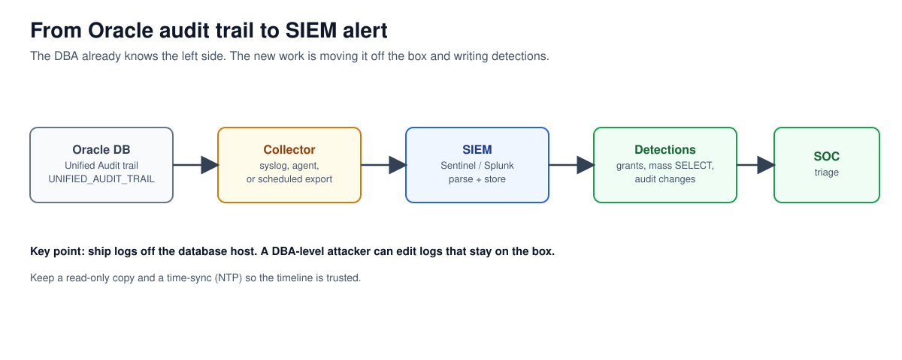

# 03. Database Activity Monitoring and Audit Logs in the SIEM

> **Module:** 11 · Database Security · **Week:** 13 · **Time:** about 7 hours
> **You will:** explain DAM, move Oracle audit records to a SIEM, write five detections, and run an offline analyzer on synthetic Oracle-unified-audit-style records.
> **Maps to:** Security+ (logging and monitoring) · SC-200 (Sentinel, KQL) · Splunk Core Certified User (SPL) · MITRE ATT&CK T1078, T1087, T1530, T1562.001/T1562 (impair defenses), T1110 · CIS Oracle Benchmark (auditing section)

## 1. Why it matters in a SOC / cloud-security job

The SOC rarely sees database audit data unless someone sends it. A DBA who can say "send these 8 audit actions to Splunk, and here is the alert logic" is very valuable. Typical SOC alerts on databases are: privilege grants, mass reads, logins from new hosts, and audit changes.

## 2. Understand it

### 2.1 What is DAM

**Database Activity Monitoring (DAM)** watches who does what in a database, in near real time, and alerts on risky actions. Ways to collect:

| Method | How | Pros | Cons |
|---|---|---|---|
| Native audit (Oracle Unified Audit) | The database writes its own records | Complete, supported, includes the SQL | Performance cost if you audit too much, trail lives in the database |
| Agent or network sniffing | A product watches traffic | No database changes | Misses encrypted traffic and local (bequeath) sessions |
| Database firewall / proxy | Sits in front, can block | Prevents as well as detects | Extra hop, tuning needed |
| Cloud-native | Cloud audit features (RDS log exports, Azure SQL auditing) | Easy | Limited to what the service offers |

### 2.2 From the audit trail to the SIEM



Common ways to move Oracle audit data:

1. Read `UNIFIED_AUDIT_TRAIL` on a schedule (a script or a SIEM database input) and send new rows, using the event timestamp as the checkpoint.
2. Send to the operating system log (syslog or the Windows event log) using the unified-audit system-log setting, then forward with the normal log agent. Check the parameters for your version.
3. Use Oracle Audit Vault and Database Firewall to collect and forward.
4. On cloud services, export logs (for example RDS to CloudWatch Logs, Azure SQL auditing to Log Analytics or Event Hubs).

Quality tips:
- Send **UTC time** and keep NTP in sync.
- Send the **fields** that give context: user, host, program, action, object, SQL text (or a hash if SQL may contain secrets), return code.
- Keep a **baseline** (who normally logs in from where, with which tool).
- Keep the trail on the database long enough, but do not rely on it. Protect the audit trail from the DBA role with `AUDIT_ADMIN` separation.

### 2.3 Five detections (example logic)

| # | Detection | Logic | Notes |
|---|---|---|---|
| 1 | Privileged grant outside change window | `ACTION_NAME = GRANT` and the SQL grants DBA, SYSDBA or an `ANY` privilege, and time not in an approved window | Join with the change calendar. In-window grants stay quiet |
| 2 | Mass SELECT on sensitive tables | count of `SELECT` on sensitive tables by user in 5 minutes above a threshold | Exclude known service accounts and their known program |
| 3 | New host or program | `LOGON` where host or program is not in this user's baseline | An app account used from SQL Developer is a strong signal |
| 4 | Audit policy tampering | `NOAUDIT`, `DROP AUDIT POLICY`, `ALTER AUDIT POLICY`, audit-trail cleanup | Cleanup by scheduled maintenance is only medium |
| 5 | Failed-login burst on SYS/SYSTEM | 5+ failures (`ORA-01017` or `ORA-28000`) in 10 minutes, then success | Success after a burst is critical |

Example SIEM queries (adapt to your parsed field names):

```text
# Splunk (SPL): grants of DBA role
index=oracle sourcetype=oracle:audit action_name=GRANT sql_text="*GRANT DBA*"
| table _time dbusername userhost client_program_name sql_text
```

```kusto
// Sentinel (KQL): failed SYS logins, 5 or more in 10 minutes
OracleAudit_CL
| where ActionName_s == "LOGON" and DbUserName_s in ("SYS","SYSTEM") and ReturnCode_d != 0
| summarize fails = count() by DbUserName_s, UserHost_s, bin(TimeGenerated, 10m)
| where fails >= 5
```

> **From DBA to security**
> You already read the trail to answer "who dropped that table?". The SIEM does the same on every database at once, and wakes someone up. Baseline logic (`new host`, `new program`) is the same idea as comparing AWR snapshots to find what changed. Your knowledge of which accounts are real (`DBSNMP`, `APP_USER`, backup jobs) is exactly what makes a rule accurate instead of noisy.

## 3. Hands-on

The lab analyzes synthetic records that use real column names of `UNIFIED_AUDIT_TRAIL` (`EVENT_TIMESTAMP`, `DBUSERNAME`, `USERHOST`, `CLIENT_PROGRAM_NAME`, `ACTION_NAME`, `RETURN_CODE`, `OBJECT_NAME`, `SQL_TEXT`). Everything is fake: hosts are `*.example` or documentation IPs.

Files in `lab/`:
- `sample_audit.py`: baseline week plus one incident night mixed with normal traffic
- `audit_analyzer.py`: the five rules (no sibling imports)
- `demo.py`, `test_audit_lab.py`

```bash
.venv/Scripts/python cybersecurity-track/11-database-security/lab/demo.py
```

Real output:

```text
Baseline learned from 35 records: users = ['APP_USER', 'BATCH_ETL', 'DBA_ALICE', 'SYS']

Analyzing 79 audit records (one normal app day + one bad night)

TIME                 SEVERITY  RULE                       USER       DETAIL
2026-03-11 02:03:00  critical  ADMIN_LOGIN_BURST          SYS        Successful SYS login right after a failure burst (from 198.51.100.44)
2026-03-11 02:16:00  critical  AUDIT_TAMPERING            SYS        NOAUDIT POLICY ORA_LOGON_FAILURES (from 198.51.100.44)
2026-03-11 02:17:00  critical  AUDIT_TAMPERING            SYS        DROP AUDIT POLICY APP_SENSITIVE_ACCESS (from 198.51.100.44)
2026-03-11 02:01:20  high      ADMIN_LOGIN_BURST          SYS        5 failed logins within 10 min (latest from 198.51.100.44)
2026-03-11 02:12:54  high      MASS_SELECT                APP_USER   20 SELECTs on sensitive tables within 5 min via SQL Developer from laptop77.example
2026-03-11 02:15:00  high      PRIV_GRANT_OUTSIDE_WINDOW  SYS        GRANT DBA TO APP_USER (from 198.51.100.44, sqlplus)
2026-03-11 02:03:00  medium    NEW_HOST_OR_PROGRAM        SYS        new host 198.51.100.44; new program 'sqlplus'
2026-03-11 02:10:00  medium    NEW_HOST_OR_PROGRAM        APP_USER   new host laptop77.example; new program 'SQL Developer'

Normal traffic only (43 records, incl. an in-window GRANT DBA): 0 findings
```

**Read the story (timeline):** At 02:01 someone from 198.51.100.44 starts guessing the `SYS` password. At 02:03 they get in. At 02:10 the app account `APP_USER` logs in from a laptop with SQL Developer (wrong host, wrong tool). It reads `CARD_DATA` 20+ times in a few minutes. At 02:15 `SYS` grants `DBA` to `APP_USER`. At 02:16 and 02:17 the audit policies are removed. That is guessing, access, collection, privilege escalation and evasion.

**What stays quiet:** the app's normal 40 `SELECT`s on `CUSTOMERS` through its usual program, and Alice's `GRANT DBA TO NEW_DBA_BOB` on Tuesday at 21:00 (inside the change window). Detections that stay quiet on normal work are the ones the SOC will trust.

**Break it yourself (predict first):**
1. Change `DEFAULT_CHANGE_WINDOWS` so Tuesday is not a window. Does Alice's grant alert? (Yes, as high.)
2. Remove `APP_USER` from `SERVICE_ACCOUNTS` in `demo.py`. What happens to the app's normal reads? (The 40 `SELECT`s trigger `MASS_SELECT`.) This shows why the allow list must name both user and program.
3. Raise `select_threshold` to 30. Does the laptop's 25 `SELECT`s still alert? (No: a miss. Thresholds must balance noise and misses.)

**Stretch:** add a rule for `CREATE USER` outside the window; add `expdp` detection using `CLIENT_PROGRAM_NAME`; add a benign test.

Run the tests (17 for this module):

```bash
.venv/Scripts/python -m pytest cybersecurity-track/11-database-security -q
```

Limits to remember: the lab uses naive time (one timezone), simple regex for SQL, and a tiny baseline. Real systems need time-zone handling, SQL parsing, per-table sensitivity from a data catalog, and tuning with real data.

*Optional free tools:* Splunk Free (500 MB/day) or a Sentinel trial; load the sample records as CSV and rebuild the five rules in SPL or KQL.

## 4. Practice platforms

- TryHackMe: **SOC Level 1** SIEM and log-analysis rooms (Splunk, Elastic). Search for "Splunk" rooms and practice the same queries.
- HTB Academy: **SOC Analyst** path SIEM modules. HTB Sherlocks involving data theft.
- Oracle LiveLabs: Unified Auditing workshop (search "LiveLabs auditing").

## 5. Three realistic scenarios

1. **GRANT DBA at 02:15.** (The lab case.) *Investigate:* change calendar, who and from where, what the grantee did next. *Do:* revoke, lock, hunt for other grants and new users, rotate SYS password, review how SYS was reached.
2. **Mass SELECT by a reporting user.** *Investigate:* is it month-end? Which program? How many rows (use SQL text and `V$` or application logs)? *Do:* if legitimate, add the user and program to the allow list with an owner; if not, disable and interview.
3. **Audit policy dropped.** *Investigate:* who, from where, what happened in the gap (other logs: listener, OS, network). *Do:* restore policy, treat as an incident, and add a SIEM rule for any change in enabled policies.

## 6. Common mistakes

- Alerting on everything an admin does.
- Auditing every `SELECT` on every table (performance and noise).
- Keeping the only copy of audit data on the database.
- No baseline, so every new host alerts.
- Not documenting the change windows, so planned work causes incidents.

## 7. Interview questions

<details><summary><b>Q1. What is DAM?</b></summary>
Monitoring database activity (logins, privileged actions, access to sensitive data) in near real time and alerting on risk. It can use native audit, agents, or a proxy.
</details>

<details><summary><b>Q2. How do you get Oracle audit records into a SIEM?</b></summary>
Query `UNIFIED_AUDIT_TRAIL` with a checkpoint, or send audit records to syslog, or use Audit Vault. Then parse the fields (user, host, program, action, object, SQL, return code) and keep UTC time.
</details>

<details><summary><b>Q3. Why not rely only on the on-box audit trail?</b></summary>
A privileged attacker can alter or purge it. A central copy is tamper-resistant and can be correlated with other logs.
</details>

<details><summary><b>Q4. Give two detections for insider exfiltration.</b></summary>
Mass `SELECT` on sensitive tables in a short window by a non-service account, and use of export tools or file-writing packages by users who normally do not.
</details>

<details><summary><b>Q5. Why is "new program" a useful signal?</b></summary>
App accounts usually connect through one program. If the same credentials are used with SQL Developer or `sqlplus`, a human or attacker is likely using stolen credentials.
</details>

<details><summary><b>Q6. How do you reduce false positives for GRANT alerts?</b></summary>
Join with the change calendar and approvals, keep named admin lists, and alert only for privileged grants outside windows or without a ticket.
</details>

<details><summary><b>Q7. What does ORA-01017 mean and how do you use it?</b></summary>
It means invalid username or password. Bursts of it against admin users indicate guessing. `ORA-28000` means the account is locked.
</details>

<details><summary><b>Q8. A failed-login burst on SYS ended with a success. Severity?</b></summary>
Critical. It looks like a successful password guess against the most powerful account. Contain at once: block the source, review everything the session did, and rotate credentials.
</details>

<details><summary><b>Q9. What data would you not send to the SIEM?</b></summary>
Passwords or secrets that appear in SQL text, and bulk personal data. Mask or hash sensitive SQL values, and limit who can read the SIEM index.
</details>

<details><summary><b>Q10. How do you test a detection?</b></summary>
Build a sample set with attack and benign cases. Assert the attack triggers and normal admin work does not. Keep it as a regression test, as in this lab.
</details>

<details><summary><b>Q11. Native audit vs network-based monitoring?</b></summary>
Native audit sees everything the database does, even local and encrypted sessions, and records the SQL. Network monitoring cannot see encrypted or local connections but needs no database change. Many programs use native audit as the base.
</details>

## 8. Checklist

- [ ] I can explain DAM and three collection methods.
- [ ] I ran the lab and can narrate the timeline from the output.
- [ ] I did the three break-it exercises.
- [ ] I wrote one of the rules in SPL or KQL.

## 9. References

- Oracle Database Security Guide: Configuring Audit Policies (your version): https://docs.oracle.com/en/database/
- Microsoft Sentinel and KQL docs: https://learn.microsoft.com/azure/sentinel/
- Splunk Search Reference: https://docs.splunk.com/
- MITRE ATT&CK T1562: https://attack.mitre.org/techniques/T1562/
- Library: Database security audit checklist (auditing section), paraphrased.
