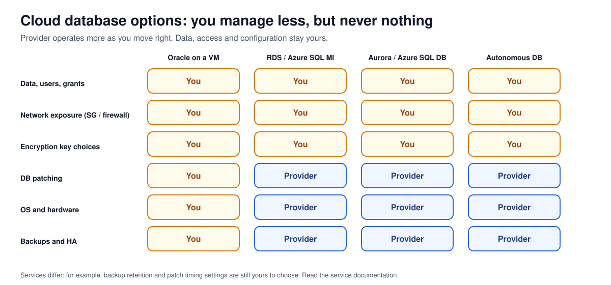

# 04. Cloud Databases: Security Features and Shared Responsibility

> **Module:** 11 · Database Security · **Week:** 14 · **Time:** about 5 hours
> **You will:** compare AWS RDS/Aurora, Azure SQL and Oracle Cloud Autonomous Database, name the security features of each, and say exactly what stays your job.
> **Maps to:** Security+ (cloud models, data protection) · AWS Security Specialty (data protection) · AZ-500 (data and storage security) · CCSP domain on cloud data security · [Module 10 lessons 01 and 04](../10-cloud-security/)

> **Version note.** Cloud services change often. Treat each feature list as a map of *what to look for*, and confirm details on the provider's current documentation page.

## 1. Why it matters in a SOC / cloud-security job

Your company will move more databases to managed services. The first question from security will be: "what do we still have to configure?" The usual answer: **everything about access, network exposure, encryption choices and monitoring.** Public database endpoints, weak master passwords and missing audit logs are typical cloud findings. As an ex-DBA you can check these faster than most security staff.

## 2. Understand it

### 2.1 Responsibility by option

| Layer | Oracle on a VM (IaaS) | RDS / Azure SQL Managed Instance | Aurora / Azure SQL Database | Autonomous Database |
|---|---|---|---|---|
| Data, users, grants | You | You | You | You |
| Network exposure (SG, firewall, endpoints) | You | You | You | You |
| Key and encryption choices | You | You (provider supports options) | You (often on by default) | You (always on; you may choose customer-managed keys) |
| DB patching | You | Provider applies, you pick windows/versions | Provider | Provider, automatic |
| OS and hardware | You | Provider | Provider | Provider |
| Backups and HA | You | Provider (you set retention) | Provider (you set retention) | Provider (you set retention) |

### 2.2 AWS RDS and Aurora

| Area | What to know |
|---|---|
| Network | Place in private subnets. Do not make "publicly accessible". Security group allows only app tier. Use VPC endpoints and private connectivity |
| Identity | Master user is highly privileged: vault it. IAM database authentication available for some engines (MySQL, PostgreSQL, Aurora). Secrets Manager can store and rotate DB passwords |
| Encryption at rest | KMS encryption chosen at creation (cannot just toggle later on an existing unencrypted instance without a snapshot copy). Snapshots inherit |
| Encryption in transit | TLS/SSL connections; require them with parameters or options |
| RDS for Oracle | Supports TDE and Native Network Encryption through option groups, Oracle audit configuration, and log export to CloudWatch Logs. No OS or SYSDBA access, so some on-prem habits change (use the RDS procedures and master user) |
| Audit and monitoring | Export engine logs to CloudWatch Logs; CloudTrail logs RDS API calls; Aurora has Database Activity Streams (near real-time, can send to a stream for SIEM). GuardDuty RDS protection can detect anomalous logins |
| Backups | Automated backups and snapshots; encrypted; share snapshots carefully (public snapshot is a classic leak); copy to another account/region |

### 2.3 Azure SQL (Database and Managed Instance)

| Area | What to know |
|---|---|
| Network | Server firewall rules, **Private Endpoint**, turn off public network access, avoid "Allow Azure services" unless required |
| Identity | Microsoft Entra authentication (preferred), managed identities for apps, limit SQL logins, set an Entra admin |
| Encryption | TDE on by default (service-managed key, or customer-managed key in Key Vault). Always Encrypted for client-side column encryption. TLS enforced |
| Data protection features | Dynamic Data Masking (like redaction at query time), row-level security (like VPD), Ledger tables for tamper evidence |
| Audit and detection | SQL Auditing to storage, Log Analytics or Event Hubs, Microsoft Defender for SQL (vulnerability assessment and threat detection), Entra logs for sign-ins |
| Backups | Automatic backups with retention and long-term retention; geo-redundant options |

### 2.4 Oracle Cloud and Autonomous Database

| Area | What to know |
|---|---|
| Network | Private endpoint in your VCN, or public endpoint restricted by access control lists (ACLs). Prefer private |
| Encryption | Data is always encrypted at rest; Oracle-managed keys by default, with customer-managed keys in OCI Vault as an option. Network traffic uses TLS or mutual TLS (wallet) |
| Identity | Database users and roles as you know them; IAM integration and Entra ID or Kerberos options exist. Protect the ADMIN user |
| Auditing and assessment | Unified Auditing; **Oracle Data Safe** provides security assessment, user assessment, activity auditing, sensitive data discovery and masking (check current feature list) |
| Patching | Automatic. Database Vault and other options are available on supported editions (check current docs) |
| Backups | Automatic backups with retention you set |

### 2.5 What you must still check, for any cloud database

1. Is it **reachable from the Internet**? Fix first.
2. Who holds the **admin/master** credential? Is it vaulted, rotated, used by humans?
3. Are **users and roles** least privilege? (Your DBA skill.)
4. Is **encryption** on with the key control you need?
5. Are **audit logs** on and shipped to the SIEM?
6. **Backups:** retention, encryption, copy to another account, snapshot sharing, restore test.
7. **Patch/version** settings and maintenance windows.

> **From DBA to security**
> On RDS you lose the OS shell, not the responsibility. The listener becomes a security group and an endpoint. The wallet becomes KMS or Key Vault. `DBA_USERS`, grants and audit are still yours. If a security architect asks "what is different in RDS?", you can answer from experience.

## 3. Hands-on

1. Make a comparison sheet: rows = the seven checks above, columns = RDS, Azure SQL, Autonomous. Fill each cell from the provider documentation (one hour of reading, valuable for interviews).
2. Connect to the lab: the audit analyzer's logic (Lesson 03) works on exported audit records from any platform if you map the fields. Write a field-mapping table from the Oracle unified-audit columns to the RDS log or Azure SQL audit fields.
3. *Optional free:* use the AWS free tier or an Azure free account for a small instance; set it private, enable logs, and view the logs. Delete after. Oracle Cloud has an Always Free tier with Autonomous Database (check current terms). Watch costs and set budget alerts.

## 4. Practice platforms

- TryHackMe: search for cloud and database rooms; check each room's scope.
- HTB Academy: search for cloud and database content.
- Provider labs: AWS Skill Builder, Microsoft Learn sandboxes, Oracle LiveLabs.

## 5. Three realistic scenarios

1. **RDS "publicly accessible" with a weak master password.** *Investigate:* security group, `Failed login` logs, GuardDuty. *Do:* make private, restrict SG, rotate master password into Secrets Manager, review users and data access.
2. **Public RDS snapshot.** *Investigate:* snapshot sharing attributes via CloudTrail (`ModifyDBSnapshotAttribute`), who copied. *Do:* make private, assume the data is exposed, notify the owner, rotate any secrets in the data.
3. **Azure SQL with "Allow Azure services" and no auditing.** *Do:* use private endpoint, disable public access, turn on auditing to Log Analytics, add Defender for SQL, alert on firewall rule changes.

## 6. Common mistakes

- "The provider handles security" with no review of public access.
- Using the master user for the app.
- Forgetting that backups and snapshots are copies of the data with their own access rules.
- Missing log export, so there is no audit trail when needed.

## 7. Interview questions

<b>Q1. Who is responsible for patching RDS?</b>

The provider applies engine patches during maintenance windows you configure. You choose versions and timing, and you are responsible for application compatibility and testing.

<b>Q2. Name three RDS security controls you configure.</b>

Private subnet and security group, KMS encryption and TLS, and log export plus IAM or vaulted credentials. Also snapshot sharing and backup retention.

<b>Q3. What does TDE do on Azure SQL?</b>

It encrypts database files and backups at rest. It is on by default with a service-managed key, and you can use a customer-managed key in Key Vault.

<b>Q4. What is a private endpoint and why use it for databases?</b>

A private IP in your network for the service. Traffic stays off the public Internet and you can disable the public endpoint completely.

<b>Q5. How do you audit Azure SQL?</b>

Turn on SQL auditing to storage, Log Analytics or Event Hubs, add Defender for SQL for threat detection, and send to Sentinel.

<b>Q6. What is Oracle Data Safe?</b>

A cloud security service for Oracle databases offering assessment of configuration and users, activity auditing, sensitive data discovery and masking. Check the current list of features in the docs.

<b>Q7. What can go wrong with snapshots?</b>

They can be shared publicly or with the wrong account, copied without encryption, or never deleted. They hold all the data, so treat them like the database.

<b>Q8. Compare Dynamic Data Masking to Oracle Data Redaction.</b>

Both change what query results show to selected users without changing stored data. Names and features differ per platform. Neither replaces access control or encryption.

<b>Q9. How do you lose OS access on RDS and still investigate?</b>

Use exported engine and audit logs, CloudTrail for API actions, Performance Insights and Enhanced Monitoring for behavior, and database queries on audit views as permitted.

<b>Q10. Migrating on-prem Oracle to the cloud: top five security tasks?</b>

Private networking, least privilege users and master credential vaulting, encryption with key control, audit logs to SIEM, and backup copies in a separate account plus restore tests.

## 8. Checklist

- [ ] I filled the comparison sheet for three platforms.
- [ ] I know the seven checks and can apply them to any cloud database.
- [ ] I can say what the provider does and what I do on RDS and Azure SQL.

## 9. References

- AWS RDS and Aurora security docs: https://docs.aws.amazon.com/rds/
- Microsoft Learn: Azure SQL security overview: https://learn.microsoft.com/azure/azure-sql/
- Oracle Autonomous Database and Data Safe docs: https://docs.oracle.com/en/cloud/
- Module 10, lessons 01 and 04 for shared responsibility and network/data protection.
