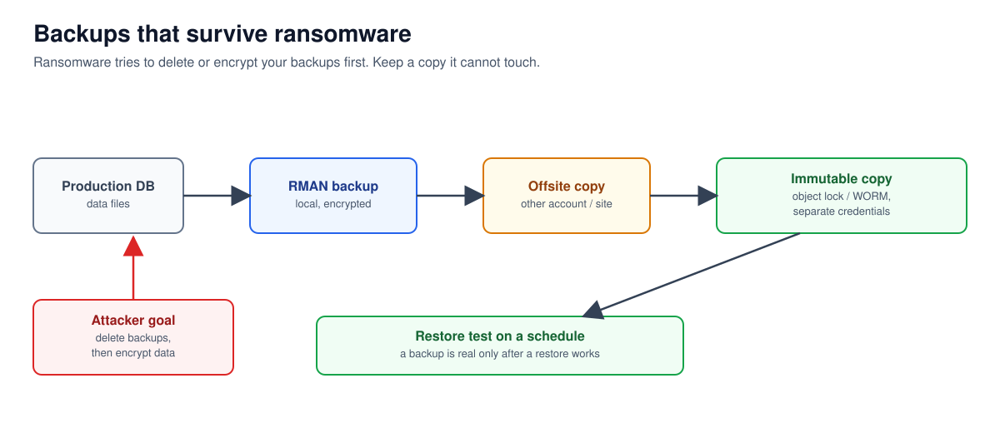

# 05. Backup Security and Ransomware Recovery (the RMAN bridge)

> **Module:** 11 · Database Security · **Week:** 14 · **Time:** about 5 hours
> **You will:** explain why backups are the last line of defense, design an immutable backup scheme, and write a ransomware recovery plan for a database.
> **Maps to:** Security+ (resilience and recovery) · NIST CSF 2.0 *Recover* · NIST IR 8374 Rev. 1 (ransomware risk management profile) · ISO/IEC 27001:2022 Annex A (backup, redundancy) · MITRE ATT&CK T1486 (Data Encrypted for Impact), T1490 (Inhibit System Recovery)

## 1. Why it matters in a SOC / cloud-security job

- **Code Spaces, 2014:** an attacker with cloud console access deleted production data and the backups held in the same account. The company could not recover. This is the oldest and clearest lesson: **backups in the same trust zone as production are not enough.**
- Modern ransomware groups are known to look for backup servers and delete shadow copies and backup catalogs before they encrypt (ATT&CK T1490).
- In a SOC you will meet alerts like "backup job deleted", "vault policy changed", "mass file rename on the DB host". In an incident, the first question from leadership is: "can we restore, and how fast?" A DBA who has tested restores is the person who answers.

## 2. Understand it



### 2.1 The rule: 3-2-1-1-0

| Number | Meaning |
|---|---|
| 3 | Three copies of the data (production plus two backups) |
| 2 | On two different media or storage types |
| 1 | One copy offsite (another site, region or account) |
| 1 | One copy **immutable or offline** (cannot be altered or deleted by an attacker with admin rights) |
| 0 | Zero errors: backups are verified, and restores are tested |

### 2.2 Immutable backups

Immutable means: for a set retention time, nobody can change or delete the object, not even an administrator.

| Technology | Idea |
|---|---|
| AWS S3 Object Lock (compliance or governance mode) and AWS Backup Vault Lock | WORM storage with a retention date. Use a **separate account** for the vault, and compliance mode for the strongest lock |
| Azure immutable blob storage and Backup vault immutability | Time-based retention that blocks delete and overwrite |
| Offline tape or air-gapped disk | Physically disconnected |
| Oracle options | RMAN to a protected target such as the Oracle Zero Data Loss Recovery Appliance or a cloud recovery service with immutable features (check current product docs) |

Also: separate credentials for backup systems (not domain admin), MFA on the backup console, network isolation of backup targets, alerts on backup deletion or retention changes, and encryption.

### 2.3 Encrypted backups

If TDE is on, RMAN backups of encrypted tablespaces stay encrypted. You can also encrypt backups with a password or a keystore key. **Keep the key safe and separate**: store the keystore backup in a different place than the backup data, and test restoring on a clean host using only what is stored offsite. A backup you cannot decrypt is no backup.

### 2.4 The RMAN bridge: what you already do, in security words

| RMAN habit | Security meaning |
|---|---|
| `BACKUP DATABASE PLUS ARCHIVELOG;` | Create recovery points (RPO) |
| `CONFIGURE ENCRYPTION FOR DATABASE ON;` | Protect backups at rest |
| `BACKUP VALIDATE CHECK LOGICAL DATABASE;` and `RESTORE DATABASE VALIDATE;` | Verify integrity without restoring: the "0 errors" |
| `DUPLICATE ... ` / restore to a test host | Restore test, proves recovery time (RTO) |
| Retention policy, `DELETE OBSOLETE` | Retention rule. Protect it from misuse |
| Control file autobackup, catalog | Recovery metadata that attackers may also target |
| Archivelog backups and point-in-time recovery | Roll back to just before the attack |

RPO is how much data you can lose (time). RTO is how long you can be down. Ransomware recovery is mostly an RTO problem: **restoring 20 TB takes hours or days**. Measure it before the incident.

### 2.5 Ransomware recovery plan for a database

1. **Detect and decide:** isolate hosts (network quarantine) but do not power off if memory evidence matters. Declare an incident.
2. **Scope:** which hosts, which databases, when did the attacker arrive (not only when encryption started). Backups taken after the intrusion may already contain attacker tools or altered data.
3. **Protect backups now:** disable backup deletion paths, lock the vault, rotate backup credentials.
4. **Rebuild clean:** new hosts from known-good images, not the infected ones. Patch the entry point.
5. **Restore:** pick a clean recovery point, restore on isolated hosts, validate (`RESTORE VALIDATE`, application checks, data counts), then reconnect in stages.
6. **Hunt and harden:** find persistence, rotate all secrets and keys, review accounts and grants, enable audit and alerts.
7. **Lessons:** update RTO/RPO numbers, runbooks and drills.

> **From DBA to security**
> You are the person leadership calls when backups matter. Many security teams have never done a real restore. Your RMAN restore tests, your habit of validating backups and knowing the RTO are the exact ransomware resilience controls auditors want. In interviews, say: "I treat backups as a security control: encrypted, offsite, immutable, and restore-tested."

## 3. Hands-on

1. Write your own backup scorecard for one database (lab or sample): 3-2-1-1-0, each line yes/no, with proof.
2. Run these on a **lab** database and record the time (this is your measured RTO sample):

```sql
-- RMAN (lab only)
BACKUP VALIDATE CHECK LOGICAL DATABASE;
RESTORE DATABASE VALIDATE;
```

3. Write the one-page ransomware recovery plan from section 2.5 with real names and phone roles for your environment (use placeholders in the repo, never real secrets).
4. Connect to the lab: the audit analyzer (Lesson 03) flags `AUDIT_TAMPERING`. Add a rule for backup-related actions (for example deletion of backup configuration from the application's audit records), with a benign test for normal retention cleanup.
5. *Optional:* in a sandbox AWS or Azure account, create a bucket or container with object lock or immutability enabled and prove that a delete is refused. Use short retention and low cost.

## 4. Practice platforms

- TryHackMe: search for ransomware and incident-response rooms in the **SOC Level 1/2** paths and check each room's scope.
- HTB Labs **Sherlocks:** choose a ransomware-themed investigation and note which artifacts show backup tampering.
- HTB Academy: SOC Analyst path content on incident handling.
- Free reading: NIST IR 8374 Rev. 1 (ransomware profile).

## 5. Three realistic scenarios

1. **Backup server credentials were used from a new host, then backup catalog deleted.** *Investigate:* backup system logs, authentication logs, network flow. *Do:* lock vault, rotate credentials, check the offsite immutable copy is intact, treat as pre-ransomware activity.
2. **Restore test fails: keystore not found.** *Do:* locate the keystore backup, store it separately, test again, add to the quarterly drill. Without the key, encrypted backups are unreadable.
3. **Ransomware hit; the newest backups contain the attacker's persistence.** *Do:* choose an older clean recovery point (use PITR and archived redo as far as is safe), restore, then replay only validated transactions, hunt for persistence before reconnecting.

## 6. Common mistakes

- Backups on the same storage or same admin domain as production.
- Never testing a restore end to end.
- Not backing up the keystore (or storing it next to the backups).
- Retention too short: attackers can wait weeks.
- Forgetting RTO: a backup that takes five days to restore may be too slow for the business.

## 7. Interview questions

<details><summary><b>Q1. Why are backups a security control?</b></summary>
They are the way to recover from ransomware, destruction or corruption. Their security (immutability, encryption, access control) decides whether recovery is possible.
</details>

<details><summary><b>Q2. Explain 3-2-1-1-0.</b></summary>
Three copies, two media types, one offsite, one immutable or offline, zero errors after verification and restore tests.
</details>

<details><summary><b>Q3. What is an immutable backup?</b></summary>
A copy that cannot be changed or deleted until its retention time ends, even by an admin. Examples: S3 Object Lock in compliance mode, immutable blob storage, offline media.
</details>

<details><summary><b>Q4. What are RPO and RTO?</b></summary>
RPO: the maximum data loss measured in time. RTO: the maximum time to restore service. Backup frequency drives RPO. Restore speed and process drive RTO.
</details>

<details><summary><b>Q5. How do you verify a backup without a full restore?</b></summary>
RMAN `VALIDATE` and `RESTORE ... VALIDATE` check readability and consistency. Still do periodic full restore tests, because validation does not prove the process works end to end.
</details>

<details><summary><b>Q6. How does TDE affect backups and restores?</b></summary>
Backups of encrypted data stay encrypted, which protects stolen backup media. You must keep the keystore (master key) available and backed up separately, or you cannot restore.
</details>

<details><summary><b>Q7. Attackers have admin rights. How do you still keep a good backup?</b></summary>
An immutable copy in a separate account or offline, with separate credentials and MFA, so admin rights on production cannot delete it.
</details>

<details><summary><b>Q8. After ransomware, how do you choose which backup to restore?</b></summary>
Find the intrusion start time. Pick a recovery point before it that you can validate as clean, restore to an isolated environment, check data and systems, then reconnect.
</details>

<details><summary><b>Q9. What alerts relate to backup attacks?</b></summary>
Backup job deletion, retention policy change, vault lock change, backup console login from a new host, mass deletion of snapshots, and shadow copy deletion commands on hosts.
</details>

<details><summary><b>Q10. How often should you test restores?</b></summary>
At least quarterly for critical databases (the audit checklist asks for this), and after major changes. Record the time taken and any gaps.
</details>

## 8. Checklist

- [ ] I can explain 3-2-1-1-0 and immutability.
- [ ] I measured a lab restore or validation time.
- [ ] I know where the keystore backup lives (in the lab) and tested restoring with it.
- [ ] I wrote a one-page ransomware recovery plan.

## 9. References

- NIST IR 8374 Rev. 1: Ransomware Risk Management, Cybersecurity Framework Profile: https://csrc.nist.gov/
- Oracle Database Backup and Recovery User's Guide (your version): https://docs.oracle.com/en/database/
- AWS S3 Object Lock and AWS Backup Vault Lock docs: https://docs.aws.amazon.com/
- Microsoft Learn: immutable storage for blobs: https://learn.microsoft.com/azure/storage/
- MITRE ATT&CK T1486 and T1490: https://attack.mitre.org/
- Library: NIST IR 8374r1 ransomware profile and the database security audit checklist (backup section), paraphrased.
