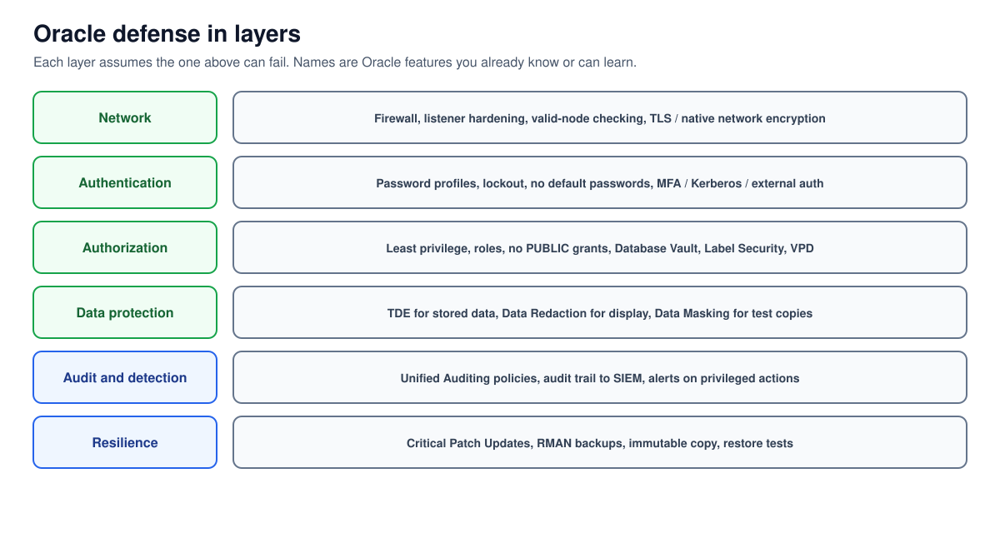

# Module 11: Database Security (the bridge from your DBA career)

> **Weeks:** 12 to 14 · **Time:** about 20 hours
> **You will:** see that years of Oracle DBA work are real security skill, learn the attacker view of databases, map Oracle controls to security language, detect abuse in audit logs, and explain cloud database and backup security in interviews.

| | |
|---|---|
| **Prerequisites** | Your Oracle DBA experience. [Module 03](../03-security-foundations/) basics |
| **Lab** | [`lab/`](lab/): an offline audit-log analyzer for synthetic Oracle-unified-audit-style records |
| **Maps to** | Security+ (data protection, access control, resilience) · CIS Oracle Database Benchmark · ISC2 CISSP/CCSP data security topics (later) · MITRE ATT&CK T1078, T1190, T1486, T1562 · OWASP Top 10 (injection) · SC-200 (alerts to SIEM) |

## Learning path

| # | Lesson | Week | Objective |
|---|---|---|---|
| 01 | [The database threat landscape](01-database-threat-landscape.md) | 12 | Attacker paths, real cases, the audit checklist |
| 02 | [Oracle security controls](02-oracle-security-controls.md) | 12 to 13 | Least privilege to CPU patching, in security language |
| 03 | [Database activity monitoring and SIEM](03-activity-monitoring-and-siem.md) | 13 | Audit logs to SIEM, detections, the lab |
| 04 | [Cloud databases](04-cloud-databases.md) | 14 | RDS, Aurora, Azure SQL, Autonomous: features and shared responsibility |
| 05 | [Backup security and ransomware recovery](05-backup-security.md) | 14 | Immutable backups, the RMAN bridge |

## What you already know (be proud)

| You did this as a DBA | Security name |
|---|---|
| Created roles and granted privileges | Access control, least privilege, RBAC |
| Set password profiles and locked accounts | Authentication hardening |
| Turned on auditing, read `DBA_AUDIT_TRAIL` | Logging and monitoring, detection |
| Configured the listener, `sqlnet.ora` | Network security, segmentation |
| Ran RMAN backups and restore tests | Business continuity, ransomware resilience |
| Applied quarterly patches | Vulnerability and patch management |
| Used AWR to learn "normal" load | Baselining for anomaly detection |
| Wrote change tickets for production | Change management, separation of duties |

## Key terms

| Term | Meaning |
|---|---|
| **SQL injection** | Attacker input changes the meaning of a SQL statement |
| **Privilege abuse** | Using allowed access for wrong purposes, or access that is too wide |
| **Insider threat** | A person with legitimate access who misuses it (on purpose or by mistake) |
| **DAM** | Database Activity Monitoring: watch and alert on database activity |
| **TDE** | Transparent Data Encryption: encrypts stored data |
| **Immutable backup** | A backup copy that cannot be changed or deleted until a set date |
| **Change window** | An approved time for risky changes |

## How this connects to your job

In SOC work, databases are the place the crown jewels live. You will see alerts about bulk reads, privilege changes and logins from strange hosts. You are one of the few analysts who can read an Oracle audit record and know what is normal. That is an advantage in interviews: say it.

## Mini-project

"DBA to SOC detection pack": take your real (sanitized, no secrets) knowledge of one Oracle audit scenario, add one new rule to `lab/audit_analyzer.py` (for example `CREATE USER` outside change windows, or `expdp` by an unexpected user from the program name), add a benign test, and publish a short post using the [blog template](../13-profile-and-portfolio/templates/blog-post-template.md).

## Interview questions (module level)

<b>Q1. Why are databases a prime target?</b>

They hold the valuable data in one place. Attackers who reach a database get customer records, credentials or payment data in bulk, and ransomware groups also go after the data and its backups.

<b>Q2. Name six database threats.</b>

SQL injection, stolen or weak credentials, privilege abuse and insider exfiltration, exposed listener or network port, default or unused accounts, and ransomware against data and backups.

<b>Q3. What does least privilege look like in Oracle?</b>

App schemas own objects but nobody logs in as the owner. Users get roles with only needed privileges, no `ANY` privileges, no unnecessary `PUBLIC` grants, and DBA rights are separate, named, audited and time-limited.

<b>Q4. TDE vs Data Redaction?</b>

TDE protects data at rest (datafiles, backups) from someone who steals files. Redaction hides values in query results from users who are allowed to run the query but should not see full values. Different threats, different tools.

<b>Q5. What would you audit first?</b>

Logons (success and failure), privilege and role changes, account management, audit policy changes, and access to sensitive tables. Oracle provides predefined unified audit policies as a starting point.

<b>Q6. Why send audit logs to a SIEM?</b>

A privileged attacker can edit or delete logs stored on the same host. A central copy is safe, searchable, correlated with other sources and covered by alerting.

<b>Q7. How does ransomware threaten database backups?</b>

Attackers with admin access delete or encrypt backups before encrypting data. Keep an immutable, offline or separate-credential copy and test restores.

<b>Q8. What is the shared responsibility for RDS?</b>

AWS runs hardware, OS and the database software platform; you control users, grants, network exposure, parameters, encryption choices and monitoring.

<b>Q9. An alert: GRANT DBA at 02:00 by an app user. What do you do?</b>

Check the change calendar. If no ticket, treat as an incident: confirm who and from where, lock the account, revoke the grant, review what that account did, and look at how it got the right to grant.

<b>Q10. How does your DBA background help in security?</b>

I know what normal looks like, how data flows, where audit and backups live, and how real changes are run. I can spot abnormal activity and speak with DBAs in their language.

## Practice on TryHackMe / HTB

- TryHackMe: **Cyber Security 101** includes web attack basics. Search the room catalog for "SQL injection" and "SQL" rooms for the attacker view, and for SIEM rooms in **SOC Level 1**.
- HTB Academy: look for the SQL injection module and database-related content; the **SOC Analyst** path trains log reading.
- HTB Sherlocks: choose investigations involving data theft or ransomware and focus on database-related artifacts.

## References

- Oracle Database Security Guide and Unified Auditing docs (for your version): https://docs.oracle.com/en/database/
- Oracle Critical Patch Updates: https://www.oracle.com/security-alerts/
- CIS Oracle Database Benchmark: https://www.cisecurity.org/cis-benchmarks
- OWASP SQL Injection Prevention Cheat Sheet: https://cheatsheetseries.owasp.org/
- NIST IR 8374 Rev. 1 (ransomware risk management profile)
- Library: Database security audit checklist, paraphrased.
