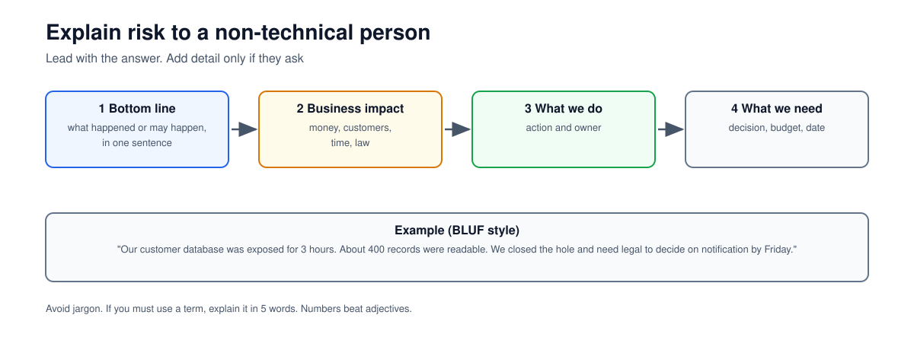

# 01 · Communication in security: explaining risk and writing executive summaries

> **Module:** 12 Soft Skills · **Ongoing:** start in week 4, repeat monthly · **Time:** ~4 hours
> **You will:** explain a security risk to a non-technical person in 30 seconds, and write a one-page executive summary using the template.
> **Certification:** Not an exam topic. It supports every SOC and security job, and many interviews.

---

## 1. Why it matters in a SOC / cloud-security job

Technical skill finds the problem. Communication gets it fixed.

- A manager reads a ticket for 20 seconds. If the point is not in the first lines, nothing happens.
- Developers fix the finding they understand. A vague "critical vulnerability" is ignored.
- During an incident, leadership needs facts and a decision, not a log dump.
- Your English does not need to be perfect. It needs to be clear. Short sentences are a strength in security writing.

---

## 2. Understand it

### 2.1 Four-part risk explanation

1. **Bottom line first (BLUF):** what happened or may happen, in one sentence.
2. **Business impact:** money, customers, law, time.
3. **What we are doing:** action and owner.
4. **What we need:** a decision, budget or date.

> "A supplier's login page can be copied by criminals. If staff type their password there, criminals can read our email. Two staff did. We reset both accounts and need approval to require security keys for finance by 30 November."

### 2.2 Replace jargon

| Technical | Plain words |
|---|---|
| Vulnerability | A weakness, like a door that does not lock |
| Exploit | Using the weakness |
| MFA | A second proof that it is really you |
| Ransomware | Software that locks our files and demands money |
| Phishing | A fake message that tricks people |
| Lateral movement | Moving from one computer to others inside our network |
| Patch | A fix from the vendor |
| Exfiltration | Stealing data out of our network |
| Zero-day | A weakness with no fix available yet |

### 2.3 Know your reader

| Reader | They want | Give them |
|---|---|---|
| Executive / board | Risk, money, decisions | 5 lines, numbers, options |
| Manager | Plan, status, help needed | Timeline, owners, blockers |
| IT / DevOps | What to change | Exact steps, evidence, deadline |
| Auditor | Evidence | Dates, records, who approved |
| Customer | Honesty, safety actions | What happened, what we did, what you should do |

### 2.4 Rules for good security writing

- One idea per sentence. Under 20 words if you can.
- Use numbers: "400 records", "3 hours", not "many" and "long".
- Active voice: "We closed the port", not "The port was closed".
- Separate **fact**, **assessment** and **recommendation**.
- Give a severity with a reason: "High, because the system is public and holds customer data."
- Say what you do not know yet, and when you will.
- Use a tone that is calm. Do not use fear.
- Ask an English-fluent colleague or an editor tool to check your grammar, but keep your own plain voice.

> **From DBA to security**
> You already translate. You explained to a manager why the batch job is slow, why the disk is full, or why a restore takes 6 hours. Do the same thing here: "RMAN restore will take 6 hours because the data is 4 TB" becomes "We can be back in 6 hours. To be back in 1 hour, we need a standby copy, which costs X." Same skill, security topic.

---

## 3. Hands-on (exercises)

1. **30-second drill.** Explain each of these to a friend who is not technical, in 30 seconds or less: phishing, MFA, a firewall, ransomware, a SQL injection. Record yourself. Listen back. Count jargon words.
2. **Rewrite.** Rewrite this ticket for a manager: *"Detected anomalous outbound traffic on port 443 from FIN-DB-02 to 203.0.113.50 with 2.3 GB transferred over 14 minutes, probable exfiltration via C2."* A good rewrite: *"A finance database server sent 2.3 GB of data to an unknown outside address in 14 minutes. This may be data theft. We have isolated the server and are checking what was in the data. We need legal on a call at 14:00."*
3. **Use the template.** Fill in [`templates/executive-summary.md`](templates/executive-summary.md) using the risk R-003 (public cloud bucket) from module 04's sample register.
4. **Peer review.** Give your summary to someone non-technical. Ask: "What is the risk? What do you need me to decide?" If they cannot say, rewrite.
5. **Optional free tools:** Hemingway Editor or the readability tools in a word processor to catch long sentences; a text-to-speech reader to hear awkward sentences.

---

## 4. Practice platforms

- **TryHackMe:** SOC Level 1 rooms end with reporting tasks. Practice writing your answer as a mini incident note.
- **HTB Sherlocks and Academy:** write a short report for each investigation you finish.
- **Toastmasters or an internal speaking group** for speaking practice (optional).

---

## 5. Three realistic scenarios

**1. The CEO asks "are we hacked?"** *Situation:* a news story about a breach in the same industry. *What to do:* answer in 3 lines: what you checked, what you found, what you are watching. "We checked X and Y. We see no sign of the same attack. We are monitoring for Z and will update you at 5 p.m."

**2. The developer lead disagrees with severity.** *Situation:* you marked a finding High, they say it is Low. *What to do:* do not argue about the label. Show the facts: exposed to the internet? holds personal data? exploit is public? Agree the *criteria*, then the rating follows.

**3. Customer breach email.** *Situation:* the company must tell customers about an incident. *What to do:* the communications and legal teams write it. You provide verified facts and a clear timeline. Do not speculate. Never send anything to customers on your own.

---

## 6. Common mistakes

- Starting with the history instead of the bottom line.
- Using a technical term, then another technical term to explain it.
- "It might be bad" with no probability or impact.
- Burying the decision you need at the end.
- Sending raw logs, screenshots with no description.
- Over-apologizing about English. Be clear and move on.

---

## 7. Interview questions

<b>Q1. How do you explain a security risk to a non-technical manager?</b>

Start with the bottom line in one sentence, then the business impact, what we are doing and what I need from them. I use plain words and numbers, and I avoid jargon.

<b>Q2. What goes into an executive summary?</b>

Bottom line, business impact, actions and owners, decision needed with options and date, what is still unknown, and the time of the next update. It fits on one page.

<b>Q3. How do you explain ransomware to a child or a senior executive?</b>

Criminals lock our files with a secret key and ask for money to unlock them. Often they also steal a copy, so they can threaten to publish it.

<b>Q4. How do you tell a manager bad news?</b>

Early, directly and calmly: what happened, what is the impact, what we have done, what we need. I bring options, not only a problem.

<b>Q5. A manager says "just give me High, Medium or Low". Is that enough?</b>

It is a good start, with one line of reason and one line of action. The label alone loses the "why" that supports a decision.

<b>Q6. How do you handle a stakeholder who does not care about security?</b>

Connect the risk to what they do care about: revenue, deadlines, customers, audits. Make the safe action small and easy.

<b>Q7. How do you communicate during a live incident?</b>

Regular scheduled updates with a fixed format, facts separated from guesses, one source of truth, and one person speaking to leadership.

<b>Q8. English is not your first language. How do you handle written reports?</b>

I write short, simple sentences, use templates, and ask a colleague to review important documents. Clear writing is a skill I practice every week.

<b>Q9. What do you do when you do not know the answer in a meeting?</b>

Say what I know, say I need to check the rest, and give a time when I will report back. Then do it.

<b>Q10. How do you describe severity?</b>

By impact and likelihood in business terms, plus exposure and whether the weakness is being exploited. I explain the reason with each rating.

---

## 8. Checklist

- [ ] I can explain 5 security terms in plain words in 30 seconds each.
- [ ] I wrote one executive summary with the template and got feedback.
- [ ] My first two lines state the answer.
- [ ] I replaced at least 10 jargon words in my own writing.

## 9. References

- NIST CSF 2.0 Quick Start Guides (written for executives).
- NCSC (UK) guidance on communicating risk and board toolkit.
- Plain-language guidelines (plainlanguage.gov).
- ISACA / ISC2 articles on reporting to the board.

**Next:** [02 · Incident reports and case notes](02-incident-reports-and-case-notes.md)
