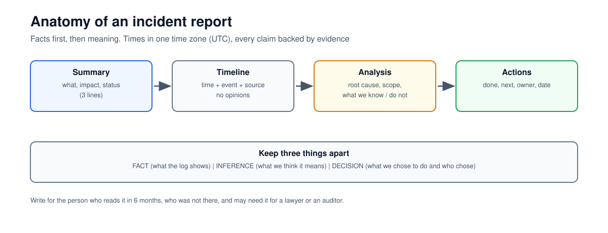

# 02 · Writing incident reports and case notes

> **Module:** 12 Soft Skills · **Ongoing:** from the first week of SOC work · **Time:** ~4 hours
> **You will:** write a clear case note in 2 minutes, and a full incident report with a clean timeline, using the template.
> **Certification:** Security+ SY0-701/801 domain 4 (incident response, documentation) · ISC2 CC domain 2 · SC-200 report writing

---

## 1. Why it matters in a SOC / cloud-security job

If it is not written down, it did not happen. Notes are how the next analyst continues your work, how auditors check your work and how lawyers understand an incident.

- Alert fatigue gets worse when tickets say only "closed, false positive". Good notes teach the team why.
- A well-kept timeline cuts hours from a post-incident review.
- Reports feed the risk register, the lessons learned and ISO/IEC 27001 evidence (module 04).

---

## 2. Understand it

### 2.1 Case notes (every alert and ticket)

Write as you work, not after. Use this one-line pattern:

`[UTC time] [analyst] OBSERVED: … | CHECKED: … | CONCLUSION: … | NEXT: …`

Good note example:

`[2026-11-16 03:40Z] [asha] OBSERVED: 4,000 failed sign-ins for 900 accounts from 198.51.100.7 | CHECKED: one success, user ben, at 03:31Z | CONCLUSION: likely password spraying, ben at risk | NEXT: revoke ben's sessions, block IP, check ben's mailbox rules`

A bad note: `checked, looks fine`.

Rules:
- Say **what you checked and where** (query, log source). Someone can repeat it.
- Write the **evidence**, not only your opinion.
- Always give a **disposition** when closing: true positive, false positive, benign true positive, or undetermined, with a reason.
- Use **UTC** and the same time format everywhere.
- Do not store secrets or personal data in tickets. Refer to the evidence location.

### 2.2 The incident report

Sections (see the full [template](templates/incident-report.md)):

1. Summary: 3 to 5 lines for non-technical readers.
2. Detection: how, when.
3. Timeline: time, event, source.
4. Scope and impact: confirmed vs suspected.
5. Analysis: root cause and what is unknown.
6. Response actions.
7. Follow-up actions with owner and date.
8. Lessons learned (blameless).
9. Evidence list.

### 2.3 Fact, inference, decision

| Type | Example |
|---|---|
| **Fact** | "Sign-in from 198.51.100.7 succeeded at 03:31Z (Entra sign-in log, ID …)." |
| **Inference** | "The IP belongs to a hosting provider, so it is probably not the user." |
| **Decision** | "At 03:45Z the on-call lead approved revoking sessions." |

Do not mix them. Mark guesses with words like "probably", "suspected", "not confirmed".

### 2.3a Severity and status words

Use your organization's severity matrix. A common pattern: **Sev 1** critical business impact or confirmed data breach; **Sev 2** significant but contained; **Sev 3** limited impact; **Sev 4** minor. Status: Open, Contained, Resolved, Closed.

### 2.4 Blameless language

| Instead of | Write |
|---|---|
| "John forgot to patch" | "The server was not patched because the patch process did not cover it" |
| "User was stupid and clicked" | "The email looked legitimate; the user reported it after 10 minutes" |
| "Failure of IT" | "Monitoring did not alert because the log source was not onboarded" |

Look for *system* causes: process gaps, missing alerts, unclear ownership, unsafe defaults.

### 2.5 Defang indicators

When you write malicious URLs or IPs in a report, defang them so nobody clicks by mistake: `hxxps://bad[.]example/login`, `198.51.100[.]7`.

> **From DBA to security**
> - **Alert log + trace files** are your raw evidence. Your *incident write-up* for a failed upgrade or corrupted block was already a timeline with a root cause. Same format.
> - **Change records** you wrote ("what, when, who approved, rollback") match the "actions" table.
> - **Post-mortem after an outage** = lessons learned. If you wrote them without blame, say that in interviews.
> - **Chain of custody** is like not touching the datafile you are about to copy: preserve first.

---

## 3. Hands-on (exercises)

1. **Rewrite the case note.** Take a bad note ("looked suspicious, blocked") and rewrite it with the 4-part pattern. Invent plausible details with `*.example` domains and documentation IPs only.
2. **Build a timeline.** Use the synthetic phishing emails from module 03 (`../03-security-foundations/lab/samples/`). Write a 6-row timeline for "phish_spoof.eml arrives at 03:12, finance replies at 03:50, …". Use the template.
3. **Run the phishing lab, then report.** Run `../03-security-foundations/lab/demo.py`, then write an incident report summary for `phish_lookalike.eml`.
4. **Blameless rewrite.** Take a sentence that blames a person and rewrite it to name the process gap.
5. **Peer test.** Give your report to someone and ask them to say what happened and what to do next.
6. **Optional tools:** Markdown editor (VS Code), a plain-text template library, TheHive (open source case management, Docker) for practising case notes if your laptop has spare RAM.

---

## 4. Practice platforms

- **TryHackMe:** SOC Level 1 includes investigation rooms and reports. Write a short report for each one.
- **HTB Sherlocks:** each ends with questions. Write the timeline and the summary in the template for 3 Sherlocks.
- **Free:** the incident report examples in NIST SP 800-61 and CISA playbooks.

---

## 5. Three realistic scenarios

**1. The closed ticket nobody understands.** *Situation:* a month later the same alert returns, and the old ticket says "FP". *What to do:* find the original logic, and write a proper note now. Update the alert's runbook with the reason. Teach: every closure states why.

**2. Legal asks for the timeline.** *Situation:* after an incident, counsel needs an accurate timeline. *What to do:* use UTC, link each event to evidence, mark confirmed vs suspected, and do not edit past entries. Add corrections as new, dated entries.

**3. Report in the middle of the night.** *Situation:* Sev 2 at 02:00 and leadership wants an update at 06:00. *What to do:* fill the summary and timeline as you go, even in rough form. At 05:30 clean up the summary (3 lines) and list unknowns honestly.

---

## 6. Common mistakes

- Writing the report at the end, from memory.
- Mixing time zones.
- Missing evidence references ("I saw it in logs").
- Opinions as facts.
- Naming and blaming a person.
- Pasting real personal data or credentials into the ticket.
- Silent edits to old entries.

---

## 7. Interview questions

<b>Q1. What goes into a good incident report?</b>

Summary, detection, timeline, scope and impact, analysis, response actions, follow-up actions with owners, lessons learned and an evidence list.

<b>Q2. How do you write a good case note?</b>

Observed, checked, conclusion, next step, with time and source, so a colleague can repeat my steps.

<b>Q3. Why use UTC?</b>

Systems and people are in different time zones. One zone prevents timeline errors and supports correlation.

<b>Q4. What is a blameless post-incident review?</b>

A review focused on how the system and process allowed the problem, not who made a mistake. It leads to fixes that last.

<b>Q5. How do you close a false positive properly?</b>

Record why it is false positive with evidence, and suggest tuning (exclude, refine the rule) so the team benefits.

<b>Q6. What is chain of custody?</b>

A record of who collected, held and moved evidence and when, with hashes, so it can be trusted in an investigation or legal case.

<b>Q7. What do you do if you made an error in a report?</b>

Add a correction with time and reason, and tell readers who may have used the wrong information. Do not silently overwrite.

<b>Q8. What is the difference between a true positive and a benign true positive?</b>

True positive: the alert is correct and malicious. Benign true positive: the alert is correct, but the activity is authorized or harmless (for example a pen test).

<b>Q9. Why defang indicators?</b>

So that nobody accidentally clicks a malicious link or an automatic tool does not fetch it from a report or chat.

<b>Q10. Scenario: a manager wants "just the summary". What do you send?</b>

A three-line summary at the top of the report: what happened, impact and status, plus the decision I need. The full report stays available.

<b>Q11. How do you document uncertainty?</b>

Say "confirmed", "suspected" or "unknown", state what would confirm it and when I expect to know.

---

## 8. Checklist

- [ ] I write case notes with observed, checked, conclusion and next.
- [ ] I filled the incident report template at least once.
- [ ] I can separate facts, inference and decisions.
- [ ] I use blameless language and defang indicators.

## 9. References

- NIST SP 800-61 Rev. 3 (incident response; reporting and communication).
- SANS incident handler's handbook (free).
- CISA incident response playbooks.
- Atlassian and Google SRE material on blameless post-mortems.

**Next:** [03 · Escalation, handover and on-call](03-escalation-handover-and-on-call.md)
