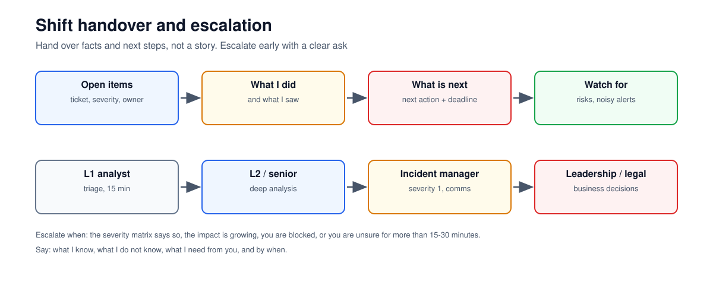

# 03 · Escalation, shift handover and on-call etiquette

> **Module:** 12 Soft Skills · **Ongoing:** from the first SOC shift · **Time:** ~3 hours
> **You will:** know when and how to escalate, write a handover another analyst can use, and behave well on call.
> **Certification:** Security+ SY0-701/801 domain 4 (incident response roles and communication) · ISC2 CC domain 2

---

## 1. Why it matters in a SOC / cloud-security job

SOCs run 24 hours. Incidents do not wait for shift change. The biggest damage often comes from a missed handover or a late escalation, not from missing tools.

- A new analyst waits 40 minutes "to be sure" before escalating, and the attacker uses those 40 minutes.
- A night shift forgets to mention an open phishing campaign. Day shift closes the alerts as duplicates.
- On-call people who are rude or silent make others afraid to call them, and the next call is late.

---

## 2. Understand it

### 2.1 Escalation

Escalating is **not** failure. It is part of the job. Typical levels: L1 analyst → L2/senior analyst → incident manager or SOC lead → leadership, legal, communications, and the business owner.

**Escalate when:**
- The severity matrix says so (for example confirmed compromise of a privileged account).
- Impact is growing or may reach customers, personal data, or money.
- You are blocked (no access, no authority, missing tool).
- You are unsure for more than your team's limit (often 15 to 30 minutes on a high-severity alert).
- You see something that is outside your playbook.

**Escalation message (SBAR style):**

| Part | Example |
|---|---|
| **S**ituation | "Sev 2, suspected account takeover of a finance user." |
| **B**ackground | "Sign-in from a hosting IP at 03:31Z after 4,000 spray attempts. MFA passed." |
| **A**ssessment | "Likely session theft. Mailbox rules not yet checked." |
| **R**equest | "Need L2 to review mailbox rules and approve disabling the account. I need an answer by 04:00Z." |

Also: say what you know, what you do not know, what you need, and by when. Put it in writing in the ticket, even after a phone call.

### 2.2 Shift handover

Use the [shift handover template](templates/shift-handover.md). Main rules:

- Write it **before** your shift ends, not after you are tired.
- Lead with the **top priority**.
- For each open item: ticket, what is known, what you did, next action, deadline, owner.
- Mention **noisy or broken** rules and sources that are down.
- List what you **could not check**.
- Give a **watch list** (users, hosts, IPs) and what to do if it triggers.
- Say it aloud for anything urgent. Confirm the other person understood.

### 2.3 On-call etiquette

- Respond within the agreed time. Acknowledge first ("I see it, checking"), then work.
- Keep your phone, laptop and VPN tested **before** the week starts.
- Know the runbooks and the escalation list. Have your own backup contact.
- Sound calm. Use short facts.
- Do not make big changes alone at 3 a.m. if the playbook says to get approval.
- Keep a log of what you did and when.
- Hand the next on-call person a note.
- After a hard night, tell your lead. Rest is part of safety (see lesson 06).
- Do not blame the person who called you. A false alarm is better than a missed one. Give feedback on the alert instead.

### 2.4 Communication channels in an incident

One shared incident channel, one incident lead, one note-taker, one person who speaks to leadership. If the main chat may be compromised, move to a pre-agreed out-of-band channel. Update at fixed times ("next update 15:00 UTC").

> **From DBA to security**
> You have been on call for databases. You know the 3 a.m. page, the runbook, the escalation to a vendor, the handover note listing running batch jobs and jobs that failed. The structure is the same. What is new: the security *severity matrix* and who has the authority to isolate a system. Learn those on day one.

---

## 3. Hands-on (exercises)

1. **Write a handover.** Use the template and the three phishing samples from module 03 as the "open items" of a fictional night shift. Include a watch list and one item you "could not check".
2. **SBAR practice.** Write three SBAR messages: a confirmed phishing click, a suspicious admin login, a cloud storage bucket made public. Keep each under 80 words.
3. **Escalation matrix.** Draw a one-page matrix for a small company: who to call for Sev 1, 2, 3, with phone and backup. Mark who has authority to isolate a server.
4. **Role-play.** With a friend: you are L1, they are the SOC lead. Practice calling them with a 60-second SBAR.
5. **Optional free tools:** a shared document or a wiki page for the handover; a free on-call scheduler (for example the free tiers of common paging tools) to understand how rotations are set up.

---

## 4. Practice platforms

- **TryHackMe:** SOC Level 1 has an escalation and reporting mindset in its investigation rooms. Practice writing the escalation note for each.
- **HTB Academy:** the SOC Analyst path includes incident handling modules; write a handover note after each lab.
- **Tabletop exercises:** the CISA tabletop exercise packages (free) are good for practising roles with friends.

---

## 5. Three realistic scenarios

**1. The "wait and see".** *Situation:* a junior analyst sees EDR flag a possible credential dumping tool on a server at 22:10 and waits until morning. *What to do:* credential dumping on a server is a classic escalate-now. Follow the matrix. In the retrospective, make "when in doubt, call" explicit and safe.

**2. The handover gap.** *Situation:* the day shift closes duplicate alerts, not knowing that the night shift saw a campaign. *What to do:* add campaign keywords, subject lines and sender domains in the watch list. Add a short verbal call at handover for any Sev 1 or 2.

**3. The 3 a.m. change.** *Situation:* a manager on the phone says "just disable the firewall rule, quickly" and you are unsure. *What to do:* confirm authority per the incident process. Record the request and time in the ticket. If it breaks the playbook, say so politely: "I will do it when the incident lead confirms in the incident channel."

---

## 6. Common mistakes

- Escalating with "something is wrong" and no facts.
- Never escalating because you fear looking weak.
- Handover by chat message only, with no confirmation.
- Telling the whole story instead of the next action.
- Taking action outside your authority at night.
- Not updating the ticket after a phone call.

---

## 7. Interview questions

<b>Q1. When should an analyst escalate?</b>

When the severity matrix says so, when impact is growing, when blocked, when unsure past the team's limit, or when something is outside the playbook. Early is better than late.

<b>Q2. How do you structure an escalation message?</b>

Situation, Background, Assessment, Request. I add what I know, what I do not know, and a deadline.

<b>Q3. What makes a good shift handover?</b>

Top priority first, open items with owner, next action and deadline, noisy or broken sources, a watch list, and what I could not check, with a spoken confirmation for urgent items.

<b>Q4. How do you avoid dropping work at handover?</b>

A fixed template, a single list of open tickets, written and verbal handover for urgent items, and acknowledgement from the receiver.

<b>Q5. How do you behave on call?</b>

Acknowledge fast, stay calm, follow the runbook, escalate early, keep notes, and hand over clearly.

<b>Q6. What do you do when a senior colleague gives an instruction that you think is risky?</b>

I ask a clarifying question, state my concern politely with facts, and follow the incident process for authority. I document the decision.

<b>Q7. You are on call and not sure whether an alert is real. What now?</b>

Spend a bounded time on quick checks from the runbook. If still unclear and the asset is important, escalate with what I found, rather than waiting.

<b>Q8. How do you handle a false alarm you escalated?</b>

Thank the team for responding, record the outcome, and suggest tuning the detection. A false alarm is better than a missed one.

<b>Q9. Who should speak to leadership during an incident?</b>

One designated person, usually the incident lead, using a fixed update schedule. Others send facts to that person.

<b>Q10. What if the incident channel may be compromised?</b>

Switch to a pre-agreed out-of-band channel such as a phone bridge, and do not discuss sensitive details in the compromised system.

---

## 8. Checklist

- [ ] I can write an SBAR escalation in under 80 words.
- [ ] I filled the handover template for a fictional shift.
- [ ] I know my team's severity matrix and who can isolate systems.
- [ ] I tested my on-call setup (phone, VPN, access) before the first week.

## 9. References

- NIST SP 800-61 Rev. 3 (roles, communication).
- SANS and CISA incident response guides and tabletop packages.
- Google SRE book chapters on being on-call and incident management (free online).
- SBAR communication method (healthcare origin, widely used in operations).

**Next:** [04 · Working with IT and DevOps, and influencing without authority](04-working-with-it-devops-and-influence.md)
