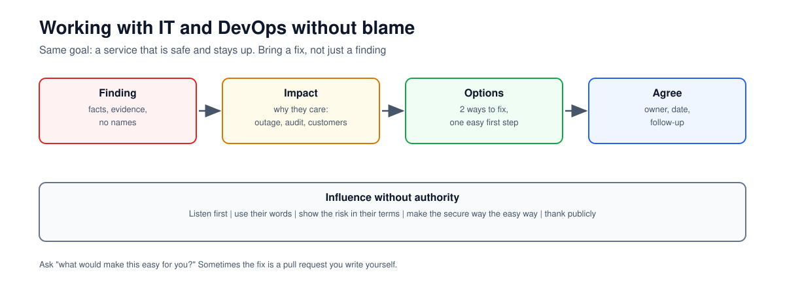

# 04 · Working with IT and DevOps without blame, and influencing without authority

> **Module:** 12 Soft Skills · **Ongoing:** from week 8 · **Time:** ~4 hours
> **You will:** raise a security finding so that teams want to fix it, and get things done when nobody reports to you.
> **Certification:** Not an exam topic. Supports ISO/IEC 27001 clause 5 (leadership) and 7.3 (awareness), the CSF Govern function, and every job interview.

---

## 1. Why it matters in a SOC / cloud-security job

Security teams rarely own the systems they protect. IT patches the servers. DevOps owns the pipelines and cloud accounts. Developers write the code. You depend on them.

- A security team seen as "the people who say no" gets bypassed. Shadow IT grows.
- A cloud finding fixed in one day by a friendly request often takes weeks by a formal ticket with blame.
- After an incident, the people who feel safe to tell the truth give you the real timeline.

---

## 2. Understand it

### 2.1 What "blameless" means

Blameless does not mean "no accountability". It means: **assume people did what made sense with the information they had, then fix the system that allowed the problem.** This approach is standard in site reliability engineering and incident response.

| Blame style | Blameless style |
|---|---|
| "Why did you open that port?" | "What made opening that port the easy option? Can we make the safe option easier?" |
| "Your team missed the patch." | "The patch did not reach these servers. Which part of the process lacks them?" |
| Naming a person in the report | Describing the missing control or process |

### 2.2 How to raise a finding

1. **Facts and evidence:** what, where, how to see it. No names.
2. **Impact in their terms:** outage risk, audit failure, customer trust, deadline, not "this is insecure".
3. **Options:** at least two fixes, one of them quick and cheap. Show the smallest safe step.
4. **Ask and agree:** owner, date, follow-up check. Write it down.
5. **Follow through and thank:** say thanks in public when it is fixed.

Message example:
> "Hi team. Cloud scan shows storage bucket `orders-backup` is public (link). It holds order exports. Impact: customer data may be exposed, and it fails our audit check. Quick fix: turn on 'block public access' (5 minutes, no downtime). Longer fix: a policy that stops this for all buckets. Can you take the quick fix today? I can help. I will re-check at 16:00."

### 2.3 Influence without authority

| Tool | How |
|---|---|
| **Build trust** | Be reliable, be honest, do small favors, learn their work |
| **Listen first** | Ask "what are you trying to do, and what is hard about it?" |
| **Use their words and goals** | Speed, stability, cost, deadlines |
| **Make the secure way the easy way** | Templates, secure defaults, pipelines that check automatically |
| **Show, do not preach** | A pull request, a script, a demo of the risk |
| **Find a champion** | One respected person in the team who cares |
| **Be consistent and fair** | Same rules for everyone, clear reasons |
| **Escalate with care** | Use the agreed risk process: a documented risk acceptance, not a threat |

### 2.4 Working with DevOps and developers

- Learn their tools: Git, CI/CD, infrastructure as code, containers.
- Put security checks **in the pipeline** (secret scanning, dependency scanning) with clear, low-noise rules.
- Offer "paved roads": approved templates that are secure by default.
- Join their stand-ups or review sessions sometimes. Be a partner.
- Agree a time to fix by severity (for example critical in 7 days) and put it in a policy, so it is not personal.
- Respect change windows and freezes. Plan emergency exceptions together.

### 2.5 Saying no (and "yes, if")

Prefer "Yes, if we add X" to "No". Example: "We can give contractors access, if it is time-limited, MFA-protected and logged." If you must say no, say why in terms of risk, and offer the closest safe option.

### 2.6 Handling conflict

- Separate the **person** from the **problem**.
- Find the shared goal ("the service stays up and safe").
- Ask questions: "What would you need to make this work?"
- If stuck, bring facts to the risk owner and let them decide, in writing.

> **From DBA to security**
> You already stand between teams: developers want fast changes, the business wants uptime, and you guard the data. You have said "yes, if we test it in staging first" many times. You have also been the person who was blamed when a query was slow. You know how it feels. Bring that empathy into security conversations.

---

## 3. Hands-on (exercises)

1. **Rewrite a blaming message.** "Dev team left the test database open to the internet again. This is the third time!" Rewrite it with facts, impact, options and a thank-you.
2. **Three options.** Choose a real or fictional finding (shared admin account on a database). Write three fix options from cheapest to best, with effort and risk left.
3. **Map stakeholders.** For one security change (turning on MFA for admins), list who is affected, what each person fears, and what each wants.
4. **Script a "yes, if".** Write a short answer for a developer who asks for production database access to debug.
5. **Optional free tools:** GitHub Actions with free secret-scanning tools (gitleaks) on a personal repo, to see how a pipeline check feels from the developer side.

---

## 4. Practice platforms

- **TryHackMe:** DevSecOps and secure coding rooms (search "DevSecOps") show the developer side of security checks.
- **HTB Academy:** modules on secure coding and web application defense help you speak developers' language.
- **Reading:** the Google SRE book chapter on blameless postmortem culture (free online).

---

## 5. Three realistic scenarios

**1. The developer who ignores findings.** *Situation:* a dev team ignores weekly scanner tickets. *What to do:* meet them, find out why (too many false positives? no time?). Reduce noise, agree the top 5 issues per sprint, offer a pull request for one, and get the product owner to include them in planning.

**2. The urgent change request.** *Situation:* IT wants to open a firewall port for a vendor "today". *What to do:* ask what the vendor needs and for how long. Offer: allow only the vendor's IP, for a week, with logging and an owner. Record the exception with an expiry.

**3. The post-incident blame game.** *Situation:* after a breach, managers ask who is at fault. *What to do:* steer to facts: which controls failed and why. Present a blameless timeline. People who fear punishment hide information, and you need information.

---

## 6. Common mistakes

- Opening with "you did this wrong".
- Sending a finding with no fix or help.
- Using fear ("you will be hacked!") instead of facts.
- Treating every finding as a Sev 1. People stop listening.
- Going over someone's head before talking to them.
- Forgetting to say thank you.
- Not learning the other team's constraints.

---

## 7. Interview questions

<b>Q1. How do you get a development team to fix a vulnerability?</b>

Give clear evidence, explain the impact in their terms, offer options including a quick fix, agree an owner and date, and offer help. Follow up and thank them.

<b>Q2. What does "blameless" mean?</b>

Focus on the process and system that allowed the problem, assuming people acted reasonably. It still includes accountability and fixes.

<b>Q3. How do you influence people when you have no authority?</b>

Build trust, listen, speak their goals, make the secure path easy, show rather than preach, and use the risk process for decisions.

<b>Q4. A team says security slows them down. What do you do?</b>

Ask for specific examples, measure the delay, and automate or simplify the check. Move the checks into the pipeline and offer secure templates.

<b>Q5. How do you handle a request that you think is too risky?</b>

Say "yes, if": offer a safer version with limits such as time, scope and logging. If still risky, document the risk and ask the risk owner to decide in writing.

<b>Q6. Tell me about a disagreement with a colleague.</b>

(Use a STAR story from lesson 05.) Show that I listened, found the shared goal, used facts, and kept the relationship.

<b>Q7. How do you handle someone who is defensive?</b>

Stay calm, use "we" and the shared goal, show evidence without blame, ask for their view and what they need.

<b>Q8. How do you prioritize requests from several teams?</b>

By risk and business impact, with clear criteria agreed in advance. I tell people the order and why.

<b>Q9. What is a paved road in security?</b>

An approved, easy, secure-by-default way to do a common task, such as a hardened template, so the safe choice is also the easiest.

<b>Q10. When do you escalate to management?</b>

When a risk is above appetite, when there is no owner or no agreed fix date, or when a team refuses a critical fix. I use the documented risk acceptance process, not threats.

---

## 8. Checklist

- [ ] I can rewrite a blaming message into a helpful one.
- [ ] I raised (or practised raising) one finding with facts, impact, options and owner.
- [ ] I can say "yes, if" in three common cases.
- [ ] I know the main fear of the IT and DevOps teams I work with.

## 9. References

- Google SRE book: *Postmortem Culture: Learning from Failure* (free online).
- Sidney Dekker's work on "just culture" (books and articles).
- NIST SP 800-61 Rev. 3 on lessons learned and improvement.
- *Crucial Conversations* and *Getting to Yes* (general reading).

**Next:** [05 · Interviews: STAR stories and "I don't know"](05-interviews-star-stories.md)
