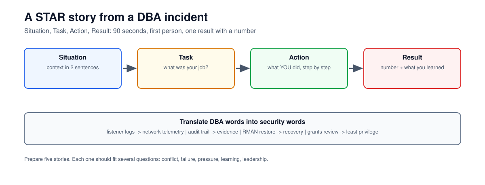

# 05 · Interviews: STAR stories from your DBA work, and how to answer "I don't know"

> **Module:** 12 Soft Skills · **Ongoing:** start in week 6, repeat before each interview · **Time:** ~5 hours
> **You will:** turn your DBA experience into 5 strong STAR stories in security language, and answer unknown questions with confidence.
> **Certification:** Not an exam topic. Helps in every Cloud Security, SOC and GRC interview.

---

## 1. Why it matters in a SOC / cloud-security job

Interviewers for SOC and cloud-security roles ask technical questions *and* behavior questions ("Tell me about a time when…"). A person changing roles from DBA to security has an advantage: real operational stories. The skill is to tell them in the language of the new role.

---

## 2. Understand it

### 2.1 STAR

| Letter | What | Time |
|---|---|---|
| **S**ituation | Context in 2 sentences | 15 sec |
| **T**ask | Your responsibility and what was at stake | 10 sec |
| **A**ction | 4 to 6 steps, what **you** did and why | 45 sec |
| **R**esult | A number, what changed for good, and what you learned | 20 sec |

Rules: use "I" for your actions. Be honest. Include one learning. Total about 90 seconds. Use the [STAR worksheet](templates/star-story-worksheet.md) for each story.

### 2.2 Translate DBA to security

| DBA phrase | Security phrase |
|---|---|
| Audit trail, alert log | Evidence, logs, telemetry |
| Grants and roles review | Least privilege, access review |
| RMAN restore, Data Guard | Recovery, BC/DR, RTO/RPO |
| Listener log | Network and connection telemetry |
| Change request and rollback | Change control, risk-managed change |
| AWR baseline | Behavior baseline, anomaly detection |
| Standard operating procedure | Runbook, playbook |
| Production outage bridge | Incident response and communication |

### 2.3 Five example stories

> **Important:** these are **templates written from typical DBA situations**. All numbers and details are examples. Replace them with your own true experiences. Never claim something you did not do. If you do not have an exact match, pick the closest real event.

#### Story 1: Pressure and availability (disk full at night) → incident response

- **S:** At 02:00, the archive log destination of a critical production database filled up, so the database stopped accepting changes. Many users were affected.
- **T:** I was on call and responsible for restoring service and finding out why it happened.
- **A:** (1) I confirmed the alert and checked the alert log and disk usage. (2) I told the incident bridge what I saw and the first estimate. (3) I freed space by backing up and deleting old archive logs, following the runbook, so the database resumed. (4) I checked that no one had run a bulk load or a loop that created the surge, using the audit trail. (5) I wrote the timeline and the root cause. (6) I added a space alert at 80% and a weekly capacity report.
- **R:** Service came back in 25 minutes (example). The alert has prevented 3 similar events since (example). I learned to confirm cause, not only fix the symptom.
- **Security angle:** this is incident response (detect, contain, recover, lessons learned) and availability. In an interview: "I follow the same steps in a security incident: confirm, communicate, contain, check the cause, document, prevent."

#### Story 2: Least privilege and conflict (app account had the DBA role)

- **S:** During an audit, I found that an application account had the DBA role. The developers said it was needed for deployments.
- **T:** Reduce the privileges without breaking releases.
- **A:** (1) I reviewed the actual statements the account ran for 30 days using audit data. (2) I met the developers and asked what they needed to do. (3) I proposed a deployment role with only the needed grants and a separate break-glass process. (4) I tested it in staging with them. (5) I scheduled the change in the release window with a rollback plan. (6) I thanked the team and recorded the change.
- **R:** The excessive privileges were removed, with zero failed deployments (example). The audit finding was closed. The method became our standard for other accounts. I learned that showing evidence and a tested alternative beats an order.
- **Security angle:** least privilege, access review, influencing without authority, audit evidence.

#### Story 3: A mistake and learning (backup restore test failed)

- **S:** In a routine restore test, a backup I thought was good failed to restore because of one missing archive log.
- **T:** Find the gap quickly, tell the right people, and fix it before it mattered in a real event.
- **A:** (1) I told my manager the same day and did not hide it. (2) I found that a cleanup job deleted logs before they were backed up. (3) I fixed the job order and ran a fresh full backup. (4) I did a complete restore test and measured the time. (5) I added restore validation and reporting to the weekly checks. (6) I shared the lesson with the team.
- **R:** The next three restore tests passed, and the measured restore time (example: 3 hours) was documented against the agreed RTO. I learned that "backup completed" does not mean "recoverable".
- **Security angle:** backup resilience against ransomware, testing controls, honesty about failure, BC/DR.

#### Story 4: Detection and attention to detail (unusual data export in the audit trail)

- **S:** While reviewing the audit trail, I saw a business user running very large exports on a Sunday night, which was unusual compared with their baseline.
- **T:** Decide whether this was normal or a risk, without causing a false alarm.
- **A:** (1) I compared with weeks of normal activity from the baseline. (2) I checked the source IP and session details. (3) I asked the user's manager, carefully and privately, whether there was a reason. (4) It was an unapproved reporting job on a laptop. (5) I reported it to the security and data owners with facts. (6) I proposed a scheduled export and an alert for large exports.
- **R:** The export was moved to an approved process. A new alert caught 2 more unusual exports in the next quarter (example). I learned the value of a baseline and of acting on small anomalies.
- **Security angle:** insider threat and data loss detection, baselines, careful investigation, reporting.

#### Story 5: Automation and initiative (manual checks replaced by a script)

- **S:** Each morning I spent about 2 hours on manual health and security checks across 40 databases (failed logins, locked accounts, new privileges).
- **T:** Reduce the manual work and make the checks consistent and reviewed.
- **A:** (1) I listed the checks and ranked them by risk. (2) I wrote scripts to collect the results into one report. (3) I added thresholds and a clear red/amber/green summary. (4) I had a colleague review the logic. (5) I ran both ways for two weeks to compare. (6) I documented the scripts and handed them over.
- **R:** The daily check dropped to 20 minutes (example). The script found two accounts with excessive failed logins that manual checks had missed. I learned to automate with review and parallel testing.
- **Security angle:** security automation, monitoring, log review, SOC efficiency, and documentation.

### 2.4 Answering "I don't know"

Honest, calm and curious beats guessing. A guess that is wrong can end an interview. A good "I don't know" can win trust.

**Pattern: Honest → Related knowledge → Method → Learning**

1. **Honest:** "I have not used that tool / I am not sure."
2. **Related knowledge:** "I do know X, which is similar."
3. **Method:** "To find out, I would check the vendor docs / ask a senior / test it in a lab."
4. **Learning:** "Can I ask how your team does it?" or "I will look it up after this interview."

Examples:

- *"What is the difference between Kerberoasting and AS-REP roasting?"* → "I know Kerberos tickets at a basic level: the client gets a ticket from the KDC. I do not remember the exact difference. My understanding is that both attack weakly protected Kerberos tickets, and I would look at the Kerberos flow to explain it. I can study this tonight."
- *"Have you used Splunk?"* → "Not in production. I have done lab searches with the free version and I know SQL, so the search logic is familiar. I am learning SPL now."

Avoid: silence, making things up, saying "I know" and then rambling, apologizing many times, or blaming the question.

### 2.5 Other interview habits

- **Ask clarifying questions** before answering scenario questions.
- **Think aloud.** Say your steps: "First I would check the scope…"
- **Use the CIA triad, kill chain or ATT&CK** as a thinking frame.
- **Ask your own questions:** What does a good first 90 days look like? What tools does the SOC use? How are on-call and handovers handled? How does the team learn?
- **Be ready for "Why security?"** Tell the true story: from protecting data as a DBA to protecting the whole company, in the cloud and in the SOC.

> **From DBA to security**
> The weakness many career changers feel is "I have no security job experience." The answer is: "I have 10+ years protecting production data, handling incidents, backups, audits and access. I am adding detection, investigation and cloud skills, and here is my lab work and certification plan." Your stories prove the first part. Modules 05–11 of this track prove the second.

---

## 3. Hands-on (exercises)

1. **Fill the worksheet** for the five stories above, but with **your real events**. Keep the structure; change the details.
2. **Translate.** Underline each DBA word in your stories and replace it with the security word from the table.
3. **Time it.** Tell each story aloud with a timer. Aim for 90 seconds. Record and listen.
4. **"I don't know" drill.** Ask a friend to pick 10 hard questions from a security question list. Practice the 4-step pattern for each question you do not know.
5. **Mock interview** with a friend, mentor or an AI mock interviewer. Ask for feedback on clarity, not only on content.
6. **Build a story bank:** one table with each story and the question types it answers (conflict, failure, pressure, leadership, learning).

---

## 4. Practice platforms

- **TryHackMe:** the SOC Level 1 path includes a lot of "walk me through your investigation" practice that you can speak aloud.
- **HTB Academy / HTB Labs (Sherlocks):** after each investigation, explain it in 2 minutes as if in an interview.
- **Library:** the IAM and zero-trust interview scenarios book has 30 structured scenarios. Practice answering aloud with the five-step answer structure it teaches (paraphrase in your own words).
- **Free:** the interview questions in each module README of this track.

---

## 5. Three realistic scenarios

**1. The unexpected question.** *Situation:* "How would you investigate a suspicious PowerShell command?" You have only used it for scripts. *What to do:* use the four-step "I don't know" pattern and a clear method: process tree, parent process, command line, user, time, network connections, and other hosts.

**2. "Tell me about a failure."** *Situation:* you worry that saying "I made a mistake" will hurt you. *What to do:* use story 3 style. Say what happened, how you told people at once, what you fixed and what changed. Interviewers like ownership and learning.

**3. "You have no security experience."** *Situation:* the interviewer is direct. *What to do:* respond calmly: "Yes, my direct SOC experience is new. My production experience includes incident response, backup recovery, access control and audit, and I have built these labs…". Then give one concrete example.

---

## 6. Common mistakes

- Saying "we" for everything, so your own role is unclear.
- Stories with no result or number.
- Too much technical detail, not enough decision and reason.
- Exaggerating or inventing experience. Interviewers test follow-up questions.
- Memorizing words. Learn the structure, not a speech.
- Revealing confidential details about a former employer or client.
- Saying "I don't know" and stopping there.

---

## 7. Interview questions

<b>Q1. Tell me about yourself.</b>

Short and structured: my background as a DBA and in DevOps (production data, backups, access, incidents), why I moved to security, what I have learned and built (labs, certifications in progress), and what I want to do next in this role.

<b>Q2. Why are you moving from DBA to security?</b>

I enjoyed protecting data and handling incidents and audits. Security lets me do that for the whole company and in the cloud. My job role already moved to Cloud Security and SOC, and I am building skills deliberately.

<b>Q3. Tell me about a time you handled an incident under pressure.</b>

Use the disk-full story (or your own): confirm, communicate, contain, recover, find root cause, prevent. Close with a number and a lesson.

<b>Q4. Tell me about a mistake you made.</b>

Use the failed restore test story (or your own): I reported it the same day, fixed the root cause, tested the fix and added a check. I learned that "completed" is not "recoverable".

<b>Q5. Describe a conflict with a developer or manager.</b>

Use the privilege-reduction story: evidence first, listen to their need, test an alternative together, thank them, and record the result.

<b>Q6. What would you do if you do not know the answer?</b>

Say so honestly, share related knowledge, describe how I would find the answer (documentation, test in a lab, ask a senior), and follow up.

<b>Q7. How do you stay current in security?</b>

Weekly lab practice, reading vendor and CISA advisories, following a few trusted blogs, and writing short notes about what I learn.

<b>Q8. What is your biggest strength for a SOC role?</b>

Careful, evidence-based work under pressure: I am used to production incidents, reading logs, backups and audits. I document clearly and follow procedure.

<b>Q9. What is your biggest weakness?</b>

Honest and specific: I am still building hands-on SOC experience with SIEM and EDR tools. My plan: weekly labs, a certification path and shadowing colleagues. Show progress.

<b>Q10. Where do you see yourself in 3 years?</b>

A confident SOC or cloud security engineer, with cloud and detection engineering skills, possibly specializing in database or cloud data security where my background is strong.

<b>Q11. Do you have questions for us?</b>

Yes: how do new analysts learn in the first 90 days, how are handovers and on-call organized, how does the team measure success, and which tools do you use?

---

## 8. Checklist

- [ ] I have 5 STAR stories from my real work, each under 2 minutes.
- [ ] Each story has a number and a learning.
- [ ] I translated DBA words into security words.
- [ ] I practised the 4-step "I don't know" pattern aloud.
- [ ] I have 3 questions to ask the interviewer.

## 9. References

- Your own work history and the [STAR worksheet](templates/star-story-worksheet.md).
- Interview question lists in each module README of this track.
- Library: IAM and zero-trust interview scenarios (practice material).
- Public advice on behavioral interviews from career centers (STAR method).

**Next:** [06 · Time management, burnout and learning in public](06-time-burnout-and-learning-in-public.md)
