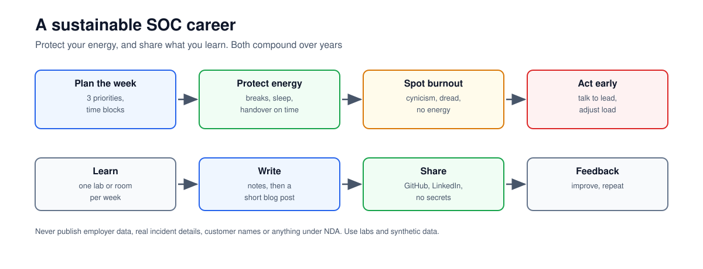

# 06 · Time management, avoiding burnout in the SOC, and learning in public

> **Module:** 12 Soft Skills · **Ongoing:** weekly · **Time:** ~3 hours to set up, then weekly habits
> **You will:** plan your week, spot early signs of burnout, and share what you learn without leaking anything private.
> **Certification:** Not an exam topic. Helps you stay in the field for the long term.

---

## 1. Why it matters in a SOC / cloud-security job

SOC work has constant alerts, shift work, and the pressure of "what if I miss something". Burnout and alert fatigue are well-known problems in security operations. You are also learning a new field, studying for certifications and working at the same time. A plan protects you.

---

## 2. Understand it

### 2.1 Time management

| Habit | How |
|---|---|
| **Weekly plan** | On Monday choose 3 priorities for work and 3 for learning. Write them down. |
| **Time blocks** | Fixed slots: a 45–60 minute study block on most days. Protect them like meetings. |
| **Urgent vs important** | Alerts are urgent. Learning, tuning and documentation are important. Book time for both. |
| **Batch small tasks** | Handle messages and tickets at set times, not all day |
| **Pomodoro** | 25 minutes focused, 5 minutes break. Good for study. |
| **Done list** | Keep a list of what you finished. It helps your weekly update and your mood. |
| **Say "not now"** | Ask what can move when a new urgent task arrives |
| **Estimate with buffer** | Add 30% for the unknown. |

Learning budget for your first months (example): 5 hours a week of study on a normal week, 1 lab session on the weekend, one review block per month. Adjust to your life. Consistency beats long sessions.

### 2.2 Burnout in security: signs and actions

| Early sign | What you can do |
|---|---|
| Dread before shifts, cynicism ("nothing matters") | Talk to a lead or a trusted colleague early |
| Always tired, poor sleep after night shifts | Protect sleep, use a fixed wind-down routine, ask for shift pattern changes |
| Alert fatigue: you start to ignore alerts | Raise noisy alerts for tuning, ask for rotation to other work |
| Feeling responsible for everything | Remember: defense is a team and a process, not one person |
| No time for family, health or hobbies | Set limits on after-hours work, take your leave |
| Physical signs: headaches, stomach problems | See a doctor. It is not weakness. |

What helps: breaks away from the screen, movement, regular meals, rest after incidents, clear handover (you can stop when you hand over), blameless culture, a mentor, and meaningful work such as detection tuning.

What to ask your employer: reasonable rotations, a day to recover after a major incident, mental health support or an employee assistance program, and paid time for learning. If you feel unwell, seek professional medical or mental health support. This lesson is not medical advice.

### 2.3 Learning in public

Sharing your learning helps you remember, builds your profile (module 13) and helps others. Options:

| Format | Idea |
|---|---|
| GitHub | Your lab code and notes (this repo is an example) |
| Blog or short posts | "What I learned this week", write-ups of rooms and labs, explained simply |
| LinkedIn | Weekly 3-line learnings, certification progress |
| Talks | A 10-minute talk at a local meetup or at work |

**Safety rules for learning in public (very important):**
- Never publish employer, client or colleague data. No real incident details, no screenshots with company names, no internal tool names or IPs, nothing under an NDA.
- Use labs, public data and synthetic examples. TryHackMe and Hack The Box ask that you do not publish answers or flags for active rooms and machines. Write about *method and learning*, not solutions. Check each platform's rules.
- Do not post exploit code against real targets. Test only on systems you own or are allowed to test.
- No secrets: scan your repos for keys before you push (gitleaks or similar).
- Be kind and accurate. Say "I think" when unsure. Correct mistakes openly.
- Keep your real identity and employer separate if you prefer. Check your employer's social media policy first.

> **From DBA to security**
> DBAs often work quietly. The system runs and nobody notices. In security you may need to be more visible: share results, ask for help, write short summaries. Your habits of careful change, backups and testing also protect your health: you plan, you test, you do not rush changes at night. Apply them to yourself.

---

## 3. Hands-on (exercises)

1. **Weekly plan.** Copy the [weekly status update template](templates/weekly-status-update.md). Fill it for this week as a plan, with 3 work and 3 learning goals.
2. **Time audit.** For 3 days, write down what you do each hour. Find 5 hours a week to protect for study.
3. **Warning-sign list.** Write your own early signs of stress and one action for each. Share it with a friend or a mentor.
4. **First public note.** Write a 150-word post about a concept you learned in module 03 (for example "why salting passwords matters, with a small demo"). Use only the synthetic lab data. Run a secret scan, then publish on GitHub or LinkedIn.
5. **Share setup.** Make a `notes/` folder in your portfolio repo, with one markdown file per week.
6. **Optional free tools:** a calendar for time blocks, a task list app, a Pomodoro timer, `gitleaks` for scanning your repo, a free blog on GitHub Pages.

---

## 4. Practice platforms

- **TryHackMe / Hack The Box:** use streaks and weekly goals gently. Their rules about publishing write-ups apply, so check the current policy before you write about a room or machine.
- **Communities:** local security meetups, Discord and Slack groups for beginners, and BSides events (often free or low cost) for learning and a network.
- **Library:** the SOC end-to-end and playbook documents show real daily work; use them to plan what to learn next.

---

## 5. Three realistic scenarios

**1. The long night after an incident.** *Situation:* you worked 14 hours on a ransomware incident and your shift starts again in 8 hours. *What to do:* hand over clearly, tell the lead you need recovery time, and follow the team's rest policy. Tired analysts make mistakes, so rest is a security control.

**2. Too many alerts.** *Situation:* 400 alerts a day, 95% noise, and you feel numb. *What to do:* collect data (top 5 noisy rules, count, reason), propose tuning with your lead, and ask for a time block for tuning each week. This is a process problem, not your failure.

**3. A post that went too far.** *Situation:* you wrote a blog about a "real phishing case" and it has details that might identify your employer. *What to do:* take it down at once, remove or generalize the details, tell your manager if needed, and rewrite with synthetic data. Fast honesty prevents harm.

---

## 6. Common mistakes

- Studying 8 hours on the weekend and nothing on weekdays, then stopping after 3 weeks.
- Working every night to "catch up" in a new job.
- Ignoring early burnout signs because "everyone is tired".
- Posting anything with employer or client data.
- Publishing active CTF solutions against the platform's rules.
- Comparing your week 4 to someone else's year 4.
- Trying to learn everything at once instead of following the 36-week plan.

---

## 7. Interview questions

<b>Q1. How do you prioritize when you have many alerts and tasks?</b>

By severity and business impact first, then deadline and effort. I keep a short list, communicate what I defer and why, and ask my lead when priorities conflict.

<b>Q2. How do you manage stress in a 24/7 SOC?</b>

Clear handovers, regular breaks, sleep discipline, rest after major incidents, tuning noisy alerts, and talking with my team early about workload.

<b>Q3. What is alert fatigue and how do you reduce it?</b>

Alert fatigue is when too many low-value alerts make people ignore real ones. I reduce it by tuning rules, adding context, automating enrichment and tracking false-positive rates.

<b>Q4. How do you keep learning while working full time?</b>

A fixed weekly plan with small daily blocks, a weekly lab, notes I publish safely, and clear goals linked to my role and certifications.

<b>Q5. What would you never publish when learning in public?</b>

Employer or client data, real incident details, internal tool names or IPs, secrets, active CTF solutions against platform rules, and exploit code aimed at real targets.

<b>Q6. How do you handle an overloaded week?</b>

I list everything, rank by impact, tell my lead what will slip, and ask for help or a deadline change early.

<b>Q7. How do you recognize burnout in a team member?</b>

Withdrawal, cynicism, more mistakes, absence, irritability. I check in privately and kindly, and I raise it with the lead.

<b>Q8. Why share your learning publicly?</b>

It deepens my understanding, builds a portfolio, helps others and attracts feedback. I do it safely, with synthetic or public data only.

<b>Q9. What do you do after a major incident?</b>

Hand over, rest, join the blameless review, document lessons, and propose fixes. I also tell my lead how I am doing.

<b>Q10. Scenario: your manager asks you to work every weekend for a month. How do you respond?</b>

Understand the need, propose a plan with rotation and time off in return, and be honest about my limits. If it is a repeated pattern, raise it as a staffing or process issue.

---

## 8. Checklist

- [ ] I have a weekly plan with protected study time.
- [ ] I wrote my early burnout signs and what I do about each.
- [ ] I know what must never go into a public post.
- [ ] I published or drafted one safe learning note.

## 9. References

- WHO and national health services: guidance on stress and burnout (seek professional help when needed).
- Your employer's social media and confidentiality policies.
- TryHackMe and Hack The Box rules on write-ups (check current pages).
- Cal Newport and James Clear style habit-building books (general reading).

**Back to:** [Module 12 overview](README.md)
