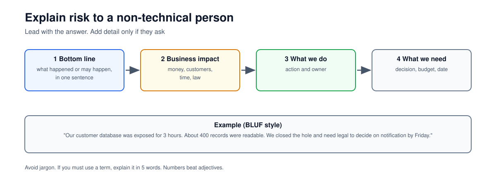

# Module 12 · Soft Skills for Security

> **Weeks:** ongoing (a little every week, from week 4) · **Time:** ~25 hours in total
> **You will:** learn to explain risk clearly, write good incident reports, hand over shifts, work with IT and DevOps without blame, tell strong interview stories from your DBA work, and keep a healthy learning rhythm.

There is no coding lab in this module. Instead you get five ready-to-use [templates](templates/) and exercises in every lesson.

## Learning path

| # | Lesson | When | Why now |
|---|---|---|---|
| 01 | [Communication and executive summaries](01-communication-and-executive-summaries.md) | Week 4, then monthly | Every ticket and report needs it |
| 02 | [Incident reports and case notes](02-incident-reports-and-case-notes.md) | First SOC week | Daily work, audit evidence |
| 03 | [Escalation, handover and on-call](03-escalation-handover-and-on-call.md) | Before the first shift | 24/7 operations |
| 04 | [Working with IT and DevOps, influence](04-working-with-it-devops-and-influence.md) | Week 8 on | Fixing findings needs other teams |
| 05 | [Interviews: STAR stories and "I don't know"](05-interviews-star-stories.md) | Week 6 on, before interviews | Turns DBA experience into security language |
| 06 | [Time, burnout and learning in public](06-time-burnout-and-learning-in-public.md) | Weekly habit | Sustainable career |

## Templates

| Template | Use it for |
|---|---|
| [`templates/incident-report.md`](templates/incident-report.md) | Full incident reports and one-line case notes |
| [`templates/executive-summary.md`](templates/executive-summary.md) | One-page summary for managers and executives |
| [`templates/shift-handover.md`](templates/shift-handover.md) | End-of-shift handover |
| [`templates/star-story-worksheet.md`](templates/star-story-worksheet.md) | Building interview stories |
| [`templates/weekly-status-update.md`](templates/weekly-status-update.md) | Weekly update to your lead |

## Key terms

| Term | Simple meaning |
|---|---|
| BLUF | Bottom line up front: the answer in the first sentence |
| SBAR | Situation, Background, Assessment, Request (escalation message) |
| Handover | Passing work and context to the next shift |
| Blameless review | Fix the system, not the person |
| STAR | Situation, Task, Action, Result (interview story shape) |
| Alert fatigue | Ignoring alerts because there are too many low-value ones |
| Defang | Change a URL or IP so it cannot be clicked by mistake (`hxxp://bad[.]example`) |

## How this connects to your job

In security, most delays are caused by unclear messages, missed handovers and tense relationships, not by missing tools. As a DBA you already know how to be careful and to work with developers. This module gives you the written and spoken tools to do the same in security.

## Mini-project: your communication kit (about 4 hours)

1. Fill the incident report template for the `phish_spoof.eml` sample from [module 03](../03-security-foundations/lab/samples/phish_spoof.eml).
2. Write an executive summary of the top risk in the [module 04 sample register](../04-risk-management-and-iso27001/lab/samples/risks.yaml).
3. Write one handover note for an imaginary shift.
4. Complete three STAR worksheets from your real DBA work.
5. Do a 10-minute mock interview with a friend and ask for feedback.

## Practice on TryHackMe / HTB

- **TryHackMe:** SOC Level 1 rooms: after each investigation, write a 5-line case note and a 3-line summary.
- **HTB Academy and Sherlocks:** finish an investigation, then write a short report using the template.
- Check each platform's rules before you publish any write-up. Describe methods, not answers.

## Module interview questions

<b>Q1. How do you explain a security issue to a non-technical manager?</b>

Bottom line first, then the business impact, what we are doing and what I need from them, in plain words with numbers.

<b>Q2. What makes a good incident report?</b>

A short summary, a timeline of facts with sources and UTC times, scope and impact, analysis with unknowns, actions with owners, and blameless lessons.

<b>Q3. When do you escalate?</b>

When the severity matrix requires it, when impact is growing, when blocked, or when unsure for more than the team's limit. Early is better.

<b>Q4. What is in a good shift handover?</b>

Top priority, open items with owner and next action, noisy or broken sources, a watch list, and what I could not check.

<b>Q5. How do you work with a team that resists security changes?</b>

Listen, understand their goals, offer easy and safe options, show evidence, agree owners and dates, and use the risk process when needed.

<b>Q6. What do you say when you do not know?</b>

Honestly say so, share related knowledge, explain how I would find the answer, and follow up.

<b>Q7. Give an example of a story from your DBA work that shows security skills.</b>

A failed restore test that I reported immediately, fixed at the root, and turned into a regular restore-validation check. It shows honesty, backup resilience and process improvement.

<b>Q8. How do you avoid burnout?</b>

Protect sleep and breaks, hand over cleanly, tune noisy alerts, take rest after major incidents, and talk to my lead early.

<b>Q9. What do you never share in public learning posts?</b>

Employer or client data, real incident details, secrets, active CTF answers against platform rules, or exploit code for real targets.

<b>Q10. Why is blameless culture important in security?</b>

People report problems early when they are not punished. Honest information gives a faster, more accurate response and better fixes.

## References

- NIST SP 800-61 Rev. 3 (incident communication and lessons learned).
- Google SRE book, chapters on postmortems and on-call (free online).
- NCSC (UK) guidance on board communication; plainlanguage.gov.
- TryHackMe and Hack The Box community rules on write-ups.
