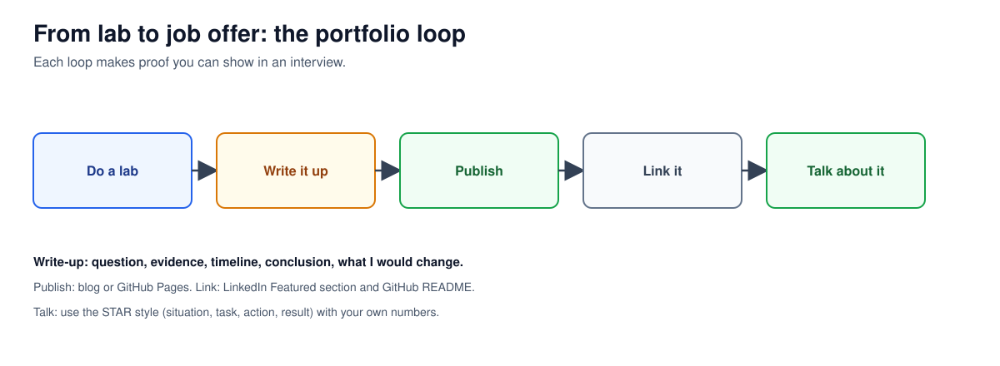

# 05. Profiles and Portfolio

> **Module:** 13 · Profile and Portfolio · **Start:** week 4 · **Time:** about 4 hours first setup, then 30 minutes per month
> **You will:** write a LinkedIn headline and About section for a DBA to Cloud Security/SOC move, create a GitHub profile README, present this repo well, and build a portfolio of investigations.



## 1. Why it matters

Recruiters and hiring managers spend seconds on a profile. A clear headline, a few real projects and links to proof can decide an interview. You do not have a security title yet, but you do have **real, relevant experience** (databases, audit, backup, access control, Linux, DevOps) and you are building public proof of new skills. Show both, honestly.

## 2. LinkedIn

### Headline (220 characters maximum; keep it clear)

Pattern: **current strength + target + tools**. Examples to adapt:

- `Oracle DBA moving into Cloud Security & SOC | AWS, Azure, Sentinel, Splunk | Building detections with Python`
- `Cloud Security & SOC Analyst (DBA background) | Database security, CloudTrail, KQL, SPL`

Rules: do not claim certificates you do not hold. Words like "learning", "building" and "studying for" are honest and attractive. Update the headline when your role changes.

### About section (draft; replace placeholders and keep it true)

> I spent [N] years as an Oracle DBA: access control, auditing, backup and recovery, patching, and performance tuning for [type of systems]. Now I work in **Cloud Security and SOC**, where those skills apply every day.
>
> What I do and learn now: reading CloudTrail and Entra logs, writing detections (Python, KQL, SPL), reviewing IAM policies, and database security (Oracle unified audit, TDE, backups that survive ransomware).
>
> What I build in public: a learning repo with labs and tests (cloud detections, database audit analyzer), and short write-ups of investigations. Link: [repo URL].
>
> Currently studying: [Security+ / SC-200 / AWS Security Specialty, whichever is true]. Open to: SOC and cloud security roles, and to talking with DBAs who want to move into security.

### Other sections

| Section | What to do |
|---|---|
| Experience | Rewrite DBA bullets in security terms with numbers. Example: "Implemented unified auditing and password profiles across [N] databases" / "Ran quarterly restore tests, reducing recovery time from [X] to [Y]". Only true statements |
| Skills | Add specific skills: Oracle security, IAM, CloudTrail, Sentinel, KQL, Splunk, Python, MITRE ATT&CK |
| Featured | Pin 2 or 3 items: your GitHub repo, a best write-up, a certificate when you have one |
| Certifications | Add only completed ones. "In progress" can go in the About text |
| Activity | One post per week or two, using the [LinkedIn post template](templates/linkedin-post-template.md) |

## 3. GitHub profile README

Create a public repository named exactly like your username, with a `README.md`. Keep it short:

```markdown
# Hi, I'm [Name]

Oracle DBA turned Cloud Security and SOC analyst.

## What I'm working on
- Detection labs in Python: CloudTrail and Oracle audit logs (with tests)
- Write-ups: [link 1], [link 2]
- Studying: [cert or path]

## Selected projects
| Project | What it shows |
|---|---|
| [ai-security learning repo](URL) | Labs, tests, write-ups across cloud, database, SOC |
| [cloud detection pack](URL) | 5 CloudTrail detections + benign tests |

## Contact
LinkedIn: [URL]
```

Tips: no animated clutter, no fake statistics, no secrets. Pin your best 4 repositories.

## 4. Showing this repo

1. Use a clear repository **description** and topics (`cloud-security`, `soc`, `detection-engineering`, `oracle`).
2. Make the README answer: what is this, who is it for, how to run one lab in three commands.
3. Pin it. Link it from LinkedIn Featured and from your blog.
4. Keep tests green. A green test badge or a note "41 tests pass" is quick proof.
5. Do not publish private notes, real employer data, or exam content. Keep private study notes in a private repo.
6. In an interview, open one lab: show the benign case first, then the attack case, then the detection.

## 5. Building a portfolio of investigations

A portfolio is **3 to 6 write-ups**, each one page, in the [investigation template](templates/writeup-template.md):

| Slot | Example | Source |
|---|---|---|
| Cloud | Compromised key to public bucket (lab output) | Module 10 |
| Database | Oracle audit: privilege abuse and audit evasion | Module 11 |
| SOC | Phishing or login investigation timeline | Module 05 / platform content that allows write-ups |
| Detection | A rule with tests and false-positive notes | Any lab |
| Vulnerability | Prioritization of 10 CVEs with CVSS, EPSS, KEV | Module 08 |
| Soft skill | A short incident report for a manager | Module 12 |

Quality checklist for each: clear question, evidence, timeline, conclusion with confidence level, recommendations, what you would do differently, and no sensitive data.

## 6. Three realistic scenarios

1. **Recruiter asks "any security experience?"** Send the repo link, one write-up, and a sentence connecting your DBA audit work to SIEM detections.
2. **Imposter feeling.** Compare to your own tracker from week 1, not to experts.
3. **A hiring manager opens your repo and finds a broken test.** Fix it quickly and add a CI check. Showing a fix is also a good story.

## 7. Common mistakes

- Overclaiming ("expert in cloud security").
- A repo with no README.
- Mixing private company data with public work.
- Tens of half-finished projects instead of a few polished ones.

## 8. Interview questions

<details><summary><b>Q1. Why are you moving from DBA to security?</b></summary>
Give a true story: security tasks such as auditing, access control and backups were already part of the work, and now I want to do them full time with detection, cloud and incident response. Show what you built in the last months.
</details>

<details><summary><b>Q2. What is one project you are proud of?</b></summary>
Pick a lab: state the problem, your design (for example detections with benign tests), the result and a lesson. Be ready to open the code.
</details>

<details><summary><b>Q3. How would you transfer DBA skills into a SOC role?</b></summary>
I know audit logs, baselines, privilege models and recovery. I can read database and system logs, spot abnormal access, and talk to DBAs during incidents.
</details>

<details><summary><b>Q4. What are your weak areas and your plan?</b></summary>
Be honest: for example endpoint forensics. Show the plan: a module, a Sherlock, a weekly time slot and a date for review.
</details>

<details><summary><b>Q5. Show me how you document an investigation.</b></summary>
Open a write-up: question, evidence, timeline, conclusion, confidence, recommendations. Explain the choices.
</details>

<details><summary><b>Q6. How do you handle a question you cannot answer?</b></summary>
Say what I know, how I would find out, and which source I would check. I do not guess facts.
</details>

## 9. Checklist

- [ ] LinkedIn headline and About updated and truthful.
- [ ] GitHub profile README created; repo pinned.
- [ ] Three write-ups in progress or published.
- [ ] Trackers updated this week.

## 10. References

- LinkedIn Help: profile sections and Featured: https://www.linkedin.com/help/
- GitHub Docs, "Managing your profile README": https://docs.github.com/
- Templates: [`templates/`](templates/) and trackers: [`trackers/`](trackers/)
