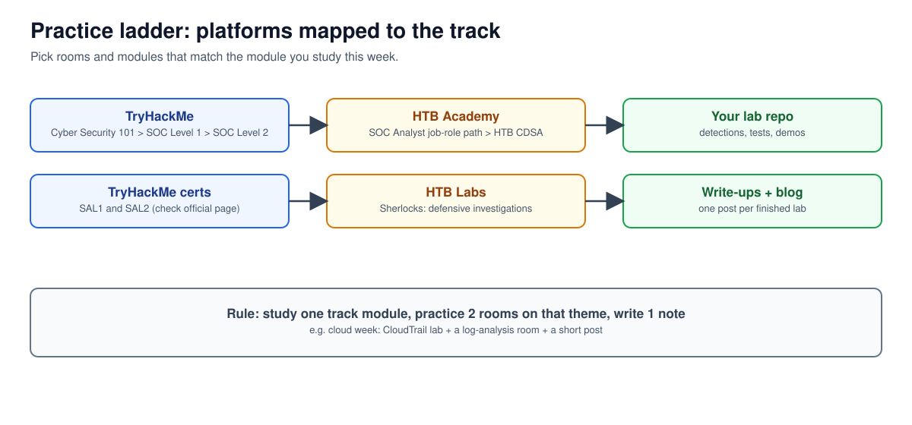

# Module 13: Profile and Portfolio

> **Weeks:** ongoing (a little every week for the whole track) · **Time:** about 2 to 3 hours per week
> **You will:** practice on TryHackMe and Hack The Box with a plan, write about what you learn, build a LinkedIn and GitHub presence for a DBA to Cloud Security/SOC move, and keep trackers that prove your progress.

| | |
|---|---|
| **Prerequisites** | None. Start in week 1 and keep going |
| **Lab** | None. This module has plans, trackers and templates |
| **Maps to** | Career goals in [Module 00](../00-career-plan-and-certifications/) · every other module (each one feeds a write-up) |

## Learning path

| # | Lesson | When | Result |
|---|---|---|---|
| 01 | [TryHackMe plan](01-tryhackme-plan.md) | Week 1 on | Cyber Security 101, then SOC Level 1, then SOC Level 2 |
| 02 | [Hack The Box plan](02-hackthebox-plan.md) | Week 8 on | SOC Analyst path, CDSA, Sherlocks |
| 03 | [Platform etiquette](03-platform-etiquette.md) | Read in week 1 | No spoilers, safe write-ups |
| 04 | [Blogging and research](04-blogging-and-research.md) | Week 2 on | A 12-week topic calendar and a writing routine |
| 05 | [Profiles and portfolio](05-profiles-and-portfolio.md) | Week 4 on | LinkedIn, GitHub README, a portfolio of investigations |

Folders:
- [`trackers/`](trackers/): Markdown tables for rooms, HTB modules and Sherlocks, blog posts, certifications and research notes.
- [`templates/`](templates/): an investigation write-up, a blog post and a LinkedIn post.

## The weekly rhythm (about 2.5 hours)

| Block | Time | Action |
|---|---|---|
| Practice | 1 hour | 1 or 2 rooms or modules that match this week's track module |
| Write | 45 minutes | Write notes in the tracker; turn one into a write-up or post draft |
| Research | 30 minutes | Read one CVE, one vendor report or one ATT&CK change; add a research note |
| Share | 15 minutes | Post or comment once on LinkedIn; update the trackers |

## Key terms

| Term | Meaning |
|---|---|
| **Write-up** | A written account of how you solved a room or investigation |
| **Sherlock** | A guided defensive investigation on Hack The Box Labs |
| **Portfolio** | A small set of work samples that show what you can do |
| **Spoiler** | A solution or flag that ruins the exercise for others |
| **ATT&CK** | MITRE's knowledge base of attacker tactics and techniques |

## Mini-project

By the end of week 12 of the track, publish **three investigations** (cloud, database, SOC) in the template format, a GitHub profile README that links them, and a LinkedIn Featured section with two of them.

## Interview questions

<b>Q1. Why should a DBA moving into security keep a portfolio?</b>

It proves skills that a job title does not show. A hiring manager can read a clear investigation and judge how you think.

<b>Q2. What does a good write-up contain?</b>

The question, the evidence, the steps in order with reasons, the conclusion, and what you would improve. It shows reasoning, not just answers.

<b>Q3. How do you avoid spoilers?</b>

Do not post flags, answers, or full walkthroughs of active content. Write about the method and what you learned. Follow each platform's rules.

<b>Q4. What did you learn from a platform that applies to real work?</b>

Prepare one story: a log you read, the clue you found, the tool you used, and how you would do it in a SOC. Use your own tracker notes.

<b>Q5. How do you stay current?</b>

Weekly research habit: read new CVEs in your area, vendor threat reports, and ATT&CK updates, then note one idea to test.

<b>Q6. Why publish your own detections?</b>

It shows you can turn knowledge into a working tool with tests, which is the core of detection engineering.

<b>Q7. How do you present your DBA past?</b>

As a strength: access control, audit, backup, patching and performance baselining are security work. Say what you did in security words, with numbers.

<b>Q8. What would you not put in a public portfolio?</b>

Employer data, real logs, customer names, internal tools, credentials, or active challenge solutions. Use synthetic data and your own labs.

<b>Q9. Certifications or portfolio?</b>

Both. Certifications get you past filters and give structure. A portfolio shows practical thinking in interviews.

<b>Q10. How much time should this take?</b>

About 2 to 3 hours a week, steadily. Regular small output beats rare big effort.

## References

- TryHackMe: https://tryhackme.com/
- Hack The Box: https://www.hackthebox.com/
- MITRE ATT&CK: https://attack.mitre.org/
- CISA Known Exploited Vulnerabilities: https://www.cisa.gov/known-exploited-vulnerabilities-catalog
- GitHub Docs, "About your profile README": https://docs.github.com/
