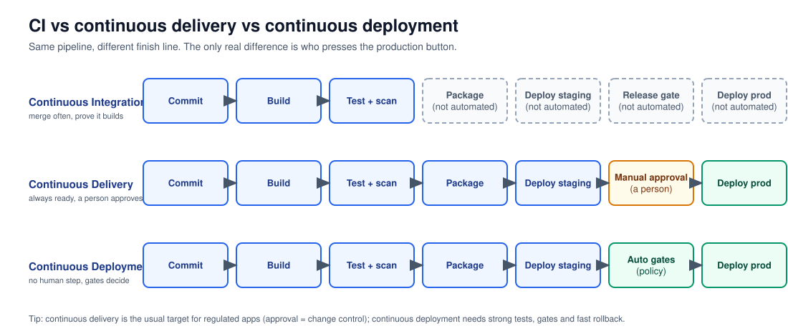
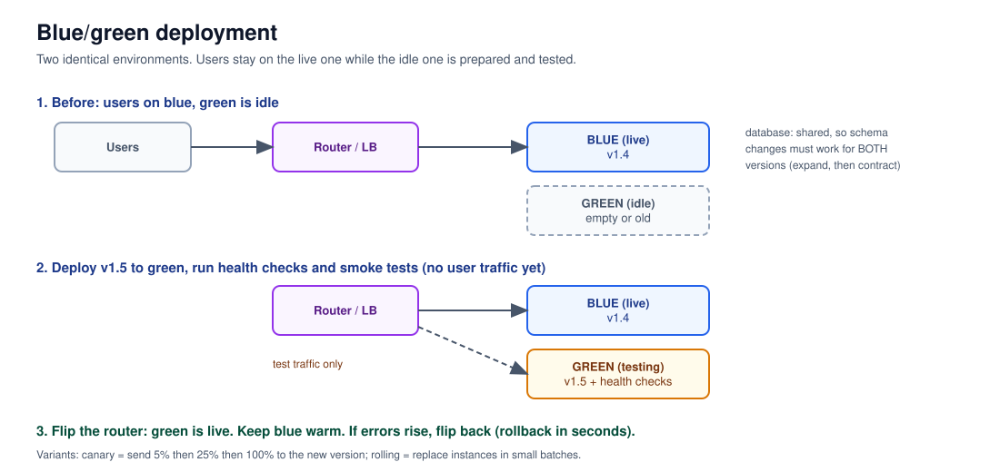

# Lesson 02: CI/CD and deployment strategies

> **Chapter:** 1 · DevOps, DevSecOps and Maturity · **Time:** ~3 hours
> **You will:** tell CI, continuous delivery and continuous deployment apart, describe the general CI/CD workflow, explain blue/green (and canary and rolling) releases, say what "full automation" really requires, and design a pipeline for a web application.

| | |
|---|---|
| **Prerequisites** | [Lesson 01](01-devops-foundations.md) |
| **Labs** | [pipeline-design](labs/pipeline-design/README.md) |
| **Syllabus lines** | What is CI and CD · CI to CD to CD · Delivery vs deployment · General workflow · Blue/Green · Full automation · Design a pipeline for a web app |
| **Reuse** | Runner mechanics and GitLab stages: [csse ch1 lesson 05](../../csse-course/ch1-introduction-to-supply-chain-security/05-cicd-stages-and-deployment.md); release gates: [06 CI/CD](../../06-ai-devsecops/cicd/README.md) |

## 1. Why it matters

A pipeline is the factory floor of software. Everything an attacker would like to change (code, dependencies, build scripts, deployment credentials) passes through it. Knowing the vocabulary exactly is the first step to securing it, and examiners love the three similar-sounding terms below.

## 2. What is Continuous Integration and Continuous Deployment?

### 2.1 Continuous Integration (CI)

Developers **merge small changes into the shared branch often** (at least daily). Every merge triggers an automatic build and test run. The goal: find that two people's changes do not fit together **within minutes**, not at the end of a release cycle.

A good CI run does at least: compile or package, run unit tests, run fast static checks (lint, secret scan, dependency scan).

### 2.2 Continuous Delivery (CD)

Every change that passes CI is automatically packaged and pushed through test environments, so that **it could go to production at any moment**. A human decides when ("press the button").

### 2.3 Continuous Deployment (CD again)

The same, but **there is no button**. If every gate is green, the change goes to production automatically.

The abbreviations collide: "CD" can mean either. Always write the full word in an exam answer.

## 3. Continuous Integration to Continuous Deployment to Continuous Delivery

The syllabus lists the three as a progression: **CI → continuous delivery → continuous deployment**. Each step automates a bit more and demands better tests and gates.

### 3.1 Continuous Delivery vs Continuous Deployment

| | Continuous delivery | Continuous deployment |
|---|---|---|
| Last step to production | A **person approves** | Automatic when gates pass |
| Typical use | Regulated apps, change control, banks | SaaS, consumer web apps with strong tests |
| Security gates | Scans, then human approval with evidence | Scans and policy only: gates must be trusted |
| Risk if tests are weak | The human might catch it | Goes straight to users |
| Rollback | Rehearsed and fast | Must be automatic |

> **DBA analogy.** Continuous delivery is a change that is fully tested and scripted but waits for the CAB (change advisory board) to say "go". Continuous deployment is when the change board has delegated the decision to automated checks.

Security rule of thumb: **moving from delivery to deployment means moving trust from people to code.** Do it only when your gates are good, your rollback is automatic and you can show the evidence to an auditor.

## 4. General workflow of a CI/CD pipeline

1. **Commit / merge request.** The developer pushes a branch. The pipeline starts. (Pre-commit hooks on the laptop are a bonus, not a control: [ch05](../05-static-analysis-and-secrets/README.md) will explain why.)
2. **Source checks:** secret scan, lint, license check.
3. **Build:** compile, resolve locked dependencies, produce one artifact (jar, wheel, container image). **Build once, deploy the same artifact everywhere.**
4. **Test:** unit and integration tests; SAST and dependency scan run here too.
5. **Package and store:** push the artifact to a registry with a unique version (commit SHA). Optionally sign it.
6. **Deploy to test or staging:** infrastructure comes from code.
7. **Acceptance and security tests:** end-to-end tests, DAST baseline, performance smoke test.
8. **Release gate:** manual approval (delivery) or policy check (deployment).
9. **Deploy to production** using a safe strategy (next section).
10. **Verify and monitor:** health checks, alerts, logs. A failed check triggers rollback.

Notice step 3: **the artifact that was tested is the artifact that is deployed.** Rebuilding for production breaks that guarantee and is a classic supply chain gap.

See the mechanics in the repo lab [csse ch1 how-cicd-works](../../csse-course/ch1-introduction-to-supply-chain-security/labs/how-cicd-works/README.md).

## 5. Blue-green deployment and its cousins

### 5.1 Blue/green

You keep **two identical production environments**. At any moment one (say blue) is **live**; the other (green) is idle.

1. Deploy the new version to the idle environment (green). Users do not see it.
2. Run health checks and smoke tests against green.
3. **Flip the router** (load balancer, DNS weight, service mesh rule) so green becomes live.
4. Watch. If error rates rise, **flip back to blue**. Rollback takes seconds because blue is still running the old version.
5. Later, blue becomes the idle one and gets the next release.

> **DBA analogy.** This is a standby database switchover (think Data Guard): prepare the standby, verify it, switch roles, and switch back if something is wrong. The hard part, as every DBA knows, is the **shared data**: both versions must work with the same schema during the switch. Use **expand then contract** migrations (add new columns first, deploy, remove old ones later).

The lab [pipeline-design](labs/pipeline-design/README.md) simulates exactly this: deploy to the idle side, health check, flip, post-flip check, rollback.

### 5.2 Other strategies

| Strategy | How it works | Good for | Watch out |
|---|---|---|---|
| **Blue/green** | Full second environment, instant switch | Fast, simple rollback | Double the infrastructure cost during release; shared database |
| **Canary** | Send a small share (1-5%) of traffic to the new version, increase step by step | Catching problems with real users at low risk | Needs good metrics to decide "healthy" |
| **Rolling** | Replace instances in small batches | Default in many orchestrators | Old and new versions run side by side; rollback is slower |
| **Recreate** | Stop old, start new | Simple, dev/test | Downtime |
| **Feature flags** | Ship code switched off, enable gradually | Separate deploy from release | Flags are code too: clean them up and protect the flag system |

Security notes: the **router/flip switch is a high-value control** (restrict who can change it and log every change); the idle environment must be hardened and patched exactly like live; and old versions kept warm for rollback also keep their old vulnerabilities, so retire them quickly.

## 6. Achieving full automation

"Full automation" does not mean "no humans". It means **no manual, undocumented, unrepeatable steps** between a commit and a running, monitored service. A checklist:

| Layer | What must be automated | Typical tools |
|---|---|---|
| Source | Branch protection, required reviews, required status checks | GitLab / GitHub settings |
| Build | One scripted build, locked dependencies, versioned artifact | Make, npm, Maven, Docker/BuildKit |
| Test | Unit, integration, security tests on every change | pytest, JUnit, Semgrep, ZAP |
| Environments | Created and changed from code | Terraform, Ansible, Helm |
| Deploy | Scripted, repeatable, with rollback | Pipeline jobs, Argo CD, Ansible |
| Config and secrets | Injected at run time from a secret store, never in the repo | Vault, cloud secret managers |
| Compliance | Rules written as code; evidence stored | InSpec, OPA, policy gates |
| Monitoring | Dashboards and alerts created from code | Prometheus rules, Grafana provisioning |
| Findings | Collected, deduplicated, ticketed | [lab](../02-tools-pipelines-and-secure-sdlc/labs/manage-findings-automatically/README.md), DefectDojo |

Things that still need a human: **designing** controls, **reviewing** risky changes, **accepting risk** with an expiry date, **investigating** incidents. [Lesson 03](03-devsecops-toolchain-sdlc-and-dsomm.md#8-security-automation-and-its-limits) covers the limits of automation.

Good order to automate: build and test first (fast wins), then deployment, then environments, then security gates, then compliance evidence.

## 7. Designing a CI/CD pipeline for a web application

Start from the application, not the tool. Worked example: a Node.js web shop with a PostgreSQL database, deployed as a container.

**Step 1: List the assets and risks.** Source code, dependencies, container image, secrets, test and production environments, customer data.

**Step 2: Choose the stages** and where each security check belongs:

| Order | Stage | Check | Fails the build when |
|---|---|---|---|
| 1 | Secrets scan | gitleaks or TruffleHog | any secret is found |
| 2 | SCA | `npm audit` or osv-scanner | high or critical, fixable vulnerability |
| 3 | SAST | Semgrep | high-severity rule hit |
| 4 | Build | Docker/BuildKit, locked deps | build error |
| 5 | Image scan | Trivy or Grype | critical OS or library vulnerability |
| 6 | Sign | cosign or Notation | signing fails |
| 7 | Deploy staging | blue/green | health check fails |
| 8 | DAST | ZAP baseline | high-risk alert |
| 9 | Deploy prod | blue/green + approval | health or post-flip check fails (auto rollback) |

**Step 3: Decide the mode.** Delivery (human approval) or deployment (automatic)? For this example: delivery, with the approval showing the scan evidence.

**Step 4: Decide failure behaviour.** Which gates block, which only warn, how long can a finding be waived and who approves it.

**Step 5: Write it down and validate it.** The lab [pipeline-design](labs/pipeline-design/README.md) has a YAML design that a validator checks against these rules (missing gates, wrong order, gates that are allowed to fail, no rollback). The real syntax per CI system comes in [chapter 2](../02-tools-pipelines-and-secure-sdlc/README.md).

Common design mistakes:

- Scans placed **after** deploy (they report, they protect nothing).
- Gates marked `allow_failure: true` "temporarily" and forgotten.
- DAST against production only, which is risky and too late.
- One giant job that nobody can debug. Prefer small jobs with clear names.
- Pipeline definition editable by anyone with write access to the repo: protect it ([csse ch2 on pipeline privilege escalation](../../csse-course/ch2-attacking-code-and-application-supply-chain/README.md)).

## 8. Self-check

1. Define CI, continuous delivery and continuous deployment in one sentence each.
2. Which of the two "CD"s needs a human, and what does that human look at?
3. Walk through a blue/green release including the rollback. What is the hardest part?
4. Why must the same artifact be promoted through environments?
5. Design the stage list for a Python API. Where does the secrets scan go and why?

## 9. Where next

[Lesson 03](03-devsecops-toolchain-sdlc-and-dsomm.md): the toolchain categories, the secure SDLC and the maturity model.
