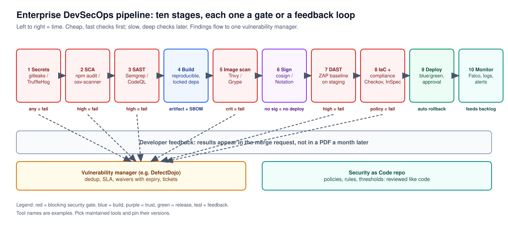

# Lesson 04: Demo, a full enterprise-grade DevSecOps pipeline

> **Chapter:** 1 · DevOps, DevSecOps and Maturity · **Time:** ~2 hours
> **You will:** read a ten-stage pipeline from secrets to monitoring, say what each stage catches, what it costs, and when it should block, and explain how findings flow to one place.

| | |
|---|---|
| **Prerequisites** | [Lessons 01 to 03](01-devops-foundations.md) |
| **Labs** | [pipeline-design](labs/pipeline-design/README.md) (design rules), [ch02 ci-pipeline-multi-platform](../02-tools-pipelines-and-secure-sdlc/labs/ci-pipeline-multi-platform/README.md) (real syntax in five CI systems), [ch02 complete-cicd-pipeline](../02-tools-pipelines-and-secure-sdlc/labs/complete-cicd-pipeline/README.md) (run it) |
| **Syllabus line** | Demo: A full enterprise grade DevSecOps Pipeline |

This is a **walkthrough**, not a recorded demo. Your course video shows the instructor's version; here is the same idea with maintained tools and honest trade-offs. Tool names are examples. **Verify versions and flags at each tool's documentation.**

## 1. The picture



Ten stages: **secrets → SCA → SAST → build → image scan → sign → DAST → IaC/compliance → deploy → monitor.** Cheap and fast checks run first so developers get feedback in minutes; slow and deep checks run later or on a schedule.

## 2. Stage by stage

| # | Stage | Tool examples | Catches | Block when | Typical time |
|---|---|---|---|---|---|
| 1 | **Secrets scan** | gitleaks, TruffleHog, detect-secrets | Passwords, tokens and keys in code and history | Any verified secret | seconds |
| 2 | **SCA** (dependencies) | npm audit, osv-scanner, pip-audit, Dependency-Check | Known-vulnerable libraries, licence issues | High/critical with a fix | seconds to a minute |
| 3 | **SAST** | Semgrep, CodeQL, SpotBugs, Bandit | Injection, weak crypto, risky patterns | High severity | 1-5 minutes |
| 4 | **Build** | Docker/BuildKit, Kaniko, Maven | Does it compile; locked deps; SBOM generated | Build fails | minutes |
| 5 | **Image scan** | Trivy, Grype | OS and library CVEs, misconfigurations in the image | Critical with a fix | 1-2 minutes |
| 6 | **Sign** | cosign, Notation | Tampering between build and deploy | Signing fails or later verify fails | seconds |
| 7 | **DAST** | ZAP baseline, Dastardly | Missing headers, cookie flags, exposed paths, some injection | High-risk alert | 5-30 minutes |
| 8 | **IaC and compliance** | Checkov, Terraform policy, InSpec/CINC | Public buckets, open ports, hardening drift | Policy violation | 1-5 minutes |
| 9 | **Deploy** | Argo CD, Helm, Ansible, blue/green | Failed release | Health check fails (auto rollback) | minutes |
| 10 | **Monitor** | Falco, logs and alerts, uptime checks | Runtime attacks, drift, outages | Not a gate: feeds the backlog and on-call | continuous |

> **Why this order?** Secrets and dependency checks need no build, so they are the cheapest. SAST needs source only. Image scan and signing need the image. DAST needs a running app. Compliance can run beside deploy. The cheaper the check, the earlier it runs.

## 3. What a gate decision looks like

A scan is only a **gate** if something can stop the pipeline. Each blocking stage follows the same pattern:

```text
run tool  ->  normalise results  ->  apply waivers (not expired)  ->  compare with thresholds
          ->  pass: continue        fail: stop, comment on the merge request, open a ticket
```

The [ch02 findings lab](../02-tools-pipelines-and-secure-sdlc/labs/manage-findings-automatically/README.md) implements this normalise/dedup/threshold/ticket logic with fake tool output.

## 4. A condensed GitLab-style sketch

This sketch is for reading, not for copy-paste. Real, validated versions of the same pipeline in five CI systems are in [ch02 fixtures](../02-tools-pipelines-and-secure-sdlc/labs/ci-pipeline-multi-platform/fixtures/gitlab-ci.yml).

```yaml
stages: [secrets, sca, sast, build, image-scan, sign, dast, compliance, deploy]

secrets-scan:           # stage 1: runs on every merge request
  stage: secrets
  image: <pinned gitleaks image>
  script: [gitleaks detect --redact]

dependency-scan:        # stage 2
  stage: sca
  script: [npm ci --ignore-scripts, npm audit --audit-level=high]

semgrep:                # stage 3
  stage: sast
  image: <pinned semgrep image>
  script: [semgrep scan --config <ruleset> --error]

build:                  # stage 4: one artifact, tagged with the commit SHA
  stage: build
  script: [<build and push image tagged $CI_COMMIT_SHA>]

trivy:                  # stage 5
  stage: image-scan
  script: [trivy image --exit-code 1 --severity CRITICAL <image>]

cosign-sign:            # stage 6: keyless signing uses the pipeline's OIDC identity
  stage: sign
  script: [cosign sign <image digest>]

zap-baseline:           # stage 7: against staging, not production
  stage: dast
  script: [zap-baseline.py -t https://staging.example -I]

policy-check:           # stage 8
  stage: compliance
  script: [<IaC scan>, <InSpec/CINC profile against staging>]

deploy-prod:            # stage 9: protected environment, manual approval for delivery
  stage: deploy
  environment: production
  when: manual
  rules: [{if: '$CI_COMMIT_BRANCH == $CI_DEFAULT_BRANCH'}]
  script: [<verify signature>, <blue/green deploy>, <health check>]
```

Things to point out in the demo:

1. **Gates before deploy.** `deploy-prod` only runs if every earlier stage passed.
2. **Deploy verifies the signature.** Signing alone protects nothing unless the deploy step checks it.
3. **DAST runs on staging**, never on production first.
4. **Production deploy is a protected environment** with a human approval (continuous delivery).

## 5. What can still go wrong (even with ten stages)

| Gap | Why | Fix |
|---|---|---|
| Pipeline definition edited by an attacker | Whoever edits CI config runs code with your secrets | CODEOWNERS, protected branches, central templates |
| Scanners disabled "temporarily" | Pressure to ship | Required jobs in a central template; alert when removed |
| Findings never fixed | No owner, no SLA | Tickets with due dates, dashboards, waivers that expire |
| Logic flaws and business abuse | Tools find patterns, not intent | Threat modelling, code review, pentests |
| Compromised third-party action or plugin | You run their code | Pin to commit SHAs, review updates |
| Production drift after deploy | Manual changes | Compliance scans, immutable infrastructure |
| Slow pipeline | Developers bypass | Parallel jobs, incremental scans, nightly deep scans |

## 6. How to present this demo in an interview

Say it in 60 seconds: *"Every change goes through ten stages. The cheap ones (secrets, dependencies, static analysis) fail fast within minutes. We build one artifact, scan and sign it, and only a signed image gets deployed. DAST runs on staging. Production deploys are blue/green with automatic rollback. All findings go into one tracker with SLAs and waivers that expire, and runtime monitoring feeds new rules back into the pipeline."*

## 7. Try it

1. Open [pipeline-design/pipeline.yaml](labs/pipeline-design/pipeline.yaml) and match each stage to the ten above.
2. Move `dast` before `deploy-staging` and run the validator. What does it say?
3. Run the ch02 [complete-cicd-pipeline lab](../02-tools-pipelines-and-secure-sdlc/labs/complete-cicd-pipeline/README.md) to watch a vulnerable commit stop at SCA.

## 8. Where next

Chapter 2 gives you the tools and the exact syntax: [Tools, pipelines and secure SDLC](../02-tools-pipelines-and-secure-sdlc/README.md).
