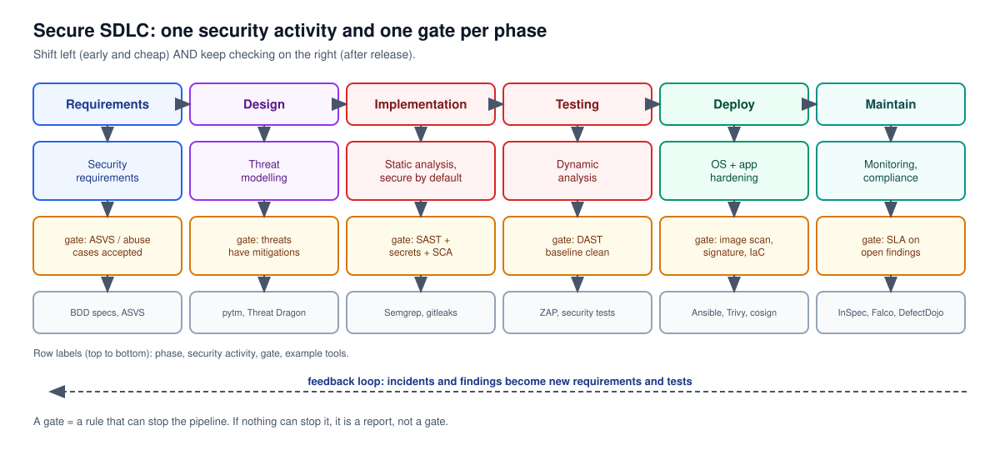

# Lesson 02: Secure SDLC, activities and security gates

> **Chapter:** 2 · Tools, Pipelines and Secure SDLC · **Time:** ~3 hours
> **You will:** define a secure SDLC, name the security activity and the gate for each phase (requirements, design, implementation, testing, deploy, maintain), and say which tool and which CI/CD job implements it.

| | |
|---|---|
| **Prerequisites** | [Chapter 1 lesson 03](../01-devops-devsecops-and-maturity/03-devsecops-toolchain-sdlc-and-dsomm.md) |
| **Labs** | [bdd-security-codify-threats](labs/bdd-security-codify-threats/README.md) · [complete-cicd-pipeline](labs/complete-cicd-pipeline/README.md) |
| **Syllabus lines** | What is Secure SDLC · Activities and Security Gates · Requirements · Design · Implementation · Testing · Deploy · Maintain |
| **Reuse** | Threat modelling basics: [01 fundamentals lesson 03](../../01-ai-security-fundamentals/03-ai-threat-modeling.md) and [caisp ch5](../../caisp-course/ch5-threat-modeling-ai-systems/README.md) |

## 1. Why it matters

The later a bug is found, the more it costs: in a requirement it is a sentence, in code a pull request, in production an incident with customers and lawyers. A **secure SDLC (SSDLC)** moves the finding earlier ("shift left") and keeps checking after release ("shift right").

## 2. What is a secure SDLC?

A **secure software development life cycle** adds, to every phase of the normal life cycle, at least one **security activity** (something people or tools do) and one **security gate** (a rule that can stop progress). Well-known frameworks you can cite: NIST SSDF (SP 800-218), OWASP SAMM, Microsoft SDL, BSIMM (descriptive survey). Verify versions at source.



> **A gate is a rule that can stop the line.** A gate with `allow_failure: true` is a report. Use both words on purpose.

## 3. Secure SDLC activities and security gates

| Phase | Activity | Gate | Typical tools |
|---|---|---|---|
| **Requirements** | Security requirements, abuse cases, data classification | Requirements reviewed; testable acceptance criteria exist | OWASP ASVS, BDD specs |
| **Design** | Threat modelling, secure design review | High threats have a mitigation or an accepted risk | STRIDE, pytm, Threagile, Threat Dragon |
| **Implementation** | Static analysis, secure by default, secrets and dependency scanning, peer review | SAST + SCA + secrets scan pass | Semgrep, SpotBugs, Bandit, gitleaks, npm audit |
| **Testing** | Dynamic analysis, security tests, fuzzing | DAST baseline clean, security regression tests pass | ZAP, pytest, BDD security |
| **Deploy** | OS and web/application hardening, image scan, signing, IaC scan | Image scan, signature check, hardening profile pass | Ansible, Trivy, cosign, InSpec |
| **Maintain** | Security monitoring, compliance checks, patching, incident response | SLA on open findings; compliance drift alerts | Falco, InSpec, DefectDojo, SIEM |

The sections below follow the syllabus order and brackets.

### 3.1 Security Requirements (Requirements)

**Goal:** say what "secure" means for this product, in a form that can be tested.

- Start from a catalogue instead of a blank page. **OWASP ASVS** (Application Security Verification Standard; version 5.0 was released in 2025, verify the current version) lists testable requirements by area (authentication, session management, access control, and so on) and by level (1 to 3).
- Add **abuse cases** next to user stories: "As an attacker I try 10,000 passwords against one account".
- Write them as **acceptance criteria** so tests can check them: "A session cookie must be HttpOnly"; "Login must lock after 5 failures". This is where **BDD** fits ([lesson 03](03-dsomm-path-and-embedding-security.md#62-bdd-security-codify-threats-as-tests) and the [lab](labs/bdd-security-codify-threats/README.md)). The full chapter on requirements as code is [chapter 3](../03-security-requirements-and-threat-modeling/README.md).
- **Gate:** no story enters development without its security acceptance criteria.

### 3.2 Threat Modelling (Design)

**Goal:** find design flaws before code exists.

- Draw a data flow diagram, mark trust boundaries, and ask STRIDE questions (Spoofing, Tampering, Repudiation, Information disclosure, Denial of service, Elevation of privilege). See the repo's [threat modelling lesson](../../01-ai-security-fundamentals/03-ai-threat-modeling.md).
- Keep it light: one hour per significant feature, results stored as a file in the repo (threat-model-as-code, see [chapter 3](../03-security-requirements-and-threat-modeling/README.md)).
- **Gate:** every high-risk threat has a mitigation ticket or a signed risk acceptance with an expiry date.

### 3.3 Static Analysis and Secure by Default (Implementation)

**Goal:** stop known-bad patterns while the code is fresh in the developer's head.

- **SAST** reads source without running it. **SCA** checks the libraries you use. **Secret scanning** looks for credentials. All three run on every merge request. ([Chapter 4](../04-software-component-analysis/README.md) and [chapter 5](../05-static-analysis-and-secrets/README.md).)
- **Secure by default** means the framework, base image and template give safe settings out of the box: parameterised queries, escaping on by default, HTTPS only, no debug mode in production.
- **Peer review** remains the strongest control for logic and authorisation bugs.
- **Gate:** SAST, SCA and secrets findings above the agreed threshold fail the merge request.

### 3.4 Dynamic Analysis (Testing)

**Goal:** test the running application the way an outsider sees it.

- **DAST** (for example ZAP baseline) against a **test environment**; add API scans from OpenAPI definitions ([chapter 6](../06-dynamic-analysis/README.md)).
- **Security unit and regression tests:** every fixed vulnerability becomes a test so it cannot come back.
- Fuzzing for parsers and protocols; IAST/RASP where the stack supports it ([chapter 7](../07-runtime-analysis-rasp-iast/README.md)).
- **Gate:** no high-risk DAST alert; all security regression tests green.

### 3.5 OS Hardening, Web/Application Hardening (Deploy)

**Goal:** what you run is configured safely and is what you tested.

- **OS hardening:** remove unneeded packages and services, restrictive file permissions, secure SSH, a CIS-style baseline, applied by Ansible or baked into a golden image (Packer).
- **Web/application hardening:** TLS settings, security headers, cookie flags, hidden banners, least-privilege service accounts, container run as non-root.
- **Supply chain at deploy:** scan the image, **sign** it, and **verify** the signature before deployment.
- **Gate:** image scan clean, signature verified, hardening/compliance profile passes (InSpec/CINC), IaC scan clean.

### 3.6 Security Monitoring and Compliance (Maintain)

**Goal:** you notice problems after release, and you can prove compliance.

- **Monitoring:** application and audit logs to a central place, alerts on suspicious behaviour, runtime security tools in containers ([chapter 12](../12-container-security-monitoring/README.md)).
- **Compliance as code:** scheduled InSpec/CINC or OpenSCAP scans detect drift; PCI DSS v4.0.1 is the current PCI standard (verify).
- **Vulnerability management:** new CVEs appear after you ship. Track findings with owners and SLAs ([chapter 14](../14-vulnerability-management/README.md), [csse ch7](../../csse-course/ch7-managing-a-secure-software-supply-chain-program/README.md)).
- **Feedback loop:** incidents and findings flow back into requirements and tests.
- **Gate:** no critical finding past its SLA; compliance drift triggers an alert and a ticket.

## 4. Mapping the gates to pipeline jobs

```text
commit  ->  secrets-scan -> sca -> sast          (Implementation gates)
        ->  build -> image-scan -> sign          (Deploy gates, part 1)
        ->  deploy-staging -> dast -> security tests   (Testing gates)
        ->  compliance/IaC scan -> deploy-prod   (Deploy gates, part 2)
        ->  monitoring, findings, SLA            (Maintain)
```

Requirements and design are **not** pipeline jobs, but they show up in the pipeline as tests (BDD specs, security regression tests) and as required files (a threat model file that must exist and have no open "high" items).

See it run in the [complete-cicd-pipeline lab](labs/complete-cicd-pipeline/README.md) (build, SCA, SAST, DAST and deploy with fake tools) and in five real syntaxes in [ci-pipeline-multi-platform](labs/ci-pipeline-multi-platform/README.md).

## 5. Common mistakes

- Security checks only at the end (pentest two weeks before launch).
- Gates that cannot fail, or that fail for everything so everyone ignores them.
- No owner for findings; no SLA.
- Treating "shift left" as "never look right": production monitoring still matters.
- Writing security requirements nobody can test.

## 6. Self-check

1. Define "secure SDLC" and "security gate" in your own words.
2. For each of the six phases write one activity, one gate and one tool.
3. Which phases are not pipeline jobs, and how do they appear in the pipeline anyway?
4. Why must the deploy stage verify an image signature, not only create it?
5. What is the value of a security regression test?

## 7. Where next

[Lesson 03](03-dsomm-path-and-embedding-security.md): the maturity path, embedding all of this in CI/CD, and DevSecOps versus pentesting.
